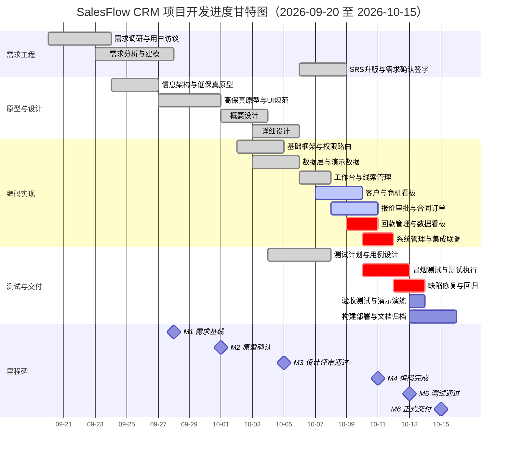

# 项目开发计划（Software Project Plan）

| 项 | 内容 |
|---|---|
| 文档编号 | SFS-CRM-PP-01 |
| 项目名称 | SalesFlow 智销云 · 销售全流程管理平台（简称 SalesFlow CRM） |
| 版本 | v1.0 |
| 编写日期 | 2026-09-23 |
| 状态 | **已基线化**（项目基准，变更须受控） |

**版本变更历史**

| 版本 | 日期 | 修订人 | 修订说明 | 状态 |
|---|---|---|---|---|
| v0.1 | 2026-09-22 | 陈志远 | 依据立项建议书建立初版 WBS 与进度安排 | 草稿 |
| v0.9 | 2026-09-23 | 陈志远 | 补充质量管理、配置管理、沟通与风险管理计划 | 评审稿 |
| v1.0 | 2026-09-23 | 陈志远 | 评审通过，确立为项目基准 | **已基线化** |

---

## 1. 引言

### 1.1 编写目的

本文档定义 SalesFlow CRM 项目的**开发过程模型、阶段划分与任务分解（WBS）、进度安排、资源计划、质量管理计划、配置管理计划、沟通计划与风险管理计划**，是项目执行与监控的基准文件。

### 1.2 项目基准

| 基准项 | 内容 |
|---|---|
| 范围基准 | 《软件需求规格说明书》SFS-CRM-SRS v1.0（2026-10-09 甲方签字） |
| 进度基准 | 2026-09-20 ~ 2026-10-15，共 26 个自然日 |
| 成本基准 | 9.05 万元（《项目立项建议书》SFS-CRM-PC-01 第 6.4 节） |
| 质量基准 | 用例通过率 ≥ 95%，无 Blocker/Critical 缺陷残留，27 份文档齐备 |

---

## 2. 开发过程模型选择

### 2.1 候选模型对比

| 模型 | 核心特征 | 优点 | 缺点 | 本项目适用性 |
|---|---|---|---|---|
| **瀑布模型** | 阶段串行、文档驱动、前一阶段完成后进入下一阶段 | 阶段界限清晰、文档完备、易于教学检查 | 需求变更代价高；缺陷暴露晚；末期才能见到可运行系统 | 部分适用：文档驱动符合要求，但无法容忍需求微调，且答辩前才能见到成品，风险过高 |
| **纯原型模型** | 快速构建原型，反复修改至用户满意 | 需求确认充分、用户参与度高 | 原型常被误当作成品；缺乏系统设计与质量保障；易陷入无休止修改 | 不适用：仅可作为需求确认手段，不能承担完整交付 |
| **纯增量模型** | 分批构建交付增量 | 早期可见部分成果 | 若无原型前置，增量方向易偏；缺少需求验证环节 | 部分适用 |
| **标准敏捷（Scrum）** | 固定周期迭代、角色仪式完整 | 响应变化快、持续交付 | 文档产出偏轻，与课程对 27 份工程文档的硬性要求冲突；角色仪式（PO/SM）成本高于 7 人小团队承载力 | 不适用：文档产出不足 |
| **迭代式增量开发 + 原型驱动（本项目选用）** | 以原型驱动需求确认，按里程碑分 3 个迭代增量交付，每迭代内走"分析—设计—编码—测试"小循环 | ① 早期可见可评；② 需求偏差在原型阶段即被纠正；③ 增量可裁剪，工期紧张时优先保核心流程；④ 每迭代产出阶段文档，满足文档完整性要求 | 需要较强的计划与配置管理能力 | **最适用** |

### 2.2 选型理由（结合课程要求）

本项目选择 **"迭代式增量开发 + 原型驱动"**，具体理由如下：

| 课程要求 | 模型提供的支撑 |
|---|---|
| **需要原型验证需求** | 原型驱动是模型的第一阶段：M2 之前完成低保真 + 高保真原型与 UI 规范，由业务方签字确认后再进入设计编码，直接消解立项阶段识别的 R-01「需求理解偏差」与 R-02「业务规则口径不一致」两项高风险 |
| **需要完整流程**（覆盖立项→需求→设计→编码→测试→交付） | 模型保留了瀑布式的阶段骨架与文档产出要求，六个里程碑 M1~M6 与软件生存周期一一对应，符合 GB/T 8566-2022 |
| **需要答辩展示** | 增量交付使系统在 M4 即具备可演示形态，M5 前预留 2 天演示演练；v0.5.0「核心流程版」在编码中期即可产出可运行闭环，避免"末期才见成品、出问题无缓冲" |
| **工期紧张（26 天）** | 增量可裁剪：若进度滞后，按优先级（Must → Should）裁剪 F-09/F-10 的增量，保证 L2C 主流程完整 |
| **需求存在微调可能** | 迭代机制为需求变更提供受控入口，变更在迭代边界处纳入，不冲击已基线部分 |

### 2.3 迭代划分

| 迭代 | 周期 | 对应里程碑 | 交付增量 | 核心目标 |
|---|---|---|---|---|
| 迭代 1（I1） | 2026-09-20 ~ 2026-10-01 | M1、M2 | 需求基线 + 确认原型（v0.1.0） | 需求与交互确认，消除理解偏差 |
| 迭代 2（I2） | 2026-10-01 ~ 2026-10-11 | M3、M4 | 设计基线 + 可运行系统（v0.5.0 → v0.9.0） | 完成全部 Must 功能编码 |
| 迭代 3（I3） | 2026-10-11 ~ 2026-10-15 | M5、M6 | 稳定版本 + 文档集（v1.0.0） | 测试通过、验收交付 |

每迭代内部均执行"分析 → 设计 → 编码 → 自测 → 评审"小循环，迭代出口处进行里程碑评审。

---

## 3. 阶段划分与任务分解（WBS）

### 3.1 WBS 总览

| 阶段 | 工作量（人日） | 占比 | 起止日期 |
|---|---|---|---|
| 1 需求调研 | 6 | 5.8% | 2026-09-20 ~ 2026-09-23 |
| 2 需求分析 | 8 | 7.7% | 2026-09-23 ~ 2026-09-28 |
| 3 原型设计 | 7 | 6.7% | 2026-09-24 ~ 2026-10-01 |
| 4 概要设计 | 5 | 4.8% | 2026-10-01 ~ 2026-10-04 |
| 5 详细设计 | 6 | 5.8% | 2026-10-03 ~ 2026-10-05 |
| 6 编码实现 | 45 | 43.3% | 2026-10-02 ~ 2026-10-11 |
| 7 测试 | 12 | 11.5% | 2026-10-04 ~ 2026-10-13 |
| 8 部署与交付 | 7 | 6.7% | 2026-10-10 ~ 2026-10-15 |
| 9 项目管理与配置管理 | 8 | 7.7% | 2026-09-20 ~ 2026-10-15 |
| **合计** | **104** | **100%** | |

### 3.2 WBS 明细表

| WBS 编号 | 阶段 | 任务 | 工作量（人日） | 责任人 | 开始 | 结束 | 前置任务 |
|---|---|---|---|---|---|---|---|
| W1.1 | 需求调研 | 制定调研计划与访谈提纲 | 1.0 | 林雪 | 2026-09-20 | 2026-09-20 | — |
| W1.2 | 需求调研 | 用户访谈（销售员/经理/财务/管理员 4 类角色） | 2.0 | 林雪、陈志远 | 2026-09-20 | 2026-09-21 | W1.1 |
| W1.3 | 需求调研 | 现状流程梳理与痛点分析 | 1.5 | 林雪 | 2026-09-21 | 2026-09-22 | W1.2 |
| W1.4 | 需求调研 | 调研纪要整理与业务方确认 | 1.5 | 林雪 | 2026-09-22 | 2026-09-23 | W1.3 |
| W2.1 | 需求分析 | 业务实体建模与状态机定义（线索/商机/报价/订单） | 2.0 | 林雪 | 2026-09-23 | 2026-09-24 | W1.4 |
| W2.2 | 需求分析 | 用例建模（UC-01 ~ UC-33） | 2.0 | 林雪 | 2026-09-24 | 2026-09-25 | W2.1 |
| W2.3 | 需求分析 | 功能需求与非功能需求编写（SRS v0.1） | 2.0 | 林雪 | 2026-09-25 | 2026-09-26 | W2.2 |
| W2.4 | 需求分析 | 需求追溯矩阵建立与评审准备 | 1.0 | 林雪、吴敏 | 2026-09-26 | 2026-09-27 | W2.3 |
| W2.5 | 需求分析 | 需求评审与基线化（M1） | 1.0 | 全员 + 刘教授 | 2026-09-27 | 2026-09-28 | W2.4 |
| W2.6 | 需求分析 | SRS 升版修订与甲方签字确认（v1.0 基线） | 0.0（含于 W2.3/W2.5） | 林雪 | 2026-10-06 | 2026-10-09 | W2.5 |
| W3.1 | 原型设计 | 信息架构与导航结构设计 | 1.0 | 苏晴 | 2026-09-24 | 2026-09-24 | W2.1 |
| W3.2 | 原型设计 | 低保真原型设计（10 个核心页面） | 2.0 | 苏晴 | 2026-09-24 | 2026-09-26 | W3.1 |
| W3.3 | 原型设计 | 高保真原型与交互说明 | 2.5 | 苏晴 | 2026-09-26 | 2026-09-29 | W3.2 |
| W3.4 | 原型设计 | UI 设计规范与组件说明 | 1.0 | 苏晴 | 2026-09-29 | 2026-09-30 | W3.3 |
| W3.5 | 原型设计 | 原型评审与业务方签字确认（M2） | 0.5 | 苏晴、林雪、刘教授 | 2026-09-30 | 2026-10-01 | W3.4 |
| W4.1 | 概要设计 | 技术选型确认与脚手架搭建 | 1.0 | 赵启明 | 2026-10-01 | 2026-10-01 | W3.5 |
| W4.2 | 概要设计 | 系统架构与模块划分 | 1.5 | 赵启明 | 2026-10-01 | 2026-10-02 | W4.1 |
| W4.3 | 概要设计 | 数据模型设计（14 个核心实体） | 1.5 | 赵启明 | 2026-10-02 | 2026-10-03 | W4.2 |
| W4.4 | 概要设计 | 概要设计说明书编制与评审 | 1.0 | 赵启明、陈志远 | 2026-10-03 | 2026-10-04 | W4.3 |
| W5.1 | 详细设计 | 组件设计与接口定义 | 2.0 | 赵启明 | 2026-10-03 | 2026-10-04 | W4.4 |
| W5.2 | 详细设计 | 状态机与业务规则详细设计（审批决策表、分期模板） | 1.5 | 赵启明 | 2026-10-04 | 2026-10-05 | W5.1 |
| W5.3 | 详细设计 | Repository 数据访问层与持久化设计 | 1.0 | 赵启明 | 2026-10-05 | 2026-10-05 | W5.1 |
| W5.4 | 详细设计 | 详细设计说明书编制与评审（M3） | 1.5 | 赵启明、全员 | 2026-10-05 | 2026-10-05 | W5.2、W5.3 |
| W6.1 | 编码实现 | 基础框架、路由、布局与权限控制 | 4.0 | 赵启明 | 2026-10-02 | 2026-10-04 | W4.2 |
| W6.2 | 编码实现 | 数据层与演示数据预置（Repository + Seed） | 4.0 | 周雨 | 2026-10-03 | 2026-10-05 | W5.3 |
| W6.3 | 编码实现 | 工作台模块 | 3.0 | 孙浩 | 2026-10-05 | 2026-10-06 | W6.2 |
| W6.4 | 编码实现 | 线索管理模块 | 4.0 | 孙浩 | 2026-10-06 | 2026-10-07 | W6.2 |
| W6.5 | 编码实现 | 客户管理模块（含 360 详情） | 4.0 | 孙浩 | 2026-10-07 | 2026-10-08 | W6.2 |
| W6.6 | 编码实现 | 商机管理模块（Kanban 拖拽、阶段留痕） | 5.0 | 赵启明 | 2026-10-06 | 2026-10-08 | W6.2 |
| W6.7 | 编码实现 | 报价与审批模块（决策表、审批链） | 6.0 | 孙浩 | 2026-10-07 | 2026-10-09 | W6.2 |
| W6.8 | 编码实现 | 合同订单模块（含回款计划生成） | 4.0 | 周雨 | 2026-10-08 | 2026-10-09 | W6.2 |
| W6.9 | 编码实现 | 回款与发票管理模块 | 4.0 | 周雨 | 2026-10-09 | 2026-10-10 | W6.8 |
| W6.10 | 编码实现 | 数据看板模块（漏斗/排行/趋势/饼图） | 4.0 | 周雨 | 2026-10-09 | 2026-10-10 | W6.2 |
| W6.11 | 编码实现 | 系统管理模块（用户/产品/字典/数据维护） | 3.0 | 周雨 | 2026-10-10 | 2026-10-10 | W6.2 |
| W6.12 | 编码实现 | 端到端集成联调与开发自测（M4） | 4.0 | 全员 | 2026-10-10 | 2026-10-11 | W6.3 ~ W6.11 |
| W7.1 | 测试 | 测试计划编制 | 1.0 | 吴敏 | 2026-10-04 | 2026-10-04 | W5.1 |
| W7.2 | 测试 | 测试用例设计（功能/边界/权限/端到端场景） | 3.0 | 吴敏 | 2026-10-05 | 2026-10-07 | W7.1 |
| W7.3 | 测试 | 测试环境准备与冒烟测试 | 1.0 | 吴敏 | 2026-10-10 | 2026-10-10 | W6.12 |
| W7.4 | 测试 | 功能测试与集成测试执行 | 3.0 | 吴敏 | 2026-10-11 | 2026-10-12 | W7.2、W7.3 |
| W7.5 | 测试 | 缺陷修复与回归测试 | 2.0 | 全员 | 2026-10-12 | 2026-10-13 | W7.4 |
| W7.6 | 测试 | 验收测试与演示演练（M5） | 2.0 | 吴敏、全员 | 2026-10-13 | 2026-10-13 | W7.5 |
| W8.1 | 部署与交付 | 生产构建优化（分包、压缩、资源内联） | 1.0 | 赵启明 | 2026-10-12 | 2026-10-12 | W7.4 |
| W8.2 | 部署与交付 | 部署包制作与静态部署验证 | 1.0 | 郑凯 | 2026-10-13 | 2026-10-13 | W8.1 |
| W8.3 | 部署与交付 | 用户手册与运维手册编制 | 1.5 | 林雪 | 2026-10-10 | 2026-10-12 | W6.1 |
| W8.4 | 部署与交付 | 27 份文档归档与配置审计 | 2.0 | 郑凯 | 2026-10-13 | 2026-10-14 | W8.2 |
| W8.5 | 部署与交付 | 交付评审与项目结项（M6） | 1.5 | 陈志远、刘教授 | 2026-10-14 | 2026-10-15 | W8.4 |
| W9.1 | 项目管理 | 计划制定、进度跟踪与偏差纠正 | 2.0 | 陈志远 | 2026-09-20 | 2026-10-15 | — |
| W9.2 | 配置管理 | 仓库管理、分支策略执行、版本打 tag | 2.0 | 郑凯 | 2026-09-20 | 2026-10-15 | — |
| W9.3 | 质量与配置 | 评审组织、代码评审与质量审计 | 2.0 | 郑凯、陈志远 | 2026-09-28 | 2026-10-13 | W2.5 |
| W9.4 | 风险管理 | 风险登记册维护、沟通与协调 | 2.0 | 陈志远 | 2026-09-20 | 2026-10-15 | — |

> 说明：W2.6「SRS 升版修订与甲方签字确认」为需求基线后的受控升版活动（v0.1 → v0.5 → v0.9 → v1.0），工作量已计入 W2.3 与 W2.5，不重复计入总量；编码阶段 W6.1 ~ W6.11 合计 41 人日，加 W6.12 联调 4 人日，共 45 人日。

---

## 4. 进度安排（甘特图）



### 4.1 关键路径

关键路径为：**W1 需求调研 → W2 需求分析 → W3 原型设计 → W4 概要设计 → W5 详细设计 → W6.2 数据层 → W6.7 报价审批 / W6.8 订单 → W6.12 集成联调 → W7.4 测试执行 → W7.5 回归 → W8.4 文档归档 → W8.5 结项**。

关键路径上的任务总浮动时间为 0，由项目经理每日跟踪。非关键路径任务（W6.3 工作台、W6.10 数据看板、W6.11 系统管理）各有 1~3 天浮动时间，可作为工期缓冲。

### 4.2 进度控制措施

| 措施 | 频次 | 责任人 | 触发纠正的阈值 |
|---|---|---|---|
| 每日站会（15 分钟，昨日进展/今日计划/阻塞） | 每日 09:00 | 陈志远 | 阻塞项未在 24 小时内解除 |
| 周进度报告（完成率、挣值、偏差分析） | 每周五 | 陈志远 | 进度偏差 > 10% |
| 燃尽图更新 | 每日 | 郑凯 | 连续 2 天高于基准线 |
| 里程碑评审 | 6 次（M1~M6） | 陈志远 + 刘教授 | 准出条件未满足即触发整改 |
| 进度纠偏 | 按需 | 陈志远 | 偏差 > 10%，措施：加班/加人/裁剪 Should 级增量 |

---

## 5. 资源计划

### 5.1 人员配备表

| 角色 | 姓名 | 投入（人日） | 投入占比 | 主要任务（WBS） | 技能要求 |
|---|---|---|---|---|---|
| 项目经理 | 陈志远 | 8 | 7.7% | W1.2、W9.1、W9.3、W9.4、W8.5 | 项目管理、沟通协调、风险管理 |
| 产品经理 / 需求分析 | 林雪 | 14 | 13.5% | W1.1~W1.4、W2.1~W2.6、W3.5、W8.3 | 需求工程、用例建模、业务分析 |
| UI 设计 / 原型 | 苏晴 | 7 | 6.7% | W3.1~W3.5 | 交互设计、Figma、设计规范 |
| 前端负责人 / 架构 | 赵启明 | 20 | 19.2% | W4.1~W4.4、W5.1~W5.4、W6.1、W6.6、W8.1 | React/TS 架构、状态机设计、性能优化 |
| 前端开发 | 孙浩 | 18 | 17.3% | W6.3、W6.4、W6.5、W6.7、W6.12 | React/TS、表单与列表开发 |
| 前端开发 | 周雨 | 17 | 16.3% | W6.2、W6.8、W6.9、W6.10、W6.11、W6.12 | React/TS、图表、数据层 |
| 测试负责人 | 吴敏 | 12 | 11.5% | W2.4、W7.1~W7.6 | 测试设计、缺陷管理、验收 |
| 配置管理 / 质量 | 郑凯 | 8 | 7.7% | W8.2、W8.4、W9.2、W9.3 | Git、CI、文档配置管理 |
| 甲方代表 / 指导教师 | 刘教授 | 3 | 2.9% | W2.5、W3.5、W8.5 | 业务确认、评审、验收 |
| **合计** | | **104** | **100%** | | |

### 5.2 软件环境需求表

| 类别 | 软件/工具 | 版本 | 用途 | 获取方式 |
|---|---|---|---|---|
| 运行时 | Node.js | ≥ 20.x LTS | 构建与开发服务器 | 开源免费 |
| 包管理 | npm | ≥ 10.x | 依赖管理 | 随 Node.js |
| 编辑器 | VSCode | 最新稳定版 | 开发 IDE | 免费 |
| 版本控制 | Git | ≥ 2.40 | 源码版本管理 | 开源免费 |
| 代码托管 | 私有 Git 远程仓库 | — | 远端仓库与协作 | 免费私有仓库 |
| 框架 | React | ≥ 18.x | UI 框架 | MIT |
| 构建 | Vite | ≥ 5.x | 构建与 HMR | MIT |
| 语言 | TypeScript | ≥ 5.x（strict） | 类型安全 | Apache-2.0 |
| 样式 | Tailwind CSS | ≥ 3.x | 原子化样式 | MIT |
| 路由 | React Router | v6 | SPA 路由 | MIT |
| 状态管理 | Zustand | v4 | 集中状态 | MIT |
| 拖拽 | dnd-kit | 最新稳定版 | 看板拖拽 | MIT |
| 图表 | ECharts / Recharts | 最新稳定版 | 数据可视化 | Apache-2.0 / MIT |
| 日期 | dayjs | 最新版 | 日期处理 | MIT |
| 质量 | ESLint + Prettier + husky | 最新版 | 规范与提交校验 | MIT |
| 测试 | Vitest + Testing Library | 最新版 | 单元与组件测试 | MIT |
| 原型 | Figma | 教育版 | 原型与 UI 规范 | 免费 |
| 文档 | Markdown + 腾讯文档 | — | 文档编写与协作 | 免费 |
| 浏览器 | Chrome / Edge / Firefox | 最新两个大版本 | 兼容性验证 | 免费 |

### 5.3 硬件环境需求表

| 类别 | 配置要求 | 数量 | 用途 | 来源 |
|---|---|---|---|---|
| 开发机 | CPU i5 及以上 / 内存 ≥ 16GB / SSD ≥ 512GB / 显示器 ≥ 1440×900 | 7 台 | 开发与自测 | 成员自有，复用 |
| 测试机（低配） | CPU i3 / 内存 8GB / 机械硬盘 | 1 台 | 性能下限验证（NFR-P-01~P-04） | 实验室复用 |
| 演示机 | 显示器分辨率 ≥ 1920×1080，投影可用 | 1 台 | 答辩演示 | 实验室复用 |
| 网络 | 带宽 ≥ 100Mbps | — | 依赖下载与协作 | 现有 |
| 备份介质 | 云端私有仓库 + 本地移动硬盘 1TB | 1 套 | 源码与文档双备份 | 现有 |

---

## 6. 质量管理计划

### 6.1 质量目标

| 编号 | 质量目标 | 指标 | 度量时机 |
|---|---|---|---|
| Q-01 | 功能完整性 | Must 级需求实现率 100% | M5 |
| Q-02 | 测试充分性 | 用例通过率 ≥ 95%；需求覆盖率 100% | M5 |
| Q-03 | 缺陷控制 | 遗留 Blocker = 0、Critical = 0、Major ≤ 3 | M5 |
| Q-04 | 代码规范 | ESLint 零 error；单文件 ≤ 300 行；无 `any` 泛滥 | 每次提交 |
| Q-05 | 性能达标 | 首屏 ≤ 2s；查询 ≤ 500ms；拖拽 ≤ 100ms | M5 |
| Q-06 | 文档完整性 | 27 份文档齐备且通过配置审计 | M6 |
| Q-07 | 评审有效性 | 各级评审问题关闭率 100% | 各里程碑 |

### 6.2 评审计划

| 评审类型 | 评审对象 | 计划时间 | 参与人 | 准入条件 | 准出条件 |
|---|---|---|---|---|---|
| **需求评审**（M1） | 《需求调研访谈纪要》《软件需求规格说明书》v0.1、《需求追溯矩阵》 | 2026-09-28 | 刘教授（主持）、陈志远、林雪、苏晴、赵启明、吴敏 | ① 全部用户故事已编写并附验收标准；② 需求条目覆盖 4 类痛点且可追溯；③ 状态机与业务规则已明确；④ 文档提前 1 个工作日分发 | ① 需求条目完整、无二义性、可测试；② 优先级（Must/Should）已标注；③ 评审问题全部关闭或形成决议；④ 甲方签字确认，纳入基线 |
| **原型评审**（M2） | 《原型设计说明书》v1.0、《UI 设计规范与组件说明》 | 2026-10-01 | 刘教授（主持）、林雪、苏晴、赵启明、业务方代表（李娜、张伟、王芳） | ① 10 个核心页面原型完成；② 导航结构与页面跳转路径完整；③ 关键交互（拖拽、审批、表单校验）已有说明 | ① 业务方逐页走查确认，端到端主场景可走通；② UI 规范覆盖间距/字号/色板/组件状态；③ 评审问题关闭率 100%；④ 业务方签字确认 |
| **设计评审**（M3） | 《概要设计说明书》《详细设计说明书》《数据库设计说明书》 | 2026-10-05 | 赵启明（主持）、陈志远、林雪、孙浩、周雨、吴敏、郑凯 | ① 需求基线已确认；② 架构、模块划分、14 个实体模型已完成；③ 组件接口与状态机设计完成；④ 文档提前 1 个工作日分发 | ① 设计与需求可双向追溯；② 业务规则集中配置（NFR-M-01）已落实；③ 无硬编码阈值；④ 性能与安全设计覆盖全部 NFR；⑤ 评审问题关闭率 100% |
| **代码评审** | 各模块源码（Pull Request） | 持续（2026-10-02 ~ 2026-10-11） | 郑凯（组织）、赵启明（主审）、孙浩、周雨 | ① PR 关联 WBS 任务编号；② 提交信息符合规范；③ ESLint/TS 检查通过；④ 自测清单已填写 | ① 至少 1 名非作者 reviewer 通过；② 无 `any` 滥用、单文件 ≤ 300 行；③ 无硬编码业务规则；④ 无 console 调试残留；⑤ 所有评审意见闭环后方可合并 |
| **测试评审**（M5） | 《测试计划》《测试用例》《缺陷清单》《测试报告》 | 2026-10-13 | 吴敏（主持）、陈志远、林雪、赵启明、刘教授 | ① 用例覆盖全部 Must 需求；② 测试执行完成且缺陷已记录；③ 回归测试已完成一轮 | ① 用例通过率 ≥ 95%；② 无 Blocker/Critical 遗留；③ 性能与兼容性验证通过；④ 端到端主成功场景演示通过；⑤ 测试报告结论为"可交付" |

### 6.3 缺陷管理

| 级别 | 定义 | 响应时限 | 修复时限 |
|---|---|---|---|
| Blocker | 系统崩溃、主流程断链、数据丢失 | 立即 | 4 小时内 |
| Critical | Must 功能不可用、计算结果错误（金额/审批判定） | 4 小时 | 1 个工作日 |
| Major | 功能部分异常、有替代操作路径 | 1 个工作日 | 2 个工作日 |
| Minor | 提示文案、样式偏差 | 2 个工作日 | 视排期，M5 前 ≤ 3 个 |
| Trivial | 错别字、对齐问题 | — | 视排期 |

### 6.4 质量保证活动

| 活动 | 频次 | 执行人 | 输出 |
|---|---|---|---|
| 静态代码检查（ESLint + tsc --noEmit） | 每次提交（husky pre-commit） | 自动 | 检查报告 |
| 单元测试 | 每次 PR | 开发者 | 覆盖率报告 |
| 交叉代码评审 | 每个 PR | 郑凯组织 | 评审记录 |
| 需求—设计—用例—代码双向追溯检查 | 每周 | 林雪、吴敏 | 追溯矩阵 |
| 配置审计（文档与代码版本一致性） | M3、M6 | 郑凯 | 配置审计报告 |

---

## 7. 配置管理计划

### 7.1 配置库结构

| 目录 | 内容 | 受控级别 |
|---|---|---|
| `docs/` | 27 份技术文档（Markdown） | 受控（变更需 PR 评审） |
| `src/` | 源代码 | 受控 |
| `public/` | 静态资源 | 受控 |
| `tests/` | 测试代码与用例 | 受控 |
| `scripts/` | 构建与数据脚本 | 受控 |
| `dist/` | 构建产物 | **不入库**（`.gitignore` 忽略） |
| `node_modules/` | 依赖 | **不入库** |

### 7.2 Git 分支策略

采用 **Git Flow 简化版**：

| 分支 | 来源 | 命名 | 用途 | 生命周期 | 保护规则 |
|---|---|---|---|---|---|
| `main` | — | `main` | 正式发布版本，始终可部署 | 长期 | 禁止直接 push；仅接受 `release/*` 与 `hotfix/*` 的 PR；必须打 tag |
| `develop` | `main` | `develop` | 集成开发分支 | 长期 | 禁止直接 push；仅接受 `feature/*` 的 PR |
| `feature/*` | `develop` | `feature/lead-list`、`feature/quote-approval` 等 | 功能开发 | 短期，合并后删除 | 需 PR + 1 人评审通过 |
| `release/*` | `develop` | `release/v0.5.0`、`release/v1.0.0` 等 | 发布准备（仅修缺陷与文档） | 短期，发布后合并回 `main` 与 `develop` 并删除 | 需 PR |
| `hotfix/*` | `main` | `hotfix/v1.0.1` | 紧急修复 | 短期，修复后合并回 `main` 与 `develop` 并删除 | 需 PR + 项目经理批准 |

**分支流转规则**：
1. 所有功能开发从 `develop` 切出 `feature/*`，完成后 PR 回 `develop`；
2. 达到发布点时从 `develop` 切出 `release/vX.Y.Z`，在 release 分支上只修缺陷、补文档、改版本号；
3. release 验证通过后合并入 `main` 并打 tag，同时反向合并回 `develop`；
4. 线上紧急问题从 `main` 切出 `hotfix/*`，修复后双合并。

### 7.3 提交规范

采用 **Conventional Commits** 规范，格式：

```
<type>(<scope>): <subject>

[可选正文]
[可选脚注，如 Refs: #12]
```

**type 枚举**：

| type | 含义 | 是否触发版本变更 |
|---|---|---|
| `feat` | 新增功能 | MINOR |
| `fix` | 修复缺陷 | PATCH |
| `docs` | 文档变更 | 无 |
| `style` | 格式调整（不影响语义） | 无 |
| `refactor` | 重构（非新增非修复） | 无 |
| `perf` | 性能优化 | PATCH |
| `test` | 测试相关 | 无 |
| `build` | 构建与依赖变更 | 无 |
| `ci` | 持续集成配置 | 无 |
| `chore` | 其他杂项 | 无 |

**scope 枚举**：`auth`、`workbench`、`lead`、`customer`、`opp`、`quote`、`approval`、`order`、`payment`、`dashboard`、`admin`、`data`、`ui`、`docs`、`config`。

**提交约束**：
1. subject 用中文祈使句，不超过 50 字，结尾不加句号；
2. 一次提交只做一件事，禁止"大杂烩"提交；
3. 提交信息必须关联 WBS 编号或需求编号（脚注 `Refs: W6.7 / FR-06-03`）；
4. pre-commit 钩子强制 ESLint 与 `tsc --noEmit` 通过，否则拒绝提交；
5. 破坏性变更在脚注中标注 `BREAKING CHANGE:`，触发 MAJOR 版本升位。

**示例**：
```
feat(quote): 实现按折扣阈值的审批链自动生成

依据决策表 R1~R4 动态构建审批链，阈值集中于 config/approvalRules.ts

Refs: W6.7 / FR-06-03
```

### 7.4 版本 tag 策略

| 项 | 规则 |
|---|---|
| 版本号格式 | 语义化版本 `vMAJOR.MINOR.PATCH`（前缀 `v`） |
| `main` 分支 tag | 每个正式发布版本必打 tag，如 `v0.1.0`、`v0.5.0`、`v0.9.0`、`v1.0.0` |
| 预发布 tag | 内测版本可打 `v0.9.0-beta.1` 形式的预发布 tag |
| tag 命名 | 必须与 `package.json` 的 `version` 字段一致 |
| tag 附注 | 附注 tag（`git tag -a v1.0.0 -m "..." -m "发布说明摘要"`），禁止轻量 tag |
| tag 保护 | tag 一经发布不得移动或删除；如需修正，升 PATCH 版本 |
| 文档同步 | 打 tag 时同步更新《里程碑与版本规划》SFS-CRM-RP-01 的 tag 对照表 |

### 7.5 变更控制

| 变更类型 | 审批人 | 流程 |
|---|---|---|
| 文档笔误、格式调整 | 文档责任人 | 直接提交 PR，1 人评审 |
| 需求条目细化（不扩大范围） | 林雪 + 陈志远 | 更新 SRS 并记录变更历史 |
| 范围变更（新增/删除功能） | 刘教授 + 陈志远 | 提交《需求变更申请单》→ 影响分析（进度/成本/质量）→ 评审 → 批准 → 更新基线与计划 |
| 进度基准变更 | 刘教授 | 变更说明 + 纠偏方案 → 评审 → 重新基线化 |
| 技术选型变更 | 赵启明 + 陈志远 | 备选方案对比 → 评审 → 更新设计文档 |

---

## 8. 沟通计划

### 8.1 沟通矩阵

| 沟通事项 | 内容 | 频次 | 参与者 | 方式 | 输出 |
|---|---|---|---|---|---|
| 每日站会 | 昨日进展、今日计划、阻塞项 | 每日 09:00，15 分钟 | 全体成员 | 线下/线上 | 站会记录 |
| 周例会 | 进度、质量、风险、下周计划 | 每周五 17:00 | 全体成员 | 线下 | 周进度报告 |
| 里程碑评审 | 阶段交付物评审 | 6 次（M1~M6） | 全体 + 刘教授 | 评审会 | 评审纪要、问题清单 |
| 需求澄清 | 业务规则口径确认 | 按需（24h 内响应） | 林雪 ↔ 业务方 | 即时通讯/邮件 | 澄清记录 |
| 风险上报 | 高风险项状态 | 每周 + 触发式 | 陈志远 → 刘教授 | 书面 | 风险登记册 |
| 变更通知 | 范围/进度/版本变更 | 触发式 | 陈志远 → 全体 + 刘教授 | 邮件 + 群通知 | 变更通知单 |
| 缺陷通报 | Blocker/Critical 缺陷 | 触发式（1h 内） | 吴敏 → 全体 | 缺陷系统 | 缺陷单 |

### 8.2 沟通原则

1. **书面留痕**：所有需求澄清、变更、风险决策必须有书面记录并归档，口头结论 24 小时内补录；
2. **单一入口**：需求与变更统一由林雪受理，禁止多头对接业务方；
3. **信息透明**：WBS 完成情况、燃尽图、缺陷看板对全体成员可见；
4. **升级机制**：阻塞项 24 小时未解决 → 上报项目经理；项目经理 48 小时未解决 → 上报刘教授。

---

## 9. 风险管理计划

### 9.1 风险管理流程

风险识别（立项阶段 + 每周例会）→ 定性评估（概率 × 影响）→ 制定应对策略 → 指定责任人 → 每周跟踪 → 关闭或升级。

### 9.2 风险跟踪表（执行期）

| 编号 | 风险 | 概率 | 影响 | 等级 | 应对策略 | 触发预警信号 | 应急方案 | 责任人 | 状态 |
|---|---|---|---|---|---|---|---|---|---|
| R-01 | 需求理解偏差导致返工 | 中 | 高 | **高** | 减轻 | 原型走查出现 > 3 处流程分歧 | 追加 1 轮原型确认；暂停相关模块编码 | 林雪 | 监控中 |
| R-02 | 业务规则口径不一致 | 中 | 高 | **高** | 减轻 | 设计评审中规则条目被质疑 | 规则表单独评审并签字 | 林雪、赵启明 | 监控中 |
| R-03 | LocalStorage 容量上限 | 中 | 中 | 中 | 减轻 | 数据量 > 2MB | 启用字段精简与分表存储；提供导出 | 赵启明 | 监控中 |
| R-04 | 拖拽交互复杂度被低估 | 中 | 中 | 中 | 减轻 | Spike 未在 1 天内跑通 demo | 降级为"下拉选择阶段 + 拖拽增强"双通道 | 赵启明 | 监控中 |
| R-05 | 图表体积影响首屏性能 | 低 | 中 | 中 | 减轻 | 首屏 > 2s | 路由级懒加载 + 图表按需引入 | 周雨 | 监控中 |
| R-06 | 工期紧张导致测试被压缩 | 高 | 高 | **高** | 减轻 | 编码延迟 > 1 天 | 测试左移；裁剪 Should 级功能；增加并行测试人力 | 陈志远、吴敏 | 监控中 |
| R-07 | 并行开发代码冲突 | 中 | 中 | 中 | 减轻 | 单次 PR 冲突文件 > 5 个 | 拆分 PR；每日同步；合并前置 rebase | 郑凯 | 监控中 |
| R-08 | 27 份文档集中爆发于末期 | 高 | 中 | **高** | 减轻 | M5 时文档完成率 < 80% | 文档随阶段同步；M6 前 5 天启动归档冲刺 | 陈志远 | 监控中 |
| R-09 | 演示数据与真实业务脱节 | 中 | 高 | **高** | 减轻 | 演示演练中被指出数据不合理 | 按业务语义重造数据，含逾期/驳回/输单场景 | 林雪、周雨 | 监控中 |
| R-10 | 关键成员不可用 | 低 | 高 | 中 | 减轻 | 连续缺勤 > 2 天 | 结对开发；设计文档可读；任务交接 | 陈志远 | 监控中 |
| R-11 | 范围蔓延 | 中 | 中 | 中 | 规避 | 出现范围外需求请求 | 按 7.5 变更控制流程处理 | 陈志远 | 监控中 |
| R-12 | 演示环境不达标 | 低 | 中 | 低 | 减轻 | 兼容性验证不通过 | 三浏览器各验证一轮；准备演示录屏兜底 | 吴敏 | 监控中 |
| R-13 | 新增：需求基线后甲方提出补充需求 | 中 | 中 | 中 | 减轻 | 10-09 签字前提出新条目 | 写入 SRS v1.0；评估影响后纳入 v1.0 或 v2.0 | 林雪 | 监控中 |

### 9.3 风险储备

| 储备类型 | 额度 | 使用权限 | 用途 |
|---|---|---|---|
| 进度储备 | 3 天（安排在 2026-10-12 ~ 10-14，通过裁剪 Should 级增量获得） | 项目经理 | 应对编码或回归延期 |
| 成本储备 | 0.43 万元（不可预见费 5%） | 项目经理 + 甲方代表 | 应对返工与变更 |
| 人力储备 | 孙浩、周雨互为备份；赵启明为技术兜底 | 项目经理 | 应对关键成员缺勤 |

---

## 10. 计划审批

| 角色 | 姓名 | 审批意见 | 签字 | 日期 |
|---|---|---|---|---|
| 项目经理 | 陈志远 | 同意，作为项目基准执行 | | 2026-09-23 |
| 需求分析负责人 | 林雪 | 同意 | | 2026-09-23 |
| 技术负责人 | 赵启明 | 同意 | | 2026-09-23 |
| 测试负责人 | 吴敏 | 同意 | | 2026-09-23 |
| 配置管理 | 郑凯 | 同意 | | 2026-09-23 |
| 甲方代表 / 指导教师 | 刘教授 | 同意 | | 2026-09-23 |
