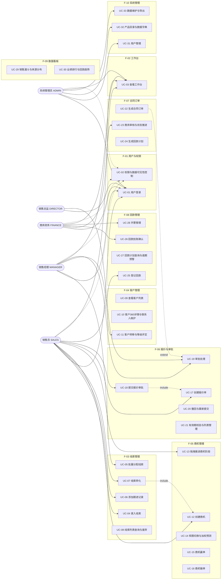
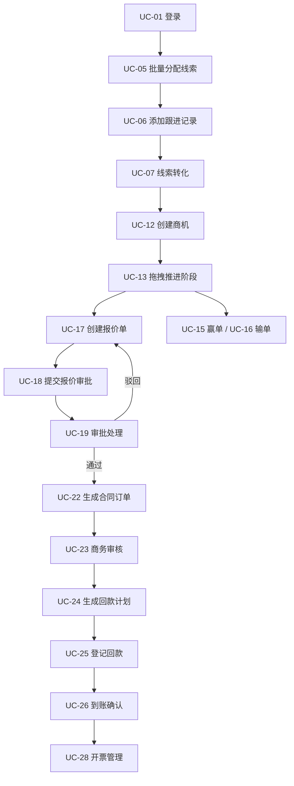

# 用例规格说明书（Use Case Specification）

| 项 | 内容 |
|---|---|
| 文档编号 | SFS-CRM-UCS-01 |
| 项目名称 | SalesFlow 智销云 · 销售全流程管理平台 |
| 版本 | v1.0 |
| 编写日期 | 2026-10-09 |
| 状态 | 已基线化 |

---

## 1. 概述

### 1.1 编写目的

本文档在《软件需求规格说明书》SFS-CRM-SRS 的基础上，将功能需求拆解为可执行的用例（Use Case），明确每个用例的主角、前置/后置条件、基本流、备选流、异常流与业务规则，作为 UI 原型设计（SFS-CRM-PRO-01）、详细设计（SFS-CRM-DD-01）与测试用例设计（SFS-CRM-TC-01）的直接输入。

### 1.2 适用范围与读者

覆盖 L2C 全链路 10 个功能模块、33 个用例。读者为产品经理、UI 设计师、前后端开发工程师、测试工程师及甲方业务代表。

### 1.3 与 SRS 的关系

本文档的用例编号（UC-01 ~ UC-33）与 SRS 附录 8.1《需求条目清单》中的"对应用例"列**严格一一对应**，不得自行增删或重排；用例描述中的业务规则一律引用 SRS 的需求编号（FR-xx-xx / NFR-x-xx），不另行发明规则。

---

## 2. 参与者（Actor）定义

| Actor | 标识 | 在系统中的职责 | 主要关注用例 |
|---|---|---|---|
| 销售员 | `SALES` | 录入与跟进线索、维护客户、推进商机、创建报价、登记回款 | UC-04、UC-06、UC-07、UC-12、UC-13、UC-17、UC-25 |
| 销售经理 | `MANAGER` | 分配线索、辅导商机、一级审批报价、查看团队业绩 | UC-05、UC-11、UC-19、UC-29、UC-30 |
| 销售总监 | `DIRECTOR` | 大额/高折扣报价的二级审批 | UC-19 |
| 商务财务 | `FINANCE` | 合同商务审核、回款到账确认、开票管理 | UC-23、UC-24、UC-26、UC-28 |
| 系统管理员 | `ADMIN` | 用户、产品目录、数据字典与数据维护 | UC-31、UC-32、UC-33 |

> 说明：销售总监在 SRS 2.3 未单列角色，按 Q-01 的处置结论，本期取 `role=MANAGER` 且职务含"总监"的用户承担二级审批职责。

---

## 3. 用例模型总览

### 3.1 用例图

### 3.2 L2C 主流程用例编排

---

## 4. 用例清单（UC-01 ~ UC-33）

| 编号 | 用例名称 | 主角（Actor） | 优先级 | 简述 | 对应 SRS 需求 |
|---|---|---|---|---|---|
| UC-01 | 用户登录（含演示账号一键登录） | 全部角色 | 高 | 校验账号密码建立会话，按角色加载菜单与按钮权限 | FR-01-01、FR-01-03 |
| UC-02 | 权限与数据可见性控制 | 全部角色 | 高 | 按角色控制菜单/按钮，并按 FR-01-04 过滤数据行 | FR-01-02、FR-01-04 |
| UC-03 | 查看工作台 | 全部角色 | 中 | 展示统计卡片、今日待跟进、漏斗缩略、最近动态 | FR-02-01 ~ FR-02-04 |
| UC-04 | 录入线索 | 销售员 / 销售经理 | 高 | 新建线索档案，状态置"待分配" | FR-03-01 |
| UC-05 | 批量分配线索 | 销售经理 | 高 | 将待分配线索批量指定归属销售员，单次 ≤50 条 | FR-03-03 |
| UC-06 | 添加跟进记录 | 销售员 | 高 | 记录跟进方式/内容/下次跟进时间，线索自动置"跟进中" | FR-03-04 |
| UC-07 | 线索转化 | 销售员 | 高 | 生成客户＋默认联系人，线索置"已转化"，可同步建商机 | FR-03-05 |
| UC-08 | 线索列表查询与废弃 | 销售员 / 销售经理 | 中 | 多条件筛选排序；废弃须填原因；展示来源分布与转化率 | FR-03-02、FR-03-06、FR-03-07 |
| UC-09 | 查看客户列表 | 销售员 / 销售经理 | 中 | 展示客户编号、等级、归属、关联商机数、累计成交金额 | FR-04-01 |
| UC-10 | 客户 360 详情与联系人维护 | 销售员 | 中 | 标签页聚合基础信息、联系人、商机、订单、回款、日志 | FR-04-02 |
| UC-11 | 客户转移与等级评定 | 销售经理 | 中 | 更换归属人（可同步转移商机）；按累计成交金额自动评级 | FR-04-03、FR-04-04 |
| UC-12 | 创建商机（含撞单校验） | 销售员 | 高 | 在客户下新建商机，阶段置 S1 并写入首条阶段历史 | FR-05-07、商机状态机 S1 |
| UC-13 | 拖拽推进商机阶段 | 销售员 | 高 | 看板拖拽改变阶段，校验进入条件并写入不可删阶段历史 | FR-05-01、FR-05-03 |
| UC-14 | 切换商机视图与查看加权预测 | 销售员 / 销售经理 | 中 | 列表/看板视图切换；按"金额×阶段赢率"展示加权汇总 | FR-05-02、FR-05-06 |
| UC-15 | 商机赢单 | 销售员 | 高 | 存在已签约订单方可赢单，填写实际成交金额 | FR-05-04 |
| UC-16 | 商机输单 | 销售员 | 中 | 标记输单，须填输单原因，竞品名称可选 | FR-05-05 |
| UC-17 | 创建报价单 | 销售员 | 高 | 建立报价单与产品明细，自动计算总额与折扣率 | FR-06-01、FR-06-02 |
| UC-18 | 提交报价审批 | 销售员 | 高 | 按折扣率/金额决策表生成审批链，状态转"审批中" | FR-06-03、FR-06-04 |
| UC-19 | 审批处理（通过/驳回） | 销售经理 / 销售总监 | 高 | 审批中心待办处理，驳回须填意见，审批链可视化 | FR-06-05、FR-06-06 |
| UC-20 | 撤回与重新提交报价单 | 销售员 | 中 | 审批中可撤回至草稿，修改后重新提交，审批链重新开始 | FR-06-04、FR-06-05 |
| UC-21 | 有效期校验与报价列表管理 | 销售员 / 销售经理 | 中 | 过期报价标记"已过期"且禁止生成订单 | FR-06-08 |
| UC-22 | 生成合同订单 | 销售员 | 高 | 由已通过报价单一键生成订单，带入客户、明细与折后金额 | FR-06-07、FR-07-01 |
| UC-23 | 商务审核与订单状态推进 | 商务财务 | 高 | 审核通过后订单转"已签约"，并按状态机推进至执行中/完成 | FR-07-02、FR-07-03 |
| UC-24 | 生成回款计划与查看回款进度 | 商务财务 / 销售员 | 高 | 签约时按付款方式生成分期计划，允许人工调整 | FR-07-04、FR-07-05 |
| UC-25 | 登记回款 | 销售员 | 高 | 登记回款金额/方式/日期/流水号，生成"待确认"回款 | FR-08-03 |
| UC-26 | 回款到账确认 | 商务财务 | 高 | 确认后计入订单已回款与客户累计成交金额 | FR-08-04 |
| UC-27 | 回款计划查询与逾期预警 | 销售员 / 商务财务 | 中 | 展示期次状态，逾期行高亮红色并汇总预警 | FR-08-01、FR-08-02、FR-08-06 |
| UC-28 | 开票管理 | 商务财务 | 中 | 对已确认回款开票，登记发票号与日期，跟踪寄出状态 | FR-08-05 |
| UC-29 | 查看销售漏斗与来源分布 | 销售经理 | 中 | 阶段数量/金额与相邻阶段转化率；线索来源饼图 | FR-09-01、FR-09-04 |
| UC-30 | 查看业绩排行与回款趋势 | 销售经理 / 商务财务 | 中 | 按已确认回款排名与达成率；近 12 个月回款趋势 | FR-09-02、FR-09-03、FR-09-05 |
| UC-31 | 用户管理 | 系统管理员 | 中 | 新增/编辑/停用用户，设置姓名、账号、角色、部门、手机 | FR-10-01 |
| UC-32 | 产品目录与数据字典维护 | 系统管理员 | 中 | 维护产品与规格单价；维护行业、来源、输单/废弃原因枚举 | FR-10-02、FR-10-03 |
| UC-33 | 数据维护与导出 | 系统管理员 | 低 | 一键重置为演示数据；导出全量数据为 JSON | FR-10-04 |

**编号一致性校验**

| 模块 | SRS 8.1 规定范围 | 本文用例 | 结论 |
|---|---|---|---|
| F-01 用户与权限 | UC-01, UC-02 | UC-01, UC-02 | 一致 |
| F-02 工作台 | UC-03 | UC-03 | 一致 |
| F-03 线索管理 | UC-04 ~ UC-08 | UC-04 ~ UC-08 | 一致 |
| F-04 客户管理 | UC-09 ~ UC-11 | UC-09 ~ UC-11 | 一致 |
| F-05 商机管理 | UC-12 ~ UC-16 | UC-12 ~ UC-16 | 一致 |
| F-06 报价与审批 | UC-17 ~ UC-21 | UC-17 ~ UC-21 | 一致 |
| F-07 合同订单 | UC-22 ~ UC-24 | UC-22 ~ UC-24 | 一致 |
| F-08 回款管理 | UC-25 ~ UC-28 | UC-25 ~ UC-28 | 一致 |
| F-09 数据看板 | UC-29, UC-30 | UC-29, UC-30 | 一致 |
| F-10 系统管理 | UC-31 ~ UC-33 | UC-31 ~ UC-33 | 一致 |

---

## 5. 重点用例详细规格

本节给出 L2C 主链路上 10 个核心用例的完整规格，其余 23 个用例以第 4 章清单表为准。

### 5.1 UC-01 用户登录

| 项 | 内容 |
|---|---|
| 用例名 / 编号 | 用户登录 / UC-01 |
| Actor | 销售员、销售经理、销售总监、商务财务、系统管理员 |
| 优先级 | 高 |

**前置条件**：用户已由管理员开通账号（FR-10-01）；系统已初始化演示数据。

**后置条件**：会话建立，写入当前用户 ID、角色、部门；跳转工作台 P02。

**基本流**
1. 用户访问系统任意地址，系统检查会话；无会话则展示登录页 P01（账号、密码、演示账号区）。
2. 用户输入账号与密码，点击"登录"。
3. 系统校验账号存在性与密码正确性（FR-01-01）。
4. 校验通过，系统按角色加载可见菜单与可操作按钮（FR-01-02，按钮级）。
5. 系统建立会话并记录登录时间、操作人（NFR-S-04）。
6. 跳转工作台 P02，按角色动态计算四张统计卡片（FR-02-01）。

**备选流**
- 2a. 用户点击登录页演示账号卡片 → 自动填充账号密码并直接登录（FR-01-03），进入步骤 4。
- 4a. 用户上次访问地址为受保护页面 → 登录后直接回跳该地址（NFR-S-01）。

**异常流**
- E1 账号不存在或密码错误 → 提示"账号或密码错误"，保留账号、清空密码，允许重试；同一账号连续 5 次失败锁定 10 分钟。
- E2 账号已停用 → 提示"账号已停用，请联系系统管理员"。
- E3 必填项为空 → 登录按钮禁用（NFR-U-03）。
- E4 会话写入失败 → 提示"登录状态保存失败"，不进入系统（NFR-R-02）。

**业务规则**：BR-01 权限粒度到按钮；BR-02 数据可见性严格遵循 FR-01-04（`SALES` 仅本人、`MANAGER` 本部门、`FINANCE` 订单/回款/发票无归属限制、`ADMIN` 全部）；BR-03 敏感操作记录操作人与时间。

**特殊需求**：密码掩码显示（NFR-S-03）；首屏加载 ≤2 秒（NFR-P-01）；未登录访问受保护页重定向登录页（NFR-S-01）。

**界面原型引用**：P01 登录页、P02 工作台。

---

### 5.2 UC-04 录入线索

| 项 | 内容 |
|---|---|
| 用例名 / 编号 | 录入线索 / UC-04 |
| Actor | 销售员、销售经理 |
| 优先级 | 高 |

**前置条件**：用户已登录（UC-01）；具备线索录入权限。

**后置条件**：线索以"待分配 NEW"状态落盘，`ownerId` = 当前用户，出现在线索列表。

**基本流**
1. 销售员进入线索管理 P03，点击"新增线索"。
2. 系统展示表单：公司名称\*、联系人姓名\*、联系电话\*、来源渠道\*、所属行业、意向等级（高/中/低）、备注。
3. 销售员填写字段并提交。
4. 系统校验必填项与联系电话格式（11 位手机号）。
5. 校验通过，系统生成线索编号，状态置 NEW，写入 `leads` 并即时落盘。
6. 系统 Toast 提示"线索创建成功"并刷新列表（NFR-U-05）。

**备选流**
- 2a. 来源渠道、所属行业取值来自数据字典（FR-10-03），以下拉选择。
- 5a. 用户勾选"继续创建" → 保留上次来源与行业，清空其余字段。

**异常流**
- E1 必填项为空 → 提交按钮禁用并在字段下方红字标注（NFR-U-03）。
- E2 手机号格式错误 → 提示"请输入 11 位有效手机号"。
- E3 公司名称与已有线索/客户重名 → 弹窗提示"系统已存在同名记录，是否仍要创建"，须二次确认（NFR-U-02）。
- E4 本地写入失败 → 提示"数据保存失败，请重试"，保留表单内容（NFR-R-02）。

**业务规则**：BR-04 意向等级默认"中"；BR-05 线索编号规则 `LD + yyyyMMdd + 4 位流水`；BR-06 录入人默认成为归属人，经理可分派他人。

**特殊需求**：核心任务 3 次点击内进入（NFR-U-01）；列表空/加载/错误三态不得留白（NFR-U-04）；日期统一 `YYYY-MM-DD`（NFR-U-06）。

**界面原型引用**：P03-01 线索列表、P03-02 线索新增弹窗。

---

### 5.3 UC-05 批量分配线索

| 项 | 内容 |
|---|---|
| 用例名 / 编号 | 批量分配线索 / UC-05 |
| Actor | 销售经理 |
| 优先级 | 高 |

**前置条件**：销售经理已登录；系统中存在状态为"待分配"的线索。

**后置条件**：选中线索 `ownerId` 更新为目标销售员，状态转为"跟进中"，记录分配人与分配时间。

**基本流**
1. 经理进入线索列表 P03-01，按状态筛选"待分配"。
2. 经理勾选目标线索（支持本页全选）。
3. 点击"批量分配"，系统弹出归属销售员选择框（仅列出本部门在职人员）。
4. 经理选择销售员并确认。
5. 系统校验选中数量 ≤ 50 条（FR-03-03）。
6. 系统批量更新归属人与状态，写入分配人、分配时间。
7. 提示"成功分配 N 条线索"，并写入操作日志。

**备选流**
- 3a. 单条分配：在列表行内点击"分配"，流程同上但仅处理一条。
- 4a. 经理可按"意向等级=高"二次筛选后批量分配。

**异常流**
- E1 未勾选任何线索 → "批量分配"按钮禁用并给出气泡说明。
- E2 选中超过 50 条 → 提示"单次最多分配 50 条，当前已选 N 条"，拒绝执行。
- E3 目标销售员已停用 → 不在候选列表中出现（FR-10-01）。
- E4 部分写入失败 → 逐条提示失败原因，成功的条目不回滚并明确告知已分配条数。

**业务规则**：BR-07 单次分配上限 50 条；BR-08 分配后线索状态由 NEW 置为 FOLLOWING；BR-09 分配不可撤销，重新分配以最新记录为准并留痕。

**特殊需求**：批量操作需展示执行进度与结果统计；失败项须给出明确原因（NFR-U-05）；列表查询响应 ≤500ms（NFR-P-02）。

**界面原型引用**：P03-01 线索列表。

---

### 5.4 UC-06 添加跟进记录

| 项 | 内容 |
|---|---|
| 用例名 / 编号 | 添加跟进记录 / UC-06 |
| Actor | 销售员 |
| 优先级 | 高 |

**前置条件**：线索归属当前用户（或当前用户为经理）；线索状态为 NEW 或 FOLLOWING。

**后置条件**：生成一条跟进记录；线索状态自动置"跟进中"；若填写下次跟进时间则更新 `nextFollowAt`。

**基本流**
1. 销售员打开线索详情 P03-03，点击"添加跟进"。
2. 系统展示表单：跟进方式（电话/拜访/邮件/微信）、跟进内容\*、下次跟进时间、跟进结果。
3. 销售员填写并提交。
4. 系统校验跟进内容非空且长度 ≤ 500 字。
5. 系统生成跟进记录写入 `follow_ups`。
6. 系统将线索状态自动置为"跟进中 FOLLOWING"（FR-03-04）。
7. 若填写下次跟进时间，写入 `nextFollowAt`，同步刷新工作台"今日待跟进"（FR-02-02）。
8. 详情页时间线倒序展示新记录，Toast 提示成功。

**备选流**
- 1a. 从工作台"今日待跟进"列表点击线索一键跳转后添加跟进（FR-02-02）。
- 2a. "快速跟进"：仅填方式与内容，跳过下次跟进时间。

**异常流**
- E1 跟进内容为空 → 提交按钮禁用（NFR-U-03）。
- E2 下次跟进时间早于当前日期 → 提示"下次跟进时间不得早于今天"。
- E3 线索已转化或已废弃 → 隐藏"添加跟进"入口并提示当前状态。
- E4 写入失败 → 提示并保留已填内容（NFR-R-02）。

**业务规则**：BR-10 新增跟进后线索状态自动变为跟进中；BR-11 跟进记录为过程留痕，不可编辑与删除；BR-12 `nextFollowAt` 驱动工作台提醒。

**特殊需求**：时间线倒序、空/加载/错误三态明确提示（NFR-U-04）；列表响应 ≤500ms（NFR-P-02）。

**界面原型引用**：P03-03 线索详情、P02 工作台。

---

### 5.5 UC-07 线索转化

| 项 | 内容 |
|---|---|
| 用例名 / 编号 | 线索转化 / UC-07 |
| Actor | 销售员 |
| 优先级 | 高 |

**前置条件**：线索状态为 NEW 或 FOLLOWING，且归属当前用户（或当前用户为经理）。

**后置条件**：生成客户档案与默认联系人（或关联已有客户）；线索置"已转化 CONVERTED"并记录转化人与时间；可选同步创建 S1 商机。

**基本流**
1. 销售员在线索详情点击"转化"。
2. 系统按公司名称查重客户档案（FR-03-05）。
3. 未发现同名客户 → 展示转化确认弹窗，预填客户名称、行业、归属人与默认联系人（来自线索联系人/电话）。
4. 销售员补充客户信息与主联系人设置。
5. 销售员可勾选"同步创建商机"，填写商机标题、预估金额、预计成交日。
6. 提交，系统生成客户编号与客户档案、默认联系人（可含同步商机）。
7. 线索状态置 CONVERTED，记录转化人与转化时间。
8. 提示"转化成功"，提供跳转客户 360 详情入口。

**备选流**
- 3a. 发现同名客户 → 提示"已存在客户【X】，是否关联至该客户"，确认后仅建立关联不新建档案（避免重复建档）。
- 5a. 暂不创建商机 → 后续可在客户详情新建商机（UC-12）。
- 5b. 同步创建商机时若该客户已有进行中商机 → 触发撞单校验并二次确认（FR-05-07）。

**异常流**
- E1 线索已转化/已废弃 → "转化"入口隐藏。
- E2 客户名称为空或超长（>100 字） → 阻断提交并标注字段。
- E3 同步创建商机校验不通过（金额 ≤0、预计成交日早于今天） → 阻断并提示具体字段。
- E4 写入过程中失败 → 客户、联系人、商机整体回滚，线索状态保持不变。

**业务规则**：BR-13 转化为终态，不可撤销；BR-14 已转化线索原始记录保留，不得删除（SRS 5.2）；BR-15 客户等级默认 C，后续按累计成交金额自动评定（FR-04-04）；BR-16 转化人 = 当前操作人。

**特殊需求**：转化为破坏性操作，须二次确认弹窗（NFR-U-02）；须记录操作人与时间（NFR-S-04）。

**界面原型引用**：P03-03 线索详情、P04-02 客户 360 详情、P05-02 商机详情。

---

### 5.6 UC-12 创建商机

| 项 | 内容 |
|---|---|
| 用例名 / 编号 | 创建商机（含撞单校验） / UC-12 |
| Actor | 销售员 |
| 优先级 | 高 |

**前置条件**：已存在客户档案（由 UC-07 生成或已存在于客户列表）；销售员已登录。

**后置条件**：商机以 S1"初步接洽"（赢率 10%）落盘；写入首条阶段历史；卡片出现在看板 S1 列。

**基本流**
1. 销售员在客户详情点击"新建商机"，或由 UC-07 勾选"同步创建商机"进入。
2. 系统展示表单：商机标题\*、关联客户\*、预估金额\*、预计成交日\*、来源、备注。
3. 销售员填写并提交。
4. 系统校验必填项、金额 > 0 且 ≤ 9 位整数、预计成交日不早于今天。
5. 系统执行撞单校验：查询该客户是否存在未关闭（进行中）商机（FR-05-07）。
6. 校验通过，生成商机编号，阶段置 S1，`ownerId` = 当前用户。
7. 写入首条 `stage_histories` 记录（原阶段为空、新阶段 S1、操作人、时间）。
8. 提示"商机创建成功"，看板与加权汇总刷新。

**备选流**
- 5a. 存在进行中商机 → 弹窗警告并展示已有商机标题、金额、负责人，销售员确认后方可继续，同时标记"撞单"痕迹。
- 1a. 从商机看板 S1 列点击"+"直接新建，需选择客户。

**异常流**
- E1 未选择关联客户 → 提交按钮禁用。
- E2 金额 ≤ 0 或格式非法 → 字段下方红字提示（NFR-U-03）。
- E3 预计成交日早于今天 → 提示"预计成交日不得早于今天"。
- E4 关联客户已被停用或已转移给他人 → 提示并阻断。

**业务规则**：BR-17 同一客户同一时间仅允许一个进行中商机（SRS 2.6 假设），超出须二次确认；BR-18 S1 赢率 10%，加权预测金额 = 商机金额 × 阶段赢率（FR-05-06）；BR-19 阶段历史不可删除（FR-05-03）；BR-20 金额以整数分存储（SRS 2.5）。

**特殊需求**：核心任务 3 次点击内进入（NFR-U-01）；金额千分位右对齐（NFR-U-06）。

**界面原型引用**：P05-01 商机看板、P05-02 商机详情。

---

### 5.7 UC-13 拖拽推进商机阶段

| 项 | 内容 |
|---|---|
| 用例名 / 编号 | 拖拽推进商机阶段 / UC-13 |
| Actor | 销售员 |
| 优先级 | 高 |

**前置条件**：商机处于非终态（S1~S4）；当前用户为归属人或经理。

**后置条件**：商机阶段变更；写入一条不可删除的阶段历史；看板与漏斗数据刷新。

**基本流**
1. 销售员打开商机看板 P05-01，系统按阶段分列展示卡片（客户名、标题、金额、负责人、预计成交日）。
2. 用户按住卡片拖动至目标阶段列。
3. 系统在 ≤100ms 内高亮可放置区域（NFR-P-03）。
4. 用户释放卡片，系统校验目标阶段的进入条件（FR-05-01）。
5. 条件满足 → 弹出确认框，要求填写阶段变更备注（回退时必填）。
6. 确认后更新商机 `stage`，写入 `stage_histories`（原阶段、新阶段、操作人、时间、备注）。
7. 看板各列数量与加权汇总刷新，Toast 提示"阶段已推进至【X】"。

**备选流**
- 4a. 目标为 S2 但未填写需求确认信息 → 拒绝并提示"推进至【需求确认】需先填写需求确认信息"。
- 4b. 目标为 S3 但未创建报价单 → 拒绝并提示"推进至【方案报价】需先创建至少一张报价单"。
- 4c. 目标为 S4 但无已通过报价单 → 拒绝并提示"推进至【商务谈判】需报价单审批通过"。
- 4d. 目标为 S5 赢单 → 转入 UC-15；拖至"输单" → 转入 UC-16。
- 6a. 阶段回退（如 S3 → S2）允许，但必须填写回退原因。

**异常流**
- E1 跨阶段跳跃（如 S1 直接拖至 S4） → 拒绝并提示"请按阶段顺序逐级推进"。
- E2 商机已赢单/输单（终态） → 卡片不可拖拽，鼠标样式提示。
- E3 数据写入失败 → 卡片回弹至原列并提示"阶段更新失败，请重试"（NFR-R-02）。
- E4 非归属人且非经理 → 前端拦截并提示"权限不足"（NFR-S-02）。

**业务规则**：BR-21 阶段进入条件严格按 SRS 商机阶段状态机执行；BR-22 阶段历史不可删除、不可修改（FR-05-03）；BR-23 阶段回退必须填写原因；BR-24 加权预测金额 = 商机金额 × 阶段赢率（FR-05-06）。

**特殊需求**：拖拽响应 ≤100ms 且无视觉卡顿（NFR-P-03）；不支持拖拽的浏览器提供下拉选择兜底方案。

**界面原型引用**：P05-01 商机看板。

---

### 5.8 UC-17 创建报价单

| 项 | 内容 |
|---|---|
| 用例名 / 编号 | 创建报价单 / UC-17 |
| Actor | 销售员 |
| 优先级 | 高 |

**前置条件**：商机存在且处于非终态；产品目录已维护（FR-10-02）；销售员已登录。

**后置条件**：报价单以"草稿 DRAFT"保存；总额、折扣后金额与整体折扣率计算完成并展示。

**基本流**
1. 销售员在商机详情点击"新建报价单"。
2. 系统自动生成报价单编号，带入关联商机（只读）。
3. 销售员填写报价有效期\*、付款方式、备注。
4. 销售员逐行添加产品明细：产品、单价、数量、折扣率。
5. 系统实时计算并展示：明细小计 = 单价 × 数量；报价总额 = Σ 明细小计；折扣后金额 = Σ（明细小计 ×(1 − 折扣率)）；整体折扣率 = 1 − 折扣后金额 / 报价总额（FR-06-02）。
6. 销售员点击"保存草稿"。
7. 系统落盘并提示"报价单已保存"。

**备选流**
- 4a. 从产品目录选择产品时自动带入标准单价与单位。
- 4b. 复制历史报价单明细后调整。
- 6a. 点击"保存并提交审批" → 直接进入 UC-18。

**异常流**
- E1 无任何产品明细 → 禁止保存与提交，提示"请至少添加一条产品明细"。
- E2 数量 ≤ 0 或折扣率不在 0~100% 区间 → 行内红字标注（NFR-U-03）。
- E3 报价有效期早于今天 → 提示"有效期不得早于今天"。
- E4 单价为 0 → 警告"单价为 0，请确认"。

**业务规则**：BR-25 报价单编号规则 `QT + yyyyMMdd + 3 位流水`；BR-26 所有金额以整数分存储，避免浮点误差（SRS 2.5）；BR-27 整体折扣率决定审批链（FR-06-03）；BR-28 一个商机可有多张报价单，以最新审批通过者为准。

**特殊需求**：金额右对齐并千分位格式化（NFR-U-06）；明细行计算实时无感延迟（NFR-P-02）；表格行高 ≤48px（NFR-U-07）。

**界面原型引用**：P06-01 报价单编辑页。

---

### 5.9 UC-19 审批处理（通过 / 驳回）

| 项 | 内容 |
|---|---|
| 用例名 / 编号 | 审批处理 / UC-19 |
| Actor | 销售经理（一级）、销售总监（二级） |
| 优先级 | 高 |

**前置条件**：报价单已提交（UC-18）并处于"审批中 APPROVING"；系统已按 FR-06-03 生成审批链；当前用户为当前待处理级别的审批人。

**后置条件**：全部级别通过 → 报价单置"已通过 APPROVED"，可执行 UC-22；任一级驳回 → 置"已驳回 REJECTED"，创建人修改后可重新提交。

**基本流**
1. 审批人进入审批中心（或工作台"待我审批"卡片），查看待办列表。
2. 审批人打开待审报价单，系统可视化展示审批链：每级审批人姓名、角色、状态（待审批/已通过/已驳回）、处理时间、审批意见（FR-06-06）。
3. 审批人查看报价明细、整体折扣率与商机背景信息。
4. 审批人选择"通过"，可填写审批意见（选填）。
5. 系统写入 `approval_records`（审批人、角色、动作、时间、意见）。
6. 若审批链仍有下一级 → 置下一级为待审批并推送待办；若为最后一级 → 报价单状态置 APPROVED。
7. 系统刷新待办与工作台统计卡片，Toast 提示"审批已通过"。

**备选流**
- 4a. 审批人选择"驳回" → 必须填写驳回意见（非空校验）→ 报价单置 REJECTED，后续由创建人修改后重新提交，审批链从头开始（FR-06-05）。
- 2a. 二级审批人（总监）在决策表 R3/R4 触发时才出现在审批链中。
- 6a. 审批中报价单被创建人撤回（UC-20）→ 待办自动消失。

**异常流**
- E1 驳回意见为空 → 驳回按钮禁用并提示"驳回须填写意见"。
- E2 审批人越权处理非本人待办 → 前端拦截并提示"权限不足"（NFR-S-02）。
- E3 报价单在审批人处理前已被撤回或过期 → 提示"该报价单状态已变更，请刷新"，待办移除。
- E4 写入失败 → 提示"审批提交失败，请重试"，审批状态保持原样（NFR-R-02）。

**业务规则**：BR-29 审批触发决策表：d < 15% 无需审批（R1）；15% ≤ d < 30% 一级审批（R2）；d ≥ 30% 二级审批（R3）；金额 ≥ 100 万强制两级审批（R4）；BR-30 驳回后回到草稿，重新提交时审批链从头开始；BR-31 审批记录为审计数据，不允许物理删除（SRS 5.2）；BR-32 审批阈值集中配置，禁止组件内硬编码（NFR-M-01）。

**特殊需求**：审批动作须记录操作人、时间与本地 IP（NFR-S-04）；审批链可视化须清晰展示每级状态与意见。

**界面原型引用**：P06-02 审批中心、P06-03 报价单详情（审批链）。

---

### 5.10 UC-25 登记回款

| 项 | 内容 |
|---|---|
| 用例名 / 编号 | 登记回款 / UC-25 |
| Actor | 销售员 |
| 优先级 | 高 |

**前置条件**：订单已签约并生成回款计划（UC-24）；销售员已登录。

**后置条件**：生成一条状态为"待确认"的回款记录；回款计划的已回款金额与状态按 FR-08-02 更新。

**基本流**
1. 销售员进入回款管理 P08，定位目标订单与期次。
2. 点击"登记回款"，系统展示表单：回款金额\*、回款方式（电汇/承兑/现金/POS）、回款日期\*、关联期次、流水号、备注。
3. 销售员填写并提交。
4. 系统校验金额 > 0、回款日期合法、流水号格式正确。
5. 系统生成回款记录写入 `payments`，状态置"待确认"。
6. 系统按 FR-08-02 更新计划状态：已回款金额 = 0 且计划日期 ≥ 今天 → 未回款；0 < 已回款 < 计划金额 → 部分回款；已回款 ≥ 计划金额 → 已回款；已回款 < 计划金额 且计划日期 < 今天 → 逾期（红色高亮）。
7. 提示"回款登记成功，等待财务确认"，并刷新回款进度与逾期预警（FR-08-06）。

**备选流**
- 2a. 一笔到账覆盖多个期次 → 支持拆分到不同期次分别登记。
- 4a. 登记金额超过本期未回款金额 → 提示"超出本期未回款金额 X 元，是否登记为溢收"，确认后标记溢收并留痕。

**异常流**
- E1 订单未签约或已取消 → 隐藏"登记回款"入口。
- E2 金额 ≤ 0 或含非法字符 → 字段红字提示（NFR-U-03）。
- E3 回款日期早于合同签订日期或晚于今天 → 提示并阻断。
- E4 流水号与已有记录重复 → 警告"流水号重复，请核对"，允许强制提交并留痕。
- E5 写入失败 → 提示并保留表单（NFR-R-02）。

**业务规则**：BR-33 未确认回款以"待确认"展示且不计入统计（FR-08-04）；BR-34 确认后计入订单已回款金额与客户累计成交金额，并驱动客户等级重算（FR-04-04）；BR-35 金额以整数分存储；BR-36 逾期期次在列表与首页红色高亮。

**特殊需求**：金额千分位右对齐（NFR-U-06）；核心任务 3 次点击内进入（NFR-U-01）；破坏性/异常操作须明确原因提示（NFR-U-05）。

**界面原型引用**：P08-01 回款计划列表、P08-02 回款登记弹窗。

---

## 6. 用例间关系说明

| 关系 | 源用例 | 目标用例 | 说明 |
|---|---|---|---|
| «include» | UC-07 线索转化 | UC-12 创建商机 | 勾选"同步创建商机"时必须执行创建商机流程 |
| «include» | UC-18 提交审批 | UC-17 创建报价单 | 提交审批前报价单必须已保存且明细完整 |
| «include» | UC-22 生成订单 | UC-02 权限控制 | 生成订单前须校验角色与数据可见性 |
| «extend» | UC-19 审批处理 | UC-22 生成订单 | 审批全部通过后可扩展执行一键生成订单 |
| «extend» | UC-13 拖拽推进 | UC-15 赢单 / UC-16 输单 | 拖至终态列时扩展执行赢单/输单 |
| «include» | UC-25 登记回款 | UC-24 生成回款计划 | 登记回款必须挂接到已存在的期次 |

## 7. 追溯与维护说明

1. 用例编号一经基线化不得变更；新增用例须走需求变更流程（见《需求变更管理与基线记录》SFS-CRM-CM-01）并在附录追加编号。
2. 每个用例至少被一个 SRS 需求条目覆盖，每个 Must 级需求至少被一个用例覆盖，双向追溯矩阵见《需求跟踪矩阵》SFS-CRM-RTM-01。
3. 用例规格中的业务规则（BR 编号）须与设计文档中的规则常量一一对应，实现时集中配置，禁止硬编码（NFR-M-01）。
