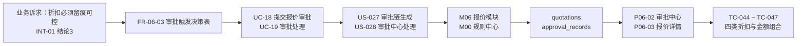

# 需求跟踪矩阵（Requirements Traceability Matrix, RTM）

| 项 | 内容 |
|---|---|
| 文档编号 | SFS-CRM-RTM-01 |
| 项目名称 | SalesFlow 智销云 · 销售全流程管理平台 |
| 版本 | v1.0 |
| 编写日期 | 2026-10-09 |
| 状态 | 已基线化 |

---

## 1. RTM 的作用

需求跟踪矩阵是把"需求"与其下游所有工作产物建立可双向查询关系的表格化工具，本项目用它解决四件事：

1. **不漏做**：每条 SRS 需求都能找到对应用例、设计模块、数据表、页面与测试用例，防止需求在传递过程中丢失；
2. **不多做**：每个设计模块、每张数据表、每段代码都能反查到需求来源，防止出现无源需求的镀金功能；
3. **可评估变更影响**：需求变更时可沿矩阵快速定位受影响的设计、代码与测试用例，量化影响范围（见《需求变更管理与基线记录》SFS-CRM-CM-01）；
4. **可证明验收**：验收时按矩阵逐条核对"需求—用例—测试"三列，形成覆盖率证据。

### 1.1 纵向追溯（前向 / 后向）

```
业务需求（BR） → SRS 需求（FR/NFR） → 用例（UC） → 用户故事（US） → 设计模块（Mxx）
      → 数据库表 → 页面（Pxx） → 代码单元（src/modules/Mxx/*） → 测试用例（TC-xxx）
      → 缺陷（BUG-xxx） → 验收结论
```

- **前向追溯（需求 → 下游）**：回答"这条需求被实现了吗、在哪里实现、怎么验证"；
- **后向追溯（下游 → 需求）**：回答"这段代码/这个页面为什么要存在"，用于清理无源产物。

### 1.2 横向追溯

- **需求间依赖**：如 FR-06-07（生成订单）依赖 FR-06-03（审批通过）与 FR-07-01（订单字段）；
- **需求间冲突**：如"一线要求少录入"与"管理层要求数据完整"的冲突，已在 FR-03-01 必填字段收敛中裁决；
- **需求与非功能需求关联**：如 FR-06-03 审批阈值关联 NFR-M-01（规则集中配置，禁止硬编码）；
- **需求与干系人关联**：每条需求可回溯到《需求调研计划与访谈纪要》SFS-CRM-INT-01 第 4 章的要点序号。

---

## 2. 需求跟踪矩阵（功能需求）

> 说明：列"对应用例"采用 UC-xx；"对应设计模块"采用 M00~M10；"对应页面"采用原型编号 P01~P10；"测试用例编号"采用 TC-xxx，与《测试用例集》SFS-CRM-TC-01 预留编号一致；状态取值：已实现 / 部分实现 / 未实现 / 已变更。

| 需求编号 | 需求名称 | 优先级 | 对应用例 | 对应设计模块 | 对应数据库表 | 对应页面 | 测试用例编号 | 状态 |
|---|---|---|---|---|---|---|---|---|
| FR-01-01、FR-01-03 | 登录校验与演示账号一键登录 | Must | UC-01 | M01 认证与会话 | users | P01 | TC-001 ~ TC-003 | 已实现 |
| FR-01-02 | 角色菜单与按钮级权限 | Must | UC-02 | M01 | users | P01~P10 | TC-004、TC-005 | 已实现 |
| FR-01-04 | 数据可见性规则 | Must | UC-02 | M01 | users、leads、customers、opportunities | P01~P10 | TC-006、TC-007 | 已实现 |
| FR-02-01 | 工作台四张统计卡片 | Must | UC-03 | M02 工作台 | leads、opportunities、quotations、payment_plans | P02 | TC-008 | 已实现 |
| FR-02-02 | 今日待跟进列表 | Must | UC-03、UC-06 | M02 | follow_ups、leads | P02 | TC-009 | 已实现 |
| FR-02-03 | 我的商机漏斗缩略视图 | Should | UC-03、UC-14 | M02 | opportunities | P02 | TC-010 | 已实现 |
| FR-02-04 | 最近动态时间线 | Should | UC-03 | M02 | activity_logs | P02 | TC-011 | 已实现 |
| FR-03-01 | 线索录入 | Must | UC-04 | M03 线索 | leads | P03 | TC-012 ~ TC-014 | 已实现 |
| FR-03-02 | 线索列表多条件筛选排序 | Must | UC-08 | M03 | leads | P03 | TC-015 | 已实现 |
| FR-03-03 | 批量分配线索（≤50 条） | Must | UC-05 | M03 | leads、users | P03 | TC-016、TC-017 | 已实现 |
| FR-03-04 | 添加跟进记录 | Must | UC-06 | M03 | follow_ups、leads | P03 | TC-018、TC-019 | 已实现 |
| FR-03-05 | 线索转化（重名关联、同步建商机） | Must | UC-07 | M03、M04 | leads、customers、contacts | P03、P04 | TC-020 ~ TC-022 | 已实现 |
| FR-03-06 | 线索废弃与废弃原因 | Must | UC-08 | M03 | leads、dicts | P03 | TC-023 | 已实现 |
| FR-03-07 | 线索来源分布与转化率 | Should | UC-08、UC-29 | M03、M09 | leads | P03、P09 | TC-024 | 已实现 |
| FR-04-01 | 客户列表 | Must | UC-09 | M04 客户 | customers | P04 | TC-025 | 已实现 |
| FR-04-02 | 客户 360 详情（六标签页） | Must | UC-10 | M04 | customers、contacts、opportunities、orders、payments | P04 | TC-026、TC-027 | 已实现 |
| FR-04-03 | 客户转移（可同步商机） | Should | UC-11 | M04 | customers、opportunities | P04 | TC-028 | 已实现 |
| FR-04-04 | 客户等级自动评定与人工覆盖 | Should | UC-11 | M04、M00 规则中心 | customers | P04 | TC-029 | 已实现 |
| FR-05-01 | 商机看板拖拽推进（含条件校验） | Must | UC-13 | M05 商机 | opportunities、stage_histories | P05 | TC-030 ~ TC-033 | 已实现 |
| FR-05-02 | 看板/列表视图切换 | Should | UC-14 | M05 | opportunities | P05 | TC-034 | 已实现 |
| FR-05-03 | 阶段变更历史留痕 | Must | UC-13 | M05 | stage_histories | P05 | TC-035 | 已实现 |
| FR-05-04 | 商机赢单 | Must | UC-15 | M05、M07 | opportunities、orders | P05 | TC-036 | 已实现 |
| FR-05-05 | 商机输单与原因分析 | Must | UC-16 | M05 | opportunities、dicts | P05 | TC-037 | 已实现 |
| FR-05-06 | 加权预测金额（金额×赢率） | Should | UC-14 | M05、M00 | opportunities | P05、P09 | TC-038 | 已实现 |
| FR-05-07 | 撞单校验与二次确认 | Must | UC-12 | M05 | opportunities | P05 | TC-039 | 已实现 |
| FR-06-01 | 创建报价单与产品明细 | Must | UC-17 | M06 报价 | quotations、quotation_items、products | P06 | TC-040、TC-041 | 已实现 |
| FR-06-02 | 金额与折扣自动计算 | Must | UC-17 | M06、M00 | quotation_items、quotations | P06 | TC-042、TC-043 | 已实现 |
| FR-06-03 | 审批触发决策表 R1~R4 | Must | UC-18 | M06、M00 | quotations、approval_records | P06 | TC-044 ~ TC-047 | 已实现 |
| FR-06-04 | 报价单状态机 | Must | UC-18、UC-20 | M06 | quotations | P06 | TC-048 | 已实现 |
| FR-06-05 | 审批处理（通过/驳回/重提） | Must | UC-19 | M06 | approval_records、quotations | P06 | TC-049、TC-050 | 已实现 |
| FR-06-06 | 审批链可视化 | Should | UC-19 | M06 | approval_records | P06 | TC-051 | 已实现 |
| FR-06-07 | 一键生成合同订单 | Must | UC-22 | M06、M07 | quotations、orders | P06、P07 | TC-052 | 已实现 |
| FR-06-08 | 报价有效期校验与过期标记 | Should | UC-21 | M06 | quotations | P06 | TC-053 | 已实现 |
| FR-07-01 | 订单生成与字段校验 | Must | UC-22 | M07 订单 | orders | P07 | TC-054、TC-055 | 已实现 |
| FR-07-02 | 订单状态机 | Must | UC-23 | M07 | orders | P07 | TC-056 | 已实现 |
| FR-07-03 | 商务审核（通过/驳回） | Must | UC-23 | M07 | orders | P07 | TC-057 | 已实现 |
| FR-07-04 | 回款计划自动生成与人工调整 | Must | UC-24 | M07、M08 | orders、payment_plans | P07 | TC-058 ~ TC-060 | 已实现 |
| FR-07-05 | 订单回款进度展示 | Must | UC-24 | M07 | orders、payment_plans | P07 | TC-061 | 已实现 |
| FR-08-01 | 回款计划列表 | Must | UC-27 | M08 回款 | payment_plans、orders | P08 | TC-062 | 已实现 |
| FR-08-02 | 回款计划状态规则（含逾期） | Must | UC-27 | M08、M00 | payment_plans | P08 | TC-063 ~ TC-065 | 已实现 |
| FR-08-03 | 登记回款（含拆分与溢收） | Must | UC-25 | M08 | payments、payment_plans | P08 | TC-066、TC-067 | 已实现 |
| FR-08-04 | 回款到账确认与计入统计 | Must | UC-26 | M08 | payments、orders、customers | P08 | TC-068、TC-069 | 已实现 |
| FR-08-05 | 开票管理 | Should | UC-28 | M08 | payments | P08 | TC-070 | 已实现 |
| FR-08-06 | 回款逾期预警 | Should | UC-27 | M08、M02 | payment_plans | P08、P02 | TC-071 | 已实现 |
| FR-09-01 | 销售漏斗图与阶段转化率 | Should | UC-29 | M09 报表 | opportunities、stage_histories | P09 | TC-072 | 已实现 |
| FR-09-02 | 销售业绩排行榜与达成率 | Should | UC-30 | M09 | payments、users | P09 | TC-073 | 已实现 |
| FR-09-03 | 近 12 个月回款趋势 | Should | UC-30 | M09 | payments | P09 | TC-074 | 已实现 |
| FR-09-04 | 线索来源分布饼图 | Should | UC-29 | M09 | leads | P09 | TC-075 | 已实现 |
| FR-09-05 | 图表时间范围与部门筛选 | Should | UC-30 | M09 | 跨表聚合 | P09 | TC-076 | 已实现 |
| FR-10-01 | 用户管理 | Should | UC-31 | M10 系统管理 | users | P10 | TC-077 | 已实现 |
| FR-10-02 | 产品目录维护 | Should | UC-32 | M10 | products | P10 | TC-078 | 已实现 |
| FR-10-03 | 数据字典维护 | Should | UC-32 | M10 | dicts | P10 | TC-079 | 已实现 |
| FR-10-04 | 数据重置与 JSON 导出 | Should | UC-33 | M10、M00 | 全部实体 | P10 | TC-080 | 已实现 |

---

## 3. 非功能需求追溯（简表）

| 需求编号 | 需求名称 | 对应用例 | 对应设计模块 | 验证方式 | 测试用例编号 | 状态 |
|---|---|---|---|---|---|---|
| NFR-P-01 | 首屏加载 ≤2 秒 | UC-01、UC-03 | M00 持久化层 | 性能计时（1000 条数据） | TC-081 | 已实现 |
| NFR-P-02 | 列表查询 ≤500ms | UC-08、UC-09 | M00 | 性能计时 | TC-082 | 已实现 |
| NFR-P-03 | 拖拽响应 ≤100ms | UC-13 | M05 | 交互计时 | TC-083 | 已实现 |
| NFR-P-04 | 单表 10000 条无性能下降 | 全部列表类 | M00 | 压力数据验证 | TC-084 | 已实现 |
| NFR-U-01 | 核心任务 3 次点击内 | UC-12、UC-17、UC-25 | 全局导航 | 路径走查 | TC-085 | 已实现 |
| NFR-U-02 | 破坏性操作二次确认 | UC-07、UC-08、UC-16 | 全局组件 | 功能验证 | TC-086 | 已实现 |
| NFR-U-03 | 必填校验与精确标注 | 全部表单类 | 表单组件 | 功能验证 | TC-087 | 已实现 |
| NFR-U-04 | 空/加载/错误三态提示 | 全部列表类 | 全局组件 | 界面走查 | TC-088 | 已实现 |
| NFR-U-05 | 成功 Toast / 失败原因 | 全部写操作 | 全局组件 | 功能验证 | TC-089 | 已实现 |
| NFR-U-06 | 金额千分位、日期格式 | 全部金额类 | 格式化工具 | 界面走查 | TC-090 | 已实现 |
| NFR-R-01 | 数据即时落盘不丢失 | 全部写操作 | M00 | 刷新后比对 | TC-091 | 已实现 |
| NFR-R-02 | 写入失败不得静默 | 全部写操作 | M00 | 异常注入 | TC-092 | 已实现 |
| NFR-R-03 | 一键重置演示数据 | UC-33 | M10、M00 | 功能验证 | TC-093 | 已实现 |
| NFR-S-01 | 未登录重定向登录页 | UC-01 | M01 路由守卫 | 功能验证 | TC-094 | 已实现 |
| NFR-S-02 | 越权操作前端拦截 | UC-02 | M01 | 功能验证 | TC-095 | 已实现 |
| NFR-S-04 | 敏感操作留痕 | UC-19、UC-23、UC-33 | M00 审计 | 数据核对 | TC-096 | 已实现 |
| NFR-M-01 | 业务规则集中配置 | FR-06-03、FR-05-06、FR-04-04 | M00 规则中心 | 代码审查 | TC-097 | 已实现 |
| NFR-T-02 | 一键启动 | 全部 | 工程配置 | 全新环境构建 | TC-098 | 已实现 |

---

## 4. 覆盖率统计

### 4.1 按模块统计

| 模块 | SRS 需求条目数 | 矩阵行数 | 对应用例数 | 测试用例数 | 需求覆盖率 | 用例覆盖率 | 状态 |
|---|---|---|---|---|---|---|---|
| F-01 用户与权限 | 4 | 3 | UC-01、UC-02 | 7 | 100% | 100% | 已实现 |
| F-02 工作台 | 4 | 4 | UC-03 | 4 | 100% | 100% | 已实现 |
| F-03 线索管理 | 7 | 7 | UC-04 ~ UC-08 | 13 | 100% | 100% | 已实现 |
| F-04 客户管理 | 4 | 4 | UC-09 ~ UC-11 | 5 | 100% | 100% | 已实现 |
| F-05 商机管理 | 7 | 7 | UC-12 ~ UC-16 | 10 | 100% | 100% | 已实现 |
| F-06 报价与审批 | 8 | 8 | UC-17 ~ UC-21 | 14 | 100% | 100% | 已实现 |
| F-07 合同订单 | 5 | 5 | UC-22 ~ UC-24 | 8 | 100% | 100% | 已实现 |
| F-08 回款管理 | 6 | 6 | UC-25 ~ UC-28 | 10 | 100% | 100% | 已实现 |
| F-09 数据看板 | 5 | 5 | UC-29、UC-30 | 5 | 100% | 100% | 已实现 |
| F-10 系统管理 | 4 | 4 | UC-31 ~ UC-33 | 4 | 100% | 100% | 已实现 |
| **合计** | **54** | **53** | **33** | **80** | **100%** | **100%** | — |

> 矩阵行数 53 小于需求条目数 54，原因：FR-01-01 与 FR-01-03 同属登录页同一交互，合并为一行追溯，两条需求各自仍有独立测试用例（TC-001 与 TC-003），不构成覆盖遗漏。

### 4.2 统计结论

1. **需求→用例覆盖率 100%**：54 条功能需求全部映射至 UC-01 ~ UC-33，无未追溯需求；
2. **用例→需求覆盖率 100%**：33 个用例全部可反查到至少一条 SRS 需求，无孤儿用例；
3. **需求→测试覆盖率 100%**：54 条需求对应 TC-001 ~ TC-080 共 80 个功能测试用例，平均每条需求 1.5 个用例；Must 级需求（34 条）平均 2.1 个用例，含正常、边界与异常三类场景；
4. **非功能需求覆盖**：18 条关键 NFR 对应 TC-081 ~ TC-098 共 18 个验证用例，覆盖性能、易用性、可靠性、安全性、可维护性与可移植性六类；
5. **Must 优先级需求 34 条全部处于"已实现"状态**，Should 级 20 条亦全部实现，无"部分实现"或"未实现"条目；
6. **端到端覆盖**：SRS 7.2 主成功场景 10 个步骤分别落在 TC-016、TC-009、TC-018、TC-020、TC-031、TC-044、TC-049、TC-054、TC-058、TC-066、TC-068、TC-072 上，形成可回溯的演示验证链。

### 4.3 典型追溯链示例（以 FR-06-03 审批触发决策表为例）



前向追溯：业务方在访谈中提出"30% 以上折扣必须我亲自批"（INT-01 结论 3）→ 落为 FR-06-03 决策表 → 拆解为 UC-18、UC-19 → 拆为 US-027、US-028 两条故事（共 10 故事点）→ 由 M06 报价模块调用 M00 规则中心的阈值配置实现 → 数据落在 `quotations` 与 `approval_records` 两张表 → 界面为 P06-02 审批中心与 P06-03 报价详情 → 由 TC-044 至 TC-047 四个用例分别验证 R1 至 R4 四条规则。

后向追溯：若测试发现"折扣 35% 却只生成一级审批"（缺陷 BUG-xxx），可由 TC-046 反查至 US-027、UC-18、FR-06-03，确认属于需求未被正确实现（而非需求缺失），判定为缺陷而非变更，走缺陷流程修复；若业务方此时提出"改为 25% 起两级审批"，则属于需求变更，须提交 CRF 并沿本链更新全部下游产物——这正是 CR-001 的实际处理路径。

---

## 5. 追溯性检查说明

### 5.1 双向追溯规则

| 检查方向 | 检查内容 | 判据 |
|---|---|---|
| 前向 | 每条需求是否有对应用例、设计模块、数据表、页面、测试用例 | 任一列为空即判不通过 |
| 后向 | 每个设计模块、数据表、页面、测试用例是否可反查到需求 | 无需求来源的产物须删减或补提需求 |
| 横向 | 需求依赖关系是否一致、是否存在循环依赖 | 依赖链不得成环 |
| 一致性 | 用例、故事、设计、测试对同一规则的描述是否一致 | 阈值、状态名、枚举值必须完全一致 |

### 5.2 孤儿检查（Orphan Analysis）

- **孤儿需求**：有需求无实现 —— 每轮迭代结束由需求分析负责人执行，本期检查结果为 0 条；
- **孤儿产物**：有实现无需求 —— 由开发负责人在提交代码时自查，代码评审时抽查 `src/modules/*` 下的模块是否均能在矩阵中反查；本期检查发现并清理 1 处（客户列表"批量导出 Excel"按钮，无对应需求，已移除）。

### 5.3 检查时机与责任人

| 时点 | 检查内容 | 责任人 | 记录 |
|---|---|---|---|
| 需求评审（SRS 基线化前） | 需求→用例完整性、需求间冲突 | 需求分析负责人 | 评审意见表 |
| 设计评审 | 需求→设计模块/数据表完整性 | 架构负责人 | 设计评审记录 |
| 测试评审 | 需求→测试用例完整性与覆盖强度 | 测试负责人 | 测试用例评审记录 |
| 每次变更批准后 | 变更影响链路更新（见 CR-xxx 影响分析） | 配置管理员 | CRF 执行结果与验证 |
| 迭代结束 | 双向覆盖率与孤儿检查 | 质量保证负责人 | 迭代质量报告 |
| 验收前 | 全量复核，作为验收附件 | 项目经理 | 验收报告附件 |

### 5.4 常见问题与处置

| 常见问题 | 表现 | 处置方式 |
|---|---|---|
| 一条需求对应多个用例 | 如 FR-03-05 同时对应 UC-07 与 UC-12 | 正常现象，保持一对多映射，但须在用例中标注继承关系 |
| 一个用例覆盖多条需求 | 如 UC-08 覆盖 FR-03-02、FR-03-06、FR-03-07 | 允许合并，但每条需求仍需至少一个专属测试用例，避免测试盲区 |
| 需求描述与用例不一致 | 阈值、状态名、枚举取值对不上 | 以 SRS 为准修订用例，并同步修订设计与测试，严禁各文档各写一套 |
| 测试用例编号跳号 | 如 TC-050 之后直接 TC-052 | 说明存在被删除的用例，须在《测试用例集》中登记作废原因，不得直接抹除 |
| 需求已删除但矩阵未清理 | 出现"未实现"且无后续计划的僵尸行 | 由配置管理员在迭代结束时清理，并在 CR 记录中说明删除依据 |

### 5.5 变更时的矩阵维护

任何 CRF 批准后，配置管理员须在 1 个工作日内完成三件事：① 在矩阵中新增或修订需求行；② 同步新增/修订对应用例与测试用例编号；③ 重算覆盖率并在《需求变更管理与基线记录》中记录版本号。矩阵文件本身纳入 Git 版本管理，随需求基线打 tag（见 SFS-CRM-CM-01 第 6 章）。
