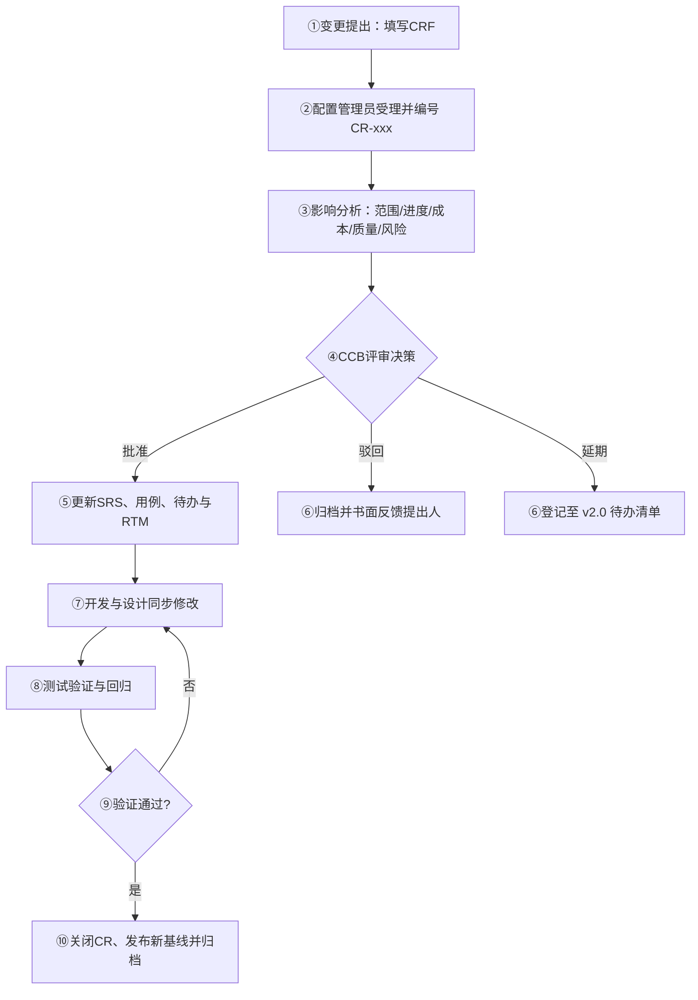

# 需求变更管理与基线记录

| 项 | 内容 |
|---|---|
| 文档编号 | SFS-CRM-CM-01 |
| 项目名称 | SalesFlow 智销云 · 销售全流程管理平台 |
| 版本 | v1.0 |
| 编写日期 | 2026-10-09 |
| 状态 | 已基线化 |

---

## 1. 概述

### 1.1 目的

SRS v1.0 已于 2026-10-09 由甲方代表签字确认并基线化。此后任何对需求条目的新增、修改、删除都必须通过本文档定义的变更控制流程处理，禁止口头变更、禁止开发人员直接按业务方要求改代码。

### 1.2 变更对象与不变更对象

| 类别 | 是否受控 | 说明 |
|---|---|---|
| SRS 中的 FR / NFR 条目 | 受控 | 必须提交 CRF 并经 CCB 决策 |
| 用例规格、用户故事与验收标准 | 受控 | 随需求一并变更并同步更新 RTM |
| 原型页面的交互细节（不改变业务规则） | 不受控 | 由产品经理与 UI 设计师协商，记入原型版本号 |
| 缺陷修复（实现与需求不一致） | 不受控 | 走缺陷流程，不视为需求变更 |
| 技术实现方案、组件拆分 | 不受控 | 属设计决策，记入设计文档 |

### 1.3 变更控制流程



流程要点：

1. **提出**：任何干系人（业务方、开发、测试、产品）均可提出，须填写 CRF 并写明业务理由；
2. **受理**：配置管理员在 1 个工作日内编号、登记并做完整性检查，材料不全退回补充；
3. **影响分析**：由需求分析负责人牵头，开发与测试配合，在 2 个工作日内给出五维影响评估；
4. **决策**：CCB 在每周三变更评审会（紧急变更可临时召集）上决策，决策结果三选一：批准 / 驳回 / 延期；
5. **执行与验证**：批准后更新文档与设计，测试补充或修订用例并回归，验证不通过则回到执行环节；
6. **归档**：CR 关闭后，配置管理员更新 RTM、发布新版本基线并打 Git tag。

### 1.4 变更紧急度分级

| 级别 | 判定标准 | 响应时限 | 决策方式 |
|---|---|---|---|
| 紧急 | 导致系统不可用或业务规则错误造成资金损失 | 24 小时内 | CCB 主任可先行决策，事后 48 小时内补评审 |
| 一般 | 影响单个模块功能或用户体验 | 5 个工作日内 | 周例会评审 |
| 微小 | 文案、枚举取值、阈值微调 | 10 个工作日内 | CCB 书面会签 |

---

## 2. 变更控制委员会（CCB）

| 角色 | 担任人 | 职责 | 决策权重 |
|---|---|---|---|
| CCB 主任 | 甲方业务代表（课程指导教师） | 主持评审、裁决争议、签署基线 | 一票否决权 |
| 项目经理 | 项目经理 | 评估进度与成本影响、调配资源 | 1 票 |
| 需求分析负责人 | 需求分析负责人 | 评估范围影响、维护 SRS 与 RTM | 1 票 |
| 开发负责人 | 架构/开发负责人 | 评估技术实现与质量风险 | 1 票 |
| 测试负责人 | 测试负责人 | 评估测试范围与回归成本 | 1 票 |
| 配置管理员 | 配置管理员（兼任秘书） | 受理编号、会议记录、基线发布、归档 | 无表决权 |

决策规则：一般变更采用**简单多数**通过；涉及基线版本升级、工期调整或工作量增加超过 8 人日的变更，须 CCB 主任签字方可生效。所有决策必须写明理由并归档，不得只写"同意"。

---

## 3. 变更申请单（CRF）标准模板

| 字段 | 填写说明 |
|---|---|
| CR 编号 | 由配置管理员填写，格式 `CR-xxx` |
| 申请日期 | 提出日期 |
| 申请人 / 所属方 | 姓名 + 业务方/开发方/测试方 |
| 变更来源 | 业务新诉求 / 评审意见 / 缺陷规避 / 法规政策 / 技术约束 |
| 变更类型 | 新增需求 / 修改需求 / 删除需求 |
| 涉及需求编号 | 如 FR-06-03；新增需求填写"新增" |
| 紧急度 | 紧急 / 一般 / 微小 |
| 变更内容描述 | 一句话说明期望结果 |
| 变更前（As-Is） | 现行需求原文或现行行为 |
| 变更后（To-Be） | 期望的需求表述（可直接用于替换 SRS 原文） |
| 业务理由与价值 | 不做的后果 / 做了的收益 |
| 影响分析：范围 | 涉及的模块、用例、故事、页面 |
| 影响分析：进度 | 工期增量（人日）与对当前 Sprint 的影响 |
| 影响分析：成本 | 工作量与可能的返工成本 |
| 影响分析：质量 | 引入的潜在风险与需补充的测试 |
| 影响分析：风险 | 风险描述与应对措施 |
| 替代方案 | 是否有成本更低的替代做法 |
| 申请人意见 | 签字与日期 |
| CCB 决策 | 批准 / 驳回 / 延期 + 决策日期 + 理由 + 生效版本 |
| 执行结果 | 文档更新情况、代码改动、测试用例变更 |
| 验证结论 | 验证人、验证日期、结论（通过/不通过） |

---

## 4. 变更申请单实例

### 4.1 CR-001 报价审批增加总监二级审批（批准，影响中）

| 字段 | 内容 |
|---|---|
| CR 编号 / 日期 | CR-001 / 2026-10-04 |
| 申请人 / 所属方 | 王建国（销售总监）/ 甲方业务方 |
| 变更来源 / 类型 | 评审意见（SRS v0.5 内部评审会）/ 修改需求 |
| 涉及需求编号 | FR-06-03（原稿仅定义两级：折扣 ≥15% 经理审批） |
| 紧急度 | 一般 |
| 变更内容 | 在经理一级审批之上，对高折扣与大额报价增加销售总监二级审批 |
| 变更前（As-Is） | 折扣 ≥15% 时仅需销售经理一级审批，总监无法在事前介入，仅在事后得知 |
| 变更后（To-Be） | 折扣 d<15% 无需审批；15%≤d<30% 经理一级审批；d≥30% 经理→总监两级审批；任意折扣且金额≥100 万强制两级审批 |
| 业务理由 | 近两季度出现 3 笔 30% 以上折扣订单，均为经理单独批准，毛利低于预期且事后无法追溯决策依据 |
| 影响分析·范围 | 涉及 F-06 模块；用例 UC-18、UC-19；故事 US-027、US-028、US-029；页面 P06-02/P06-03；新增配置项 `approval.thresholds` |
| 影响分析·进度 | +4 人日（审批链生成器改造 2、审批链可视化 1、测试 1）；占用 Sprint 2 容量，需从 Should 故事中腾挪 5 SP |
| 影响分析·成本 | 约 4 人日，无外部采购成本 |
| 影响分析·质量 | 审批链长度可变，需补充 R3/R4 两类场景用例；审批人角色判定逻辑引入分支，需代码评审 |
| 影响分析·风险 | 风险：总监账号缺失导致审批链卡死。应对：按 Q-01 取值 `role=MANAGER` 且职务含"总监"，并在演示数据中预置 1 名总监 |
| 替代方案 | 方案 B：仅对金额≥100 万加签总监（成本 2 人日），但无法覆盖高折扣小额订单，被业务方否决 |
| CCB 决策 | **批准**。理由：属于 SRS 2.6 已假设的审批阈值细化，业务价值明确（毛利可控），工期增量 4 人日在 Sprint 2 缓冲内可吸收。生效版本：v0.9（并入 v1.0 基线） |
| 执行结果 | SRS FR-06-03 决策表改写为 R1~R4；用例 UC-18/UC-19 补充二级审批分支；US-029 由 Could 提升为 Should；RTM 新增 TC-044~TC-047 |
| 验证结论 | 验证人：测试负责人；日期：2026-11-05；结论：**通过**。四类折扣/金额组合（10%/20%/35%/120 万）审批链生成均符合决策表 |

### 4.2 CR-002 增加移动端适配（驳回，超出本期范围）

| 字段 | 内容 |
|---|---|
| CR 编号 / 日期 | CR-002 / 2026-10-05 |
| 申请人 / 所属方 | 陈磊（IT 负责人）/ 甲方业务方 |
| 变更来源 / 类型 | 业务新诉求 / 新增需求 |
| 涉及需求编号 | 新增（拟影响 FR-01-02、NFR-U-07 及全部页面） |
| 紧急度 | 一般 |
| 变更内容 | 要求系统在手机浏览器上可用，销售可随时录入线索与跟进 |
| 变更前（As-Is） | SRS 2.4 明确：客户端为 Chrome/Edge/Firefox，分辨率 ≥1440×900，PC 优先，非移动端 |
| 变更后（To-Be） | 全部 10 个模块页面适配 375~768px，看板拖拽改为触摸交互，列表改为卡片流 |
| 业务理由 | 销售外出拜访时希望随手录入，避免在客户现场用手机记备忘录后再回公司补录 |
| 影响分析·范围 | 涉及全部 10 个模块、33 个用例、10 个页面；UI 组件库需引入响应式栅格；拖拽交互需重写 |
| 影响分析·进度 | +28 人日，相当于额外 1.5 个 Sprint，将直接导致 Sprint 3 无法完成回款与看板模块 |
| 影响分析·成本 | 约 28 人日，且需新增移动端设计稿 10 屏 |
| 影响分析·质量 | 拖拽、审批链、看板三类复杂交互在移动端风险高，回归测试量翻倍 |
| 影响分析·风险 | 风险：范围蔓延导致 L2C 主链路无法按期交付，触发整体工期风险 |
| 替代方案 | 方案 B（采纳）：本期仅做响应式兜底——窄屏下看板拖拽降级为下拉选择，表格横向滚动，保证"能看能用"但不做移动优先设计 |
| CCB 决策 | **驳回**。理由：与 SRS 2.4 产品定位及立项范围冲突，工作量超出本期工期与人力承受范围；待定问题 Q-03 已明确"本期仅 PC Web，响应式仅做兜底"。生效版本：无 |
| 执行结果 | 不修改任何需求条目；将"移动端适配"登记入 v2.0 候选需求清单；采纳替代方案 B，在 NFR-U-07 补充说明窄屏兜底要求 |
| 验证结论 | 验证人：配置管理员；日期：2026-10-06；结论：**通过**（无需求变更，已归档并书面反馈 IT 负责人） |

### 4.3 CR-003 回款计划支持自定义分期（批准，影响小）

| 字段 | 内容 |
|---|---|
| CR 编号 / 日期 | CR-003 / 2026-10-05 |
| 申请人 / 所属方 | 王芳（商务财务主管）/ 甲方业务方 |
| 变更来源 / 类型 | 访谈后续诉求 / 修改需求 |
| 涉及需求编号 | FR-07-04 |
| 紧急度 | 微小 |
| 变更内容 | 系统自动生成的回款计划允许人工调整每期金额与日期，并支持自定义期次数量 |
| 变更前（As-Is） | 按付款方式（全额预付/三三四/验收后付）生成固定分期，金额与日期不可改 |
| 变更后（To-Be） | 按付款方式生成默认分期后，允许人工调整每期金额与日期，支持增删期次；保存时校验各期金额合计等于合同金额 |
| 业务理由 | 实际业务中客户常要求"2:4:4"或"验收后 30 天付"等非常规节奏，固定模板导致系统计划与合同不符，财务无法据以催收 |
| 影响分析·范围 | 涉及 F-07 模块；用例 UC-24；故事 US-035（SP 由 3 调整为 5）；页面 P07-03 回款计划编辑区 |
| 影响分析·进度 | +1.5 人日（前端编辑交互 1、合计校验 0.5），可由 Sprint 3 缓冲吸收 |
| 影响分析·成本 | 约 1.5 人日 |
| 影响分析·质量 | 需补充"各期合计 ≠ 合同金额"的校验用例与"删除最后一期"边界用例 |
| 影响分析·风险 | 风险：人工调整后各期合计与合同金额不一致。应对：保存时强校验并阻断，差异金额实时提示 |
| 替代方案 | 方案 B：仅允许改日期不允许改金额（成本 0.5 人日），但无法满足客户非常规付款比例，财务否决 |
| CCB 决策 | **批准**。理由：改动局限在单个页面且不影响既有状态机，工期增量小于 2 人日，属财务口径一致性刚需。生效版本：v0.9（并入 v1.0 基线） |
| 执行结果 | FR-07-04 补写"允许人工调整每期金额与日期"及合计校验规则；UC-24 基本流第 3 步补充调整分支；US-035 故事点由 3 上调为 5；RTM 新增 TC-060 |
| 验证结论 | 验证人：王芳 + 测试负责人；日期：2026-11-18；结论：**通过**。三三四模板下修改第 2 期为 40% 后合计校验正确拦截不等额情形 |

### 4.4 CR-004 增加企业微信消息推送（延期至 v2.0）

| 字段 | 内容 |
|---|---|
| CR 编号 / 日期 | CR-004 / 2026-10-07 |
| 申请人 / 所属方 | 需求分析负责人 / 开发方（源自 INT-01 与 INT-05） |
| 变更来源 / 类型 | 业务新诉求 / 新增需求 |
| 涉及需求编号 | 新增（拟新增 FR-11，涉及 NFR 通信接口） |
| 紧急度 | 一般 |
| 变更内容 | 商机赢单、报价待审批、回款逾期三类事件通过企业微信推送给相关人员 |
| 变更前（As-Is） | SRS 6.3 明确本期无外部系统通信需求，仅在"预留"中提及未来可对接企业微信 |
| 变更后（To-Be） | 新增消息推送模块，配置企业微信应用凭证，三类事件触发模板消息并回写推送记录 |
| 业务理由 | 审批人不在系统内时无法及时获知待办，INT-01 中总监明确表示希望收到提醒 |
| 影响分析·范围 | 新增 FR-11 消息推送模块；涉及 UC-19、UC-25、UC-27；新增 `notifications` 表与推送配置页；与 SRS 2.5"本期不依赖后端服务"约束冲突 |
| 影响分析·进度 | +9 人日，且需企业微信管理员配合开通应用与联调，存在外部依赖 |
| 影响分析·成本 | 约 9 人日 + 企业微信应用开通（需甲方 IT 配合，排期不可控） |
| 影响分析·质量 | 推送失败重试、重复推送、凭证失效三类异常需完备处理，测试需真实环境 |
| 影响分析·风险 | 风险一：与"纯前端 + LocalStorage"架构约束冲突，推送需服务端中转；风险二：甲方 IT 审批流程耗时不可控，可能拖累 Sprint 3 |
| 替代方案 | 方案 A（本期采纳）：系统内待办聚合（工作台卡片 + 审批中心红点）已在 FR-02-01、FR-06-05 中实现，可部分替代提醒诉求 |
| CCB 决策 | **延期至 v2.0**。理由：与本期架构约束（纯前端实现、无服务端）根本冲突，改造需引入后端服务，超出本期范围与工期；系统内待办提醒已能覆盖核心诉求。生效版本：v2.0 |
| 执行结果 | 不修改本期需求；SRS 6.3 保留"预留"表述并注明 v2.0 计划；登记新增需求 FR-11 于 v2.0 候选清单；RTM 不新增行 |
| 验证结论 | 验证人：配置管理员；日期：2026-10-08；结论：**通过**（需求未纳入本期，v2.0 清单已登记并抄送甲方 IT） |

### 4.5 变更汇总

| CR 编号 | 变更主题 | 决策 | 影响程度 | 工期增量 | 生效版本 |
|---|---|---|---|---|---|
| CR-001 | 报价审批增加总监二级审批 | 批准 | 中 | +4 人日 | v0.9 → v1.0 |
| CR-002 | 增加移动端适配 | 驳回 | 大（未实施） | +28 人日（未发生） | 无 |
| CR-003 | 回款计划支持自定义分期 | 批准 | 小 | +1.5 人日 | v0.9 → v1.0 |
| CR-004 | 企业微信消息推送 | 延期 | 大（未实施） | +9 人日（未发生） | v2.0 |

---

## 5. 需求基线记录

### 5.1 基线版本说明

| 版本 | 建立日期 | 基线说明 | 变更摘要 | 状态 |
|---|---|---|---|---|
| v0.1 | 2026-09-28 | 依据五份调研纪要建立首稿，确定 10 个功能模块与 L2C 主链路范围，仅含功能需求条目 | 初始建立；确立线索/客户/商机/报价/订单/回款六大对象 | 草稿（未基线） |
| v0.5 | 2026-10-03 | 补充第 4 章非功能需求（性能/易用性/可靠性/安全/可维护/可移植）与第 6 章接口需求，完善商机阶段状态机与报价审批状态机 | 新增 NFR-P/U/R/S/M/T 共 26 条；商机阶段由 4 段改为 5 段并定义阶段赢率；报价审批初版仅定义单级审批 | 内部评审 |
| v0.9 | 2026-10-06 | 按 v0.5 评审意见修订，纳入 CR-001、CR-003，澄清商机阶段推进判定条件与回款统计口径 | CR-001：FR-06-03 决策表扩展为 R1~R4（含总监二级审批与 100 万强制两级）；CR-003：FR-07-04 允许人工调整每期金额与日期；澄清"未确认回款不计入统计"；补充 Q-01~Q-03 待定问题清单 | 评审稿 |
| v1.0 | 2026-10-09 | 需求评审通过，双方签字确认，正式基线化；后续变更一律走 CRF 流程 | 无实质需求变更，仅修订表述与编号一致性；附录 8.1 需求条目清单与 UC-01~UC-33 对齐 | **正式基线** |

### 5.2 基线审批记录

| 版本 | 审批环节 | 审批人 | 审批意见 | 审批日期 | 结论 |
|---|---|---|---|---|---|
| v0.1 | 内部走查 | 需求分析负责人 | 模块划分合理，非功能需求缺失，需补充 | 2026-09-29 | 有条件通过 |
| v0.5 | 内部评审 | 项目经理、开发负责人、测试负责人 | 状态机定义清晰；审批层级需业务方确认；建议补充性能与易用性指标 | 2026-10-03 | 有条件通过 |
| v0.5 | 业务方评审 | 王建国、李娜、王芳 | 认可五阶段与加权预测；提出总监二级审批（→ CR-001）与回款计划可调（→ CR-003） | 2026-10-04 | 提出 2 项变更 |
| v0.9 | 变更评审（CCB） | CCB 全体 | CR-001 批准、CR-003 批准、CR-002 驳回、CR-004 延期 | 2026-10-07 | 通过 |
| v1.0 | 需求基线评审 | 甲方业务代表（课程指导教师） | 需求完整、可追溯、范围明确，同意基线化 | 2026-10-09 | **通过并签字** |

### 5.3 基线包含的配置项

| 配置项 | 文档编号 | 基线版本 | 存放路径 |
|---|---|---|---|
| 软件需求规格说明书 | SFS-CRM-SRS | v1.0 | `docs/02-需求工程/05-软件需求规格说明书-SRS.md` |
| 用例规格说明书 | SFS-CRM-UCS-01 | v1.0 | `docs/02-需求工程/06-用例规格说明书-Use-Case-Specification.md` |
| 用户故事与产品待办列表 | SFS-CRM-PB-01 | v1.0 | `docs/02-需求工程/07-用户故事与产品待办列表-Product-Backlog.md` |
| 需求调研计划与访谈纪要 | SFS-CRM-INT-01 | v1.0 | `docs/02-需求工程/08-需求调研计划与访谈纪要.md` |
| 需求跟踪矩阵 | SFS-CRM-RTM-01 | v1.0 | `docs/02-需求工程/09-需求跟踪矩阵-RTM.md` |
| 需求变更管理与基线记录 | SFS-CRM-CM-01 | v1.0 | `docs/02-需求工程/10-需求变更管理与基线记录.md` |

---

## 6. 需求文档的 Git 管理实践

### 6.1 分支策略

| 分支 | 用途 | 生命周期 | 保护规则 |
|---|---|---|---|
| `main` | 存放已基线化的需求文档，仅接受来自 `develop` 的合并 | 长期 | 禁止直接推送；须 PR + CCB 主任批准 |
| `develop` | 需求文档的当前工作线，汇聚各 feature 分支 | 长期 | 禁止直接推送；须 PR + 至少 1 名评审人 |
| `feature/CR-xxx-简述` | 单项变更的文档修改分支 | 变更关闭后删除 | 无 |
| `release/req-vx.y` | 基线发布候选，用于评审与冻结 | 发布后删除 | 仅配置管理员可推送 |

### 6.2 提交信息规范

采用 `类型(范围): 简述` 格式，范围取文档编号：

```
docs(SRS): 按CR-001重写FR-06-03审批决策表R1-R4
docs(UCS): UC-18/UC-19补充二级审批分支
docs(RTM): 新增TC-044至TC-047审批链用例映射
docs(CM): 归档CR-003执行结果与验证结论
chore(baseline): 发布需求基线 v1.0
```

类型取值：`docs`（文档内容变更）、`fix`（勘误与笔误修正）、`chore`（基线、格式化、目录调整）。

### 6.3 基线打 tag

每次基线发布在 `main` 上打附注标签，标签名 `req-baseline-x.y`，标签说明中记录基线摘要与 CCB 批准日期：

```bash
git tag -a req-baseline-v1.0 -m "需求基线 v1.0：CCB 2026-10-09 批准，含 CR-001/CR-003，共 54 条功能需求"
git push origin req-baseline-v1.0
```

### 6.4 变更闭环的提交顺序

1. 从 `develop` 拉取 `feature/CR-001-approval-level2`；
2. 在同一次提交中同步修改 SRS、用例、待办与 RTM 四份文档（避免矩阵与需求脱节）；
3. PR 描述中粘贴 CRF 编号、五维影响分析与 CCB 决策结论，评审人须包含测试负责人；
4. 合并至 `develop`，测试验证通过后由配置管理员合并至 `main` 并打新 tag；
5. CR 关闭，分支删除，CRF 扫描件归档至 `docs/02-需求工程/attachments/CR-001.pdf`。

### 6.5 追溯性保障

需求编号（FR/NFR）、用例编号（UC-xx）、故事编号（US-xxx）、测试用例编号（TC-xxx）在代码中以注释形式出现，例如审批规则实现文件头部标注 `// 实现 FR-06-03，对应 UC-18/UC-19，测试用例 TC-044~TC-047`，使代码评审时可直接按编号反查 RTM，实现从代码到需求的后向追溯（见 SFS-CRM-RTM-01 第 5.2 节孤儿检查）。
