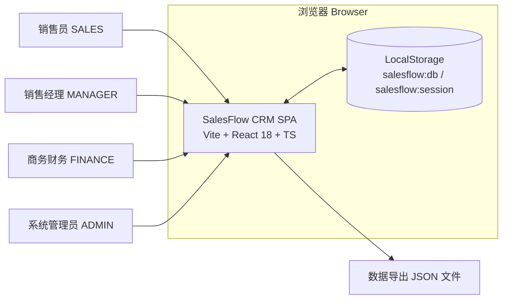
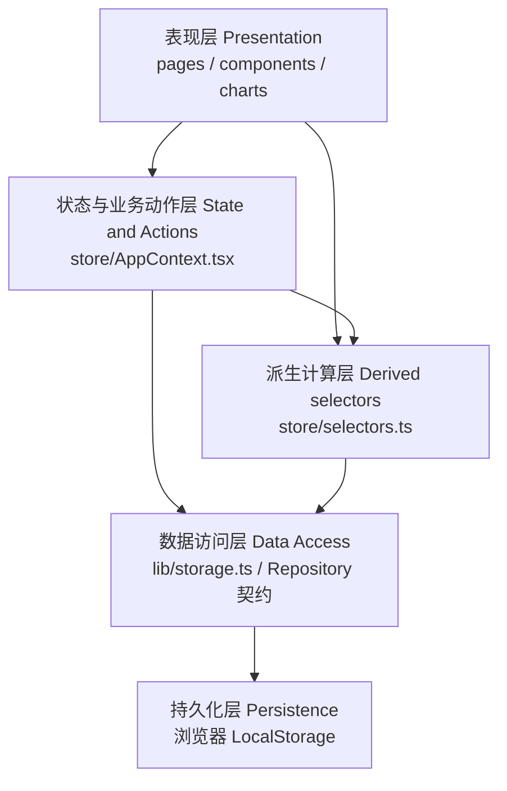
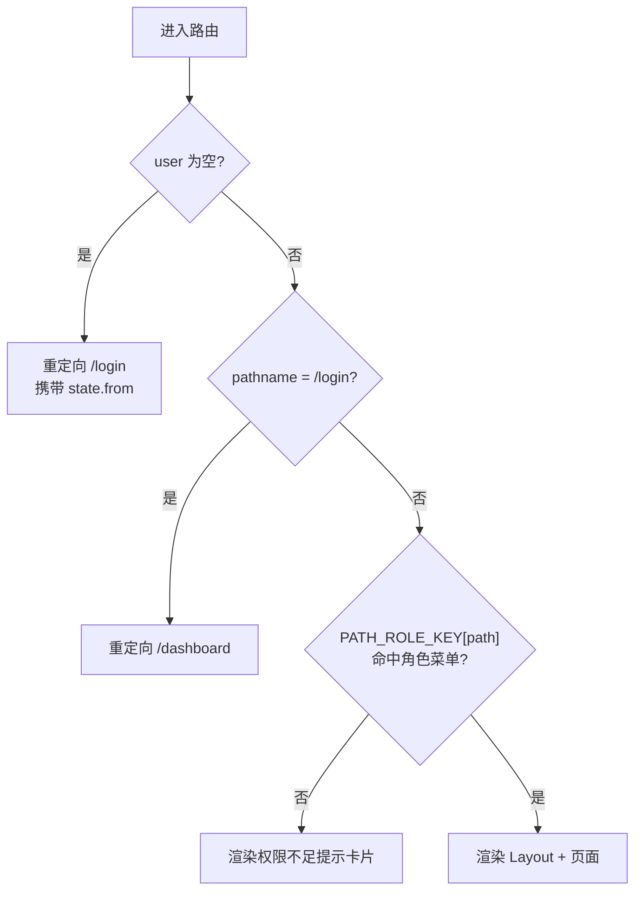
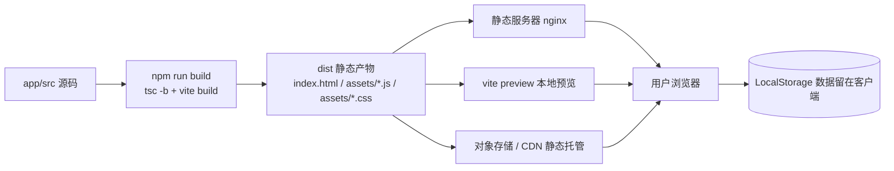

# 总体架构设计说明书

| 项 | 内容 |
|---|---|
| 文档编号 | SFS-CRM-AR-01 |
| 项目名称 | SalesFlow 智销云 · 销售全流程管理平台（SalesFlow CRM） |
| 版本 | v1.0 |
| 编写日期 | 2026-10-09 |
| 状态 | 已评审通过 |

**版本变更历史**

| 版本 | 日期 | 修订人 | 修订说明 |
|---|---|---|---|
| v0.1 | 2026-10-05 | 架构组 | 分层架构与上下文初稿 |
| v0.7 | 2026-10-07 | 架构组 | 补充权限模型与 ADR |
| v1.0 | 2026-10-09 | 架构组 | 按评审意见补充质量属性与部署架构 |

---

## 1. 引言

### 1.1 编写目的

本文档定义 SalesFlow CRM 的总体架构：系统边界、分层结构、路由与页面组织、状态管理方案、权限模型、关键设计决策（ADR）、质量属性实现策略与部署架构，作为《详细设计说明书》《API 接口设计说明书》《模块实现说明》的上位约束与编码实现的架构基线。

### 1.2 适用范围

适用于 PC Web 端单页应用（SPA）前端全部代码（`app/src`），覆盖 L2C 业务闭环的 10 个页面与 14 个领域实体。本期不含服务端。

### 1.3 参考文档

| 编号 | 文档 |
|---|---|
| SFS-CRM-SRS | 《软件需求规格说明书》 |
| SFS-CRM-DB-01 | 《数据库设计说明书》 |
| SFS-CRM-API-01 | 《API 接口设计说明书》 |
| SFS-CRM-DD-01 | 《详细设计说明书》 |
| SFS-CRM-UI-01 | 《UI 设计规范与组件说明》 |

---

## 2. 架构设计目标与非功能约束映射

架构目标直接来自 SRS 第 4 章非功能需求，并逐条落到具体架构手段上，保证"目标—手段—验收"可追溯。

| 目标编号 | 架构目标 | 对应 NFR | 架构实现手段 | 落地位置 |
|---|---|---|---|---|
| G-01 | 零后端即可完整演示 L2C 闭环 | 2.5 设计约束 1 | 数据全部驻留浏览器，持久化依赖 LocalStorage，启动即装载演示数据 | `lib/storage.ts`、`data/seed.ts` |
| G-02 | 数据变更即时落盘，刷新不丢失 | NFR-R-01 | 统一事务包装 `commit`：修改 → `saveDb` → 失败提示 | `store/AppContext.tsx` |
| G-03 | 写入失败不得静默 | NFR-R-02 | `saveDb` 抛出 `StorageError`，`commit` 捕获后 Toast 提示并保留内存态 | `lib/storage.ts` |
| G-04 | 业务规则集中配置，禁止组件硬编码 | NFR-M-01 | 常量与阈值统一放 `config/businessRules.ts`，组件只读取不定义 | `config/businessRules.ts` |
| G-05 | 组件与业务逻辑分离、状态集中化 | NFR-M-02 | 页面只做展示与调用；全部业务动作收敛在 `AppContext`；派生计算收敛在 `selectors` | `store/AppContext.tsx`、`store/selectors.ts` |
| G-06 | 全量类型覆盖 | NFR-M-03 | TypeScript `strict` + `noUnusedLocals` + `noUnusedParameters`，领域模型集中定义 | `types.ts`、`tsconfig.json` |
| G-07 | 未登录不得访问受保护页 | NFR-S-01 | 路由守卫：无 `user` 一律重定向 `/login` | `App.tsx` |
| G-08 | 越权操作前端拦截并提示 | NFR-S-02 | 菜单过滤 + 路径级拦截 + 动作内角色校验三重防线 | `App.tsx`、`components/Layout.tsx`、`store/AppContext.tsx` |
| G-09 | 列表查询与拖拽响应及时 | NFR-P-02/P-03 | 派生结果 `useMemo` 缓存；拖拽用 `useRef` 暂存拖拽项，避免额外渲染 | 各页面、`pages/Opportunities.tsx` |
| G-10 | 构建产物为纯静态文件 | NFR-T-03 | Vite 构建输出 `dist`，可部署任意静态服务器 | `vite.config.ts` |

---

## 3. 系统上下文

系统边界内只有一个交付物——运行在浏览器中的 SPA；边界外只有两类交互方：使用者（四种角色）与浏览器提供的 LocalStorage 持久化介质。本期没有任何服务端、第三方服务或外部系统通信。

| 边界要素 | 说明 |
|---|---|
| 角色用户 | 通过 `/login` 建立会话，会话写入 `salesflow:session`，记录 `userId` 与 `loginAt` |
| SPA | 承担全部表现、业务规则、数据访问逻辑；进程内维护完整 `Database` 对象 |
| LocalStorage | 唯一持久化介质。业务数据键 `salesflow:db`（整库 JSON），会话键 `salesflow:session` |
| 导出文件 | 管理员可导出全量 JSON 至本地磁盘，属单向出口，不回写系统 |

---

## 4. 分层架构

### 4.1 分层视图

### 4.2 各层职责

| 层 | 目录 | 职责 | 禁止事项 |
|---|---|---|---|
| 表现层 | `pages/*`、`components/*` | 页面布局、表单采集、列表/看板/图表渲染、调用动作层方法、展示 Toast | 不得直接读写 LocalStorage；不得定义业务阈值；不得绕过动作层修改 `db` |
| 状态与业务动作层 | `store/AppContext.tsx` | 持有 `Database` 与会话态；实现全部业务动作；执行前置条件与业务规则校验；统一落盘与审计日志 | 不得包含 JSX 展示逻辑 |
| 派生计算层 | `store/selectors.ts` | 数据可见性过滤、工作台统计、漏斗、排行、月度趋势、来源分布等只读计算 | 不得修改状态；不做持久化 |
| 数据访问层 | `lib/storage.ts` | 封装 LocalStorage 读写、会话读写、异常封装（`StorageError`） | 不含业务规则 |
| 持久化层 | 浏览器 LocalStorage | 键值存储 | — |

### 4.3 依赖方向规则

1. 依赖只能向下：表现层可依赖动作层与派生层，动作层可依赖派生层与数据访问层，反向依赖禁止；
2. 跨层向下跳级被禁止：页面不得直接引用 `lib/storage.ts`（当前代码中页面仅通过 `useApp()` 获取动作，符合约束）；
3. 领域模型 `types.ts` 与规则常量 `config/businessRules.ts` 为"横切可依赖"模块，允许各层引用，但二者不依赖任何上层；
4. 数据访问层以 Repository 契约为抽象（《数据库设计说明书》6.2），未来替换为 HTTP 实现时，动作层与表现层零改动。

---

## 5. 前端路由与页面结构

路由由 `react-router-dom` v6 的 `BrowserRouter` + `Routes` 定义，全部集中在 `App.tsx`；路由与角色权限的映射由 `PATH_ROLE_KEY` 与 `ROLE_MENUS` 联合决定。

| 路径 | 页面组件 | 功能 | 可访问角色 |
|---|---|---|---|
| `/login` | `pages/Login` | 账号登录、演示账号一键登录 | 全部（未登录可访问） |
| `/dashboard` | `pages/Dashboard` | 工作台：统计卡片、今日待跟进、待我审批、漏斗、回款进度、最近动态 | SALES / MANAGER / FINANCE / ADMIN |
| `/leads` | `pages/Leads` | 线索列表、新建、批量分配、跟进、转化、废弃、来源分布 | SALES / MANAGER / ADMIN |
| `/customers` | `pages/Customers` | 客户列表与客户 360 抽屉（基础信息/联系人/商机/订单/回款/日志） | SALES / MANAGER / ADMIN |
| `/opportunities` | `pages/Opportunities` | 商机看板（拖拽推进）、已关闭列表、商机详情、新建、赢单/输单 | SALES / MANAGER / ADMIN |
| `/quotations` | `pages/Quotations` | 报价单列表、新建、提交审批、审批中心、详情与审批链可视化 | SALES / MANAGER / ADMIN |
| `/orders` | `pages/Orders` | 订单列表、由报价生成订单、商务审核、状态推进、回款计划与记录 | SALES / MANAGER / FINANCE / ADMIN |
| `/payments` | `pages/Payments` | 回款计划、登记回款、财务到账确认、开票 | SALES / MANAGER / FINANCE / ADMIN |
| `/analytics` | `pages/Analytics` | 数据看板：漏斗、业绩排行、12 月趋势、来源分布、赢输单分析 | SALES / MANAGER / FINANCE / ADMIN |
| `/admin` | `pages/Admin` | 用户管理、产品目录、数据字典、数据概览、导出与重置 | ADMIN |
| `*` | — | 兜底重定向至 `/dashboard` | 已登录用户 |

**路由守卫规则（NFR-S-01 / NFR-S-02）**

说明：`ROLE_MENUS.FINANCE` 仅含 `dashboard/orders/payments/analytics`，因此财务角色直接输入 `/leads` 会被拦截；`admin` 仅 ADMIN 可见，且 `pages/Admin` 内部再做一次 `user?.role !== 'ADMIN'` 兜底校验（双重防线）。

---

## 6. 状态管理方案选型

### 6.1 候选方案对比

| 维度 | React Context + useState（选用） | Redux Toolkit | Zustand |
|---|---|---|---|
| 引入依赖 | 无，React 内置 | 需额外依赖 + 中间件 | 需额外依赖 |
| 代码量 | 1 个 Provider + 1 个 hook | action / reducer / slice / 样板较多 | 极少 |
| 与本期数据规模匹配度 | 单库 JSON，实体 14 个、千级记录，内存态整体替换即可 | 过度设计 | 合适但非必需 |
| 业务动作组织 | 以 `useCallback` 暴露具名方法，语义直观 | 需 dispatch + type 常量 | 直接定义函数 |
| 选择器与渲染优化 | 配合 `useMemo` 与派生层即可 | `reselect` 需额外引入 | 自带 selector |
| 教学演示可读性 | 高，全部状态与动作集中在一个文件 | 概念多，答辩解释成本高 | 中等 |
| 迁移后端成本 | 动作层方法签名可 1:1 映射为 REST 调用 | 同 | 同 |

### 6.2 选型理由

1. **规模匹配**：单库全量内存态，一次操作即整体替换 `Database`，无细粒度订阅需求，Redux 的细粒度更新优势无法发挥；
2. **约束满足**：NFR-M-02 要求"状态管理集中化"，Context Provider 天然把状态与动作集中到 `AppContext`，反而比分散的 slice 更集中；
3. **类型安全**：动作签名直接写在 `interface AppCtx` 上，TypeScript 全量推导，无需为 dispatch 定义联合类型；
4. **可迁移性**：动作层方法名即未来 REST 的业务语义边界（见《API 接口设计说明书》第 3 章），替换为 HTTP 实现时仅改内部实现；
5. **零依赖**：符合 NFR-T-02 一键启动与演示版定位，依赖越少环境风险越低。

**代价与缓解**：Context 的 value 变化会引起所有消费者重渲染。缓解措施为——页面内所有派生计算使用 `useMemo`，`AppContext` 暴露的动作全部以 `useCallback` 稳定引用，拖拽等高频交互使用 `useRef` 而非 state。

---

## 7. 权限模型设计

权限模型分四层，逐层收紧，任何一层不通过即拒绝。

### 7.1 四层模型

| 层级 | 控制对象 | 实现位置 | 失败表现 |
|---|---|---|---|
| L1 角色 | `Role = SALES / MANAGER / FINANCE / ADMIN` | `types.ts`、`AppContext.login` | 停用账号拒绝登录 |
| L2 菜单 | `ROLE_MENUS[role]` 决定侧边导航项 | `Layout.tsx` 过滤 `MENUS`；`App.tsx` 路径级拦截 | 菜单不渲染；直接输 URL 显示"权限不足"卡片 |
| L3 按钮 | 页面内按角色/归属/审批层级显示操作按钮 | 各页面条件渲染 + 动作层二次校验 | 按钮不渲染；动作层校验失败 Toast 提示 |
| L4 数据可见范围 | `selectors.ts` 的 `visible*` 函数 | 页面统一调用 | 数据不出现在列表与统计中 |

### 7.2 L2 菜单矩阵

| 菜单 key | SALES | MANAGER | FINANCE | ADMIN |
|---|---|---|---|---|
| dashboard | ✓ | ✓ | ✓ | ✓ |
| leads | ✓ | ✓ | — | ✓ |
| customers | ✓ | ✓ | — | ✓ |
| opportunities | ✓ | ✓ | — | ✓ |
| quotations | ✓ | ✓ | — | ✓ |
| orders | ✓ | ✓ | ✓ | ✓ |
| payments | ✓ | ✓ | ✓ | ✓ |
| analytics | ✓ | ✓ | ✓ | ✓ |
| admin | — | — | — | ✓ |

### 7.3 L3 按钮级规则（摘录）

| 按钮 | 显示条件 | 动作层二次校验 |
|---|---|---|
| 批量分配线索 | `role ∈ {MANAGER, ADMIN}` 且已勾选 | `ids.length > 50` 拒绝："一次最多分配 50 条线索" |
| 提交报价 | `q.createdBy === user.id` 且状态 ∈ {DRAFT, REJECTED} | 过期拒绝："报价已过期，请更新有效期后再提交" |
| 审批通过/驳回 | `approvalChain` 中 `step === currentStep` 且 `approverId === user.id` | 不匹配拒绝："权限不足：当前审批层级不归您处理（NFR-S-02）" |
| 商务审核 | `role === FINANCE` 且订单状态 PENDING | 角色不符拒绝："权限不足：仅商务财务可执行商务审核（NFR-S-02）" |
| 确认回款到账 | `role === FINANCE` 且回款状态 REGISTERED | 角色不符拒绝："权限不足：仅商务财务可确认回款到账（NFR-S-02）" |
| 开票 | `role === FINANCE` 且已确认、未开票 | 发票号为空拒绝："请填写发票号" |
| 导出/重置数据 | `role === ADMIN` | Admin 页面内角色兜底校验 |

### 7.4 L4 数据可见范围（selectors）

| 函数 | SALES | MANAGER | FINANCE | ADMIN |
|---|---|---|---|---|
| `visibleLeads` | `ownerId === self` 或 `ownerId == null` | 同部门成员 + 未分配 | 空集合 | 全部 |
| `visibleCustomers` | 归属自己 | 同部门成员 | 全部（无归属限制） | 全部 |
| `visibleOpportunities` | 归属自己 | 同部门成员 | 仅 `status === 'WON'` | 全部 |
| `visibleQuotations` | `createdBy === self` | 同部门成员创建 | `createdBy === self` | 全部 |
| `visibleOrders` | 归属自己 | 同部门成员 | 全部 | 全部 |
| `visiblePlans` | 由 `visibleOrders` 的订单集合推导 | 同 | 全部订单的计划 | 全部 |
| `pendingMyApproval` | 审批链当前层级审批人为本人 | 同 | 同 | 同 |

同部门判定由 `deptMemberIds(db, user)` 完成：`db.users.filter(u => u.dept === user.dept)`。通用判定函数 `visible()` 的优先级为：ADMIN 直通 → 角色白名单直通 → `ownerId` 为空即不可见 → MANAGER 按部门 → 其余按本人归属。

---

## 8. 关键设计决策记录（ADR）

### ADR-01：采用 LocalStorage 作为唯一持久化介质

- **背景**：SRS 2.5 要求本期为 SPA，不依赖后端即可完整演示；验收需要全新环境一键启动。
- **决策**：整库 JSON 序列化后写入单一键 `salesflow:db`，读取时整体反序列化为 `Database`。
- **理由**：零部署成本、演示可重复、与后端解耦；数据量 < 5MB，全量覆盖写性能可接受。
- **影响/权衡**：无并发与事务能力，多标签页同时操作会互相覆盖；容量受限，需提供导出与重置兜底（已实现）。

### ADR-02：业务规则集中配置

- **背景**：NFR-M-01 明确禁止组件硬编码阈值。
- **决策**：阶段赢率、审批阈值、客户等级阈值、回款计划模板、枚举字典、状态展示字典统一置于 `config/businessRules.ts`。
- **理由**：规则变更只改一处；页面可把规则直接渲染为提示文案（如报价页标题动态展示审批阈值）。
- **影响/权衡**：常量文件成为高频依赖，需保持无副作用、纯数据。

### ADR-03：审批链快照化内嵌于报价单

- **背景**：审批过程中人员可能调岗、离职，若审批链只存角色则该单据历史不可追溯。
- **决策**：`Quotation.approvalChain` 内嵌 `{step, approverId, approverName, approverRole, status, comment, at}` 数组，创建时按规则构建并固化。
- **理由**：单据自包含，审批人身份以"当时的快照"为准，历史可审计。
- **影响/权衡**：人员变更不影响在途单据（符合预期），但需要在创建时一次性确定审批人，若审批人缺失则链会退化为一级或空链。

### ADR-04：报价明细做产品与价格快照

- **背景**：产品目录调价后，历史报价单金额若联动变化将失真。
- **决策**：`QuotationItem` 冗余保存 `productName / spec / unit / price`，不回查产品表。
- **理由**：保证历史报价可复核、可审计。
- **影响/权衡**：存在数据冗余，但只读快照永不更新，冗余可控。

### ADR-05：审计数据只增不删

- **背景**：SRS 5.2 与 BR-10 要求阶段历史、审批记录、操作日志不允许物理删除。
- **决策**：`stageHistories`、`approvalRecords` 每次动作仅 `unshift` 新记录；`activityLogs` 同理并截断至最近 200 条；数据访问层不提供针对三者的删除动作。
- **理由**：满足审计追溯与责任认定。
- **影响/权衡**：`activityLogs` 容量受限，故采用"保留最近 200 条"的滚动窗口策略。

### ADR-06：状态管理选用 Context + useState

- **背景**：见第 6 章选型对比。
- **决策**：单一 `AppProvider` 持有 `db / user / toasts`，以具名方法暴露 24 个业务动作。
- **理由**：零依赖、语义集中、类型完备、易讲解。
- **影响/权衡**：需靠 `useMemo` / `useCallback` 控制重渲染；超大数据量下需引入分片订阅。

### ADR-07：整库单键存储而非分实体多键

- **背景**：《数据库设计说明书》1.2 节原设计按实体分 key（`salesflow:{entity}`）。
- **决策**：实现上采用单一键 `salesflow:db` 保存完整 `Database`，保留 `version` 字段供迁移。
- **理由**：一次 `JSON.stringify` 即可保证跨实体一致性（见 ADR-08 事务），避免多键写入中途失败造成半一致。
- **影响/权衡**：单次写入体积更大；已在导出/重置与容量提示中做兜底。该偏差已在《数据库设计说明书》与本文档同步标注。

### ADR-08：所有写操作统一走 `commit` 事务包装

- **背景**：NFR-R-01/R-02 要求即时落盘且失败不静默。
- **决策**：`commit(mutator)` 接收一个对 draft 的修改函数，先浅拷贝 `Database`，执行 mutator，再 `saveDb`；`saveDb` 抛错时延迟 Toast 提示，内存态仍然返回。
- **理由**：落盘与状态更新原子绑定，业务代码无需关心持久化；异常处理集中一处。
- **影响/权衡**：draft 为浅拷贝，mutator 内必须整体替换数组或对象，禁止原地 `push`（代码已遵循）。

### ADR-09：自研 SVG 图表，不引入第三方图表库

- **背景**：FR-09 需要漏斗、折线、环形、条形四类图表；引入 ECharts/Recharts 会显著增加包体与依赖。
- **决策**：`components/charts` 内以原生 SVG 与 CSS 实现 `FunnelChart / LineChart / PieChart / BarRanking / MiniBars`。
- **理由**：图表语义简单、数据量小；可控样式与主题；零依赖。
- **影响/权衡**：无缩放、导出、动画等高级能力，交互以 `<title>` 悬浮提示替代。

### ADR-10：PC 优先，不做移动端适配

- **背景**：SRS 2.4 明确 PC 优先，分辨率 ≥ 1440×900；Q-03 已列入待定。
- **决策**：布局采用固定 224px 侧边栏 + 右侧内容区，表格 `min-w-[720px]` 横向滚动兜底。
- **理由**：聚焦 PC 场景，避免响应式带来的样式分支膨胀。
- **影响/权衡**：小屏体验降级，仅保证不破版。

---

## 9. 质量属性设计

### 9.1 性能

| NFR | 策略 |
|---|---|
| NFR-P-01 首屏 ≤ 2s | 依赖精简（运行时仅 React + React Router），Tailwind 原子类无运行时；首屏仅装载一次 LocalStorage |
| NFR-P-02 列表查询 ≤ 500ms | 过滤在内存数组中完成；页面用 `useMemo` 缓存筛选与派生结果，避免每次渲染重算 |
| NFR-P-03 拖拽 ≤ 100ms | 拖拽项存于 `useRef`（`draggingRef`），`dragOver` 状态仅用于高亮列，落点校验调用 `moveStage` 同步返回 |
| NFR-P-04 万级数据 | 派生计算为 O(n) 单次遍历；`selectors` 内采用 `Set` / `Map` 做关联过滤，避免嵌套循环 |

### 9.2 可靠性

| NFR | 策略 |
|---|---|
| NFR-R-01 即时落盘 | 每个业务动作内部调用 `commit`，`setDb` 与 `saveDb` 成对出现 |
| NFR-R-02 失败不静默 | `saveDb` 捕获 `localStorage.setItem` 异常并包装为 `StorageError`，提示语含"容量已满，请导出备份后重置" |
| NFR-R-03 一键恢复 | Admin 页"重置演示数据"`clearDb` 后重建 seed；"导出数据 JSON"生成 `salesflow-data-{date}.json` |

### 9.3 安全性

| NFR | 策略 |
|---|---|
| NFR-S-01 未登录重定向 | `App.tsx` 顶层守卫，携带 `state.from` |
| NFR-S-02 越权拦截 | 菜单过滤 + 路径拦截 + 动作层角色校验三层；提示统一标注 NFR 编号便于追溯 |
| NFR-S-03 密码掩码 | 登录框 `type="password"` |
| NFR-S-04 敏感操作留痕 | `log(action, target)` 记录操作人、姓名、动作、对象、时间；审批动作另写 `approvalRecords` |
| 数据脱敏 | 列表手机号使用 `maskPhone` 输出 `138****8888` |

### 9.4 可维护性

| NFR | 策略 |
|---|---|
| NFR-M-01 | 全部阈值、枚举、模板集中在 `config/businessRules.ts` |
| NFR-M-02 | 五层单向依赖（见 4.3）；页面不含业务规则判断，仅展示与调用 |
| NFR-M-03 | `tsconfig` 开启 `strict`、`noUnusedLocals`、`noUnusedParameters`、`noFallthroughCasesInSwitch`；`npm run typecheck` 可独立执行 |
| NFR-M-04 | 目标为单文件 ≤ 300 行；组件按"页面 + 私有子组件"拆分，UI 原子集中于 `components/ui`。当前 `AppContext.tsx`、`seed.ts` 及部分页面超出该上限，已登记为待重构项（见《模块实现说明》第 6 章） |

### 9.5 可移植性

| NFR | 策略 |
|---|---|
| NFR-T-01 | 仅使用标准 DOM / LocalStorage API，无浏览器私有特性 |
| NFR-T-02 | `npm install && npm run dev`；脚本 `dev / build / preview / typecheck` |
| NFR-T-03 | 构建输出 `dist` 纯静态文件（HTML + JS + CSS） |

---

## 10. 技术栈与依赖清单

| 类别 | 名称 | 版本 | 用途 |
|---|---|---|---|
| 运行时依赖 | react | ^18.3.1 | UI 框架 |
| 运行时依赖 | react-dom | ^18.3.1 | DOM 渲染 |
| 运行时依赖 | react-router-dom | ^6.26.2 | 前端路由 |
| 构建工具 | vite | ^5.4.8 | 开发服务器与构建 |
| 构建插件 | @vitejs/plugin-react | ^4.3.2 | React JSX 转换与热更新 |
| 语言 | typescript | ^5.6.2 | 类型系统 |
| 样式 | tailwindcss | ^3.4.13 | 原子化 CSS |
| 样式 | postcss | ^8.4.47 | CSS 处理 |
| 样式 | autoprefixer | ^10.4.20 | 浏览器前缀 |
| 类型声明 | @types/react | ^18.3.11 | React 类型 |
| 类型声明 | @types/react-dom | ^18.3.1 | React DOM 类型 |
| 运行环境 | Node.js | ≥ 20 | 构建与开发服务器 |
| 运行环境 | 浏览器 | Chrome / Edge / Firefox 最新两个大版本 | 客户端 |

**主题与工程约定**：`tailwind.config.js` 扩展品牌色 `brand`（主色 `#2544eb`）与中性色 `ink`（900 为 `#1c2027`），阴影 `shadow-card` / `shadow-pop`；`index.css` 定义 `.num` 类（`font-variant-numeric: tabular-nums`）保证金额数字等宽对齐；路径别名 `@` → `src`（`vite.config.ts` 与 `tsconfig.json` 同步配置）。

---

## 11. 部署架构

### 11.1 构建与运行

### 11.2 部署要点

| 项 | 说明 |
|---|---|
| 构建命令 | `npm run build`（先 `tsc -b` 类型检查，再 `vite build`）；失败即中断，保证产物类型安全 |
| 产物 | `app/dist`，纯静态；`sourcemap: false`，`chunkSizeWarningLimit: 1200` |
| 服务器要求 | 任意静态服务器。因使用 `BrowserRouter`，**必须配置 history fallback**（未知路径回退 `index.html`），否则刷新子路由会 404 |
| nginx 示例 | `try_files $uri $uri/ /index.html;` |
| 数据位置 | 数据存放于各客户端 LocalStorage，服务端无状态；多用户之间数据不互通（演示版预期行为） |
| 环境差异 | 无需环境变量；部署后首次访问自动装载演示数据 |
| 回滚 | 静态产物整体替换即可回滚；数据回滚由 Admin 页"重置演示数据"完成 |

---

**评审记录**

| 角色 | 意见 | 日期 |
|---|---|---|
| 架构师 | 同意通过 | 2026-10-09 |
| 项目经理 | 同意通过 | 2026-10-09 |
