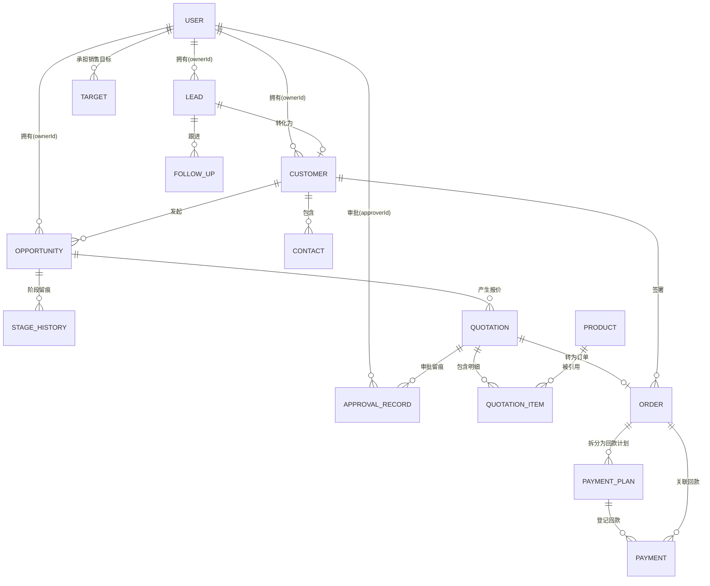

# 数据库设计说明书

| 项 | 内容 |
|---|---|
| 文档编号 | SFS-CRM-DB-01 |
| 项目名称 | SalesFlow 智销云 · 销售全流程管理平台 |
| 版本 | v1.0 |
| 编写日期 | 2026-10-09 |
| 状态 | 已评审通过 |

**版本变更历史**

| 版本 | 日期 | 修订人 | 修订说明 |
|---|---|---|---|
| v0.1 | 2026-10-04 | 设计组 | 概念模型初稿，14 个实体 |
| v0.6 | 2026-10-06 | 设计组 | 补充审批记录与阶段历史的审计字段 |
| v1.0 | 2026-10-08 | 设计组 | 按设计评审意见补充索引与约束定义 |

---

## 1. 引言

### 1.1 编写目的

本文档定义 SalesFlow CRM 的数据模型，包括概念模型（ER）、逻辑表结构、字段约束、枚举字典、完整性约束与存储方案，作为编码实现与测试用例设计的依据。

### 1.2 存储方案说明

本期系统为纯前端单页应用，数据持久化采用浏览器 **LocalStorage**，以 JSON 文档形式按实体分 key 存储。逻辑上仍严格遵循关系模型设计，实体间通过外键字段关联，由数据访问层（Repository）维护引用完整性。此设计保证后续迁移至关系型数据库或 REST 后端时，表结构可零改动复用。

- 存储前缀：`salesflow:`
- 单实体存储键：`salesflow:{entity}`，值为实体数组 JSON
- 写入策略：全量覆盖写（数据量 < 5MB，性能可接受）
- 迁移字段：`version`，用于未来数据结构升级时做兼容处理

---

## 2. 概念模型

### 2.1 实体关系图



### 2.2 实体清单

| 序号 | 实体 | 中文名 | 说明 | 预估规模 |
|---|---|---|---|---|
| 1 | `user` | 用户 | 系统操作者与销售组织成员 | 8 |
| 2 | `lead` | 线索 | 销售漏斗最前端的原始商机信息 | 24 |
| 3 | `follow_up` | 跟进记录 | 线索的跟进过程留痕 | 60+ |
| 4 | `customer` | 客户 | 正式建档的企业主体 | 12 |
| 5 | `contact` | 联系人 | 客户方的对接人 | 20 |
| 6 | `opportunity` | 商机 | 有金额与阶段的核心业务对象 | 15 |
| 7 | `stage_history` | 阶段历史 | 商机阶段变更审计流水 | 40+ |
| 8 | `product` | 产品 | 可报价的产品目录 | 12 |
| 9 | `quotation` | 报价单 | 面向客户的价格方案 | 10 |
| 10 | `quotation_item` | 报价明细 | 报价单的产品行项 | 25 |
| 11 | `approval_record` | 审批记录 | 审批链每一级的处理留痕 | 15 |
| 12 | `order` | 合同订单 | 正式销售合同 | 7 |
| 13 | `payment_plan` | 回款计划 | 订单的分期收款安排 | 18 |
| 14 | `payment` | 回款记录 | 实际收款流水 | 9 |
| 15 | `target` | 销售目标 | 销售人员的业绩目标 | 4 |

---

## 3. 逻辑表结构

> 类型说明：`PK` 主键，`FK` 外键，`NN` 非空，`UQ` 唯一。
> 金额字段统一以**元**为单位（保留 2 位小数），计算时使用整数分以避免浮点误差。

### 3.1 user（用户表）

| 字段 | 类型 | 约束 | 说明 |
|---|---|---|---|
| id | STRING | PK | 用户唯一标识，如 `U001` |
| username | STRING | NN, UQ | 登录账号 |
| password | STRING | NN | 登录口令（演示系统明文，生产须加密） |
| name | STRING | NN | 真实姓名 |
| role | ENUM | NN | `SALES`/`MANAGER`/`FINANCE`/`ADMIN` |
| title | STRING | | 岗位职称，如"销售总监"，用于二级审批人匹配 |
| dept | STRING | NN | 所属部门 |
| phone | STRING | | 联系电话 |
| avatar | STRING | | 头像文字（取姓名首字） |
| status | ENUM | NN | `ACTIVE`/`DISABLED` |
| createdAt | DATETIME | NN | 创建时间 |

### 3.2 lead（线索表）

| 字段 | 类型 | 约束 | 说明 |
|---|---|---|---|
| id | STRING | PK | 线索编号 `L2026xxxx` |
| companyName | STRING | NN | 公司名称 |
| contactName | STRING | NN | 联系人姓名 |
| phone | STRING | NN | 联系电话 |
| source | ENUM | NN | 来源：官网表单/展会名录/电话咨询/客户转介绍/广告投放/其他 |
| industry | STRING | | 所属行业 |
| level | ENUM | NN | 意向等级 `HIGH`/`MID`/`LOW` |
| status | ENUM | NN | `NEW`/`FOLLOWING`/`CONVERTED`/`LOST` |
| ownerId | STRING | FK→user.id | 归属销售，`NEW` 状态时可为空 |
| remark | TEXT | | 备注 |
| lostReason | STRING | | 废弃原因（status=LOST 时必填） |
| createdBy | STRING | FK→user.id | 创建人 |
| createdAt | DATETIME | NN | 创建时间 |
| nextFollowAt | DATE | | 下次跟进日期（冗余字段，便于工作台查询） |
| convertedAt | DATETIME | | 转化时间 |

### 3.3 follow_up（跟进记录表）

| 字段 | 类型 | 约束 | 说明 |
|---|---|---|---|
| id | STRING | PK | 记录编号 |
| leadId | STRING | FK→lead.id, NN | 所属线索 |
| type | ENUM | NN | 电话/拜访/邮件/微信/其他 |
| content | TEXT | NN | 跟进内容 |
| result | STRING | | 跟进结果 |
| nextFollowAt | DATE | | 下次跟进时间 |
| createdBy | STRING | FK→user.id, NN | 跟进人 |
| createdAt | DATETIME | NN | 跟进时间 |

**业务规则**：插入跟进记录时同步更新 `lead.status = FOLLOWING`、`lead.nextFollowAt`。

### 3.4 customer（客户表）

| 字段 | 类型 | 约束 | 说明 |
|---|---|---|---|
| id | STRING | PK | 客户编号 `C2026xxxx` |
| name | STRING | NN, UQ | 客户名称（唯一，防止重复建档） |
| industry | STRING | | 行业 |
| level | ENUM | NN | 客户等级 `A`/`B`/`C` |
| levelAuto | BOOLEAN | NN | 等级是否由系统自动评定（false 表示人工覆盖） |
| source | STRING | | 客户来源 |
| ownerId | STRING | FK→user.id, NN | 归属销售 |
| address | STRING | | 详细地址 |
| website | STRING | | 官网 |
| totalAmount | DECIMAL(12,2) | NN | 累计成交金额（由已确认回款汇总） |
| createdAt | DATETIME | NN | 建档时间 |
| leadId | STRING | FK→lead.id | 来源线索 |

### 3.5 contact（联系人表）

| 字段 | 类型 | 约束 | 说明 |
|---|---|---|---|
| id | STRING | PK | 联系人编号 |
| customerId | STRING | FK→customer.id, NN | 所属客户 |
| name | STRING | NN | 姓名 |
| title | STRING | | 职位 |
| phone | STRING | | 手机 |
| email | STRING | | 邮箱 |
| isPrimary | BOOLEAN | NN | 是否主联系人（每客户至多一个） |

### 3.6 opportunity（商机表）—— 核心业务对象

| 字段 | 类型 | 约束 | 说明 |
|---|---|---|---|
| id | STRING | PK | 商机编号 `O2026xxxx` |
| title | STRING | NN | 商机标题 |
| customerId | STRING | FK→customer.id, NN | 关联客户 |
| customerName | STRING | NN | 客户名称冗余（列表展示用） |
| amount | DECIMAL(12,2) | NN | 商机预估金额 |
| stage | ENUM | NN | `S1`/`S2`/`S3`/`S4`/`S5` |
| probability | INT | NN | 赢率百分比，随阶段联动（10/30/60/80/100） |
| expectedCloseDate | DATE | NN | 预计成交日 |
| ownerId | STRING | FK→user.id, NN | 归属销售 |
| ownerName | STRING | NN | 归属人姓名冗余 |
| source | STRING | | 商机来源 |
| status | ENUM | NN | `OPEN`/`WON`/`LOST` |
| lostReason | STRING | | 输单原因 |
| competitor | STRING | | 竞品名称 |
| actualAmount | DECIMAL(12,2) | | 实际成交金额（赢单时填写） |
| closedAt | DATETIME | | 关闭时间 |
| createdAt | DATETIME | NN | 创建时间 |

**约束**：同一 `customerId` 下 `status = OPEN` 的商机至多 1 个（撞单校验，允许人工确认后放行）。

### 3.7 stage_history（商机阶段历史表）

| 字段 | 类型 | 约束 | 说明 |
|---|---|---|---|
| id | STRING | PK | 记录编号 |
| opportunityId | STRING | FK→opportunity.id, NN | 关联商机 |
| fromStage | ENUM | | 原阶段（创建时可为空） |
| toStage | ENUM | NN | 新阶段 |
| operatorId | STRING | FK→user.id, NN | 操作人 |
| operatorName | STRING | NN | 操作人姓名 |
| remark | TEXT | | 备注 |
| createdAt | DATETIME | NN | 变更时间 |

**业务规则**：审计数据，禁止物理删除。

### 3.8 product（产品表）

| 字段 | 类型 | 约束 | 说明 |
|---|---|---|---|
| id | STRING | PK | 产品编号 `P001` |
| name | STRING | NN | 产品名称 |
| spec | STRING | | 规格型号 |
| unit | STRING | NN | 单位（套/台/年/次） |
| price | DECIMAL(12,2) | NN | 标准单价 |
| category | STRING | NN | 产品分类 |
| status | ENUM | NN | `ON_SALE`/`OFF_SALE` |

### 3.9 quotation（报价单表）

| 字段 | 类型 | 约束 | 说明 |
|---|---|---|---|
| id | STRING | PK | 报价单编号 `Q2026xxxx` |
| opportunityId | STRING | FK→opportunity.id, NN | 关联商机 |
| customerId | STRING | FK→customer.id, NN | 关联客户 |
| customerName | STRING | NN | 客户名称冗余 |
| totalAmount | DECIMAL(12,2) | NN | 报价总额（原价合计） |
| discountAmount | DECIMAL(12,2) | NN | 折后金额 |
| discountRate | DECIMAL(5,4) | NN | 整体折扣率 0~1 |
| validUntil | DATE | NN | 报价有效期 |
| payMethod | STRING | | 付款方式 |
| status | ENUM | NN | `DRAFT`/`APPROVING`/`APPROVED`/`REJECTED`/`CONVERTED`/`EXPIRED` |
| approvalChain | JSON | NN | 审批链：`[{step, role, approverId, approverName, status, comment, at}]` |
| currentStep | INT | NN | 当前审批层级，0 表示未开始 |
| createdBy | STRING | FK→user.id, NN | 创建人 |
| createdAt | DATETIME | NN | 创建时间 |
| remark | TEXT | | 备注 |

### 3.10 quotation_item（报价明细表）

| 字段 | 类型 | 约束 | 说明 |
|---|---|---|---|
| id | STRING | PK | 明细编号 |
| quotationId | STRING | FK→quotation.id, NN | 所属报价单 |
| productId | STRING | FK→product.id, NN | 产品 |
| productName | STRING | NN | 产品名称快照 |
| spec | STRING | | 规格快照 |
| unit | STRING | | 单位快照 |
| price | DECIMAL(12,2) | NN | 单价快照 |
| quantity | INT | NN | 数量 |
| discountRate | DECIMAL(5,4) | NN | 行折扣率 |
| subtotal | DECIMAL(12,2) | NN | 小计 = price × quantity |
| netAmount | DECIMAL(12,2) | NN | 折后金额 = subtotal × (1 - discountRate) |

**设计说明**：产品名称与单价做快照存储，保证历史报价单不因产品目录调价而失真。

### 3.11 approval_record（审批记录表）

| 字段 | 类型 | 约束 | 说明 |
|---|---|---|---|
| id | STRING | PK | 记录编号 |
| bizType | STRING | NN | 业务类型，本期固定 `QUOTATION` |
| bizId | STRING | NN | 业务单据号 |
| step | INT | NN | 审批层级（1/2） |
| approverId | STRING | FK→user.id, NN | 审批人 |
| approverName | STRING | NN | 审批人姓名 |
| approverRole | ENUM | NN | 审批人角色 |
| action | ENUM | NN | `APPROVED`/`REJECTED`/`SUBMITTED` |
| comment | TEXT | | 审批意见（驳回时必填） |
| createdAt | DATETIME | NN | 处理时间 |

### 3.12 order（合同订单表）

| 字段 | 类型 | 约束 | 说明 |
|---|---|---|---|
| id | STRING | PK | 订单编号 `SO2026xxxx` |
| quotationId | STRING | FK→quotation.id | 来源报价单 |
| customerId | STRING | FK→customer.id, NN | 客户 |
| customerName | STRING | NN | 客户名称冗余 |
| contractNo | STRING | | 合同编号（手工录入） |
| amount | DECIMAL(12,2) | NN | 合同金额 |
| signDate | DATE | NN | 签订日期 |
| deliveryDate | DATE | | 交付日期 |
| payMethod | STRING | NN | 付款方式（决定回款计划模板） |
| status | ENUM | NN | `PENDING`/`SIGNED`/`EXECUTING`/`COMPLETED`/`CANCELLED` |
| paidAmount | DECIMAL(12,2) | NN | 已回款金额（由已确认回款汇总） |
| ownerId | STRING | FK→user.id, NN | 归属销售 |
| auditBy | STRING | FK→user.id | 商务审核人 |
| auditAt | DATETIME | | 审核时间 |
| remark | TEXT | | 备注 |
| createdAt | DATETIME | NN | 创建时间 |

### 3.13 payment_plan（回款计划表）

| 字段 | 类型 | 约束 | 说明 |
|---|---|---|---|
| id | STRING | PK | 计划编号 |
| orderId | STRING | FK→order.id, NN | 所属订单 |
| customerName | STRING | NN | 客户名称冗余 |
| period | INT | NN | 期次（1/2/3…） |
| planAmount | DECIMAL(12,2) | NN | 计划金额 |
| planDate | DATE | NN | 计划回款日期 |
| paidAmount | DECIMAL(12,2) | NN | 已回款金额 |
| status | ENUM | NN | `UNPAID`/`PARTIAL`/`PAID`/`OVERDUE` |

**状态计算规则**（派生字段，每次回款确认后重算）：

| 条件 | 状态 |
|---|---|
| paidAmount ≥ planAmount | `PAID` |
| 0 < paidAmount < planAmount 且 planDate ≥ today | `PARTIAL` |
| paidAmount = 0 且 planDate ≥ today | `UNPAID` |
| paidAmount < planAmount 且 planDate < today | `OVERDUE` |

### 3.14 payment（回款记录表）

| 字段 | 类型 | 约束 | 说明 |
|---|---|---|---|
| id | STRING | PK | 回款编号 `PAY2026xxxx` |
| orderId | STRING | FK→order.id, NN | 关联订单 |
| planId | STRING | FK→payment_plan.id, NN | 关联期次 |
| amount | DECIMAL(12,2) | NN | 回款金额 |
| method | ENUM | NN | 电汇/承兑/现金/POS |
| payDate | DATE | NN | 回款日期 |
| serialNo | STRING | | 流水号 |
| status | ENUM | NN | `REGISTERED`（待确认）/`CONFIRMED`（已确认） |
| invoiceNo | STRING | | 发票号 |
| invoiceStatus | ENUM | NN | `NONE`/`ISSUED`/`SENT` |
| invoiceDate | DATE | | 开票日期 |
| registeredBy | STRING | FK→user.id, NN | 登记人 |
| confirmedBy | STRING | FK→user.id | 确认人 |
| confirmedAt | DATETIME | | 确认时间 |
| remark | TEXT | | 备注 |

### 3.15 target（销售目标表）

| 字段 | 类型 | 约束 | 说明 |
|---|---|---|---|
| id | STRING | PK | 目标编号 |
| userId | STRING | FK→user.id, NN | 销售人员 |
| userName | STRING | NN | 姓名冗余 |
| period | STRING | NN | 目标周期，如 `2026-Q4` |
| amount | DECIMAL(12,2) | NN | 目标金额 |
| achieved | DECIMAL(12,2) | NN | 已达成金额（由已确认回款汇总） |

---

## 4. 数据字典（枚举定义）

| 字典名 | 枚举值 | 说明 |
|---|---|---|
| 用户角色 role | SALES / MANAGER / FINANCE / ADMIN | 销售员/销售经理/商务财务/管理员 |
| 线索状态 lead.status | NEW / FOLLOWING / CONVERTED / LOST | 待分配/跟进中/已转化/已废弃 |
| 线索等级 lead.level | HIGH / MID / LOW | 高/中/低 |
| 线索来源 lead.source | 官网表单 / 展会名录 / 电话咨询 / 客户转介绍 / 广告投放 / 其他 | |
| 客户等级 customer.level | A / B / C | 累计≥50万=A，≥10万=B，其余=C |
| 商机阶段 opportunity.stage | S1 初步接洽 / S2 需求确认 / S3 方案报价 / S4 商务谈判 / S5 赢单 | 对应赢率 10/30/60/80/100 |
| 商机状态 opportunity.status | OPEN / WON / LOST | |
| 报价状态 quotation.status | DRAFT / APPROVING / APPROVED / REJECTED / CONVERTED / EXPIRED | 草稿/审批中/已通过/已驳回/已转订单/已过期 |
| 订单状态 order.status | PENDING / SIGNED / EXECUTING / COMPLETED / CANCELLED | |
| 回款计划状态 payment_plan.status | UNPAID / PARTIAL / PAID / OVERDUE | |
| 回款方式 payment.method | 电汇 / 承兑 / 现金 / POS | |
| 回款状态 payment.status | REGISTERED / CONFIRMED | 待确认/已确认 |
| 发票状态 payment.invoiceStatus | NONE / ISSUED / SENT | 未开票/已开票/已寄出 |
| 输单原因 lostReason | 价格过高 / 竞品胜出 / 无预算 / 项目取消 / 客户失联 / 其他 | |
| 付款方式 payMethod | 全额预付 / 三三四 / 验收后付 | 决定回款计划拆分模板 |

---

## 5. 完整性约束

### 5.1 主键约束

全部实体主键为业务编号字符串，全局唯一，由业务规则生成器产生：
`{前缀}{年份}{4位序号}`，如 `L20260001`、`Q20260007`、`SO20260003`。

### 5.2 引用完整性规则

| 子表 | 外键 | 父表 | 删除策略 |
|---|---|---|---|
| lead | ownerId | user | 置空（改为 NEW 状态） |
| customer | ownerId | user | 禁止（须先转移） |
| opportunity | customerId | customer | 级联提示（禁止删除有商机的客户） |
| quotation_item | quotationId | quotation | 级联删除 |
| payment_plan | orderId | order | 级联删除 |
| payment | planId | payment_plan | 禁止（须先作废回款） |
| approval_record | bizId | quotation | 禁止（审计数据） |
| stage_history | opportunityId | opportunity | 禁止（审计数据） |

### 5.3 业务级校验规则

| 编号 | 规则 | 触发时机 |
|---|---|---|
| BR-01 | 线索废弃必须填写 lostReason | 线索废弃 |
| BR-02 | 客户名称唯一 | 线索转化 / 客户新增 |
| BR-03 | 商机阶段推进须满足前置条件（S3 需有报价单，S4 需报价已通过，S5 需订单已签约） | 商机阶段变更 |
| BR-04 | 折扣率 ≥ 15% 触发一级审批；≥ 30% 或金额 ≥ 100 万触发两级审批 | 报价提交 |
| BR-05 | 报价过期不可生成订单 | 订单生成 |
| BR-06 | 回款登记金额不得超过该期次剩余未回款金额 | 回款登记 |
| BR-07 | 未确认回款不计入统计 | 所有金额汇总 |
| BR-08 | 商机输单必须填写输单原因 | 商机输单 |
| BR-09 | 同一客户同时仅允许一个 OPEN 商机 | 商机创建 |
| BR-10 | 审批记录与阶段历史禁止删除 | 所有删除操作 |

---

## 6. 数据访问层设计

### 6.1 存储结构

```jsonc
// localStorage key: salesflow:lead
[
  { "id": "L20260001", "companyName": "华远科技有限公司", ... }
]
```

### 6.2 Repository 接口契约

所有实体统一由泛型 Repository 访问，接口定义如下（TypeScript）：

```typescript
interface Repository<T extends { id: string }> {
  list(): T[];                          // 全量读取
  findById(id: string): T | undefined;  // 主键查询
  query(predicate: (t: T) => boolean): T[];  // 条件查询
  insert(entity: T): T;                 // 新增
  update(id: string, patch: Partial<T>): T;  // 局部更新
  remove(id: string): void;             // 删除
  bulkInsert(entities: T[]): void;      // 批量新增
  count(): number;                      // 计数
}
```

### 6.3 迁移至后端的对应方式

| 本地实现 | 后端实现 | 改动范围 |
|---|---|---|
| `LocalStorageRepository` | `HttpRepository`（REST） | 仅替换 Repository 实现 |
| 内存中计算 | SQL 聚合查询 / 视图 | 业务逻辑层不变 |
| 业务规则常量 | 数据库配置表 | 常量文件不变 |

---

## 7. 演示数据设计

### 7.1 数据构造原则

1. **覆盖全状态**：每种状态机的每个状态都至少有 1 条样本；
2. **包含异常场景**：至少 1 条逾期回款、1 条已驳回报价、1 条输单商机、1 条废弃线索；
3. **时间分布合理**：数据跨越近 6 个月，使趋势图有意义；
4. **金额有梯度**：从 3 万到 180 万，覆盖不同审批阈值。

### 7.2 状态覆盖检查表

| 实体 | 状态值 | 演示数据条数 |
|---|---|---|
| lead | NEW / FOLLOWING / CONVERTED / LOST | 5 / 8 / 9 / 2 |
| opportunity | S1/S2/S3/S4/S5 + WON/LOST | 3 / 4 / 3 / 3 / 2 + (输单 2) |
| quotation | DRAFT/APPROVING/APPROVED/REJECTED/CONVERTED/EXPIRED | 2 / 2 / 2 / 1 / 2 / 1 |
| order | PENDING/SIGNED/EXECUTING/COMPLETED/CANCELLED | 1 / 2 / 2 / 1 / 1 |
| payment_plan | UNPAID/PARTIAL/PAID/OVERDUE | 6 / 3 / 6 / 3 |
| payment | REGISTERED/CONFIRMED | 3 / 6 |

---

## 8. 安全与备份

| 项 | 措施 |
|---|---|
| 敏感字段 | 联系人手机与邮箱在列表页做脱敏展示（如 `138****8888`） |
| 数据备份 | 管理员可导出全量 JSON 至本地文件 |
| 数据恢复 | 一键重置为演示数据 |
| 防丢失 | 每次写操作后立即持久化，不等批量 |

---

**评审记录**

| 角色 | 姓名 | 意见 | 日期 |
|---|---|---|---|
| 架构师 | | 同意通过 | 2026-10-08 |
| 项目经理 | | 同意通过 | 2026-10-08 |
