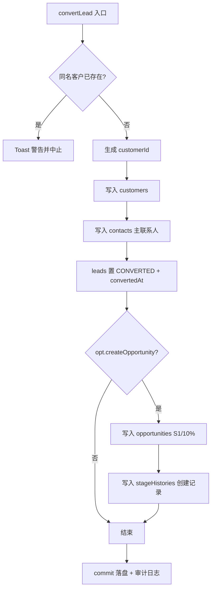
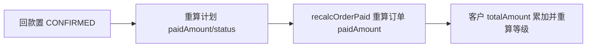

# API 接口设计说明书

| 项 | 内容 |
|---|---|
| 文档编号 | SFS-CRM-API-01 |
| 项目名称 | SalesFlow 智销云 · 销售全流程管理平台（SalesFlow CRM） |
| 版本 | v1.0 |
| 编写日期 | 2026-10-09 |
| 状态 | 已评审通过 |

**版本变更历史**

| 版本 | 日期 | 修订人 | 修订说明 |
|---|---|---|---|
| v0.1 | 2026-10-05 | 设计组 | Repository 契约初稿 |
| v0.6 | 2026-10-07 | 设计组 | 补充业务动作 API 清单 |
| v1.0 | 2026-10-09 | 设计组 | 补充 REST 契约、错误码与版本策略 |

---

## 1. 引言

### 1.1 编写目的

本文档定义 SalesFlow CRM 的两类接口契约：

1. **Repository 契约**：本期纯前端实现的数据访问接口约定，是业务动作层与持久化之间的唯一通道；
2. **业务动作 API**：`AppContext` 对外暴露的全部业务方法契约，是页面与业务逻辑之间的调用契约；
3. **REST 契约（前瞻）**：未来迁移至后端服务时的 HTTP 接口设计，本期不实现但保持语义 1:1 对齐。

### 1.2 重要前提说明

> **本期为纯前端实现，不存在 HTTP 服务端。** 所有"接口调用"均为进程内方法调用，数据最终落到浏览器 LocalStorage。
>
> - 业务动作层不直接触碰 `localStorage`，一律经由 Repository 契约（`lib/storage.ts` 的本地实现）；
> - 未来接入后端时，仅需新增 `HttpRepository` 实现同一契约，业务动作层与页面组件零改动（《数据库设计说明书》6.3）；
> - 第 5 章的 REST 契约为迁移目标形态，用于约束后端设计，不作为本期验收依据。

---

## 2. Repository 契约

### 2.1 泛型接口定义

《数据库设计说明书》6.2 定义的 Repository 契约如下，本期由 `lib/storage.ts` 提供本地实现：

```typescript
interface Repository<T extends { id: string }> {
  list(): T[];                                  // 全量读取
  findById(id: string): T | undefined;          // 主键查询
  query(predicate: (t: T) => boolean): T[];     // 条件查询
  insert(entity: T): T;                         // 新增
  update(id: string, patch: Partial<T>): T;     // 局部更新
  remove(id: string): void;                     // 删除
  bulkInsert(entities: T[]): void;              // 批量新增
  count(): number;                              // 计数
}
```

### 2.2 本期实现形态

本期实现未逐实体拆分为多个 Repository 实例，而是以"整库 Repository"承载全部实体，这在语义上等价于对 `Database` 这一聚合根的访问：

```typescript
// lib/storage.ts（本期实现，节选）
const STORAGE_KEY = 'salesflow:db';
export const DB_VERSION = 1;

export class StorageError extends Error {}

/** 读取整库；解析失败或结构不合法时返回 null，由上层回退到演示数据 */
export function loadDb(): Database | null;

/** 整库覆盖写；失败抛出 StorageError（NFR-R-02） */
export function saveDb(db: Database): void;

/** 清空整库 */
export function clearDb(): void;
```

会话数据独立成键，接口如下：

```typescript
export const SESSION_KEY = 'salesflow:session';

export interface Session { userId: string; loginAt: string }

export function loadSession(): Session | null;
export function saveSession(s: Session): void;
export function clearSession(): void;
```

### 2.3 方法说明

| 方法 | 入参 | 返回 | 语义 | 异常处理 |
|---|---|---|---|---|
| `loadDb` | 无 | `Database \| null` | 读取 `salesflow:db` 并 `JSON.parse`；校验为对象且 `users` 为数组，否则返回 `null` | 解析异常被吞掉并返回 `null`，由 `AppProvider` 回退装载演示数据 |
| `saveDb` | `db: Database` | `void` | `JSON.stringify` 后 `localStorage.setItem` 整库覆盖写 | 抛出 `StorageError`，错误信息含"存储容量已满，请导出备份后重置" |
| `clearDb` | 无 | `void` | 移除业务数据键 | 无 |
| `loadSession` | 无 | `Session \| null` | 读取当前登录会话 | 解析异常返回 `null` |
| `saveSession` | `s: Session` | `void` | 写入会话 | 无 |
| `clearSession` | 无 | `void` | 退出登录时清除会话 | 无 |

### 2.4 契约与实现的偏差说明

| 项 | 设计文档 | 本期实现 | 说明 |
|---|---|---|---|
| 存储粒度 | 分实体多键 `salesflow:{entity}` | 整库单键 `salesflow:db` | 见《总体架构设计说明书》ADR-07：整库写入保证跨实体一致性 |
| 写策略 | 全量覆盖写 | 全量覆盖写 | 一致 |
| 迁移字段 | `version` | `DB_VERSION = 1` 且 `Database.version` 保留 | 一致 |
| 单实体 CRUD | `Repository<T>` 八方法 | 由 `AppContext` 的 `commit` + 数组变换等价实现 | 迁移后端时按 2.1 落地即可 |

---

## 3. 业务动作 API 清单

### 3.1 通用约定

| 约定 | 说明 |
|---|---|
| 调用方式 | 页面通过 `const { xxx } = useApp()` 获取方法引用 |
| 返回值 | 大多数动作为 `void`，通过 Toast 反馈结果；需要同步结果判断的动作返回 `{ ok: boolean; message: string }` |
| 事务性 | 所有写操作内部调用 `commit`：浅拷贝 `Database` → 执行变更 → `saveDb` → 返回新状态 |
| 审计 | 关键动作末尾调用 `log(action, target)` 写入 `activityLogs`（最近 200 条） |
| 错误提示 | 校验失败以 Toast（`tone: 'error'` 或 `'warning'`）提示，文案与本文保持一致 |

### 3.2 会话与系统类

| 方法 | 入参 | 返回 | 前置条件 | 业务规则校验 | 失败场景与提示 | 副作用 |
|---|---|---|---|---|---|---|
| `login` | `username: string, password: string` | `{ ok, message }` | 无 | 账号存在；密码相等；`status !== 'DISABLED'` | "账号不存在" / "密码错误" / "该账号已被停用，请联系管理员" | 设置 `userId`，写入会话 `saveSession`；成功提示"欢迎回来，{name}" |
| `logout` | 无 | `void` | 已登录 | 无 | 无 | 清空 `userId`，`clearSession` |
| `resetDemo` | 无 | `void` | 无 | 无 | 无 | `clearDb` → 重建 seed → `saveDb` → 清空会话；提示"已重置为演示数据" |
| `toast` | `message: string, tone?: 'success'\|'error'\|'info'\|'warning'` | `void` | 无 | 无 | 无 | 压入 Toast 队列，3.6s 后自动移除 |
| `dismissToast` | `id: number` | `void` | 无 | 无 | 无 | 从队列移除指定 Toast |
| `exportData` | 无 | `void` | 已登录 | 无 | 无 | Blob 导出 `salesflow-data-{YYYY-MM-DD}.json`；提示"数据已导出" |
| `log` | `action: string, target: string` | `void` | 已登录 | 无 | 未登录直接返回 | `activityLogs` 头部插入一条，截断至 200 条 |
| `upsertUser` | `u: User` | `void` | ADMIN 页面 | 按 `id` 判断新增或覆盖 | 无 | 更新 `db.users`；提示"用户已保存" |
| `upsertProduct` | `p: Product` | `void` | ADMIN 页面 | 按 `id` 判断新增或覆盖 | 无 | 更新 `db.products`；提示"产品已保存" |

### 3.3 线索类

| 方法 | 入参 | 返回 | 前置条件 | 业务规则校验 | 失败场景与提示 | 副作用 |
|---|---|---|---|---|---|---|
| `createLead` | `Omit<Lead,'id'\|'createdAt'\|'status'\|'createdBy'>` | `void` | 已登录 | 页面侧校验公司名称、联系人、7–15 位电话必填 | 页面侧"请完善必填项：公司名称、联系人姓名、联系电话（7-15 位数字）" | 生成 `L{yyyy}{0001}` 编号；`ownerId` 有值则状态 `FOLLOWING`，否则 `NEW`；写入 `leads`；日志"新增线索"；提示"线索 {id} 创建成功" |
| `assignLeads` | `ids: string[], ownerId: string` | `void` | 已登录；仅 `status === 'NEW'` 的线索会被处理 | 一次最多 50 条 | "一次最多分配 50 条线索" | 命中的线索置 `ownerId/ownerName/status=FOLLOWING`；日志"批量分配线索"；提示"已分配 N 条线索给 {name}" |
| `addFollowUp` | `Omit<FollowUp,'id'\|'createdAt'\|'createdByName'\|'createdBy'>` | `void` | 已登录；跟进内容非空（页面按钮禁用） | 无 | 无 | 写入 `followUps`（`uid('FU')`）；线索由 `NEW` 自动转 `FOLLOWING`，回写 `nextFollowAt`；日志"添加跟进记录"；提示"跟进记录已保存" |
| `convertLead` | `leadId: string, opt: { createOpportunity: boolean; opportunityTitle?: string; amount?: number }` | `void` | 已登录；线索存在 | BR-02 客户名称唯一：同名客户已存在则拒绝 | "客户「{companyName}」已存在，请直接关联已有客户" | 见第 4 章"线索转化事务"：创建客户 + 主联系人 + 线索置 `CONVERTED` +（可选）创建商机与阶段历史；日志"线索转化" |
| `loseLead` | `leadId: string, reason: string` | `void` | 已登录 | BR-01 废弃必须填写原因 | "废弃线索必须填写原因（BR-01）" | 线索置 `LOST` 并写 `lostReason`；日志"废弃线索"；提示"线索已标记废弃" |

### 3.4 客户类

| 方法 | 入参 | 返回 | 前置条件 | 业务规则校验 | 失败场景与提示 | 副作用 |
|---|---|---|---|---|---|---|
| `addContact` | `Omit<Contact,'id'>` | `void` | 客户存在 | 若 `isPrimary` 为真，同客户其余联系人 `isPrimary` 置 `false`（每客户至多一个主联系人） | 无 | 写入 `contacts`（`uid('CT')`）；提示"联系人已添加" |
| `transferCustomer` | `customerId: string, toUserId: string, withOpportunities: boolean` | `void` | 目标用户存在 | 仅同步 `status === 'OPEN'` 的商机 | 无 | 客户 `ownerId/ownerName` 更新；`withOpportunities` 为真时同步商机归属；日志"转移客户"；提示"客户已转移给 {name}" |
| `updateCustomer` | `id: string, patch: Partial<Customer>` | `void` | 客户存在 | 人工覆盖等级时由页面设置 `levelAuto = false` | 无 | 合并 patch；提示"客户信息已更新" |

### 3.5 商机类

| 方法 | 入参 | 返回 | 前置条件 | 业务规则校验 | 失败场景与提示 | 副作用 |
|---|---|---|---|---|---|---|
| `createOpportunity` | `Omit<Opportunity,'id'\|'createdAt'\|'status'\|'stage'\|'probability'\|'ownerName'\|'customerName'\|'ownerId'>` | `void` | 已登录；关联客户存在 | BR-09 撞单由页面提示（非阻断，二次确认后放行） | 页面黄色警告："该客户已存在进行中的商机「{title}」（{id}），可能存在撞单（BR-09），请确认后再创建" | 生成 `O{yyyy}{0001}`；强制 `stage='S1'`、`probability=10`、`status='OPEN'`、`ownerId=当前用户`；冗余 `customerName/ownerName`；写入初始阶段历史（"创建商机"）；日志"创建商机" |
| `moveStage` | `oppId: string, to: Stage, remark: string` | `{ ok, message }` | 已登录；商机存在且 `status === 'OPEN'` | BR-03：S3 需 ≥1 张报价单；S4 需存在 APPROVED/CONVERTED 报价单；S5 需客户存在已签约订单 | "商机已关闭，不可再推进阶段"／"不满足前置条件：进入「方案报价」阶段需至少创建 1 张报价单"／"不满足前置条件：进入「商务谈判」阶段需存在审批通过的报价单"／"不满足前置条件：赢单需存在已签约的订单，请在订单模块完成商务审核" | 更新 `stage` 与联动 `probability`（`STAGE_MAP[to].probability`）；写入 `stageHistories`（含 `fromStage/toStage/操作人/备注`）；日志"推进商机阶段"；提示"商机已推进至「{阶段名}」" |
| `closeOpportunity` | `oppId: string, result: 'WON'\|'LOST', payload: { reason?: string; competitor?: string; actualAmount?: number }` | `void` | 已登录 | BR-08 输单必须填写原因 | "输单必须填写输单原因（BR-08）" | `status` 置 WON/LOST；WON 时 `stage='S5'`、`probability=100`；LOST 时 `probability=0`；写 `lostReason/competitor/actualAmount/closedAt`；WON 追加 S4→S5 阶段历史；日志"商机赢单/输单" |

### 3.6 报价与审批类

| 方法 | 入参 | 返回 | 前置条件 | 业务规则校验 | 失败场景与提示 | 副作用 |
|---|---|---|---|---|---|---|
| `createQuotation` | `{ opportunityId, validUntil, payMethod, remark, items: { productId, quantity, discountRate }[] }` | `void` | 已登录；商机存在；产品存在 | 页面侧：必须选商机；明细行产品非空且数量 > 0 | "请选择关联商机" / "请完善产品明细" | 生成 `Q{yyyy}{0001}`；按行计算 `subtotal/netAmount`，汇总 `totalAmount/discountAmount/discountRate`；按折扣率与金额构建审批链快照（BR-04）；状态 `DRAFT`；写入 `quotations` + `quotationItems`；日志"创建报价单"；提示含整体折扣率 |
| `submitQuotation` | `id: string` | `{ ok, message }` | 已登录；报价单存在 | 状态 ∈ {DRAFT, REJECTED}；`validUntil >= today()` | "当前状态不可提交审批" / "报价已过期，请更新有效期后再提交" | 空审批链：直接置 `APPROVED`，提示"折扣率低于 15%，无需审批，报价单已直接定稿"；否则置 `APPROVING`、`currentStep=1`、重置各步为 PENDING；写入 `approvalRecords`（`action='SUBMITTED'`，`step=0`）；日志"提交报价审批" |
| `approveQuotation` | `id: string, action: 'APPROVED'\|'REJECTED', comment: string` | `void` | 已登录；报价单存在 | 当前 `currentStep` 对应审批人必须为操作者；驳回必须填写意见 | "权限不足：当前审批层级不归您处理（NFR-S-02）" / "驳回必须填写审批意见" | 更新链上当前步状态与意见；末级通过 → `APPROVED`，未到末级 → `APPROVING` 且 `currentStep+1`，驳回 → `REJECTED`；写入 `approvalRecords`；通过且商机处于 S3 时自动推进至 S4 并写阶段历史；日志"报价审批通过/驳回" |
| `withdrawQuotation` | `id: string` | `void` | 已登录；创建人本人（页面控制） | 无 | 无 | 状态回 `DRAFT`，`currentStep=0`，各步重置 PENDING；提示"已撤回审批" |

### 3.7 订单类

| 方法 | 入参 | 返回 | 前置条件 | 业务规则校验 | 失败场景与提示 | 副作用 |
|---|---|---|---|---|---|---|
| `createOrderFromQuotation` | `quotationId: string, payload: { contractNo: string; signDate: string; deliveryDate?: string }` | `void` | 已登录；报价单存在 | 报价单状态必须为 `APPROVED`；BR-05 报价未过期 | "仅审批通过的报价单可生成订单" / "该报价单已过期（BR-05），请重新出具报价" | 生成 `SO{yyyy}{0001}`；带入客户、折后金额、付款方式；状态 `PENDING`、`paidAmount=0`；报价单置 `CONVERTED`；日志"生成合同订单"；提示"订单 {id} 已生成，请等待商务审核" |
| `auditOrder` | `orderId: string, pass: boolean, comment: string` | `void` | 已登录；订单存在 | 角色必须为 `FINANCE`；订单状态必须为 `PENDING` | "权限不足：仅商务财务可执行商务审核（NFR-S-02）" / "仅待签约订单可审核" | 通过 → `SIGNED`，驳回 → `CANCELLED`；写 `auditBy/auditByName/auditAt`，审核意见追加到 `remark`；通过后按 `payMethod` 模板生成回款计划（FR-07-04）；日志"商务审核通过/驳回" |
| `updateOrderStatus` | `orderId: string, status: Order['status']` | `void` | 订单存在 | 页面仅提供 SIGNED→EXECUTING、EXECUTING→COMPLETED 两个流转按钮；FINANCE 点击时提示由销售推进 | "订单交付状态由销售或项目经理推进" | 更新 `status`；提示"订单状态已更新" |

### 3.8 回款类

| 方法 | 入参 | 返回 | 前置条件 | 业务规则校验 | 失败场景与提示 | 副作用 |
|---|---|---|---|---|---|---|
| `registerPayment` | `{ planId, amount, method, payDate, serialNo, remark }` | `{ ok, message }` | 已登录；计划存在 | 金额 > 0；BR-06 不得超过该期次剩余未回款金额 | "回款金额必须大于 0" / "回款金额不得超过该期次剩余未回款金额 {remain} 元（BR-06）" | 生成 `PAY{yyyy}{0001}`；状态 `REGISTERED`，`invoiceStatus='NONE'`；写入 `payments`；日志"登记回款"；提示"回款 {id} 已登记，等待财务确认" |
| `confirmPayment` | `paymentId: string` | `void` | 已登录；回款存在 | 角色必须为 `FINANCE` | "权限不足：仅商务财务可确认回款到账（NFR-S-02）" | 回款置 `CONFIRMED` 并写确认人与时间；重算所属计划 `paidAmount/status`；`recalcOrderPaid` 重算订单已回款；BR-07 同步客户 `totalAmount` 与自动等级；日志"确认回款到账" |
| `issueInvoice` | `paymentId: string, invoiceNo: string` | `void` | 已登录；回款已确认且未开票 | 角色必须为 `FINANCE`；发票号非空 | "权限不足：仅商务财务可开票" / "请填写发票号" | `invoiceNo/invoiceStatus='ISSUED'/invoiceDate=today()`；日志"开具发票"；提示"发票已开具" |

---

## 4. 关键业务事务说明

### 4.1 线索转化事务（跨实体）

`convertLead` 是唯一跨三个实体写入的动作，其一致性依赖"整库单键 + `commit` 一次落盘"：



任一步骤在内存态完成后才统一 `saveDb`，不存在"客户已建、线索未转"的中间态被持久化的情况。

### 4.2 回款确认的状态重算链

`confirmPayment` 一次动作联动三个实体的派生字段，顺序不可颠倒：



---

## 5. 未来 REST 接口契约（迁移目标）

> 以下接口为后端化后的目标契约，路径统一前缀 `/api/v1`，鉴权采用 `Authorization: Bearer <token>`，数据可见性规则由服务端依据角色重新执行（前端 `selectors` 逻辑迁移为服务端过滤）。

### 5.1 统一约定

| 项 | 约定 |
|---|---|
| 协议 | HTTPS |
| 请求/响应编码 | `application/json; charset=utf-8` |
| 时间格式 | `YYYY-MM-DD HH:mm`（`now()` 格式）或 `YYYY-MM-DD`（日期） |
| 金额类型 | number，单位元，保留 2 位小数（服务端以整数分计算） |
| 分页 | `GET` 列表支持 `page`、`size`，响应含 `total` |
| 幂等 | 写操作建议携带 `Idempotency-Key`（本期不涉及） |

### 5.2 端点清单

| 编号 | Method | Path | 说明 | 对应业务动作 |
|---|---|---|---|---|
| API-01 | POST | `/api/v1/auth/login` | 登录 | `login` |
| API-02 | POST | `/api/v1/auth/logout` | 登出 | `logout` |
| API-03 | GET | `/api/v1/users` | 用户列表 | `visibleUsers` |
| API-04 | PUT | `/api/v1/users/{id}` | 新增/更新用户 | `upsertUser` |
| API-05 | GET | `/api/v1/leads` | 线索列表（按角色过滤） | `visibleLeads` |
| API-06 | POST | `/api/v1/leads` | 新建线索 | `createLead` |
| API-07 | POST | `/api/v1/leads/{id}/convert` | 线索转化 | `convertLead` |
| API-08 | POST | `/api/v1/leads/assign` | 批量分配 | `assignLeads` |
| API-09 | GET | `/api/v1/customers` | 客户列表 | `visibleCustomers` |
| API-10 | POST | `/api/v1/customers/{id}/transfer` | 客户转移 | `transferCustomer` |
| API-11 | GET | `/api/v1/opportunities` | 商机列表 | `visibleOpportunities` |
| API-12 | POST | `/api/v1/opportunities` | 新建商机 | `createOpportunity` |
| API-13 | POST | `/api/v1/opportunities/{id}/stage` | 阶段推进 | `moveStage` |
| API-14 | POST | `/api/v1/opportunities/{id}/close` | 赢单/输单 | `closeOpportunity` |
| API-15 | GET | `/api/v1/quotations` | 报价列表 | `visibleQuotations` |
| API-16 | POST | `/api/v1/quotations` | 新建报价 | `createQuotation` |
| API-17 | POST | `/api/v1/quotations/{id}/submit` | 提交审批 | `submitQuotation` |
| API-18 | POST | `/api/v1/quotations/{id}/approve` | 审批处理 | `approveQuotation` |
| API-19 | POST | `/api/v1/orders` | 由报价生成订单 | `createOrderFromQuotation` |
| API-20 | POST | `/api/v1/orders/{id}/audit` | 商务审核 | `auditOrder` |
| API-21 | GET | `/api/v1/payment-plans` | 回款计划列表 | `visiblePlans` |
| API-22 | POST | `/api/v1/payments` | 登记回款 | `registerPayment` |
| API-23 | POST | `/api/v1/payments/{id}/confirm` | 确认到账 | `confirmPayment` |
| API-24 | POST | `/api/v1/payments/{id}/invoice` | 开票 | `issueInvoice` |
| API-25 | GET | `/api/v1/products` | 产品目录 | `visibleProducts` |
| API-26 | PUT | `/api/v1/products/{id}` | 新增/更新产品 | `upsertProduct` |
| API-27 | GET | `/api/v1/analytics/dashboard` | 工作台统计 | `dashboardStats` |

### 5.3 关键端点请求/响应示例

**API-01 登录**

```http
POST /api/v1/auth/login
```

请求体：

```json
{ "username": "zhangwei", "password": "123456" }
```

响应体：

```json
{ "code": 0, "message": "欢迎回来，张伟", "data": { "token": "eyJhbGciOi...", "user": { "id": "U003", "name": "张伟", "role": "SALES", "dept": "华东销售一部" } } }
```

状态码：`200` 成功；`401` 账号或密码错误；`403` 账号已停用；`404` 账号不存在。

**API-13 商机阶段推进**

```http
POST /api/v1/opportunities/O20260007/stage
```

请求体：

```json
{ "to": "S3", "remark": "看板拖拽推进至 方案报价" }
```

成功响应体：

```json
{ "code": 0, "message": "", "data": { "id": "O20260007", "stage": "S3", "probability": 60 } }
```

失败响应体（BR-03 未满足）：

```json
{ "code": 40501, "message": "不满足前置条件：进入「方案报价」阶段需至少创建 1 张报价单", "data": null }
```

状态码：`200` 成功；`400` 参数缺失；`409` 业务规则不满足；`404` 商机不存在。

**API-16 新建报价单**

```http
POST /api/v1/quotations
```

请求体：

```json
{
  "opportunityId": "O20260007",
  "validUntil": "2026-11-08",
  "payMethod": "三三四",
  "remark": "年度框架协议报价",
  "items": [
    { "productId": "P001", "quantity": 2, "discountRate": 0.2 },
    { "productId": "P005", "quantity": 1, "discountRate": 0.1 }
  ]
}
```

响应体：

```json
{
  "code": 0,
  "message": "报价单 Q20260011 已创建，整体折扣率 17.5%",
  "data": {
    "id": "Q20260011",
    "totalAmount": 480000,
    "discountAmount": 396000,
    "discountRate": 0.175,
    "status": "DRAFT",
    "approvalChain": [
      { "step": 1, "approverId": "U002", "approverName": "李娜", "approverRole": "MANAGER", "status": "PENDING" }
    ]
  }
}
```

状态码：`201` 创建成功；`400` 明细不完整；`404` 商机或产品不存在。

**API-18 报价审批**

```http
POST /api/v1/quotations/Q20260011/approve
```

请求体：

```json
{ "action": "APPROVED", "comment": "折扣合理，同意" }
```

响应体：

```json
{ "code": 0, "message": "审批通过", "data": { "id": "Q20260011", "status": "APPROVED", "currentStep": 1 } }
```

状态码：`200` 成功；`403` 当前层级不归该审批人；`409` 状态不可审批或驳回未填意见。

**API-20 商务审核**

```http
POST /api/v1/orders/SO20260003/audit
```

请求体：

```json
{ "pass": true, "comment": "合同条款审核通过" }
```

响应体：

```json
{ "code": 0, "message": "订单已签约，系统自动生成 3 期回款计划", "data": { "id": "SO20260003", "status": "SIGNED", "plans": [
  { "period": 1, "planAmount": 118800, "planDate": "2026-10-16" },
  { "period": 2, "planAmount": 118800, "planDate": "2026-11-08" },
  { "period": 3, "planAmount": 158400, "planDate": "2027-01-07" }
] } }
```

状态码：`200` 成功；`403` 非商务财务；`409` 订单状态不可审核。

**API-22 登记回款**

```http
POST /api/v1/payments
```

请求体：

```json
{ "planId": "SO20260003-P1", "amount": 60000, "method": "电汇", "payDate": "2026-10-15", "serialNo": "ICBC-20261015-001", "remark": "首期部分回款" }
```

响应体：

```json
{ "code": 0, "message": "回款 PAY20260010 已登记，等待财务确认", "data": { "id": "PAY20260010", "status": "REGISTERED" } }
```

状态码：`201` 成功；`400` 金额非法；`409` 超过剩余未回款金额（BR-06）。

**API-23 确认到账**

```http
POST /api/v1/payments/PAY20260010/confirm
```

响应体：

```json
{ "code": 0, "message": "回款已确认到账，统计口径同步更新", "data": { "planStatus": "PARTIAL", "orderPaidAmount": 60000, "customerTotalAmount": 560000 } }
```

状态码：`200`；`403` 非商务财务。

**API-27 工作台统计**

```http
GET /api/v1/analytics/dashboard
```

响应体：

```json
{ "code": 0, "message": "", "data": { "todoLeads": 4, "openOpportunities": 6, "pendingApproval": 2, "planAmountThisMonth": 318000, "overdueAmount": 96000, "overdueCount": 3 } }
```

状态码：`200`。

**其余端点简表**

| 端点 | 请求体示例 | 成功响应要点 | 状态码 |
|---|---|---|---|
| `GET /api/v1/leads` | Query: `status=NEW&source=官网表单&page=1&size=20` | `{ items: Lead[], total: 24 }` | 200 |
| `POST /api/v1/leads` | `{ companyName, contactName, phone, source, industry, level, remark, ownerId }` | 返回 `Lead`，`status` 由 `ownerId` 推导 | 201 / 400 |
| `POST /api/v1/leads/L20260003/convert` | `{ createOpportunity: true, opportunityTitle: "华远科技采购项目", amount: 320000 }` | `{ customerId, contactId, opportunityId? }` | 200 / 409 客户已存在 |
| `POST /api/v1/leads/assign` | `{ ids: ["L20260001","L20260002"], ownerId: "U003" }` | `{ assigned: 2 }` | 200 / 400 超 50 条 |
| `GET /api/v1/customers` | Query: `level=A&industry=制造业` | `{ items, total }` | 200 |
| `POST /api/v1/customers/C20260005/transfer` | `{ toUserId: "U004", withOpportunities: true }` | `{ transferredOpportunities: 2 }` | 200 |
| `POST /api/v1/opportunities` | `{ customerId, title, amount, expectedCloseDate, source, remark }` | 返回 `S1/10%/OPEN` | 201 / 409 撞单警告 |
| `POST /api/v1/opportunities/{id}/close` | `{ result: "LOST", reason: "价格过高", competitor: "竞品A" }` | `{ status: "LOST" }` | 200 / 400 缺原因 |
| `GET /api/v1/quotations` | Query: `status=APPROVING&tab=approval` | `{ items, total }` | 200 |
| `POST /api/v1/quotations/{id}/submit` | 无请求体 | `{ status: "APPROVING", currentStep: 1 }` | 200 / 409 已过期 |
| `POST /api/v1/orders` | `{ quotationId: "Q20260011", contractNo: "HT-2026-0001", signDate: "2026-10-09", deliveryDate: "" }` | 返回订单 `PENDING` | 201 / 409 报价非通过态或过期 |
| `GET /api/v1/payment-plans` | Query: `status=OVERDUE` | `{ items, total }` | 200 |
| `POST /api/v1/payments/{id}/invoice` | `{ invoiceNo: "02658903" }` | `{ invoiceStatus: "ISSUED" }` | 200 / 400 发票号为空 |
| `GET/PUT /api/v1/products` | `{ name, spec, unit, price, category, status }` | 返回 `Product` | 200 / 201 |
| `GET/PUT /api/v1/users` | `{ username, name, role, title, dept, phone, status }` | 返回 `User`（不含密码） | 200 / 201 |

---

## 6. 统一错误码设计

### 6.1 错误响应结构

```json
{
  "code": 40501,
  "message": "不满足前置条件：进入「方案报价」阶段需至少创建 1 张报价单",
  "data": null,
  "traceId": "8f2c1a9e"
}
```

| 字段 | 类型 | 说明 |
|---|---|---|
| `code` | number | 业务错误码，`0` 表示成功 |
| `message` | string | 可直接展示给用户的中文文案 |
| `data` | any | 成功为业务数据，失败为 `null` |
| `traceId` | string | 链路追踪标识（本期前端实现为时间戳+随机数） |

### 6.2 错误码分段

| 段位 | 含义 | 示例 |
|---|---|---|
| `0` | 成功 | 0 |
| `1xxxx` | 通用错误：参数、序列化、未知异常 | 10001 参数缺失 |
| `2xxxx` | 认证与会话 | 20101 未登录；20102 账号不存在；20103 密码错误；20104 账号停用 |
| `3xxxx` | 权限 | 30101 菜单越权；30102 数据越权；30103 审批层级不匹配 |
| `4xxxx` | 业务规则（对齐 BR 编号） | 40001 BR-01；40002 BR-02；40003 BR-03；40004 BR-04；40005 BR-05；40006 BR-06；40008 BR-08；40009 BR-09 |
| `5xxxx` | 持久化 | 50001 LocalStorage 写入失败（`StorageError`） |

### 6.3 本期前端错误提示映射

| 场景 | 提示文案 | Toast tone |
|---|---|---|
| 账号不存在 | 账号不存在 | 表单内联 error |
| 密码错误 | 密码错误 | 表单内联 error |
| 账号停用 | 该账号已被停用，请联系管理员 | 表单内联 error |
| 越权动作 | 权限不足：{具体动作}（NFR-S-02） | error |
| 业务规则不满足 | 同第 3 章各动作失败提示原文 | error / warning |
| 持久化失败 | 本地存储写入失败：{原因}。可能是存储容量已满，请在系统管理中导出备份后重置数据。 | error |

---

## 7. 接口版本与向后兼容约定

| 项 | 约定 |
|---|---|
| 版本位置 | URL 路径前缀 `/api/v1` |
| 版本升级 | 仅在发生破坏性变更时递增主版本号（`/api/v2`）；新增字段、新增端点属兼容变更，不升版 |
| 兼容原则 | 新增响应字段不删除旧字段；枚举值只增不改；请求参数新增必须给默认值 |
| 弃用流程 | 弃用端点在响应头返回 `Deprecation: true` 与 `Sunset` 日期，保留至少一个版本周期 |
| 字段命名 | 与 `types.ts` 完全一致（小驼峰），不做下划线转换，避免前后端映射歧义 |
| 金额字段 | 统一元（number，2 位小数）；服务端内部以整数分计算，见《详细设计说明书》第 6 章 |
| 时间字段 | 日期 `YYYY-MM-DD`，日期时间 `YYYY-MM-DD HH:mm`，均为服务端时区字符串 |
| 空值 | 允许为 `null`，不使用 `undefined`（JSON 无法表达） |

---

**评审记录**

| 角色 | 意见 | 日期 |
|---|---|---|
| 架构师 | 同意通过 | 2026-10-09 |
| 开发负责人 | 同意通过 | 2026-10-09 |
