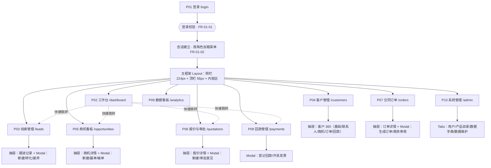
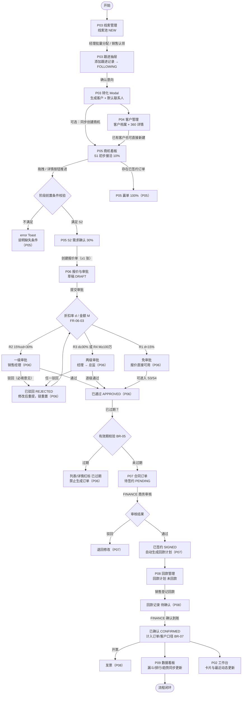
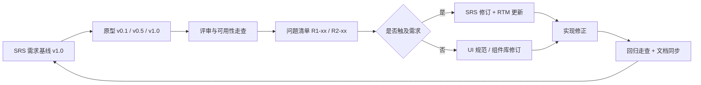

# 原型设计说明书（Prototype Specification）

| 项 | 内容 |
|---|---|
| 文档编号 | SFS-CRM-PRO-01 |
| 项目名称 | SalesFlow 智销云 · 销售全流程管理平台 |
| 版本 | v1.0 |
| 编写日期 | 2026-10-09 |
| 状态 | 已通过两轮评审，作为开发实现与验收演示依据 |

**关联文档**：《软件需求规格说明书》SFS-CRM-SRS、《UI 设计规范与组件说明》SFS-CRM-UI-01、《需求调研访谈纪要》SFS-CRM-INT-01、课程作业《原型设计调研报告》（`homework/3-原型设计/README.md`）。

**版本变更历史**

| 版本 | 日期 | 原型形态 | 修订说明 | 状态 |
|---|---|---|---|---|
| v0.1 | 2026-09-30 | 纸面草图 + 线框 | 首次交付，覆盖站点地图与主要页面区块 | 已评审 |
| v0.5 | 2026-10-05 | 中保真可点击 | 组件库 + 路由 + Mock 数据，主流程可跳转 | 已评审 |
| v0.9 | 2026-10-07 | 高保真可运行 | 补状态机、审批链、拖拽、图表、异常态 | 内部走查 |
| v1.0 | 2026-10-09 | 高保真可运行 | 按评审意见收敛，冻结为产品骨架 | **已发布** |

---

## 1. 引言

### 1.1 编写目的

本文档说明 SalesFlow CRM 原型的**路线选择、版本演进、页面结构、界面草图、状态与交互规则、评审过程及需求追溯关系**，用于：① 向干系人传递"系统长什么样、怎么用"；② 作为《UI 设计规范》与《详细设计说明书》的输入；③ 作为系统验收时演示路径的依据。

### 1.2 阅读对象

| 读者 | 关注章节 |
|---|---|
| 甲方/指导教师（业务方） | 第 2、3、5、6 章（页面与流程） |
| UI 设计师 | 第 5 章 + 《UI 设计规范》SFS-CRM-UI-01 |
| 开发工程师 | 第 5 章的元素清单、状态与交互规则 |
| 测试工程师 | 第 5.6 状态说明、第 6 章流程、第 8 章追溯表 |

### 1.3 名词

| 名词 | 说明 |
|---|---|
| 演化型原型 | 从粗糙原型逐步增量完善、最终演进为真实产品的原型策略 |
| 保真度 | 原型与最终产品在视觉/内容/交互三方面的相似程度 |
| 页面编号 P0x | 本项目 10 个页面的稳定编号，需求追溯与测试用例均以该编号对齐 |

---

## 2. 原型路线选择

### 2.1 候选路线对比

课程作业《原型设计调研报告》已对抛弃型与演化型做过系统比较（见该报告 3.1、6.3）：演化型的优势是"无重复劳动、所见即所得、天然支持迭代"，风险是"早期结构糟糕会一路带病"。结合本项目约束，对比如下：

| 路线 | 工作量 | 对本项目适用性 | 结论 |
|---|---|---|---|
| 抛弃型（Axure/Figma 高保真） | 原型 1 份 + 实现 1 份 ≈ 双倍 | 课程周期有限，重复劳动不可接受 | ❌ 不采用 |
| **演化型（组件库搭建的可运行 Web 原型）** | 只做 1 份，直接长成产品 | 需求框架清楚、技术栈明确、追求交付 | ✅ **采用** |
| 增量型（按模块分批交付） | 中 | 可作为演化型内部的排期方式 | ✅ 融入排期 |

### 2.2 本项目的技术路线修正（与调研报告的呼应）

调研报告 8.1 案例假设的技术栈为 "Vue 3 + Element Plus 搭建可运行原型，Mock 数据"。本项目在实际落地时做了一次**受控修正**：

| 项 | 调研报告假设 | 本期实际 | 修正理由 |
|---|---|---|---|
| 框架 | Vue 3 + Element Plus | **Vite + React 18 + TypeScript** | 团队对 React 函数式 + TS 类型收益更熟悉，有利于 NFR-M-03（禁止 any 泛滥） |
| 样式 | Element Plus 组件库 | **Tailwind CSS + 自建轻量组件库**（`src/components/ui`） | 本系统组件量 ≤ 20 个，自建可完全掌控视觉（有利于 NFR-U-07 的密度控制与 UI 规范落地），且构建产物更小（NFR-T-03） |
| 数据 | Mock 数据 | `seed.ts` 演示数据 + LocalStorage 持久化 + 统一 Repository 抽象 | 满足 NFR-R-01 即时落盘、FR-10-04 导出/重置 |

> **这正是演化型路线的应有之义**：策略层（"用组件库做可运行原型并演进为产品"）保持不变，实现层允许在早期用最低代价纠偏。调研报告第 2.7 节提醒的"原型被误认为成品"风险，本项目通过第 3 章的版本演进记录（明确标注 v0.1/v0.5 的不完整假设）加以管理。

### 2.3 原型交付物清单

| # | 交付物 | 位置/说明 |
|---|---|---|
| 1 | 站点地图与页面清单 | 本文第 4 章 |
| 2 | 逐页界面草图与元素清单 | 本文第 5 章 |
| 3 | 关键流程可点击串接 | 本文第 6 章 + 运行态应用 |
| 4 | 基础组件库 | `src/components/ui/index.tsx`（17 个组件） |
| 5 | 演示数据与角色数据 | `src/data/seed.ts`（8 用户/24 线索/12 客户/…） |
| 6 | 评审记录与问题闭环 | 本文第 7 章 |
| 7 | 需求追溯矩阵 | 本文第 8 章 |

---

## 3. 原型版本演进

### 3.1 演进总览

| 版本 | 保真度 | 形态 | 覆盖范围 | 验证活动 | 主要结论 |
|---|---|---|---|---|---|
| **v0.1** | 低保真 | 纸面草图 + 线框（灰块、无配色、无真实数据） | 站点地图、10 页区块划分、L2C 主流程走向 | 第 1 轮评审（2026-09-30） | 补 P10 系统管理；工作台按角色裁剪；明确驳回必填意见；明确回款统计口径 |
| **v0.5** | 中保真 | React + Tailwind 组件库 + 路由 + Mock 数据，主要跳转可点击 | 全部 10 页骨架 + 列表 + 空态 + 主要弹窗 | 内部走查（2026-10-05） | 组件 Props 收敛；确认悬停、禁用与空态等反馈由 UI 规范统一承载 |
| **v1.0** | 高保真 | 可运行原型（= 产品骨架）：真实视觉、真实状态机、Toast、拖拽、图表、异常态 | FR-01~FR-10 全部 Must 能力 | 第 2 轮评审（2026-10-06）+ 可用性走查 | 见第 7 章，共 17 项问题全部闭环 |

### 3.3 各阶段验证点

| 阶段 | 验证点 | 结论 |
|---|---|---|
| v0.1 | 页面数量与层级 | 10 页（一级导航 9 项 + 登录页），符合心智 |
| v0.1 | L2C 主线能否一图说清 | 可，路径见第 6 章 |
| v0.1 | 是否存在缺失页面 | 发现缺失：系统管理 P10、已关闭商机列表 |
| v0.5 | 信息架构与导航 | 通过；财务角色菜单裁剪为 4 项 |
| v0.5 | 字段完整性（对照 FR） | 通过；补齐线索"下次跟进日期"、报价"审批级别" |
| v0.5 | 空/加载/错误/禁用四态 | 空态通过；禁用与错误态移至 v1.0 |
| v0.5 | 组件复用率 | 收敛出 17 个基础组件，页面不再各写样式 |
| v1.0 | 端到端业务可跑通 | 通过（SRS 7.2 十步脚本全部可执行） |
| v1.0 | 业务规则在界面可感知 | 通过：阈值写入 PageHeader、前置条件常驻抽屉、撞单警告前置 |
| v1.0 | 异常路径有反馈 | 通过：拦截均返回 error Toast 并说明原因 |
| v1.0 | 视觉与 UI 规范一致 | 通过：UI 走查 15 项全过 |

---

## 4. 站点地图

### 4.1 页面层级结构



### 4.2 页面—路由—角色对照

| 编号 | 页面 | 路由 | SALES | MANAGER | FINANCE | ADMIN |
|---|---|---|:---:|:---:|:---:|:---:|
| P01 | 登录 | `/login` | ✅ | ✅ | ✅ | ✅ |
| P02 | 工作台 | `/dashboard` | ✅ | ✅ | ✅ | ✅ |
| P03 | 线索管理 | `/leads` | ✅ | ✅ | ❌ | ✅ |
| P04 | 客户管理 | `/customers` | ✅ | ✅ | ❌ | ✅ |
| P05 | 商机看板 | `/opportunities` | ✅ | ✅ | ❌ | ✅ |
| P06 | 报价与审批 | `/quotations` | ✅ | ✅ | ❌ | ✅ |
| P07 | 合同订单 | `/orders` | ✅ | ✅ | ✅ | ✅ |
| P08 | 回款管理 | `/payments` | ✅ | ✅ | ✅ | ✅ |
| P09 | 数据看板 | `/analytics` | ✅ | ✅ | ✅ | ✅ |
| P10 | 系统管理 | `/admin` | ❌ | ❌ | ❌ | ✅ |

> 越权访问路由时，系统在内容区渲染琥珀色提示卡「权限不足：当前角色（XX）无权访问该模块」（NFR-S-02），不做白屏跳转。

### 4.3 通用页面框架草图

所有内页共享同一框架。图中 `N1~N9` 为导航项（见下表），`M1~M5` 为内容区通用分区，`A` 为页头右侧操作区，**不同页面仅 M2~M5 的组合不同**。

```text
+============+====================================================================+
| SIDEBAR    | HEADER  h=56  sticky top-0 z-20  bg-white                          |
| w=224      +--------------------------------------------------------------------+
| fixed      | A1 breadcrumb              A2 Badge | A3 姓名·部门 | A4 头像 | A5 ⏻ |
| bg=ink-900 |                                                                    |
| text-ink-  | CONTENT  main p-6  (1440 视口下宽 1168px)                           |
| 100        | +----------------------------------------------------------------+ |
|            | | M1  PageHeader：标题 + 描述              |  actions 区 A        | |
| [S] Sales  | +----------------------------------------------------------------+ |
|    Flow    | | M2  概览卡区  grid-cols-4 / 5  mb-4~5  StatCard / KPI           | |
|    智销云   | +----------------------------------------------------------------+ |
|            | | M3  FilterBar  rounded-lg bg-white p-3  mb-3                    | |
| N1         | +----------------------------------------------------------------+ |
| N2         | | M4  内容区：Table / Kanban / Charts  （本页主体）               | |
| N3         | |                                                                | |
| N4         | +----------------------------------------------------------------+ |
| N5    (3)  | | M5  补充区  mt-5（最近动态 / 结果分析，可选）                   | |
| N6         | +----------------------------------------------------------------+ |
| N7         |                                                                    |
| N8         | OVERLAY：Modal(居中 z-50) / Drawer(右侧 z-50) / Toast(右上 z-100)   |
| N9         |                                                                    |
|            |                                                                    |
| v1.0.0     |                                                                    |
| SFS-CRM    |                                                                    |
+============+====================================================================+
```

| 区域码 | 名称 | 说明 |
|---|---|---|
| A1 | 面包屑 | 「销售全流程管理平台 / L2C 业务闭环」 |
| A2 | 角色徽标 | `Badge tone="primary"`，文本取自 `ROLE_LABEL` |
| A3 | 用户标识 | `{姓名} · {部门}` |
| A4 | 头像 | 姓名首字，`rounded-full bg-brand-100 text-brand-700` |
| A5 | 退出 | `Button size="sm" variant="ghost"`，登出并跳 `/login` |
| N1 | 工作台 | ▣ `/dashboard` |
| N2 | 线索管理 | ◉ `/leads` |
| N3 | 客户管理 | ▤ `/customers` |
| N4 | 商机看板 | ◆ `/opportunities` |
| N5 | 报价与审批 | ▦ `/quotations`，右上角红色计数 = 待我审批条数 |
| N6 | 合同订单 | ▩ `/orders` |
| N7 | 回款管理 | ◈ `/payments` |
| N8 | 数据看板 | ◐ `/analytics` |
| N9 | 系统管理 | ⚙ `/admin` |
| M1 | 页面页头 | 见 5.0 通用说明 |
| M2 | 概览卡区 | StatCard 或 KPI 小卡 |
| M3 | 筛选栏 | FilterBar |
| M4 | 内容区 | 表格 / 看板 / 图表 |
| M5 | 补充区 | 次要信息卡 |

---

## 5. 逐页原型说明

> 每页统一按八项模板描述：① 页面编号与名称 ② 访问角色 ③ 页面目标 ④ 布局草图 ⑤ 关键元素清单 ⑥ 状态说明 ⑦ 跳转关系 ⑧ 关键交互规则。

### 5.1 P01 登录页

**① 编号与名称**：P01 登录页 · `/login`
**② 访问角色**：未登录用户（四类角色共用入口）
**③ 页面目标**：完成身份校验并建立会话；为演示/答辩提供四个角色的一键登录（FR-01-01、FR-01-03）。

**④ 布局草图**（不套主框架，全屏两栏）

```text
+---------------------------------+----------------------------------------------+
| BRAND  w=46%  bg=ink-900        | FORM  bg-white 居中 max-w-sm                  |
| p-12 text-white                 |                                              |
|                                 | H2 账号登录                                  |
| [S] SalesFlow 智销云            | p  请使用企业分配的销售平台账号登录          |
|     销售全流程管理平台          |                                              |
|                                 | F1 账号 *                                    |
| (flex-1 垂直弹性)               |    [________________________]                |
|                                 | F2 密码 *                                    |
| H1 从线索到回款                 |    [________________________]                |
|    让每一笔生意有迹可循         |    <err> 红字错误提示（条件）                |
|                                 |                                              |
| p  覆盖线索获取…L2C 闭环        | B1 [      登  录      ] primary w-full        |
|                                 |                                              |
| C1 ┌ ● 线索管理 ─────────────┐  | ---- 分隔线 pt-5 ----                         |
|    │ 线索池统一分配…          │  | 演示账号（点击一键登录）   密码统一 123456   |
| C2 ├ ● 商机看板 ─────────────┤  | +--------------------------------------------+ |
| C3 ├ ● 报价审批 ─────────────┤  | | (张)  张伟  [销售员]        登录 ->        | |
| C4 ├ ● 回款管理 ─────────────┤  | |        跟进线索、推进商机…                 | |
|    └──────────────────────────┘  | | (李)  李娜  [销售经理]      登录 ->        | |
|                                 | |        分配线索、审批报价（一级）         | |
| footer 软件工程课程作业 v1.0.0  | | (王)  王芳  [商务财务]      登录 ->        | |
|       SFS-CRM                   | |        审核合同、确认回款、开票           | |
|                                 | | (赵)  赵强  [系统管理员]    登录 ->        | |
|                                 | |        用户、产品、数据字典维护           | |
|                                 | +--------------------------------------------+ |
|                                 | tip 不同角色可见菜单与可操作按钮不同…        |
+---------------------------------+----------------------------------------------+
```

**⑤ 关键元素清单**

| 元素 | 类型 | 说明 | 交互 |
|---|---|---|---|
| F1 账号 | `Field required` + `Input` | 占位符「请输入账号」 | 支持 Enter 提交 |
| F2 密码 | `Field required` + `Input type=password` | 掩码显示（NFR-S-03）；错误文案落在 `Field error` | 支持 Enter 提交 |
| B1 登录 | `Button variant=primary w-full` | 点击执行校验 | 未填/失败 → F2 下方红字 |
| C1~C4 能力卡 | 自绘 `rounded-md bg-ink-800/60 p-3` | 品牌说明 | 无交互 |
| 演示账号卡 | `<button>` + 头像 + `Badge primary` | 四个角色，密码统一 `123456` | 单击即一键登录 |
| 底部提示 | `text-[11px] text-ink-400` | 说明角色差异 | 无交互 |

**⑥ 状态说明**

| 状态 | 表现 |
|---|---|
| 默认态 | 账号/密码为空，演示区默认展开 |
| 错误态-未填账号 | F2 下方红字「请输入账号」（实现上统一挂在密码字段下） |
| 错误态-未填密码 | 「请输入密码」 |
| 错误态-凭据错误 | 服务端/数据层返回文案，红字展示 |
| 禁用态 | 无（登录按钮始终可点，靠错误文案引导） |
| 成功态 | `toast(success)` + 跳转 `/dashboard` |

**⑦ 跳转关系**：成功 → P02 工作台；已登录访问 `/login` → 重定向 `/dashboard`；退出 → 回到本页。

**⑧ 关键交互规则**
- 校验顺序：账号非空 → 密码非空 → 凭据匹配；任一失败立即停止并给出对应文案。
- 一键登录等价于「填入账号 + 密码 123456 + 提交」，成功后同样跳 P02。
- 未登录访问任意受保护路由 → 重定向本页并记录 `from`。

---

### 5.2 P02 工作台

**① 编号与名称**：P02 工作台 · `/dashboard`
**② 访问角色**：SALES / MANAGER / FINANCE / ADMIN（按角色裁剪卡片）
**③ 页面目标**：一个页面回答三件事——今天要做什么、有什么卡住了、钱什么时候回来（FR-02-01~04）。

**④ 布局草图**

```text
+--M1---------------------------------------------------------------------------+
| 你好，{姓名}                                              [查看商机看板]      |
| 今天是 YYYY-MM-DD · {职位} · {部门}                                           |
+-------------------------------------------------------------------------------+
+--M2 grid-cols-4 gap-4 mb-5----------------------------------------------------+
| +--S1------------+ +--S2------------+ +--S3------------+ +--S4------------+    |
| | 待跟进线索 ◉   | | 进行中商机 ◆   | | 待我审批 ▦     | | 本月待回款 ◈   |    |
| | 12             | | 8              | | 3              | | ¥ 86.5 万      |    |
| | 线索池共 5 条… | | 加权预测 ¥…    | | 最早来自 XX    | | 其中逾期 2 期  |    |
| +----------------+ +----------------+ +----------------+ +----------------+    |
| (S1/S2 对 FINANCE 角色隐藏)                                                    |
+-------------------------------------------------------------------------------+
+--WARN (条件: overdueCount>0) rose-50 border-rose-200 mb-5---------------------+
| 逾期预警：有 2 个回款期次已逾期，涉及金额 ¥ 12.34 万        [立即处理 danger] |
+-------------------------------------------------------------------------------+
+-- grid-cols-3 gap-5 ----------------------------------------------------------+
| +-- col-span-2 --------------------------------+ +-- 右栏 ------------------+ |
| | Card 今日待跟进                 [全部线索]   | | Card 我的商机漏斗        | |
| | +------------------------------------------+ | |  [漏斗图 5 段]           | |
| | | Table / EmptyState（≤8 条）             | | |  加权预测金额 ¥…         | |
| | +------------------------------------------+ | +---------------------------+ |
| | Card 待我审批的报价单         [审批中心]    | | Card 回款进度概览          | |
| | +------------------------------------------+ | |  XX · 第 1 期  3.0/10.0万 | |
| | | Table / EmptyState                      | | |  [====----] 计划日期 …    | |
| | +------------------------------------------+ | |  … ≤5 条 / EmptyState     | |
| +----------------------------------------------+ +---------------------------+ |
+---------------------------------------------------------------------------------+
+--M5 Card 最近动态 mt-5----------------------------------------------------------+
| (张) 张伟  创建了商机   XX 采购项目                            2026-10-09 14:32 |
| … 取最近 8 条                                                                   |
+---------------------------------------------------------------------------------+
```

**⑤ 关键元素清单**

| 元素 | 类型 | 说明 | 交互 |
|---|---|---|---|
| S1~S4 | `StatCard` | 待跟进线索(warning)/进行中商机(primary)/待我审批(有=danger 无=info)/本月待回款(有逾期=danger 无=success) | 点击跳转对应页面 |
| 逾期预警条 | 自绘 `rose-50` 条 | 显示期次数与金额 | 「立即处理」→ P08 |
| 今日待跟进表 | `Card` + `Table` | 列：线索/联系人/意向/计划跟进日/归属/操作；取 `nextFollowAt ≤ today` 且状态为跟进中，最多 8 条；过期日期转红 | 「跟进」→ P03 |
| 待我审批表 | `Card` + `Table` | 列：报价单号/客户/商机/折后金额/折扣率/状态/操作 | 「去审批」→ P06 |
| 商机漏斗 | `Card dense` + `FunnelChart` | 五阶段金额与数量，底部显示加权预测合计 | 无 |
| 回款进度概览 | `Card dense` + `Progress` | 未完成的期次 ≤ 5 条，逾期用 `tone=danger` | 无 |
| 最近动态 | `Card` | 最近 8 条操作日志（头像 + 人 + 动作 + 对象 + 时间） | 无 |

**⑥ 状态说明**

| 状态 | 表现 |
|---|---|
| 默认态 | 四类卡片 + 三区内容齐全 |
| 空态 | 无今日跟进 → `EmptyState`（主文案「今日没有待跟进的线索」/ hint「可在线索管理中为线索设置下次跟进时间」） |
| 空态 | 无待审批 → `EmptyState`「没有待您审批的报价单」 |
| 空态 | 回款计划全部完成 → `EmptyState`「全部回款已完成」 |
| 金融陷阱 FINANCE | 隐藏 S1/S2，其余照常 |
| 加载态/错误态 | 本地数据同步渲染，无异步错误分支 |

**⑦ 跳转关系**：→ P03（今日跟进/全部线索/跟进）、→ P05（查看商机看板）、→ P06（去审批/审批中心）、→ P08（本月待回款/立即处理）。

**⑧ 关键交互规则**
- "待跟进线索"口径 = 跟进中且 `nextFollowAt ≤ 今天`；
- "本月待回款"口径 = 未完成且计划月份 = 当前月；
- StatCard 的 tone 随数据动态切换，不得写死；
- 审批数 > 0 时同步在侧栏 N5 显示红色计数徽标。

---

### 5.3 P03 线索管理

**① 编号与名称**：P03 线索管理 · `/leads`
**② 访问角色**：SALES（仅自己数据）/ MANAGER（部门数据 + 批量分配）/ ADMIN
**③ 页面目标**：完成线索录入、认领跟进、批量分配、转化与废弃，并给出来源与转化概览（FR-03-01~07）。

**④ 布局草图**

```text
+--M1---------------------------------------------------------------------------+
| 线索管理                                                    [+ 新建线索]       |
| 线索池统一分配，跟进过程全程留痕，转化后自动建立客户档案                        |
+-------------------------------------------------------------------------------+
+--M2 grid-cols-4 gap-4 mb-4----------------------------------------------------+
| +--待分配 warning--+ +--跟进中 info---+ +--已转化 success-+ +--已废弃 neutral+ |
| |  label |  count  | | label | count  | | label | count  | | label | count  | |
| +------------------+ +----------------+ +----------------+ +----------------+ |
+-------------------------------------------------------------------------------+
+-- grid-cols-4 gap-5 ----------------------------------------------------------+
| +-- col-span-3 ----------------------------------+ +-- 右栏 ---------------+  |
| | FilterBar                                       | | Card 线索来源分布     |  |
| | [关键词 w-52][状态▾][来源▾][归属▾][重置]        | |  [饼图]              |  |
| | (MANAGER/ADMIN + 勾选时) 批量分配条:            | +-----------------------+  |
| |  已选 3 条线索 [选择归属销售▾][确认分配][取消]  | | Card 转化概览         |  |
| | Card dense: Table / EmptyState                  | |  线索总数 / 已转化    |  |
| |  列: ☑ 线索编号·公司 | 联系人(脱敏) | 来源 |    | |  跟进中 / 待分配      |  |
| |      意向 | 状态 | 归属 | 下次跟进 | 操作      | |  ---- 整体转化率 ---- |  |
| |                                                 | |  [======  ] 45.8%     |  |
| +------------------------------------------------+ +-----------------------+  |
+-------------------------------------------------------------------------------+
OVERLAY: Modal 新建线索(max-w-xl) / Modal 转化(max-w-lg) / Modal 废弃(max-w-md)
         Drawer 跟进记录(560px)
```

**⑤ 关键元素清单**

| 元素 | 类型 | 说明 | 交互 |
|---|---|---|---|
| 状态概览卡 | 4 × `Card dense` | 待分配/跟进中/已转化/已废弃 的计数 + 同名 Badge | 无 |
| 筛选：关键词 | `Field` + `Input w-52` | 匹配 公司/联系人/电话/编号 | 即时过滤 |
| 筛选：状态/来源/归属 | `Field` + `Select` | 字典来自 `LEAD_STATUS`/`LEAD_SOURCES`/用户表 | 即时过滤 |
| 重置 | `Button default` | 清空四个筛选值 | — |
| 批量选择 | `<input type=checkbox>` | 仅 MANAGER/ADMIN 可见；非「待分配」状态的行禁用 | 勾选后顶部浮出分配条 |
| 确认分配 | `Button primary sm` | 需先选择归属销售；未选择时不执行分配 | 分配后清空选中 |
| 数据表格 | `Table` | 见上图示列；电话 `maskPhone`；下次跟进过期转红 | 悬停 `hover:bg-ink-50` |
| 行操作：跟进 | `Button ghost sm` | 打开跟进 Drawer | — |
| 行操作：转化/废弃 | `Button ghost sm` | 仅状态非已转化/已废弃时显示 | 打开对应 Modal |
| 来源饼图 | `PieChart` | 按来源统计线索数 | 无 |
| 转化概览 | 自绘 | 总数/已转化/跟进中/待分配 + 整体转化率进度条 | 无 |
| 新建线索 Modal | `Modal` | 8 个字段 + 顶部错误摘要 | 保存后关闭并刷新列表 |
| 跟进 Drawer | `Drawer 560` | 顶部信息块 + 添加跟进表单 + 历史时间线 | 「保存跟进」内容为空时禁用 |
| 转化 Modal | `Modal max-w-lg` | 提示"不可回退" + 可选同步创建商机 | 确认后跳 P04 |
| 废弃 Modal | `Modal max-w-md` | 废弃原因必选 | danger 确认 |

**⑥ 状态说明**

| 状态 | 表现 |
|---|---|
| 默认态 | 概览卡 + 筛选 + 表格 + 右侧统计 |
| 空态 | 无匹配线索 → `EmptyState`「没有符合条件的线索」/「调整筛选条件或新建线索」 |
| 空态 | 跟进历史为空 → `EmptyState`「暂无跟进记录」 |
| 禁用态 | 非「待分配」线索的复选框禁用；跟进内容为空时保存按钮禁用 |
| 错误态 | 新建线索缺项 → Modal 顶部红条「请完善必填项：公司名称、联系电话（7-15 位数字）」 |
| 角色态 | SALES 不显示复选框列与批量分配条 |

**⑦ 跳转关系**：转化成功 → P04 客户管理；其余在本页完成。

**⑧ 关键交互规则**
- 添加跟进后线索自动变为「跟进中」，并写入 `nextFollowAt`；
- 一次最多勾选 50 条（BR-01 规则的界面侧约束由后端/数据层兜底，界面不做分页限流）；
- 电话校验：`^\d{7,15}$`；
- 转化时若客户名已存在则关联既有客户（避免重复建档），成功后线索不可回退编辑。

---

### 5.4 P04 客户管理

**① 编号与名称**：P04 客户管理 · `/customers`
**② 访问角色**：SALES（仅自己）/ MANAGER（部门）/ ADMIN（全部）
**③ 页面目标**：统一客户档案入口，并以抽屉提供"客户 360"聚合视图（FR-04-01~04）。

**④ 布局草图**

```text
+--M1---------------------------------------------------------------------------+
| 客户管理                                                                      |
| 客户 360 视图：基础信息、联系人、商机、订单、回款记录一站式聚合                |
+-------------------------------------------------------------------------------+
+--M3 FilterBar-----------------------------------------------------------------+
| [客户名称/编号/行业 w-56][客户等级▾][所属行业▾][重置]   右: 共 N 家客户 · 累计成交 ¥…|
+-------------------------------------------------------------------------------+
+--M4 Card dense: Table / EmptyState--------------------------------------------+
| 客户编号·名称 | 行业 | 等级 | 归属销售 | 累计成交 | 商机 | 订单 | 建档时间 | 操作 |
| XX 科技       | 制造 | A 级 | 张伟     | ¥1,280,000.00 | 1 进行中/2 | 3 | … | [360 详情] |
+-------------------------------------------------------------------------------+
OVERLAY: Drawer 客户 360 (w-720)
+--Drawer-----------------------------------------------------------------------+
| [XX] XX 科技有限公司                                                       ✕   |
|     C-2026-0003 · 制造业 · 张伟                                                |
| +--KPI grid-cols-4--+ +-------------+ +----------------+ +------------------+  |
| | 累计成交 ¥128.0万 | | 客户等级 A  | | 进行中商机  1  | | 历史订单    3    |  |
| +-------------------+ +-------------+ +----------------+ +------------------+  |
| Tabs: 基础信息 | 联系人 (3) | 商机 (2) | 订单 (3) | 回款 (4)                   |
| ----------------------------------------------------------------------------  |
| 基础信息: Info 两列 8 项 + 【客户等级评定】区(自动/人工 + 三个按钮 + 恢复)     |
|                          + 【客户转移】区(新归属▾ + ☑同步转移商机 + 确认转移) |
|                          + 【备注】Textarea + 保存备注                        |
| 联系人: 新增表单(姓名/职位/手机号/邮箱 + ☑主联系人 + 添加) + 联系人列表       |
| 商机  : 卡片列表（标题 + Badge + 金额/赢率/预计成交/负责人）或 EmptyState     |
| 订单  : 卡片列表（编号·合同号 + Badge + 金额/已回款/签订日 + Progress）      |
| 回款  : Table(回款编号/金额/方式/日期/状态/发票) 或 EmptyState                 |
+-------------------------------------------------------------------------------+
| [关闭]                                                                        |
+-------------------------------------------------------------------------------+
```

**⑤ 关键元素清单**

| 元素 | 类型 | 说明 | 交互 |
|---|---|---|---|
| 筛选 | `FilterBar` + Field/Input/Select + 重置 | 关键词、等级、行业 | 即时过滤 |
| 右上汇总 | `text-xs` | 「共 N 家客户 · 累计成交 ¥…」 | — |
| 等级列 | `Badge` | A=danger / B=warning / C=neutral；人工覆盖追加「（人工）」 | — |
| 累计成交列 | `Td text-right num` | `money()` 精确值 | — |
| 操作列 | `Button ghost sm`「360 详情」 | 打开抽屉并重置到「基础信息」页签 | — |
| KPI 四宫格 | `rounded-md bg-ink-50 p-3` | 累计成交/等级/进行中商机/历史订单 | — |
| Tabs | `Tabs` | 5 个页签，计数实时 | 切换 |
| 等级评定区 | 自绘卡片 | 说明阈值 + 当前自动值 + 生效值；被覆盖时橙色标注「（已被人工覆盖）」 | 「设为 A/B/C 级」即时生效；「恢复自动评定」 |
| 转移区 | `Select` + checkbox + Button | 候选人排除当前归属人；可勾选同步转移进行中商机 | 未选人时按钮禁用 |
| 备注区 | `Textarea` + Button | 备注为空时保存禁用 | — |
| 联系人新增 | 4 × `Input` + checkbox + Button | 姓名必填 | 姓名为空时禁用 |
| 联系人列表 | 自绘行 | 主联系人显示 `Badge primary`；电话 `maskPhone` | — |

**⑥ 状态说明**

| 状态 | 表现 |
|---|---|
| 默认态 | 列表 + 抽屉 |
| 空态 | 无匹配客户 → `EmptyState`「没有符合条件的客户」 |
| 空态 | 各页签无数据 → 「暂无联系人」「该客户暂无商机」「该客户暂无订单」「该客户暂无回款记录」 |
| 禁用态 | 转移未选人、备注为空、联系人姓名为空 → 对应按钮禁用 |
| 提示态 | 人工覆盖等级时橙色文字提示 + 列表等级列「（人工）」后缀 |

**⑦ 跳转关系**：由 P03 转化成功后自动跳转本页；本页不向其他页面跳转（详情在抽屉内闭环）。

**⑧ 关键交互规则**
- 客户等级阈值：累计 ≥ 50 万 A 级、≥ 10 万 B 级、其余 C 级；人工覆盖后 `levelAuto=false` 并在列表标注；
- 转移时记录原/新归属人，可选同步转移该客户下进行中的商机；
- 累计成交口径 = 已确认回款累计（BR-07）。

---

### 5.5 P05 商机看板

**① 编号与名称**：P05 商机看板 · `/opportunities`
**② 访问角色**：SALES（仅自己）/ MANAGER（部门）/ ADMIN（全部）
**③ 页面目标**：以 Kanban 表达五阶段漏斗，拖拽推进时自动校验前置条件，并支持赢单/输单与阶段留痕（FR-05-01~07）。

**④ 布局草图**

```text
+--M1---------------------------------------------------------------------------+
| 商机看板                                                    [+ 新建商机]       |
| 五阶段状态机驱动，拖拽推进时自动校验前置条件；加权金额 = 商机金额 × 阶段赢率  |
+-------------------------------------------------------------------------------+
+--M2 grid-cols-5 gap-3 mb-4 (阶段汇总)-----------------------------------------+
| +--S1 初步接洽 10%-+ +--S2 需求确认 30%-+ ... +--S5 赢单 100%-+                |
| | 3                | | 2                |     | 1             |                |
| | ¥ 45.0 万        | | ¥ 30.0 万        |     | ¥ 12.0 万     |                |
| | 加权 ¥ 4.5 万    | | 加权 ¥ 9.0 万    |     | 加权 ¥12.0 万 |                |
| +------------------+ +-----------------+     +---------------+                |
+-------------------------------------------------------------------------------+
+--M3 FilterBar-----------------------------------------------------------------+
| [商机标题/客户/编号 w-52][负责人▾]        ml-auto: Tabs 看板视图 | 已关闭 (4)  |
+-------------------------------------------------------------------------------+
+--M4a 看板视图 grid-cols-5 gap-3-----------------------------------------------+
| +--S1 初步接洽 (3)-+ +--S2 需求确认 (2)-+   ... 共 5 列                        |
| | ● 卡片 draggable | |                   |                                     |
| |  商机标题         | | 卡片：标题/客户   |                                     |
| |  客户名           | | ¥金额      负责人 |                                     |
| |  ¥9.0 万   张伟   | | 预计 YYYY-MM-DD  |                                     |
| |  预计 2026-11-30  | |  (过期显示 已逾期)|                                     |
| |  已逾期(条件红字) | |                   |                                     |
| +-------------------+ +-------------------+                                    |
| 空列: 「拖拽商机到此」虚线框                                                    |
+-------------------------------------------------------------------------------+
+--M4b 已关闭视图 Card dense: Table---------------------------------------------+
| 商机 | 客户 | 金额 | 结果(Badge success/neutral) | 原因 | 竞品 | 负责人 | 关闭时间 |
+-------------------------------------------------------------------------------+
OVERLAY: Drawer 商机详情(w-620) / Modal 新建商机(max-w-xl) / Modal 赢单·输单(max-w-md)
+--Drawer-----------------------------------------------------------------------+
| XX 采购项目  OP-2026-0007                                                 ✕   |
| +--商机金额 ¥…--+ +--当前阶段 S3--+ +--加权预测 ¥…--+                         |
| 客户/负责人/预计成交/来源  （w-20 标签右对齐两列）                             |
| 阶段推进: [S1][S2][S3][S4][S5]  当前=阶段本色白字，已过=绿，未来=灰            |
|           琥珀条: 下一阶段「商务谈判」前置条件：需存在审批通过的报价单          |
|           Field 推进备注（选填）                                               |
| 关联报价单 (n): 行 = 单号 | 金额 | Badge(英文状态码)  或虚线提示「尚未创建…」   |
| 阶段变更历史 (n): 时间线 → 从 X 到 Y / 备注                                    |
+-------------------------------------------------------------------------------+
| [关闭]  [标记输单 danger]  [标记赢单 success (仅当有已签约订单)]               |
+-------------------------------------------------------------------------------+
```

**⑤ 关键元素清单**

| 元素 | 类型 | 说明 | 交互 |
|---|---|---|---|
| 阶段汇总卡 | 5 × `Card dense` | 阶段名 + 赢率 + 数量 + 金额 + 加权金额 | 无 |
| 看板列容器 | `div` + `onDragOver/onDrop` | 拖拽命中时 `border-brand-400 bg-brand-50/50` | 接收卡片 |
| 商机卡片 | `div draggable` | 标题/客户/金额/负责人/预计成交日；过期追加红字「已逾期」 | 拖拽推进；点击打开详情 |
| 空列占位 | 虚线框 | 「拖拽商机到此」 | 无 |
| Tabs | `Tabs` | 看板视图 / 已关闭 (n) | 切换视图 |
| 已关闭表格 | `Table` | 8 列（见草图） | 悬停反馈 |
| 抽屉 KPI | 3 × `rounded-md bg-ink-50` | 金额/当前阶段/加权预测 | 无 |
| 阶段按钮条 | 5 × `<button>` | `title` = 阶段前置条件；三态配色 | 点击直接尝试推进，失败给 Toast |
| 前置条件提示 | 琥珀条 | 常驻显示下一阶段要求 | 无 |
| 推进备注 | `Field` + `Input` | 选填，写入阶段历史 | — |
| 关联报价单区 | 行列表 / 虚线提示 | 显示该商机的报价单 | 无 |
| 阶段历史 | 时间线 `<ol>` | 不可删除 | 无 |
| 新建商机 Modal | `Modal` | 客户/标题/金额/预计成交日/来源/备注 | 标题或客户为空时「创建」禁用；撞单显示琥珀警告 |
| 赢单 Modal | `Modal` | 绿色提示「已检测到已签约订单」+ 实际成交金额（必填）+ 竞品 | success 确认 |
| 输单 Modal | `Modal` | 输单原因（必选）+ 竞品（选填） | danger 确认 |

**⑥ 状态说明**

| 状态 | 表现 |
|---|---|
| 默认态 | 5 列看板 + 卡片 |
| 空态-空列 | 「拖拽商机到此」 |
| 空态-已关闭 | `EmptyState`「暂无已关闭商机」 |
| 空态-报价单 | 虚线提示「尚未创建报价单，进入『方案报价』阶段需至少 1 张」 |
| 禁用/失败态 | 拖动到不满足前置条件的列 → 卡片回原位 + `toast(error)` 说明缺失条件 |
| 赢单条件缺失 | 「标记赢单」按钮不渲染，仅显示「标记输单」 |

**⑦ 跳转关系**：由 P02（查看商机看板/P03 转化同步创建）进入；详情抽屉内的报价单为只读引用，需到 P06 操作。

**⑧ 关键交互规则**
- 阶段赢率 S1=10%、S2=30%、S3=60%、S4=80%、S5=100%；加权 = 金额 × 赢率；
- 前置条件：S2 需需求要点、S3 需 ≥1 张报价单、S4 需审批通过的报价单、S5（赢单）需已签约订单；
- 每次阶段变更写入一条不可删除的历史（原阶段/新阶段/操作人/时间/备注）；
- 同一客户存在进行中商机时，新建弹窗给出撞单警告但允许继续（BR-09 二次确认）。

---

### 5.6 P06 报价与审批

**① 编号与名称**：P06 报价与审批 · `/quotations`
**② 访问角色**：SALES（仅自己创建的）/ MANAGER（部门 + 审批）/ ADMIN（全部）
**③ 页面目标**：完成报价创建、折扣计算、审批发起与处理，并可视化审批链（FR-06-01~08）。

**④ 布局草图**

```text
+--M1---------------------------------------------------------------------------+
| 报价与审批                                                  [+ 新建报价单]     |
| 审批触发规则（FR-06-03）：折扣率 ≥ 15% 需一级审批；≥ 30% 或 金额 ≥ 1,000,000 需两级审批 |
+-------------------------------------------------------------------------------+
+--M3 FilterBar-----------------------------------------------------------------+
| [报价单号/客户/商机 w-52][状态▾]   ml-auto: Tabs 全部(10)|待我审批(3)|我创建的 |
+-------------------------------------------------------------------------------+
+--M4 Card dense: Table / EmptyState--------------------------------------------+
| 报价单号     | 客户/商机 | 报价总额 | 折后金额 | 折扣率 | 审批链 | 状态 | 有效期 | 操作 |
| QT-…         | XX 科技   | ¥120,000 | ¥96,000  | 20.0%  | 李娜…  | 审批中| 2026-11-08 | 详情/提交/通过/驳回 |
+-------------------------------------------------------------------------------+
OVERLAY: Drawer 报价详情(w-680) / Modal 新建报价单(max-w-3xl) / Modal 审批意见(max-w-md)
+--Drawer 报价详情-------------------------------------------------------------+
| QT-2026-0008  XX 科技有限公司                                             ✕   |
| +--报价总额--+ +--折后金额(brand-700)--+ +--整体折扣率--+ +--有效期至(过期红)--+ |
| (过期且未转订单) 红条: 该报价单已超过有效期（BR-05），不可提交审批或生成订单…   |
| 产品明细 Table: 产品 | 规格 | 单价 | 数量 | 折扣 | 小计 | 折后                  |
|                     合计行: 右对齐 ¥总额 | ¥折后 (bg-ink-50)                   |
| 审批流程: Stepper 创建 → 审批人① → 审批人② → 生成合同订单                      |
| 备注: bg-ink-50 信息块                                                        |
+-------------------------------------------------------------------------------+
| [关闭] [提交审批(disabled if 过期)] [撤回(if 创建人)] [审批通过/驳回(if 轮到我)] |
| [生成合同订单(if APPROVED 且未过期)]                                           |
+-------------------------------------------------------------------------------+
+--Modal 新建报价单------------------------------------------------------------+
| 关联商机▾ (仅我名下进行中商机，无则 disabled) | 报价有效期 date | 付款方式▾   |
| 产品明细 Table: 产品▾ | 标准单价 | 数量 | 行折扣率% | 折后金额 | [删除]     |
|                                                              [+ 添加行]       |
| 【合计 4 宫格】报价总额 | 折后金额 | 整体折扣率 | 审批级别（红/黄/绿文字）    |
| 备注 Textarea                                                                |
+-------------------------------------------------------------------------------+
```

**⑤ 关键元素清单**

| 元素 | 类型 | 说明 | 交互 |
|---|---|---|---|
| PageHeader 描述 | 文本 | **把审批阈值写在页头**，让规则可见 | — |
| Tabs | `Tabs` | 全部(n)/待我审批(n)/我创建的 | 切换数据源 |
| 折扣率列 | `Badge` | ≥30% danger / ≥15% warning / 其余 neutral | — |
| 审批链列 | 多个 `Badge` | 每级审批人名 + `✓/✕/…`；无审批链显示「无需审批」；`title` 显示「姓名（角色）」 | 悬停可见角色 |
| 状态列 | `Badge` | 取 `QUOTATION_STATUS`；过期覆盖为「已过期」 | — |
| 有效期列 | `Td` | 过期时 `text-rose-600` | — |
| 行操作 | 条件渲染按钮 | 详情；提交（草稿/驳回 且 是创建人）；通过/驳回（APPROVING 且 `approverId=我 && step=currentStep`） | — |
| 抽屉 KPI | 4 宫格 | 总额/折后/折扣率/有效期 | — |
| 过期红条 | 自绘 | 明确 BR-05 后果 | — |
| 产品明细表 | `Table` | 含合计行（`bg-ink-50 font-medium`） | — |
| 审批 Stepper | `Stepper` | 创建 → 各级审批 → 生成订单 | — |
| 新建表单 | `Modal` | 商机/有效期/付款方式 + 明细行（增删）+ 合计 4 宫格 + 备注 | 明细至少 1 行（删除按钮单行时禁用） |
| 审批意见 Modal | `Modal` | `Textarea`；驳回时 `required` | success/danger 确认 |

**⑥ 状态说明**

| 状态 | 表现 |
|---|---|
| 默认态 | 列表 + Tabs |
| 空态 | 无匹配 → `EmptyState`「没有符合条件的报价单」 |
| 禁用态 | 过期报价的「提交审批」「生成合同订单」禁用；无进行中商机时关联商机下拉禁用并显示「暂无进行中的商机」 |
| 错误态 | 提交不合法（如必填缺失、超期）→ `toast(error)` 说明原因 |
| 审批态 | 审批中的报价单在列表与抽屉显示审批链徽标；轮到当前用户时显示「通过/驳回」 |

**⑦ 跳转关系**：「生成合同订单」→ P07 并携带 `?from=QUOTATION_ID` 预选来源报价单；由 P02「去审批」进入。

**⑧ 关键交互规则**
- 审批规则：折扣率 <15% 免审批；15%~30% 一级（销售经理）；≥30% 或 金额 ≥100 万 两级（经理 → 总监）；
- 驳回必须填写意见；驳回后报价单回草稿，创建人可修改重提，**审批链从头开始**；
- 撤回仅在 APPROVING 且创建人为本人时可用；
- 已通过且在有效期内才能生成订单。

---

### 5.7 P07 合同订单

**① 编号与名称**：P07 合同订单 · `/orders`
**② 访问角色**：SALES / MANAGER / FINANCE / ADMIN；**商务财务拥有专属的商务审核入口**
**③ 页面目标**：由报价一键生成订单，商务审核通过后签约并自动生成回款计划（FR-07-01~05）。

**④ 布局草图**

```text
+--M1---------------------------------------------------------------------------+
| 合同订单                                                    [+ 生成订单]       |
| 报价审批通过后一键生成订单，商务审核通过即自动按付款方式拆分为分期回款计划      |
+-------------------------------------------------------------------------------+
+--M2 grid-cols-5 gap-3 mb-4----------------------------------------------------+
| 待签约(3) ¥… | 已签约(2) ¥… | 执行中(1) ¥… | 已完成(1) ¥… | 已取消(0) ¥…      |
+-------------------------------------------------------------------------------+
+--M3 FilterBar-----------------------------------------------------------------+
| [订单号/客户/合同号 w-52][状态▾][重置]   右: 合同总额 ¥… · 已回款 ¥…          |
+-------------------------------------------------------------------------------+
+--M4 Card dense: Table / EmptyState--------------------------------------------+
| 订单编号·合同号 | 客户 | 合同金额 | 已回款 | 回款进度(Progress+%) | 付款方式 | 状态 | 签订日期 | 操作 |
+-------------------------------------------------------------------------------+
OVERLAY: Drawer 订单详情(w-680) / Modal 生成订单(max-w-xl) / Modal 商务审核(max-w-md)
+--Drawer 订单详情-------------------------------------------------------------+
| OR-2026-0005  XX 科技有限公司                                             ✕   |
| +--合同金额--+ +--已回款(emerald)--+ +--待回款(amber)--+ +--付款方式--+        |
| 合同编号 / 签订日期 / 交付日期 / 归属销售 / 来源报价单 / 商务审核  （两列）     |
| 回款计划 (n): Table(期次|计划金额|计划日期(过期红)|已回款|状态Badge)           |
|              或 虚线提示「订单尚未签约，商务审核通过后自动生成回款计划」       |
| 回款记录 (n): Table(编号|金额|方式|日期|状态|发票号) 或 EmptyState             |
+-------------------------------------------------------------------------------+
| [关闭] [审核通过/驳回 (FINANCE 且 PENDING)] [开始交付/交付完成 (非 FINANCE)]   |
+-------------------------------------------------------------------------------+
+--Modal 生成订单--------------------------------------------------------------+
| 来源报价单▾（仅 我创建 + 已通过 + 未过期；无则琥珀提示）                       |
| 信息 6 宫格：客户/折后金额/付款方式/报价总额/折扣率/有效期                     |
| 合同编号 | 签订日期* | 交付日期                                               |
| 品牌提示：订单生成后状态为「待签约」，需商务财务审核通过…                      |
+-------------------------------------------------------------------------------+
+--Modal 商务审核--------------------------------------------------------------+
| 灰底摘要：订单/客户/金额                                                       |
| (通过时) 绿条：审核通过后将自动生成回款计划： 第1期 30%(¥…) 第2期 30%…        |
| Field 审核意见 Textarea（驳回时必填）                           [取消][确认]  |
+-------------------------------------------------------------------------------+
```

**⑤ 关键元素清单**

| 元素 | 类型 | 说明 | 交互 |
|---|---|---|---|
| 状态概览 | 5 × `Card dense` | 数量 + 金额合计 | 无 |
| FilterBar 右侧汇总 | `text-xs` | 合同总额 / 已回款（`moneyShort`） | — |
| 回款进度列 | `Progress showText`（容器 `w-40`） | 已回款 ≥ 合同额时 `tone=success` | — |
| 行操作 | 详情；审核/驳回（FINANCE 且 PENDING） | — | — |
| 抽屉 KPI | 4 宫格 | 金额/已回款/待回款/付款方式 | — |
| 信息两列 | 自绘（`Row` 组件，`w-20` 标签） | 合同编号、签订/交付日期、归属销售、来源报价单、商务审核人·时间 | — |
| 回款计划区 | `Table` / 虚线提示 | 计划表含期次、金额、日期、已回款、状态 Badge | — |
| 回款记录区 | `Table` / `EmptyState` | 含发票号 | — |
| 生成订单 Modal | `Modal` | 见草图；无可生成报价单时给出琥珀说明 | 未选报价单时按钮禁用 |
| 商务审核 Modal | `Modal` | 通过时预览分期；驳回必填意见 | success/danger 确认 |

**⑥ 状态说明**

| 状态 | 表现 |
|---|---|
| 默认态 | 概览 + 列表 |
| 空态 | 无匹配 → `EmptyState`「没有符合条件的订单」 |
| 空态 | 无回款计划（未签约）→ 虚线提示；无回款记录 → `EmptyState`「暂无回款记录」 |
| 禁用态 | 无可生成报价单时下拉 disabled + 琥珀提示；未选报价单时生成按钮禁用 |
| 提示态 | FINANCE 点击交付推进 → `toast(info)`「订单交付状态由销售或项目经理推进」 |
| 错误态 | 商务审核失败（如必填意见缺失）由确认流程保证，不产生 Toast |

**⑦ 跳转关系**：由 P06「生成合同订单」带 `?from=` 进入并预填；订单详情与 P08 通过回款计划/记录双向呼应。

**⑧ 关键交互规则**
- 状态流：待签约 →（商务审核通过）已签约 →（开始交付）执行中 →（交付完成）已完成；待签约可取消；
- 订单签约瞬间即按付款方式自动生成回款计划（全额预付 1 期 / 三三四 3 期 / 验收后付 2 期）；
- 金额与折扣继承自报价单（折后金额 = 合同金额）；
- 只有 `FINANCE` 可商务审核；只有非财务角色可推进交付。

---

### 5.8 P08 回款管理

**① 编号与名称**：P08 回款管理 · `/payments`
**② 访问角色**：SALES / MANAGER / FINANCE / ADMIN；**FINANCE 独占「确认到账」与「开票」**
**③ 页面目标**：按计划催收、登记回款、财务确认与开票，并对逾期实时预警（FR-08-01~06）。

**④ 布局草图**

```text
+--M1---------------------------------------------------------------------------+
| 回款管理                                                                      |
| 分期计划自动生成，回款登记后需财务确认到账才计入统计（BR-07），逾期实时预警    |
+-------------------------------------------------------------------------------+
+--M2 grid-cols-4 gap-4 mb-4 (StatCard)-----------------------------------------+
| 计划回款总额(info) ¥… | 已回款(success) ¥… 回款率 x% | 待回款(warning) ¥… | 逾期期次(danger 可点击→筛选逾期) |
+-------------------------------------------------------------------------------+
+--M3 FilterBar-----------------------------------------------------------------+
| [客户/订单号 w-48][状态▾][重置]        ml-auto: Tabs 回款计划 | 回款记录 (n)   |
+-------------------------------------------------------------------------------+
+--M4a 回款计划 Table (逾期行 bg-rose-50/40)-----------------------------------+
| 订单·客户 | 期次 | 计划金额 | 计划日期(过期红+已逾期) | 已回款 | 回款进度 | 状态 | 操作 |
|                                                                  [登记回款] / 已完成 |
+-------------------------------------------------------------------------------+
+--M4b 回款记录 Table-----------------------------------------------------------+
| 回款编号 | 客户·订单 | 金额 | 方式 | 回款日期 | 流水号 | 状态(+确认人) | 发票 Badge | 操作 |
|                                                       [确认到账] / [开票] / 待财务确认 |
+-------------------------------------------------------------------------------+
+--非 FINANCE 角色底部说明------------------------------------------------------+
| 提示：销售员登记回款后状态为「待确认」，需商务财务确认到账后才计入…（含账号提示）|
+-------------------------------------------------------------------------------+
OVERLAY: Modal 登记回款(max-w-lg) / Modal 开具发票(max-w-md)
+--Modal 登记回款---------------------------------------------------------------+
| 顶部 3 宫格：计划金额 / 已回款 / 剩余未回款(amber 加粗)                        |
| 回款金额*(hint: 不得超过剩余未回款金额 BR-06) | 回款方式▾ | 回款日期* | 流水号 |
| 备注 Textarea                                                                 |
| 底部琥珀提示：登记后状态为「待确认」，需商务财务确认到账后才计入统计口径        |
+-------------------------------------------------------------------------------+
```

**⑤ 关键元素清单**

| 元素 | 类型 | 说明 | 交互 |
|---|---|---|---|
| 4 张 StatCard | `StatCard` | 计划/已回款(带回款率)/待回款/逾期 | 「逾期期次」点击 = 切到计划页签 + 状态筛选 OVERDUE |
| Tabs | `Tabs` | 回款计划 / 回款记录(n) | 切换 |
| 计划表 | `Table` | 逾期行 `bg-rose-50/40`；日期过期时红字 + 「已逾期」后缀 | — |
| 进度列 | `Progress showText`（`w-36`） | 逾期 danger / 已回款 success / 其他 primary | — |
| 计划状态列 | `Badge` | `PLAN_STATUS`（未回款/部分回款/已回款/逾期） | — |
| 登记回款按钮 | `Button primary sm` | 剩余 > 0 时显示，否则显示「已完成」 | 打开 Modal |
| 记录表 | `Table` | 含流水号、状态（+ 确认人小字）、发票 Badge | — |
| 确认到账 | `Button success sm` | 仅 FINANCE + 待确认 | 直接执行 |
| 开票 | `Button ghost sm` | 仅 FINANCE + 已确认 + 未开票 | 打开 Modal |
| 非财务提示 | `text-xs` | 「待财务确认」灰字 + 页脚说明 | — |
| 登记 Modal | `Modal` | 金额/方式/日期/流水号/备注 + 剩余金额强调 + 琥珀提示 | 提交后由数据层校验 BR-06 |
| 开票 Modal | `Modal` | 发票号必填 | — |

**⑥ 状态说明**

| 状态 | 表现 |
|---|---|
| 默认态 | 4 张卡 + 计划表 |
| 空态 | 无匹配计划 → `EmptyState`「没有符合条件的回款计划」；无记录 → 「暂无回款记录」 |
| 完成态 | 某期已全额回款 → 操作列显示「已完成」文本而非按钮 |
| 错误态 | 登记金额 > 剩余 → `toast(error)` 说明 BR-06 限制 |
| 逾期态 | 整行浅红底 + 计划日期红字 + 「已逾期」 |
| 角色态 | 非财务看到「待财务确认」；只有财务看到按钮 |

**⑦ 跳转关系**：由 P02「本月待回款/立即处理」、P07 详情中的回款计划进入；P07 与本页面共享同一份回款数据。

**⑧ 关键交互规则**
- 状态判定：已回款=0 → 未回款；0<已回款<计划 → 部分回款；≥计划 → 已回款；<计划 且 已过期 → 逾期；
- **只有已确认回款计入订单已回款与客户累计成交**（BR-07）；
- 登记金额不得超过该期剩余未回款；
- 回款方式：电汇/承兑/现金/POS；发票状态：未开票 → 已开票 → 已寄出（本期通过开票操作置为已开票）。

---

### 5.9 P09 数据看板

**① 编号与名称**：P09 数据看板 · `/analytics`
**② 访问角色**：SALES / MANAGER / FINANCE / ADMIN（数据范围受 `visibleXxx` 约束）
**③ 页面目标**：管理层视角的漏斗、业绩达成、回款趋势与线索质量分析（FR-09-01~05）。

**④ 布局草图**

```text
+--M1---------------------------------------------------------------------------+
| 数据看板                                                                      |
| 销售漏斗、业绩达成、回款趋势与线索来源分析，支持按时间范围与部门筛选           |
+-------------------------------------------------------------------------------+
+--M3 FilterBar-----------------------------------------------------------------+
| [时间范围▾ 全部/本年度/本季度][部门▾]   右: 统计商机 N 个 · 口径：仅含已确认回款 |
+-------------------------------------------------------------------------------+
+--M2 grid-cols-5 gap-4 mb-4 (KPI 小卡)-----------------------------------------+
| 商机总金额 ¥… | 加权预测金额 ¥… | 赢单率 x% | 平均客单价 ¥… | 线索转化率 x%   |
+-------------------------------------------------------------------------------+
+--grid-cols-2 gap-5------------------------------------------------------------+
| +--Card 销售漏斗（按阶段）-------+ +--Card 销售业绩排行（2026-Q4）-----------+ |
| | [漏斗图 5 段]                  | | [BarRanking 目标 vs 完成]                | |
| | ---- 阶段转化率 ----           | |  或 EmptyState「暂无目标数据」           | |
| | S1→S2  66.7%  [良好 success]  | +-------------------------------------------+ |
| | S2→S3  50.0%  [一般 warning]  | +--Card 近 12 个月回款趋势---------------+  |
| +--------------------------------+ | [LineChart]                             |  |
| +--Card 线索来源分布与转化------+ +-------------------------------------------+ |
| | [PieChart]                     |                                            |
| | Table: 来源|线索数|已转化|转化率|                                            |
| +--------------------------------+                                            |
+---------------------------------------------------------------------------------+
+--M5 Card 商机结果分析 mt-5------------------------------------------------------+
| +--赢单 (n) 绿标题 Table--+ +--输单 (n) Table--+                                |
| | 商机 | 客户 | 成交金额   | | 商机 | 客户 | 原因 | 竞品 |                       |
| +-------------------------+ +------------------+                               |
| 或 EmptyState「暂无已关闭商机」                                                 |
+---------------------------------------------------------------------------------+
```

**⑤ 关键元素清单**

| 元素 | 类型 | 说明 | 交互 |
|---|---|---|---|
| 时间范围 | `Select` | 全部 / 本年度 / 本季度（按预计成交日过滤商机） | 即时重算 |
| 部门 | `Select` | 按负责人所在部门过滤 | 即时重算 |
| 口径标注 | `text-xs` | **「口径：仅含已确认回款」** 常驻右上 | — |
| KPI 小卡 | 自绘（`Card dense` + `p-4`） | 总金额/加权预测/赢单率/平均客单价/线索转化率 | — |
| 漏斗图 | `FunnelChart` | 5 阶段数量与金额 | 无 |
| 阶段转化率 | 自绘行 + `Badge` | ≥60% 良好(success)/≥30% 一般(warning)/<30% 偏低(danger)/无数据显示 neutral | 无 |
| 业绩排行 | `BarRanking` | 完成额 vs 目标额 | 无 |
| 回款趋势 | `LineChart` | 近 12 个月已确认回款金额 | 无 |
| 线索来源 | `PieChart` + `Table` | 各来源线索数/已转化/转化率 | 无 |
| 结果分析 | 两张 `Table` | 赢单（含成交金额）/ 输单（含原因、竞品） | 无 |

**⑥ 状态说明**

| 状态 | 表现 |
|---|---|
| 默认态 | 全部图表渲染 |
| 空态 | 无目标数据 → `EmptyState`「暂无目标数据」；无已关闭商机 → 「暂无已关闭商机」 |
| 筛选后态 | 统计商机数、窗口提示随筛选变化；图表不可用时仍保留标题与容器 |
| 加载态/错误态 | 本地计算，无异步分支 |

**⑦ 跳转关系**：无强制跳转，作为管理视图被 P02 之后的复盘动作引用。

**⑧ 关键交互规则**
- 漏斗只统计「进行中」商机；排行基于 `targets` 数据；趋势只统计"已确认"回款；
- 所有百分比保留 1 位小数；金额用 `moneyShort`；
- 财务角色亦可见本页（了解回款全景），但商机数据受可见性过滤。

---

### 5.10 P10 系统管理

**① 编号与名称**：P10 系统管理 · `/admin`
**② 访问角色**：仅 ADMIN（其余角色直接访问路由会被"权限不足"提示卡拦截）
**③ 页面目标**：维护用户、产品目录与数据字典，并提供数据导出与重置能力（FR-10-01~04）。

**④ 布局草图**

```text
+--M1---------------------------------------------------------------------------+
| 系统管理                                                                      |
| 用户与组织架构、产品目录、数据字典维护，支持数据导出与演示数据重置             |
+-------------------------------------------------------------------------------+
+--Tabs-------------------------------------------------------------------------+
| 用户管理 | 产品目录 | 数据字典 | 数据维护                                      |
+-------------------------------------------------------------------------------+
+--M4 Card dense: Table + 行/页头操作-------------------------------------------+
| T1 用户管理:  姓名/账号/角色/部门/手机号/状态 + 操作[新增][编辑][停用]         |
| T2 产品目录:  产品名称/规格型号/单位/标准单价/所属分类/上架状态 + 操作         |
| T3 数据字典:  字典项（客户行业/客户来源/线索来源/输单原因/废弃原因…）+ 操作    |
| T4 数据维护:  导出全部数据为 JSON / 一键重置为演示数据（二次确认）            |
+-------------------------------------------------------------------------------+
+--危险操作提示条---------------------------------------------------------------+
| 重置将清空本地所有业务数据并恢复演示数据，操作不可撤销                         |
+-------------------------------------------------------------------------------+
```

**⑤ 关键元素清单**

| 元素 | 类型 | 说明 | 交互 |
|---|---|---|---|
| Tabs | `Tabs` | 用户 / 产品目录 / 数据字典 / 数据维护 | 切换，与 P04 抽屉内 Tabs 保持同一组件与样式 |
| 用户表 | `Card` + `Table` | 姓名、账号、角色（`ROLE_LABEL`）、部门、手机号（列表脱敏）、状态 Badge | 新增/编辑走 Modal 表单；停用为危险操作需二次确认 |
| 产品目录表 | `Card` + `Table` | 名称、规格型号、单位、标准单价（右对齐 `money`）、分类、上架状态 Badge | 停用/下架影响报价新建时的可选产品（`status === 'ON_SALE'`） |
| 数据字典表 | `Card` + `Table` | 枚举项与启用状态 | 与 `businessRules.ts` 的字典保持一致，页面不硬编码选项 |
| 数据维护区 | 自绘卡片 + `Button` | 导出 JSON（FR-10-04）、一键重置演示数据 | 重置必须二次确认（danger） |
| 越权提示 | 琥珀提示卡 | 非 ADMIN 访问 `/admin` 由路由拦截展示 | — |

**⑥ 状态说明**

| 状态 | 表现 |
|---|---|
| 默认态 | 显示当前页签表格 |
| 空态 | 表格无数据时按 UI 规范使用 `EmptyState` |
| 禁用态 | 停用/重置类按钮在不可执行时禁用并给出原因 |
| 错误态 | 导出或写入失败按 NFR-R-02 给出明确 Toast，禁止静默失败 |

**⑦ 跳转关系**：无出向业务跳转；产品与用户的变更会立即反映到 P06 新建报价（产品可选范围）与 P03 批量分配（归属人列表）。

**⑧ 关键交互规则**
- 只有 `ADMIN` 的 `ROLE_MENUS` 包含 `admin`，因此只有管理员在侧栏看到 N9；
- 停用用户不等于删除历史数据，其历史操作记录与业务数据保留；
- 产品下架后不再出现在新建报价单的产品下拉中，但已生成报价单的历史明细不受影响。

---

## 6. 关键流程原型串接

### 6.1 L2C 跨页面主流程（线索 → 客户 → 商机 → 报价 → 审批 → 订单 → 回款）



### 6.2 节点—页面—操作角色对照

| 序号 | 流程节点 | 对应页面 | 操作角色 | 关键校验 |
|---|---|---|---|---|
| 1 | 线索分配 | P03 | MANAGER | 仅待分配线索可勾选 |
| 2 | 线索跟进 | P03 抽屉 | SALES | 跟进内容必填 |
| 3 | 线索转化 | P03 Modal | SALES | 客户重名校验；不可回退 |
| 4 | 客户建档/360 | P04 | SALES/MANAGER | 等级自动评定 + 人工覆盖 |
| 5 | 商机推进 | P05 | SALES/MANAGER | 五阶段前置条件 |
| 6 | 报价创建 | P06 | SALES | 明细至少 1 行；金额/折扣即时计算 |
| 7 | 审批判定 | P06 | 系统自动 | FR-06-03 决策表 |
| 8 | 审批处理 | P06 | MANAGER / 总监 | 驳回必填意见；通过后链推进 |
| 9 | 生成订单 | P07 | SALES | 报价必须已通过且在有效期 |
| 10 | 商务审核 | P07 | FINANCE | 通过后生成回款计划 |
| 11 | 登记回款 | P08 | SALES | 不得超过剩余未回款 |
| 12 | 确认到账 | P08 | FINANCE | 确认后计入统计 |
| 13 | 开票 | P08 | FINANCE | 需已确认 + 未开票 |
| 14 | 数据分析 | P09 | 全员（按权限） | 口径：仅已确认回款 |

---

## 7. 原型评审记录

### 7.1 第 1 轮评审（低保真 / v0.1 纸面草图）

| 项 | 内容 |
|---|---|
| 时间 | 2026-09-30 14:00–16:00 |
| 地点 | 线上会议（腾讯会议） |
| 材料 | 站点地图 1 张 + 10 页纸面草图（A4 打印稿）+ L2C 流程便签墙 |
| 参与人 | 指导教师（甲方代表）1 人、销售领域用户（某 B2B 企业销售经理）1 人、项目组 3 人（需求分析、UI 设计、开发） |
| 评审方式 | 走查主线流程 → 逐页确认区块 → 现场标注问题 → 当场改草图再确认（一天内改三轮） |

**问题清单与处理结果**

| 编号 | 问题描述 | 优先级 | 提出人 | 处理结果 | 落位 |
|---|---|---|---|---|---|
| R1-01 | 站点地图缺少"系统管理"入口，用户/产品/字典无从维护 | 高 | 领域用户 | 新增 P10 系统管理页；拆为「用户/产品目录/数据字典/数据维护」四组 | SRS FR-10-01~04；本文 5.10 |
| R1-02 | 工作台四张卡对商务财务无意义（看不到线索/商机） | 高 | 指导教师 | 财务角色隐藏"待跟进线索""进行中商机"两张卡 | SRS FR-02-01 补充"按角色动态计算"；本文 5.2 |
| R1-03 | 输单/赢单后商机无处可查，无法复盘 | 中 | 领域用户 | 商机页新增 Tabs「已关闭 (n)」列表视图 | SRS FR-05-02；本文 5.5 |
| R1-04 | 线索列表缺少"下次跟进"列，销售无法排日程 | 高 | 领域用户 | 列表与工作台均增加该列，超期显示为红字 | SRS FR-03-02；本文 5.3 |
| R1-05 | 审批驳回可不带理由，会造成无理由驳回、无法改进报价 | 高 | 指导教师 | 明确"驳回必须填写驳回意见"，并在 UI 上标 required | SRS FR-06-05；本文 5.6 |
| R1-06 | 审批链不可见，提交人不知道卡在谁手上 | 中 | 领域用户 | 列表增加审批链徽标（人名 + ✓/✕/…），详情增加纵向 Stepper | SRS FR-06-06；组件 Stepper |
| R1-07 | 回款是否计入业绩口径不清，销售与财务理解不一致 | 高 | 指导教师 | 明确 BR-07：登记=待确认、不计入；财务确认后计入订单已回款与客户累计成交 | SRS FR-08-04 / 3.5；本文 5.8 |
| R1-08 | 答辩演示需频繁切换账号，登录成本高 | 低 | 项目组 | 登录页增加四个角色一键登录卡片 | SRS FR-01-03；本文 5.1 |

**评审结论**：低保真阶段聚焦结构与范围，共 8 项问题（4 高 3 中 1 低），全部在评审当天以纸面改稿方式确认，SRS 同步升版至 v0.5；**未产生任何关于配色、字体的讨论**（印证了调研报告"低保真天然聚焦结构"的判断）。

### 7.2 第 2 轮评审（中高保真 / v0.5~v0.9 可点击原型）

| 项 | 内容 |
|---|---|
| 时间 | 2026-10-06 09:30–12:00 |
| 地点 | 实验室 + 线上同步（原型部署为本地可访问站点） |
| 材料 | 可点击原型（10 页全通）+ SRS v0.9 + UI 规范 v0.9 + 5 个任务脚本 |
| 参与人 | 指导教师 1 人、销售用户 1 人、商务财务用户 1 人、项目组 3 人（含可用性观察记录员 1 人） |
| 评审方式 | 任务式可用性走查：给 3 名用户 5 个任务，观察完成路径与卡点，记录问题并按严重度分级 |

**任务完成情况**

| 任务 | 描述 | 完成率 | 平均点击数 | 主要卡点 |
|---|---|---|---|---|
| T1 | 把 3 条线索分配给张伟 | 3/3 | 4 | 无 |
| T2 | 为一条线索添加电话跟进并转化 | 3/3 | 6 | 1 人误以为要"保存"两次 |
| T3 | 把商机推进到"方案报价"并创建 20% 折扣报价单 | 2/3 | 8 | 1 人未满足前置条件被拒但不知原因 |
| T4 | 审批一张报价单（含驳回） | 3/3 | 4 | 无 |
| T5 | 由报价生成订单并登记一笔回款 | 3/3 | 7 | 1 人回款金额填超，报错但不知上限在哪 |

**问题清单与处理结果**

| 编号 | 问题描述 | 严重度 | 提出人 | 处理结果 | 落位 |
|---|---|---|---|---|---|
| R2-01 | 拖拽推进被拒时无任何解释，用户不知道为什么不能拖 | 严重 | 销售用户（T3） | 详情抽屉常驻琥珀色"下一阶段前置条件"提示；校验失败返回明确 error Toast 说明缺失条件 | FR-05-01；本文 5.5 |
| R2-02 | 折扣率与"需要几级审批"的对应关系不可感知 | 中等 | 指导教师 | ① PageHeader 描述直接写明阈值；② 新建报价弹窗实时显示"审批级别"并处理为红/黄/绿文字 | FR-06-03；本文 5.6 |
| R2-03 | 过期报价仍可提交/生成订单，存在错误下单风险 | 严重 | 财务用户 | 列表与详情红标「已过期」、红条说明 BR-05，并 disabled 提交与生成订单 | FR-06-08；本文 5.6 |
| R2-04 | 回款金额可超过剩余未回款，报错后不知上限 | 严重 | 销售用户（T5） | 登记弹窗顶部显示"计划金额/已回款/剩余未回款"；金额 hint 写明"不得超过剩余未回款金额（BR-06）" | FR-08-03；本文 5.8 |
| R2-05 | 商机卡片看不到预计成交时间与逾期状态 | 中等 | 销售用户 | 卡片增加"预计 YYYY-MM-DD"，过期追加红字「已逾期」 | FR-05-01；本文 5.5 |
| R2-06 | 财务点不到"开始交付"，怀疑是 Bug | 轻微 | 财务用户 | 保留按钮但对财务角色点击给出 info Toast「订单交付状态由销售或项目经理推进」 | FR-07-02；本文 5.7 |
| R2-07 | 数据看板不知道统计口径（是否含未确认回款） | 中等 | 指导教师 | FilterBar 右侧常驻"口径：仅含已确认回款"；KPI 副标题补充算法说明 | FR-09-02/03；本文 5.9 |
| R2-08 | 多个列表在无数据时只显示空表格头，像"加载失败" | 严重 | 项目组自查 | 全部列表与抽屉页签补 `EmptyState`（主文案 + hint） | NFR-U-04；UI 规范 5.11 |
| R2-09 | 越权访问路由结果为空页面 | 中等 | 项目组自查 | 改为内容区琥珀提示卡「权限不足：当前角色（XX）无权访问该模块」 | NFR-S-02；本文 4.2 |
| R2-10 | 侧栏"报价与审批"看不出有代办，容易漏审批 | 中等 | 财务/销售用户 | 侧栏菜单项右侧增加红色计数徽标（待我审批条数） | FR-02-01；本文 4.3 N5 |

**评审结论**：共发现 10 项问题（严重 4、中等 4、轻微 1、自查 1），全部在 v1.0 落地；任务完成率由首轮的 12/15 提升至三轮后 **15/15**，核心任务平均点击数 ≤ 8，满足 NFR-U-01（核心任务 3 次点击内进入入口，任务总步数受控）。第 2 轮评审同时触发 SRS 的 3 处修订（FR-05-01 拒绝提示、FR-06-08 过期禁用、FR-08-03 金额上限提示），形成"原型 → 需求 → 实现"的闭环回流。

### 7.3 评审问题流向闭环



---

## 8. 原型与需求追溯表

| 页面编号 | 页面名称 | 需求编号 | 原型承载的关键元素 | 验证方式 |
|---|---|---|---|---|
| P01 | 登录 | FR-01-01、FR-01-02、FR-01-03 | 账号/密码表单、错误红字、四个演示账号一键登录 | 可用性任务 T0（登录四角色） |
| P02 | 工作台 | FR-02-01 ~ FR-02-04 | 4 张 StatCard、逾期预警条、今日待跟进表、待审批表、漏斗、回款进度、最近动态 | 肉眼比对账实一致（订单回款变化后重看） |
| P03 | 线索管理 | FR-03-01 ~ FR-03-07 | 状态概览、四维筛选、批量分配条、跟进抽屉、转化/废弃 Modal、来源饼图、转化概览 | 可用性任务 T1、T2 |
| P04 | 客户管理 | FR-04-01 ~ FR-04-04 | 列表三筛、等级 Badge（含人工标注）、360 抽屉 5 页签、等级覆盖、客户转移 | 升级后列表 "（人工）" 标注验证 |
| P05 | 商机看板 | FR-05-01 ~ FR-05-07 | 阶段汇总（含加权）、拖拽看板、阶段按钮条、前置条件提示、阶段历史、赢单/输单 Modal、撞单警告 | 可用性任务 T3 + 拒绝路径验证 |
| P06 | 报价与审批 | FR-06-01 ~ FR-06-08 | 折扣/金额计算、审批级别实时提示、审批链徽标、Stepper、过期禁用、撤回与重提 | 20% 折扣触发一级审批、35% 触发两级审批 |
| P07 | 合同订单 | FR-07-01 ~ FR-07-05 | 状态概览、回款进度 Progress、生成订单（带 `?from=`）、商务审核 + 分期预览、回款计划表 | 可用性任务 T5 |
| P08 | 回款管理 | FR-08-01 ~ FR-08-06 | 4 张 StatCard（逾期可点击）、逾期行高亮、登记回款上限提示、确认到账、开票 | 登记超额 + 确认前后金额对比 |
| P09 | 数据看板 | FR-09-01 ~ FR-09-05 | 时间与部门筛选、5 张 KPI、漏斗 + 转化率、业绩排行、12 月趋势、来源分布、结果分析 | 口径标注核查（仅已确认回款） |
| P10 | 系统管理 | FR-10-01 ~ FR-10-04 | 用户/产品/字典/维护四页签、导出 JSON、重置二次确认 | 越权拦截 + 导出文件校验 |

**补充追溯**

| 非功能需求 | 原型中的落实 |
|---|---|
| NFR-U-01 三次点击内进入 | T1~T5 平均路径 ≤ 8 步，其中"进入入口"均 ≤ 3 步 |
| NFR-U-02 破坏性操作二次确认 | 废弃、输单、驳回、重置均有 Modal + danger 按钮 |
| NFR-U-03 必填提示 | `Field required` + 提交时顶部错误摘要 / `Field error` |
| NFR-U-04 四种状态 | 第 5 章每页「状态说明」明确空/加载/错误/禁用表现 |
| NFR-U-05 Toast | 成功/失败/信息提示时机见 UI 规范 7.3 |
| NFR-U-06 金额与日期格式 | `money()` / `YYYY-MM-DD` 全页统一 |
| NFR-U-07 密度 | 表格行 `px-3 py-2.5`，1440×900 首屏 ≥ 12 行 |
| NFR-S-02 越权拦截 | `/admin` 等路由的权限不足提示卡 |

---

## 9. 原型限制与后续演进

| # | 限制 | 说明 | 后续计划 |
|---|---|---|---|
| 1 | 数据持久化 | 浏览器 LocalStorage，单浏览器内有效，多端不同步 | v2.0 接入 REST API（契约见 SFS-CRM-API-01） |
| 2 | 加载态 | 本地数据同步渲染，**未实现骨架屏/加载动画** | 接入后端后补齐 |
| 3 | 分页与导出 | 列表为全量渲染，未做服务端分页；导出仅系统管理页提供 JSON | v2.0 增加分页与 Excel 导出 |
| 4 | 批量分配上限 | SRS 规定一次 ≤ 50 条，界面未做显式限制提示 | 由数据层校验并给 Toast |
| 5 | 响应式 | 仅做 ≥1024px 兜底，不保证移动端体验 | 本期不做（SRS Q-03） |
| 6 | 可访问性 | 焦点陷阱、Esc 关闭、`scope`/`aria-live` 未实现 | 已登记 UI 规范 A-07~A-12，v1.1 改进 |

---

**文档结束。** 本说明书所述页面均已在运行态原型中实现并可点击验证，任何页面增删或规则调整应同步更新本文第 4、5、8 章。
