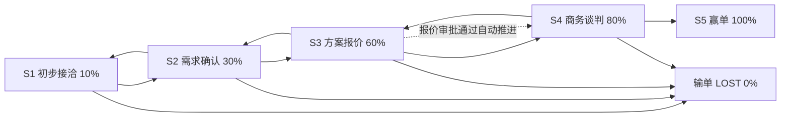
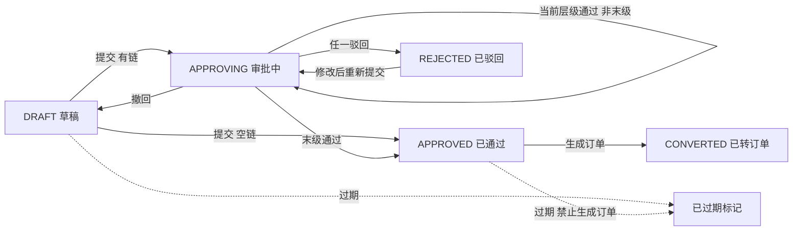
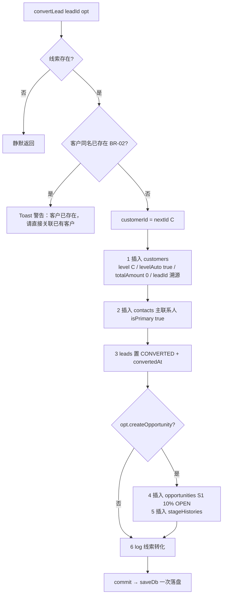
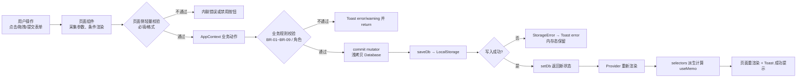

# 详细设计说明书

| 项 | 内容 |
|---|---|
| 文档编号 | SFS-CRM-DD-01 |
| 项目名称 | SalesFlow 智销云 · 销售全流程管理平台（SalesFlow CRM） |
| 版本 | v1.0 |
| 编写日期 | 2026-10-09 |
| 状态 | 已评审通过 |

**版本变更历史**

| 版本 | 日期 | 修订人 | 修订说明 |
|---|---|---|---|
| v0.1 | 2026-10-06 | 开发组 | 模块划分与状态机初稿 |
| v0.8 | 2026-10-08 | 开发组 | 补充审批引擎、回款计划、金额计算 |
| v1.0 | 2026-10-09 | 开发组 | 按评审意见补充伪代码与异常处理 |

---

## 1. 引言

本文档在《总体架构设计说明书》的分层约束下，细化到模块、函数与算法级设计：文件职责清单、五大核心模块的详细逻辑（含伪代码与流程图）、数据流链路与错误处理机制，作为编码实现的直接依据。

---

## 2. 模块划分与文件清单

### 2.1 目录结构

```
app/src
├── types.ts              领域模型（14 实体 + Database）
├── main.tsx              应用入口（StrictMode + BrowserRouter + AppProvider）
├── App.tsx               路由定义与权限守卫
├── config/
│   └── businessRules.ts  业务规则与枚举常量（NFR-M-01）
├── lib/
│   ├── storage.ts        数据访问层（LocalStorage 读写、会话、StorageError）
│   ├── id.ts             业务编号生成器
│   └── format.ts         金额/日期/脱敏格式化工具
├── data/
│   └── seed.ts           演示数据构建与 DEMO_ACCOUNTS
├── store/
│   ├── AppContext.tsx    状态与业务动作层（24 个业务方法 + commit 事务）
│   └── selectors.ts      派生计算与数据可见性
├── components/
│   ├── Layout.tsx        框架布局（侧边导航、页头、PageHeader、FilterBar）
│   ├── ui/index.tsx      基础 UI 组件库
│   └── charts/index.tsx  SVG 图表组件
└── pages/                10 个页面
```

### 2.2 文件职责清单

| 文件 | 行数 | 职责 | 依赖层 |
|---|---|---|---|
| `types.ts` | 313 | 领域模型与类型定义：`Role`、`Lead`、`Customer`、`Opportunity`、`Quotation`、`Order`、`PaymentPlan`、`Payment`、`Database` 等 | 横切 |
| `main.tsx` | 16 | 挂载 React 根节点，包裹 `StrictMode`、`BrowserRouter`、`AppProvider` | 入口 |
| `App.tsx` | 76 | 路由表、未登录重定向、越权拦截、ToastHost 挂载 | 表现层 |
| `config/businessRules.ts` | 148 | 阶段配置 `STAGES/STAGE_MAP`、审批阈值、客户等级阈值、回款模板、角色菜单、枚举字典、状态展示字典 | 横切 |
| `lib/storage.ts` | 66 | `loadDb/saveDb/clearDb`、`loadSession/saveSession/clearSession`、`StorageError`、`DB_VERSION` | 数据访问层 |
| `lib/id.ts` | 32 | `nextId(prefix)` 生成 `{前缀}{年}{4位序号}`；`uid(prefix)` 生成随机 ID；`primeCounter/nextId` 保证重置后不冲突 | 工具 |
| `lib/format.ts` | 71 | `yuan/money/moneyShort/percent/today/now/addDays/daysBetween/monthOf/last12Months/maskPhone/sum` | 工具 |
| `data/seed.ts` | 588 | 构建演示数据（8 用户、24 线索、12 客户、15 商机、10 报价、7 订单、18 计划、9 回款、12 产品、4 目标）、`DEMO_ACCOUNTS` | 数据 |
| `store/AppContext.tsx` | 762 | 全局状态 `db/user/toasts`；24 个业务动作；`commit` 事务；`buildApprovalChain`；`recalcOrderPaid` | 动作层 |
| `store/selectors.ts` | 184 | `deptMemberIds/visible*/pendingMyApproval/dashboardStats/buildFunnel/buildRanking/buildMonthlyPayments/buildSourceDistribution` | 派生层 |
| `components/Layout.tsx` | 121 | 侧边导航（按角色过滤）、顶栏、退出登录、`PageHeader`、`FilterBar` | 表现层 |
| `components/ui/index.tsx` | 296 | `cn/Card/Button/Badge/Field/Input/Textarea/Select/Modal/Drawer/Table/Th/Td/EmptyState/StatCard/Tabs/Progress/Stepper/ToastHost` | 表现层 |
| `components/charts/index.tsx` | 198 | `FunnelChart/LineChart/BarRanking/PieChart/MiniBars` | 表现层 |
| `pages/Login.tsx` | 129 | 登录表单、演示账号一键登录 | 表现层 |
| `pages/Dashboard.tsx` | 179 | 统计卡片、今日待跟进、待我审批、漏斗、回款进度、最近动态 | 表现层 |
| `pages/Leads.tsx` | 423 | 线索列表/筛选/新建/批量分配/跟进抽屉/转化/废弃/来源分布 | 表现层 |
| `pages/Customers.tsx` | 382 | 客户列表、客户 360 抽屉（基础/联系人/商机/订单/回款/日志）、转移 | 表现层 |
| `pages/Opportunities.tsx` | 451 | 商机看板（拖拽）、已关闭列表、详情抽屉、新建（撞单提示）、赢单/输单 | 表现层 |
| `pages/Quotations.tsx` | 409 | 报价列表、新建（明细与实时折扣计算）、提交/撤回、审批、详情与审批链可视化 | 表现层 |
| `pages/Orders.tsx` | 353 | 订单列表、由报价生成、商务审核、状态推进、详情（回款计划与记录） | 表现层 |
| `pages/Payments.tsx` | 256 | 回款计划、登记回款、财务确认、开票、逾期统计 | 表现层 |
| `pages/Analytics.tsx` | 197 | 漏斗/排行/趋势/来源分布/赢输单分析，时间与部门筛选 | 表现层 |
| `pages/Admin.tsx` | 279 | 用户管理、产品目录、数据字典、数据概览、导出与重置 | 表现层 |
| `src/index.css` | — | Tailwind 入口、滚动条样式、`.num` 等宽数字类 | 样式 |

---

## 3. 核心模块详细设计

### 3.1 商机阶段状态机（FR-05 / BR-03）

#### 3.1.1 状态定义

| 阶段 | 名称 | 赢率 | 配置来源 | 颜色 |
|---|---|---|---|---|
| S1 | 初步接洽 | 10% | `STAGES[0]` | `#64748b` |
| S2 | 需求确认 | 30% | `STAGES[1]` | `#0ea5e9` |
| S3 | 方案报价 | 60% | `STAGES[2]` | `#8b5cf6` |
| S4 | 商务谈判 | 80% | `STAGES[3]` | `#f59e0b` |
| S5 | 赢单 | 100% | `STAGES[4]` | `#16a34a` |

商机另有 `status ∈ {OPEN, WON, LOST}` 与阶段并行：`WON` 强制 `stage=S5`、`probability=100`；`LOST` 强制 `probability=0`，阶段保持不变。

#### 3.1.2 转换矩阵

行=源阶段，列=目标阶段。实现允许在 `status === 'OPEN'` 时任意阶段间跳转（含回退），但仅对目标 S3/S4/S5 做强制前置校验；S1、S2 的前置条件（`STAGES[i].requirement`）在界面以提示文案呈现，不做代码阻断。

| 源 \ 目标 | S1 | S2 | S3 | S4 | S5 |
|---|---|---|---|---|---|
| S1 | — | 允许 | 校验：需 ≥1 张报价单 | 校验：需审批通过报价单 | 校验：需已签约订单 |
| S2 | 允许（回退） | — | 校验 | 校验 | 校验 |
| S3 | 允许（回退） | 允许（回退） | — | 校验 | 校验 |
| S4 | 允许（回退） | 允许（回退） | 允许（回退） | — | 校验 |
| S5 / WON / LOST | 拒绝："商机已关闭，不可再推进阶段" |

#### 3.1.3 前置条件校验伪代码

```
function moveStage(oppId, to, remark) -> { ok, message }
  if user == null:              return { false, "未登录" }
  opp = find(opportunities, oppId)
  if opp == null:               return { false, "商机不存在" }
  if opp.status != 'OPEN':      return { false, "商机已关闭，不可再推进阶段" }

  if to == 'S3':
    if !exists(quotations, q => q.opportunityId == oppId):
      return { false, "不满足前置条件：进入「方案报价」阶段需至少创建 1 张报价单" }
  if to == 'S4':
    if !exists(quotations, q => q.opportunityId == oppId && q.status in {APPROVED, CONVERTED}):
      return { false, "不满足前置条件：进入「商务谈判」阶段需存在审批通过的报价单" }
  if to == 'S5':
    if !exists(orders, o => o.customerId == opp.customerId && o.status not in {PENDING, CANCELLED}):
      return { false, "不满足前置条件：赢单需存在已签约的订单，请在订单模块完成商务审核" }

  commit(draft => {
    opp.stage = to
    opp.probability = STAGE_MAP[to].probability
    stageHistories.unshift({ id: uid('SH'), opportunityId, fromStage: opp.stage(旧), toStage, 操作人, remark, 时间 })
  })
  log("推进商机阶段", `${oppId} → ${STAGE_MAP[to].name}`)
  return { true, "" }
```

#### 3.1.4 阶段流程图



#### 3.1.5 关键函数签名与异常

```typescript
moveStage: (oppId: string, to: Stage, remark: string) => { ok: boolean; message: string }
closeOpportunity: (oppId: string, result: 'WON' | 'LOST',
  payload: { reason?: string; competitor?: string; actualAmount?: number }) => void
```

异常与边界：商机关闭后拒绝推进；输单缺原因时不写库（提前 return）；`actualAmount` 缺省为 0（页面回显商机金额作为 placeholder），不做非空强制。

---

### 3.2 折扣审批引擎（FR-06 / BR-04）

#### 3.2.1 决策表

| 规则 | 条件 | 处理 | 审批链 |
|---|---|---|---|
| R1 | `discountRate < 0.15` 且 `折后金额 < 1,000,000` | 无需审批，提交即定稿 | 空链 |
| R2 | `0.15 ≤ discountRate < 0.30` 且 折后金额 < 100 万 | 一级审批 | 销售经理 |
| R3 | `discountRate ≥ 0.30` | 两级审批 | 销售经理 → 销售总监 |
| R4 | 任意折扣率且 `折后金额 ≥ 1,000,000` | 强制两级审批 | 销售经理 → 销售总监 |

阈值常量：`DISCOUNT_NO_APPROVAL = 0.15`、`DISCOUNT_TWO_LEVEL = 0.3`、`AMOUNT_FORCE_TWO_LEVEL = 1_000_000`（`config/businessRules.ts`，满足 NFR-M-01）。

#### 3.2.2 审批链构建算法伪代码

```
function buildApprovalChain(discountRate, amount /* 折后金额 */, db) -> ApprovalStep[]
  needTwo = discountRate >= DISCOUNT_TWO_LEVEL || amount >= AMOUNT_FORCE_TWO_LEVEL
  needOne = discountRate >= DISCOUNT_NO_APPROVAL
  if !needOne && !needTwo: return []            // R1：空链，无需审批

  manager  = find(db.users, u => u.role == 'MANAGER' && u.title == '销售经理')
             ?? find(db.users, u => u.role == 'MANAGER')
  director = find(db.users, u => u.role == 'MANAGER' && u.title.includes('总监'))

  chain = []
  if manager:  chain.push({ step: 1, approverId: manager.id,  approverName, approverRole, status: 'PENDING' })
  if needTwo && director && director.id != manager?.id:
                 chain.push({ step: 2, approverId: director.id, approverName, approverRole, status: 'PENDING' })
  return chain
```

**降级策略**：若未找到经理，链为空 → 提交时直接定稿；若未找到总监或总监与经理为同一人，两级审批退化为一级。该策略保证任何组织配置下流程不会卡死。

#### 3.2.3 审批推进逻辑

```
function approveQuotation(id, action, comment)
  q = find(quotations, id); if !q: return
  if action == 'REJECTED' && comment.trim() == "": toast("驳回必须填写审批意见"); return

  step    = q.currentStep
  myStep  = find(q.approvalChain, s => s.step == step)
  if !myStep || myStep.approverId != user.id:
    toast("权限不足：当前审批层级不归您处理（NFR-S-02）"); return   // 越权拦截

  commit(draft => {
    chain = q.approvalChain.map(s => s.step == step ? { ...s, status: action, comment, at: now() } : s)
    isLast   = step >= chain.length
    rejected = action == 'REJECTED'
    nextStatus = rejected ? 'REJECTED' : (isLast ? 'APPROVED' : 'APPROVING')
    quotations: { ...q, approvalChain: chain, status: nextStatus,
                  currentStep: (rejected || isLast) ? step : step + 1 }
    approvalRecords.unshift({ bizType: 'QUOTATION', bizId: id, step, approverId, action, comment, 时间 })

    // 副作用：报价通过且商机处于 S3 → 自动推进至 S4（probability = 80）并写阶段历史
    if nextStatus == 'APPROVED' && opp.status == 'OPEN' && opp.stage == 'S3':
        opportunities: { ...opp, stage: 'S4', probability: 80 }
        stageHistories.unshift({ fromStage: 'S3', toStage: 'S4', remark: `报价单 ${id} 审批通过，自动推进` })
  })
```

#### 3.2.4 报价单状态机



提交时若 `approvalChain` 为空，直接置 `APPROVED` 并提示"折扣率低于 15%，无需审批，报价单已直接定稿"；重新提交时重置各步 `status='PENDING'`、`comment/at` 清空，审批从头开始（FR-06-05）。

#### 3.2.5 关键函数签名

```typescript
buildApprovalChain(discountRate: number, amount: number, d: Database): ApprovalStep[]
createQuotation(input: { opportunityId: string; validUntil: string; payMethod: string; remark: string;
  items: { productId: string; quantity: number; discountRate: number }[] }): void
submitQuotation(id: string): { ok: boolean; message: string }
approveQuotation(id: string, action: 'APPROVED' | 'REJECTED', comment: string): void
withdrawQuotation(id: string): void
```

---

### 3.3 回款计划生成与状态重算（FR-07-04 / FR-08 / BR-06 / BR-07）

#### 3.3.1 拆分模板

| 付款方式 | 期数 | 比例 | 计划日期（相对签订日偏移） |
|---|---|---|---|
| 全额预付 | 1 | [1] | [+7 天] |
| 三三四 | 3 | [0.3, 0.3, 0.4] | [+7, +30, +90 天] |
| 验收后付 | 2 | [0.5, 0.5] | [+7, +15 天] |

模板定义于 `PAY_PLAN_TEMPLATES`；未匹配到模板时回退为「三三四」。计划编号规则为 `{orderId}-P{期次}`，如 `SO20260003-P1`。

> 实现说明：SRS FR-07-04 描述「验收后付」第二期为"交付日期 + 15 天"，当前实现统一以签订日期 + 偏移天数计算（`offsets[1] = 15`），交付日期仅作为订单字段展示。该偏差已登记，待 v1.1 对齐。

#### 3.3.2 生成与尾差处理伪代码

```
function generatePlans(order, draft)
  tpl  = PAY_PLAN_TEMPLATES[order.payMethod] ?? PAY_PLAN_TEMPLATES['三三四']
  plans = tpl.ratios.map((ratio, i) => ({
    id: `${order.id}-P${i+1}`, orderId: order.id, orderNo: order.id,
    customerName: order.customerName, period: i + 1,
    planAmount: yuan(order.amount * ratio),
    planDate: addDays(order.signDate, tpl.offsets[i] ?? 30),
    paidAmount: 0, status: 'UNPAID',
  }))
  // 尾差处理：前 n-1 期按四舍五入分配，最后一期吸收全部舍入误差
  allocated = yuan(sum(plans.slice(0, -1).map(p => p.planAmount)))
  plans[last].planAmount = yuan(order.amount - allocated)
  draft.paymentPlans = [...plans, ...draft.paymentPlans]
```

**尾差示例**：合同金额 396,000 元，三三四拆分时前两期各 118,800.00，最后一期 = 396,000 − 237,600 = 158,400.00，保证 Σ 期次金额 = 合同金额，杜绝"少一分钱"的对账差异。

#### 3.3.3 状态判定伪代码（每次回款确认后重算）

```
function recalcPlanStatus(plan, draft)
  confirmed = draft.payments.filter(p => p.planId == plan.id && p.status == 'CONFIRMED')  // BR-07：未确认不计入
  paid   = yuan(sum(confirmed.map(p => p.amount)))
  remain = yuan(plan.planAmount - paid)
  plan.paidAmount = paid
  plan.status =
      remain <= 0                        ? 'PAID'
    : paid   >  0                        ? (plan.planDate < today() ? 'OVERDUE' : 'PARTIAL')
    :                                      (plan.planDate < today() ? 'OVERDUE' : 'UNPAID')

function recalcOrderPaid(orderId, draft)                     // 订单已回款
  paid = yuan(sum(draft.payments.filter(p => p.orderId == orderId && p.status == 'CONFIRMED').map(p => p.amount)))
  draft.orders = draft.orders.map(o => o.id == orderId ? { ...o, paidAmount: paid } : o)
```

客户侧同步（BR-07）：确认到账时 `customer.totalAmount = yuan(totalAmount + amount)`；若 `levelAuto === true`，按 `calcCustomerLevel` 重算等级（≥50 万 A、≥10 万 B、其余 C）。

#### 3.3.4 回款登记校验（BR-06）

```
function registerPayment(input) -> { ok, message }
  plan = find(paymentPlans, input.planId);  if !plan: return { false, "回款计划不存在" }
  remain = yuan(plan.planAmount - plan.paidAmount)      // 只减已确认回款，待确认不占用额度
  if input.amount <= 0: return { false, "回款金额必须大于 0" }
  if input.amount > remain:
    return { false, `回款金额不得超过该期次剩余未回款金额 ${remain.toLocaleString()} 元（BR-06）` }
  insert payments({ status: 'REGISTERED', invoiceStatus: 'NONE', ... })
  return { true, "" }
```

> 口径说明：`remain` 基于计划 `paidAmount`，而 `paidAmount` 仅在财务确认后更新，因此"已登记未确认"的回款不占用剩余额度。此为有意设计（BR-07），避免销售重复登记导致额度被虚占。

#### 3.3.5 关键函数签名

```typescript
registerPayment(input: { planId: string; amount: number; method: PayMethod;
  payDate: string; serialNo: string; remark: string }): { ok: boolean; message: string }
confirmPayment(paymentId: string): void
issueInvoice(paymentId: string, invoiceNo: string): void
function recalcOrderPaid(orderId: string, d: Database): void   // AppContext 内部函数
```

---

### 3.4 线索转化事务（FR-03-05 / BR-02）

#### 3.4.1 事务步骤



#### 3.4.2 一致性设计

| 风险 | 处理 |
|---|---|
| 客户已建但线索未转 | 全部变更在同一 `commit` 的 draft 上完成，最后一次性 `saveDb`，不存在半一致落盘 |
| 编号冲突 | `nextId('C')` 在 mutator 外先取，避免 draft 内多次调用；`primeAll` 在装载时用已有最大序号初始化计数器 |
| 归属人缺失 | `ownerId = lead.ownerId ?? user.id`，未分配线索转化后归属转化人 |
| 客户名重复 | 前置校验同名客户（BR-02），命中即中止并提示 |
| 可回退性 | 转化后线索状态置 `CONVERTED` 且页面不再提供转化入口，语义上不可回退 |

#### 3.4.3 关键函数签名

```typescript
convertLead(leadId: string, opt: { createOpportunity: boolean; opportunityTitle?: string; amount?: number }): void
```

---

### 3.5 金额计算（SRS 2.5 约束 3）

#### 3.5.1 精度策略

| 项 | 设计 |
|---|---|
| 存储单位 | 元（number），保留 2 位小数 |
| 计算过程 | 每一步四则运算后立即 `yuan()` 归一，等价于"精确到分" |
| 归一函数 | `yuan(v) = Math.round(v * 100) / 100` |
| 展示 | `money(v)` 千分位 + 2 位；`moneyShort(v)` ≥1 万显示"万"、≥1 亿显示"亿" |
| 对齐 | 表格/卡片使用 `.num`（`tabular-nums`）保证数字等宽右对齐（NFR-U-06） |

#### 3.5.2 报价计算链

```
for each item:
  subtotal   = yuan(product.price * quantity)
  netAmount  = yuan(subtotal * (1 - discountRate))
  total      = yuan(total + subtotal)
  net        = yuan(net + netAmount)
discountRate = total > 0 ? yuan(1 - net / total) : 0
```

页面侧（`CreateQuotationModal.calc`）与动作侧（`createQuotation`）使用同一公式，保证界面预览与最终落库数值一致；`createQuotation` 以动作侧计算为准重新计算一次，不信任页面传入的汇总值。

#### 3.5.3 快照策略

| 快照对象 | 字段 | 目的 |
|---|---|---|
| 报价明细 | `productName / spec / unit / price` | 产品目录调价不影响历史报价（ADR-04） |
| 审批链 | `approverId / approverName / approverRole` | 审批人身份以创建时快照为准（ADR-03） |
| 单据冗余 | `opportunityTitle / customerName / ownerName / orderNo` | 列表展示免联表，历史单据名称变更不失真 |
| 订单金额 | `order.amount = quotation.discountAmount` | 合同金额锁定为报价折后金额 |

#### 3.5.4 关键函数签名

```typescript
function yuan(v: number): number            // 归一到分
function money(v: number): string           // 千分位展示
function moneyShort(v: number): string      // 万/亿简写
function sum(list: number[]): number        // 求和并归一
```

---

### 3.6 编号生成与启动装载

#### 3.6.1 编号规则

业务编号格式 `{前缀}{年份}{4 位序号}`，由 `lib/id.ts` 统一生成：线索 `L`、客户 `C`、商机 `O`、报价 `Q`、订单 `SO`、回款 `PAY`。非业务主数据采用随机 ID：跟进记录 `FU`、联系人 `CT`、报价明细 `QI`、阶段历史 `SH`、审批记录 `AR`、操作日志 `AL`，由 `uid()` 组合时间戳（36 进制）与随机串生成，保证同毫秒内不重复。

#### 3.6.2 计数器初始化与幂等装载

```
function primeAll(db)
  resetCounters()
  for (prefix, ids) of [['L', leads], ['C', customers], ['O', opportunities],
                        ['Q', quotations], ['SO', orders], ['PAY', payments]]:
      primeCounter(prefix, ids)     // 取当前年份下最大序号作为起点

// AppProvider 初始化（幂等，可安全重复执行）
existing = loadDb()
if existing:  primeAll(existing); state = existing
else:         seed = buildSeedDb(); primeAll(seed); saveDb(seed); state = seed
```

装载流程保证三点：一是重置演示数据后编号不与历史 ID 冲突；二是 React 严格模式下初始化函数被重复执行时，第二次会命中已写入的数据，不会生成两份种子数据；三是任何一次装载完成后计数器与库中数据保持同步。

#### 3.6.3 会话装载

会话独立存放于 `salesflow:session`，仅保存 `userId` 与 `loginAt`。当前用户由 `db.users.find(u => u.id === userId) ?? null` 派生（`useMemo`），因此用户被删除或停用后，会话会自动失效并退回登录页，无需额外清理逻辑。

---

## 4. 数据流设计

### 4.1 完整链路



### 4.2 关键节点说明

| 节点 | 说明 |
|---|---|
| 页面侧校验 | 只做即时反馈（必填、数字范围、格式），不替代业务规则 |
| 动作层校验 | 唯一权威校验，返回 `{ ok, message }` 供页面决定是否提示 |
| `commit` | `setDb(prev => { const draft = {...prev}; mutator(draft); saveDb(draft); return draft })`；mutator 内禁止原地 `push`，必须整体替换数组 |
| 落盘 | `saveDb` 在 `setDb` 的更新函数内同步执行，保证"状态更新 = 已持久化"（NFR-R-01） |
| 派生重算 | 页面用 `useMemo` 依赖 `db`/`user` 重算可见集合与统计，避免无效计算 |
| 反馈 | 成功/失败均 Toast；失败不写库，状态不变 |

### 4.3 渲染优化约定

| 手段 | 位置 |
|---|---|
| `useMemo` 缓存可见集合与统计 | 全部列表页、`Dashboard`、`Analytics` |
| `useCallback` 稳定动作引用 | `AppContext` 全部动作 |
| `useRef` 暂存拖拽项 | `Opportunities.tsx` 的 `draggingRef` |
| 局部 state 控制弹窗/抽屉 | 各页面的 `open/detail/target` 状态 |

---

## 5. 错误处理机制

### 5.1 错误分类与处理

| 类别 | 代表 | 处理机制 | 用户可见 |
|---|---|---|---|
| 持久化错误 | `StorageError` | `saveDb` 抛出 → `commit` 内 `try/catch` → `window.setTimeout(() => toast(msg,'error'), 0)` | 是，提示含"存储容量已满，请导出备份后重置数据" |
| 业务规则错误 | BR-01/03/05/06/08 | 动作内提前 `return` + Toast | 是，文案含规则编号 |
| 权限错误 | 角色/审批层级不匹配 | 动作内提前 `return` + Toast（标注 NFR-S-02） | 是 |
| 数据不存在 | 商机/报价/计划不存在 | 动作内 `if (!x) return` 或返回 `{ ok:false, message }` | 是 |
| 解析错误 | LocalStorage JSON 损坏 | `readRaw` 捕获并返回 `null` → `AppProvider` 重建演示数据 | 否，静默恢复（NFR-R-03） |

### 5.2 事务包装 `commit`

```typescript
const commit = useCallback((mutator: (draft: Database) => void) => {
  setDb((prev) => {
    const draft: Database = { ...prev };
    mutator(draft);
    try {
      saveDb(draft);
    } catch (e) {
      // 避免在上更新函数内直接 setState，延迟到下一个宏任务
      window.setTimeout(() => toast(e instanceof Error ? e.message : String(e), 'error'), 0);
    }
    return draft;                 // 即使落盘失败，内存态仍然生效（NFR-R-02）
  });
}, [toast]);
```

要点：

1. 通过 `window.setTimeout(..., 0)` 把 Toast 的 `setState` 移出 updater 函数，规避 React 18 严格模式下 updater 被重复执行导致的副作用重复与告警；
2. 落盘失败不回滚内存态，用户仍可导出数据自救；
3. 所有写操作必须经 `commit`，不允许直接 `setDb`。

### 5.3 Toast 队列

| 项 | 实现 |
|---|---|
| 数据结构 | `ToastItem { id, tone: 'success'\|'error'\|'info'\|'warning', message }` |
| 入队 | `toast(message, tone)` 自增 `toastSeq.current` 作为 id，追加到数组 |
| 出队 | 3.6 秒后自动移除；点击进入 `dismissToast` 立即移除 |
| 渲染 | `ToastHost` 固定右上角，`z-[100]`，按 tone 映射配色 |

### 5.4 恢复与兜底

| 场景 | 处理 |
|---|---|
| 首次启动无数据 | `loadDb()` 返回 `null` → `buildSeedDb()` → `saveDb` |
| 数据损坏 | `readRaw` 结构校验失败返回 `null` → 同上重建 |
| 存储写满 | `StorageError` 提示，引导 Admin 导出备份后重置 |
| 编号冲突 | `primeAll` 遍历已有 ID 初始化计数器，`resetDemo` 时先 `resetCounters()` |

---

## 6. 设计约束与已知偏差

| 编号 | 偏差 | 影响 | 计划 |
|---|---|---|---|
| D-01 | `AppContext.tsx` 762 行、`seed.ts` 588 行等超过 NFR-M-04 的 300 行上限 | 单文件阅读成本较高 | 后续按领域拆分为 `actions/*.ts` |
| D-02 | 整库单键存储（与《数据库设计说明书》分实体设计不一致） | 单次写入体积较大 | 已在架构 ADR-07 记录 |
| D-03 | 「验收后付」第二期按签订日 +15 天而非交付日 +15 天 | 与 SRS 文字描述略有差异 | v1.1 对齐 |
| D-04 | 阶段 S1/S2 前置条件仅提示不阻断 | 流程约束弱于 SRS 表格描述 | 后续补充需求确认信息字段后启用 |
| D-05 | 金额以元存储并 `yuan()` 归一，未按整数分存储 | 语义等价，实现更简洁 | 若出现大额累计误差再改为分 |

---

**评审记录**

| 角色 | 意见 | 日期 |
|---|---|---|
| 架构师 | 同意通过 | 2026-10-09 |
| 开发负责人 | 同意通过 | 2026-10-09 |
