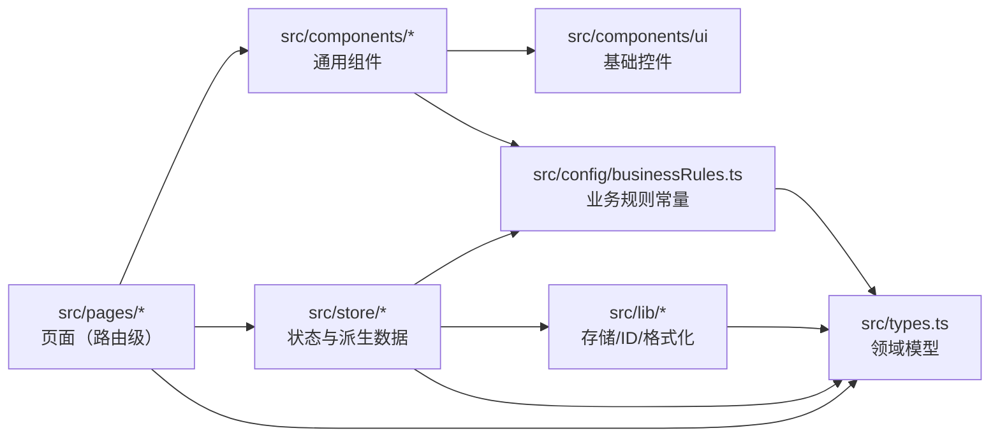

# 编码规范（Coding Standard）

| 项 | 内容 |
|---|---|
| 文档编号 | SFS-CRM-CS-01 |
| 项目名称 | SalesFlow 智销云 · 销售全流程管理平台（简称 SalesFlow CRM） |
| 版本 | v1.0 |
| 编写日期 | 2026-10-09 |
| 状态 | 已评审通过 |

**版本变更历史**

| 版本 | 日期 | 修订人 | 修订说明 |
|---|---|---|---|
| v0.5 | 2026-10-05 | 开发组 | 依据技术选型（Vite 5 + React 18 + TS 5）建立初稿 |
| v1.0 | 2026-10-09 | 开发组 | 补充业务规则集中化约定与 20 条代码评审检查单 |

---

## 1. 引言

### 1.1 编写目的

本文档统一 SalesFlow CRM 前端源码的编码风格与工程约束，使多人协作产出的代码具备一致的可读性、可维护性与可评审性，降低代码评审成本，并为《代码评审记录》与《测试报告》提供判定依据。

### 1.2 适用范围

适用于 `app/` 目录下全部源码（`*.ts` / `*.tsx` / `*.css` / `*.html` / `*.json`），以及所有参与本项目编码、评审、重构的人员。

### 1.3 技术前提（以实际工程配置为准）

| 项 | 实际值 | 来源 |
|---|---|---|
| 构建工具 | Vite 5.4.x | `app/package.json` |
| 框架 | React 18.3.x | `app/package.json` |
| 语言 | TypeScript 5.6.x | `app/package.json` |
| 路由 | React Router 6.26.x | `app/package.json` |
| 样式 | Tailwind CSS 3.4.x + PostCSS + autoprefixer | `app/tailwind.config.js` |
| 编译选项 | `strict: true`、`noUnusedLocals: true`、`noUnusedParameters: true`、`noFallthroughCasesInSwitch: true`、`jsx: react-jsx`、`moduleResolution: bundler` | `app/tsconfig.json` |
| 路径别名 | `@/*` → `src/*` | `app/vite.config.ts` + `app/tsconfig.json` |
| 开发端口 | 5173 | `app/vite.config.ts` |

### 1.4 参考资料

- 《软件需求规格说明书》SFS-CRM-SRS（NFR-M-01 业务规则可配置、NFR-S-01/02 权限与鉴权、NFR-R-02 存储失败不得静默）
- 《数据库设计说明书》SFS-CRM-DB-01（第 3 章逻辑表结构、第 6 章 Repository 接口契约）
- 《系统设计说明书》（分层架构与模块划分）

---

## 2. 通用原则

| 编号 | 原则 | 说明 |
|---|---|---|
| P-1 | **可读性优先** | 代码是写给人看的，其次才是给机器执行。宁可多一个中间变量，不要一行嵌套三层三元表达式。 |
| P-2 | **单一职责** | 一个文件、一个函数、一个组件只做一件事。页面组件负责"取数 + 渲染 + 触发动作"，不负责计算业务规则。 |
| P-3 | **单文件不超过 300 行** | 超过 300 行必须拆分：抽取子组件、抽取自定义 Hook、抽取选择器函数。页面文件（如 `src/pages/Quotations.tsx`）通过抽取 `Modal` 表单区、表格区、行操作区来控制体积。 |
| P-4 | **命名即注释** | 好的命名可以省掉注释。如果必须靠注释才能说明一个变量是什么，说明命名失败，应先改名。 |
| P-5 | **显式优于隐式** | 类型、props、返回值、依赖项一律显式声明，禁止依赖推断"蒙混过关"。 |
| P-6 | **不重复（DRY）** | 同一段逻辑出现第 3 次时，必须抽取。前两次可以容忍，第三次必须抽象。 |
| P-7 | **先正确后优雅** | 不要为了"优雅"引入尚未需要的抽象层；但也不要为了省事把业务规则写死在 JSX 里。 |

**依赖方向约定**（只能单向依赖，禁止反向引用）：



反向引用（如 `lib/` 引用 `store/`）属于架构违规，代码评审一律打回。

---

## 3. 命名规范

### 3.1 总表

| 对象 | 规则 | 正例 | 反例 |
|---|---|---|---|
| 目录 | 小写单词，复数表示集合；不使用驼峰、不使用下划线 | `components`、`pages`、`store`、`config`、`lib`、`data` | `Components`、`my_components`、`srcPage` |
| 页面文件 | **PascalCase**，与路由一一对应 | `Quotations.tsx`、`Opportunities.tsx`、`Dashboard.tsx` | `quotation.tsx`、`QuotationPage.tsx`、`quotations.tsx` |
| 组件文件 | **PascalCase**，与导出组件同名 | `Layout.tsx`（导出 `Layout`）、`charts/index.tsx`（导出 `FunnelChart`） | `layout.tsx`、`ChartIndex.tsx` |
| 非组件文件 | **camelCase**，体现职责 | `storage.ts`、`format.ts`、`id.ts`、`businessRules.ts`、`seed.ts`、`selectors.ts` | `Storage.ts`、`utils.ts`、`tools.ts`、`common.ts` |
| 组件 / 类型 | **PascalCase** | `StatCard`、`ApprovalStep`、`PayPlanTemplate` | `statCard`、`approval_step` |
| 变量 / 函数 | **camelCase**，动词开头命名函数 | `visibleLeads`、`buildFunnel`、`calcCustomerLevel`、`pendingMyApproval` | `VisibleLeads`、`get_data`、`f()` |
| 布尔值 | `is/has/can/should` 前缀 | `isPrimary`、`hasApproval`、`canApprove` | `primary`、`flag`、`check` |
| 常量 | **UPPER_SNAKE_CASE** | `DISCOUNT_TWO_LEVEL`、`AMOUNT_FORCE_TWO_LEVEL`、`CUSTOMER_LEVEL_A` | `discountTwoLevel`、`TwoLevel` |
| 常量集合 / 字典 | **UPPER_SNAKE_CASE**（复数或 `_MAP` / `_STATUS` 后缀） | `STAGES`、`STAGE_MAP`、`ROLE_MENUS`、`QUOTATION_STATUS`、`PAY_PLAN_TEMPLATES` | `stages`、`quotationStatus` |
| 类型别名（联合字面量） | **PascalCase** | `type Role = 'SALES' \| 'MANAGER' \| 'FINANCE' \| 'ADMIN'` | `type role = ...` |
| 枚举值 / 状态值 | **UPPER_SNAKE_CASE** 或领域既定缩写 | `'APPROVING'`、`'WON'`、`'PARTIAL'`、阶段 `'S1'`~`'S5'` | `'approving'`、`'won'` |
| LocalStorage 键 | `产品名:域`，全小写 | `salesflow:db`、`salesflow:session` | `DB`、`salesflow_db` |
| 业务编号前缀 | 大写字母前缀 + 数字，由 `nextId(prefix)` 生成 | 线索 `L0001`、客户 `C0001`、商机 `O0001`、报价 `Q0001`、订单 `SO0001`、回款 `PAY0001` | `lead-1`、`1`、UUID 直接当业务编号 |
| 事件回调 props | `on` + 动词 | `onChange`、`onDismiss`、`onSubmit` | `change`、`handleChange`（`handleXxx` 留给组件内部函数） |
| 组件内部事件处理 | `handle` + 对象 + 动作 | `handleApprove`、`handleRowClick` | `onApprove`（易与 props 混淆） |
| CSS 类名 | 仅 Tailwind 工具类；自定义类名用短横线 | `className="rounded-lg border border-ink-200"` | `className="quotation-card-big"` |

### 3.2 补充说明

1. **禁止拼音命名**：一律使用英文单词，`lead`、`quotation`、`payment` 等为领域标准词，不得写成 `xianSuo`、`baoJia`。
2. **禁止无意义后缀**：不要出现 `Data`、`Info`、`Obj`、`Temp`、`List2` 这类后缀。`db.leads` 已表明是集合，不要写成 `leadsList`。
3. **缩写要约定俗成**：仅允许 `db`、`id`、`opp`（商机）、`qty`（数量）、`no`（编号）等本项目已约定的缩写，其余一律写全。
4. **禁止在命名中使用版本号或日期**：`selectors_v2.ts`、`formatNew.ts` 一律禁止，需要新版本就改名并同步引用。

---

## 4. TypeScript 规范

### 4.1 编译选项（不可弱化）

`app/tsconfig.json` 中以下选项**不得关闭**（PR 中修改这些项为架构变更，需组长批准）：

```jsonc
{
  "strict": true,                     // P-5：显式优于隐式
  "noUnusedLocals": true,             // 禁止声明未使用的变量/导入
  "noUnusedParameters": true,         // 禁止未使用的形参（可用 _ 前缀豁免）
  "noFallthroughCasesInSwitch": true, // switch 必须 break/return
  "isolatedModules": true,            // 禁止 const enum、禁止类型重导出歧义
  "jsx": "react-jsx"                  // 无需 import React 即可用 JSX
}
```

提交前必须执行并通过：

```bash
cd app
npm run typecheck
```

> `npm run build` 内部为 `tsc -b && vite build`，构建期同样会做类型检查，类型不通过则产物不出。

### 4.2 禁止 `any`

| 场景 | 正确做法 | 错误做法 |
|---|---|---|
| 未知结构 | 用 `unknown` + 类型守卫 | `const x: any = JSON.parse(raw)` |
| 第三方无类型 | 在 `src/types.ts` 补充声明，或用 `as` 精确断言一次 | `as any` |
| 事件对象 | 使用 React 提供的类型 `React.ChangeEvent<HTMLInputElement>` | `(e: any) => ...` |
| 空数组初值 | 显式标注 `useState<Lead[]>([])` | `useState([])` |

例外：仅在 `catch (e)` 中可保持 `unknown`，通过 `e instanceof Error ? e.message : String(e)` 取值（见 `src/lib/storage.ts` 的 `saveDb`）。

### 4.3 类型定义位置

**所有领域模型（实体、枚举、状态字典）集中定义在 `src/types.ts`**，不在组件内、不在页面内重复定义。

- 实体：`User` / `Lead` / `FollowUp` / `Customer` / `Contact` / `Opportunity` / `StageHistory` / `Product` / `Quotation` / `QuotationItem` / `ApprovalStep` / `ApprovalRecord` / `Order` / `PaymentPlan` / `Payment` / `Target` / `ActivityLog`
- 聚合根：`Database`（`version` + 全部实体数组）
- 联合类型：`Role`、`Stage`、`LeadStatus`、`QuotationStatus`、`OrderStatus`、`PlanStatus`、`PayMethod` 等

允许在**使用处就近定义**的仅限：组件的 props 结构（若仅该组件使用）、纯展示用的行数据结构（如 `src/store/selectors.ts` 中导出的 `FunnelRow`、`RankRow`）。

### 4.4 `interface` vs `type`

| 约定 | 说明 | 示例 |
|---|---|---|
| 实体、对象结构 → `interface` | 可被 `extends`、声明合并，语义为"结构契约" | `export interface Order { ... }` |
| 联合字面量、元组、映射、函数签名 → `type` | 只能用 `type` 表达 | `export type Role = 'SALES' \| 'MANAGER' \| 'FINANCE' \| 'ADMIN'` |
| 同一文件内不混用 | 对象结构统一 `interface`，联合统一 `type` | — |

### 4.5 泛型与 Repository 契约

数据访问层（`src/lib/storage.ts`）与状态层（`src/store/AppContext.tsx`）遵循以下契约：

```ts
// 1. 只读派生（选择器）：纯函数，输入 Database，输出视图数据，不得修改入参
export function visibleOrders(db: Database, user: User | null): Order[]

// 2. 写入动作：通过 commit(mutator) 事务包装，改 → 落盘 → 失败提示
const commit = useCallback((mutator: (draft: Database) => void) => { /* ... */ }, []);

// 3. 通用集合操作泛型（如需新增，遵循此签名形态）
export interface Repository<T extends { id: string }> {
  list(): T[];
  findById(id: string): T | undefined;
  insert(entity: Omit<T, 'id'>): T;
  update(id: string, patch: Partial<T>): T;
  remove(id: string): void;
}
```

规则：

1. **新建实体统一使用 `Omit<T, 'id' | ...>` 表达输入**，让调用方无法伪造 `id`、`createdAt` 等由系统生成的字段（见 `AppCtx.createLead`、`createQuotation`）。
2. **业务动作返回值显式声明**：可能失败的动作返回 `{ ok: boolean; message: string }`（如 `moveStage`、`submitQuotation`、`registerPayment`、`login`），不会失败的动作返回 `void`。
3. **禁止跨层直接 `localStorage.getItem`**：只有 `src/lib/storage.ts` 允许操作 `localStorage`，其他层一律通过 `loadDb/saveDb/loadSession/saveSession`。

### 4.6 其他

- 导入类型必须用 `import type { ... } from '@/types'`，避免运行时引入（`isolatedModules` 下更安全）。
- 导入路径统一使用 `@/` 别名，禁止 `../../../` 形式的深层相对路径。
- 数字字面量允许使用分隔符提升可读性：`1_000_000`、`500_000`。
- 禁止使用 `!` 非空断言绕过检查，除非该处上下文已 100% 保证非空且附注释（如 `document.getElementById('root')!`）。

---

## 5. React 规范

### 5.1 组件形态

- **一律使用函数组件 + Hooks**，禁止类组件。
- 页面组件为默认导出：`export default function Quotations() { ... }`。
- 通用组件为具名导出：`export function StatCard(...) { ... }`。
- **props 类型必须显式声明**（P-5），可以内联对象字面量类型，也可以独立 `interface`：

```tsx
// 正例：内联显式声明
export function Badge({ children, tone = 'neutral', className }: {
  children: React.ReactNode;
  tone?: Tone;
  className?: string;
}) { /* ... */ }

// 反例：隐式 any
export function Badge(props) { /* ... */ }
```

### 5.2 Hooks 规则

| 规则 | 说明 |
|---|---|
| H-1 | 只在组件顶层调用 Hooks，禁止在 `if` / `for` / 嵌套函数中调用。 |
| H-2 | `useEffect` / `useMemo` / `useCallback` 的依赖数组必须完整，禁止为了"只跑一次"而故意漏依赖；确实需要忽略时必须写注释说明原因。 |
| H-3 | **禁止在渲染过程中做副作用**：不得在组件函数体内直接 `localStorage.setItem`、`window.location.href = ...`、发起请求；副作用一律放 `useEffect` 或事件回调。 |
| H-4 | 派生数据用 `useMemo`，避免每次渲染重算（如 `dashboardStats`、`buildFunnel`）。 |
| H-5 | 传给 Context 的函数用 `useCallback` 包裹，避免 Provider 值频繁变更导致全树重渲染（`AppContext` 中 `toast`、`dismissToast`、`commit` 均已包裹）。 |
| H-6 | 定时器必须在 `useEffect` 清理函数中清除（`AppContext.toast` 的 `window.setTimeout` 需在卸载时清理）。 |
| H-7 | 自定义 Hook 以 `use` 开头，放在 `src/store/` 或组件同目录，不跨层引用页面。 |

### 5.3 组件拆分原则

单个文件超过 300 行（P-3）时，按以下顺序拆分：

1. **纯展示片段 → 子组件**：表格行、卡片、表单区域抽为本页内的小组件或 `components/` 下组件。
2. **状态逻辑 → 自定义 Hook**：筛选、分页、弹窗开合等抽为 `useXxx`。
3. **数据加工 → 选择器**：放 `src/store/selectors.ts`，保持页面只负责渲染。

拆分的判定标准：一段 JSX 或逻辑**有独立的可命名语义**，且被复用或超过 40 行，即应抽取。

### 5.4 渲染与事件

- 列表渲染必须提供稳定的 `key`，使用业务 `id`，**禁止使用数组下标**（`key={i}` 会在排序/删除后导致状态错乱）。
- 不要在 JSX 中写复杂三元嵌套，超过一层改写为 `&&` + 子组件，或提前计算变量：

```tsx
// 反例
{status === 'APPROVING' ? (isMine ? <BtnA/> : <BtnB/>) : status === 'APPROVED' ? <BtnC/> : null}

// 正例
const actionNode = renderQuotationAction(q, user);
return <>{actionNode}</>;
```

- 弹窗（`Modal` / `Drawer`）受控于本页状态，关闭时必须清理表单草稿。
- 表单提交按钮在提交中需 `disabled`，避免重复提交产生重复流水。

---

## 6. 样式规范

### 6.1 Tailwind 优先

- **一律使用 Tailwind 工具类**，禁止新建 `.css` 业务样式文件；全局样式只允许存在于 `src/index.css`（Tailwind 三层指令 + `@layer base` + `@layer components`）。
- 极少数必须自定义的样式（如 `.num` 表格数字等宽）写在 `src/index.css` 的 `@layer components` 中。

### 6.2 禁止内联魔法数字

```tsx
// 反例：内联 style 与魔法数字
<div style={{ width: 320, marginTop: 17, color: '#3b62f6' }}>...</div>

// 正例：Tailwind 语义类
<div className="mt-4 w-80 text-brand-500">...</div>
```

### 6.3 颜色只能使用 theme 色板

`app/tailwind.config.js` 中 `theme.extend.colors` 仅定义两套色板，**业务代码不得出现其他颜色值**（图表配色除外，图表颜色由 `STAGES[].color` 常量提供）：

| 色板 | 取值 | 用途 |
|---|---|---|
| `brand-50` ~ `brand-900` | 主色蓝，`brand-500 = #3b62f6` | 主按钮、链接、选中态、品牌标识 |
| `ink-50` ~ `ink-900` | 中性灰，`ink-900 = #1c2027` | 背景、边框、正文、次级文字 |

语义映射约定：

| 语义 | 类名 |
|---|---|
| 页面背景 | `bg-ink-50` |
| 卡片 | `bg-white border border-ink-200 rounded-lg shadow-card` |
| 主标题 | `text-ink-900` |
| 正文 | `text-ink-800` |
| 次级/说明文字 | `text-ink-500` |
| 主按钮 | `bg-brand-600 hover:bg-brand-700 text-white` |
| 危险操作 | `text-red-600`（仅用于危险语义，且需在评审中确认） |

阴影仅使用 theme 中定义的 `shadow-card`、`shadow-pop`，禁止自定义 `boxShadow`。

### 6.4 响应式与断点

- **本产品面向 PC Web，设计基准分辨率 1440×900**，`index.html` 中已固定 `<meta name="viewport" content="width=1440" />`。
- **PC 优先**：先保证 1440 宽下布局完整，再向下兼容 1280。
- 响应式断点使用 Tailwind 默认：`sm 640 / md 768 / lg 1024 / xl 1280 / 2xl 1536`。
- 表格类页面优先使用横向滚动容器而非堆叠布局，避免列折叠导致数据缺失。
- **不做移动端适配**（见《软件需求规格说明书》约束），因此禁止为移动端新增断点样式。

---

## 7. 业务规则规范（NFR-M-01）

**硬约束：所有业务阈值、枚举字典、状态文案、权限矩阵必须集中在 `src/config/businessRules.ts`；组件、页面、store 中一律不得出现字面量阈值。**

### 7.1 正例

```ts
// src/config/businessRules.ts
/** 折扣率 ≥ 该值需两级审批 */
export const DISCOUNT_TWO_LEVEL = 0.3;
/** 金额 ≥ 该值强制两级审批（元） */
export const AMOUNT_FORCE_TWO_LEVEL = 1_000_000;
```

```ts
// src/store/AppContext.tsx（引用常量，不重复数值）
import { DISCOUNT_NO_APPROVAL, DISCOUNT_TWO_LEVEL, AMOUNT_FORCE_TWO_LEVEL } from '@/config/businessRules';

function buildApprovalChain(discountRate: number, amount: number): ApprovalStep[] {
  if (discountRate >= DISCOUNT_TWO_LEVEL || amount >= AMOUNT_FORCE_TWO_LEVEL) {
    return [managerStep, financeStep]; // 两级
  }
  if (discountRate >= DISCOUNT_NO_APPROVAL) {
    return [managerStep]; // 一级
  }
  return []; // 免审批
}
```

### 7.2 反例（评审直接打回）

```ts
// 反例 1：页面里硬编码阈值
if (form.discountRate >= 0.3) setTwoLevel(true);          // ❌ 0.3 是魔法数字

// 反例 2：把阈值常量定义在页面文件顶部
const TWO_LEVEL = 0.3;                                     // ❌ 规则不在 config 中

// 反例 3：直接写死状态文案
<span>{q.status === 'APPROVING' ? '审批中' : '已通过'}</span> // ❌ 应使用 QUOTATION_STATUS 字典

// 反例 4：把权限判断写进组件
if (user.role === 'ADMIN')                                 // ❌ 应使用 ROLE_MENUS
```

### 7.3 规则清单

| 规则 | 落地位置 |
|---|---|
| 商机阶段定义与概率 | `STAGES` / `STAGE_MAP` |
| 折扣审批阈值 | `DISCOUNT_NO_APPROVAL` / `DISCOUNT_TWO_LEVEL` / `AMOUNT_FORCE_TWO_LEVEL` |
| 客户等级阈值 | `CUSTOMER_LEVEL_A` / `CUSTOMER_LEVEL_B` + `calcCustomerLevel()` |
| 回款计划模板 | `PAY_PLAN_TEMPLATES` / `PAY_METHODS` |
| 角色标签与菜单权限 | `ROLE_LABEL` / `ROLE_MENUS` |
| 枚举字典（来源、行业、流失原因等） | `LEAD_SOURCES` / `INDUSTRIES` / `LOST_REASONS` / `LEAD_LOST_REASONS` / `FOLLOW_UP_TYPES` / `PAY_METHODS_PAYMENT` |
| 状态展示字典（含语义色） | `LEAD_STATUS` / `QUOTATION_STATUS` / `ORDER_STATUS` / `PLAN_STATUS` / `PAYMENT_STATUS` / `INVOICE_STATUS` |

新增规则时的动作序列：① 在 `businessRules.ts` 增加常量并写注释 → ② 在 `store` 中引用 → ③ 若影响展示，同步更新状态字典 → ④ 更新《需求跟踪矩阵》中对应 NFR 条目。

---

## 8. 注释规范

### 8.1 文件头注释

每个文件（`.ts` / `.tsx`）首行必须有块注释，说明**职责**与**对应设计文档章节**：

```ts
/**
 * 全局应用状态与业务动作
 * 所有业务规则集中在此执行，页面组件只负责展示与调用
 */
```

```ts
/**
 * 业务规则集中配置
 * 依据 NFR-M-01：业务规则必须集中配置，禁止在组件中硬编码
 * 对应《软件需求规格说明书》FR-05 / FR-06 / FR-07 / FR-08
 */
```

### 8.2 必须写注释的情形

| 情形 | 要求 |
|---|---|
| 复杂业务规则 / 算法 | 说明"为什么这么做"，而非"做了什么" |
| 非直观的边界条件 | 如 `discountRate >= DISCOUNT_TWO_LEVEL` 为何取闭区间 |
| 常量 | 每个导出常量必须有 `/** 含义 + 单位 */` |
| 规避性代码 / 兼容处理 | 说明规避对象与可移除条件 |
| 对外暴露的接口 | 用 JSDoc 描述参数与返回值语义 |

### 8.3 禁止

- **禁止注释掉的代码**：`// const old = ...`、`/* ... */` 包裹的整段代码一律删除，历史由 Git 保管。
- 禁止"翻译式"注释：`// 设置状态为 true` 写在 `setOpen(true)` 上方。
- 禁止在行尾写长注释，超过 20 字改为上一行块注释。
- 禁止使用注释标记个人信息（`@author` 除外，且由 Git 记录更可靠）。

### 8.4 TODO 规范

允许 `// TODO(负责人): 说明 + 期望完成节点`，但**不允许 TODO 进入 release 分支**，发布前必须清理或转为需求条目。

---

## 9. 目录结构与文件放置约定

```
app/
├── index.html                     # 入口 HTML，固定 viewport width=1440
├── package.json                   # 依赖与脚本
├── tsconfig.json                  # TS 编译配置（strict）
├── vite.config.ts                 # Vite 配置（别名 @、端口 5173、outDir dist）
├── tailwind.config.js             # 主题色板 brand / ink
├── postcss.config.js              # PostCSS（tailwindcss + autoprefixer）
└── src/
    ├── main.tsx                   # 应用入口，挂载 StrictMode + BrowserRouter + AppProvider
    ├── App.tsx                    # 路由表与登录/越权拦截
    ├── index.css                  # 全局样式（唯一业务 CSS 入口）
    ├── types.ts                   # 领域模型集中定义
    ├── config/
    │   └── businessRules.ts       # 业务规则常量（唯一来源）
    ├── lib/
    │   ├── storage.ts             # LocalStorage 数据访问层（唯一可触碰 localStorage 的文件）
    │   ├── id.ts                  # 业务编号生成（nextId / uid / primeCounter）
    │   └── format.ts              # 金额/日期/百分比格式化
    ├── data/
    │   └── seed.ts                # 演示数据种子（buildSeedDb / DEMO_ACCOUNTS）
    ├── store/
    │   ├── AppContext.tsx         # 全局状态 Provider + 全部业务动作
    │   └── selectors.ts           # 纯派生（权限过滤、统计、图表数据）
    ├── components/
    │   ├── Layout.tsx             # 主框架：侧边栏/顶栏/PageHeader/FilterBar
    │   ├── ui/index.tsx           # 基础控件库（Button/Card/Modal/Table/Badge...）
    │   └── charts/index.tsx       # 自绘图表（Funnel/Line/Pie/Bar/MiniBars）
    └── pages/                     # 10 个路由级页面
        ├── Login.tsx  Dashboard.tsx  Leads.tsx  Customers.tsx  Opportunities.tsx
        └── Quotations.tsx  Orders.tsx  Payments.tsx  Analytics.tsx  Admin.tsx
```

| 我要新增… | 放在哪 | 命名 |
|---|---|---|
| 新的业务阈值 / 字典 | `src/config/businessRules.ts` 追加导出 | `UPPER_SNAKE_CASE` |
| 新的实体 / 联合类型 | `src/types.ts` | `PascalCase` |
| 新的路由页面 | `src/pages/` | `PascalCase.tsx`，默认导出 |
| 可复用的展示组件 | `src/components/`（通用）或页面同目录（私有） | `PascalCase.tsx` |
| 新的基础控件 | `src/components/ui/index.tsx` 追加导出 | `PascalCase` |
| 新的图表 | `src/components/charts/index.tsx` 追加导出 | `PascalCase` |
| 新的派生统计口径 | `src/store/selectors.ts` | `buildXxx` / `visibleXxx` |
| 新的业务动作 | `src/store/AppContext.tsx`（`AppCtx` 接口 + `useCallback` 实现） | 动词开头 |
| 格式化工具 | `src/lib/format.ts` | 动词/名词 |
| 演示数据 | `src/data/seed.ts`（`buildSeedDb` 内） | — |

---

## 10. 代码评审检查单

每次提交 PR 前，作者自查；评审人逐项确认。任一项不通过即打回。

**类型与编译**

- [ ] 1. `npm run typecheck` 无报错、无警告
- [ ] 2. 代码中无 `any`、无不必要的 `as` 断言、无 `!` 非空断言滥用
- [ ] 3. 未关闭 `strict` / `noUnusedLocals` / `noUnusedParameters` 等编译选项
- [ ] 4. 新增的领域类型已集中到 `src/types.ts`，未在页面/组件内重复定义
- [ ] 5. 导入路径统一使用 `@/` 别名，无三层以上相对路径

**命名与结构**

- [ ] 6. 文件、组件、变量、常量命名符合第 3 章规范（无拼音、无无意义后缀）
- [ ] 7. 单文件不超过 300 行，超长文件已按第 5.3 节原则拆分
- [ ] 8. 文件放置在正确目录（业务常量不在页面、localStorage 不在组件）
- [ ] 9. 函数职责单一，无"既算规则又渲染"的混合函数
- [ ] 10. 无重复代码第三次出现（DRY）

**React**

- [ ] 11. 函数组件 + Hooks，props 类型已显式声明
- [ ] 12. `useEffect` / `useMemo` / `useCallback` 依赖数组完整且正确
- [ ] 13. 渲染过程中无副作用（无直接写 localStorage / 跳转 / 请求）
- [ ] 14. 列表 `key` 使用业务 `id`，未使用数组下标
- [ ] 15. 定时器/监听器已在 `useEffect` 清理函数中释放
- [ ] 16. 无在 `if` / 循环内调用 Hooks 的违规写法

**样式**

- [ ] 17. 样式全部使用 Tailwind 工具类，无内联 `style` 魔法数字
- [ ] 18. 颜色仅使用 `brand-*` / `ink-*` 两套色板（图表使用 `STAGES[].color`）
- [ ] 19. 未新增业务 `.css` 文件，未为移动端新增断点

**业务规则与注释**

- [ ] 20. 业务阈值全部来自 `src/config/businessRules.ts`，组件内无任何硬编码阈值/文案
- [ ] 21. 修改业务规则时已同步更新状态字典与《需求跟踪矩阵》
- [ ] 22. 文件头注释完整；复杂逻辑有"为什么"的说明；无注释掉的代码残留

---

## 11. 附：提交前自检命令

```bash
cd app
npm run typecheck     # 类型检查：必须 0 错误
npm run build         # 构建：tsc -b && vite build，必须成功出 dist/
npm run preview       # 预览构建产物，肉眼确认主流程无白屏
```

> 完整提交规范与分支策略见《Git 协作与分支管理规范》SFS-CRM-GW-01；环境准备见《环境搭建与运行手册》SFS-CRM-SG-01。
