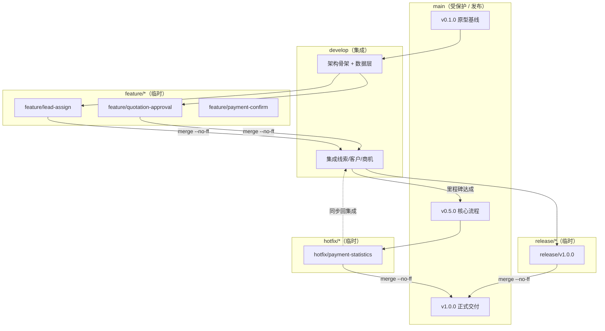
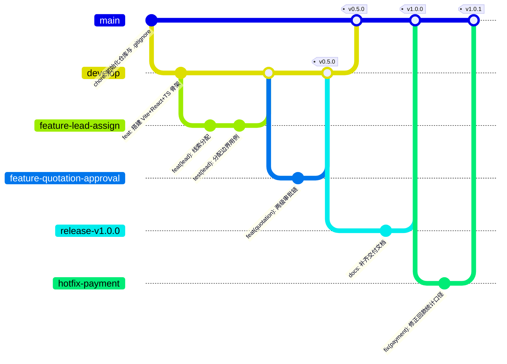
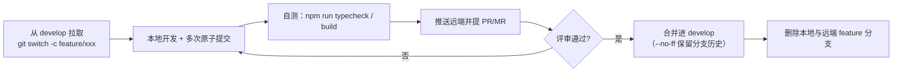

# Git 协作与分支管理规范

| 项 | 内容 |
|---|---|
| 文档编号 | SFS-CRM-GW-01 |
| 项目名称 | SalesFlow 智销云 · 销售全流程管理平台（简称 SalesFlow CRM） |
| 版本 | v1.0 |
| 编写日期 | 2026-10-09 |
| 状态 | 已评审通过 |

**版本变更历史**

| 版本 | 日期 | 修订人 | 修订说明 |
|---|---|---|---|
| v0.5 | 2026-10-05 | 开发组 | 建立分支策略与 Conventional Commits 约定 |
| v1.0 | 2026-10-09 | 开发组 | 补充里程碑 tag 对照表、操作手册与协作红线 |

---

## 1. 引言

### 1.1 编写目的

本文档定义 SalesFlow CRM 项目的 Git 仓库结构、分支策略、提交信息规范、版本标签规范与常用操作手册，用于支撑多人协作开发、里程碑交付与课程项目过程留痕（提交历史是过程考核的重要证据）。

### 1.2 适用范围

所有向本仓库推送代码的成员，以及评审提交历史、打版本标签的负责人。

### 1.3 仓库现状

| 项 | 值 |
|---|---|
| 仓库根目录 | `C:/Users/LiShiWei/WorkBuddy/2026-10-09-00-40-16` |
| 默认分支 | `main` |
| 远端 | 课程项目可无远端；有远端时默认名 `origin` |
| 初始化状态 | 已 `git init`，当前尚无首次提交（HEAD 未创建），需按第 8.1 节完成初始化提交 |

---

## 2. 仓库结构说明

顶层共 5 个目录，用途与纳入版本控制的策略如下：

| 目录 | 用途 | 是否纳入版本控制 | 说明 |
|---|---|---|---|
| `app/` | 前端源码（Vite + React 18 + TS 5） | ✅ 全部纳入 | `node_modules/`、`dist/`、`tsconfig.tsbuildinfo` 由 `.gitignore` 排除 |
| `docs/` | 27 份工程技术文档（立项、需求、设计、开发、测试、交付） | ✅ 全部纳入 | 文档与代码同仓，保证文档版本与代码版本一致 |
| `skill/` | 软件开发全流程 Skill（过程资产） | ✅ 全部纳入 | 属于方法论资产，随项目演进 |
| `homework/` | 三份调研报告（需求表达工具、需求管理、原型设计） | ✅ 全部纳入 | 课程作业原件，不得删改历史 |
| `prototype/` | 原型设计产物 | ✅ 纳入（当前为空目录） | 空目录不会被 Git 跟踪，建议放入 `.gitkeep` 占位 |

**不得纳入版本控制的内容**：依赖包、构建产物、编辑器/系统文件、含密钥的环境变量文件、个人日志、截图缓存等，详见第 9 章 `.gitignore`。

> 提示：Git 不跟踪空目录。若 `prototype/` 暂时为空，请执行 `touch prototype/.gitkeep` 后提交，避免目录在克隆后丢失。

---

## 3. 分支策略

### 3.1 分支角色

| 分支 | 角色 | 生命周期 | 可否直接提交 | 保护级别 |
|---|---|---|---|---|
| `main` | 发布分支，始终代表"可交付/可演示"的状态 | 永久 | ❌ 仅接受来自 `release/*` 与 `hotfix/*` 的合并 | **最高**：禁止 force push、禁止直接 commit、每个合并点对应一个 tag |
| `develop` | 集成分支，汇聚已完成评审的 `feature/*` | 永久 | ❌ 仅接受来自 `feature/*`、`release/*`、`hotfix/*` 的合并 | 高：禁止 force push |
| `feature/*` | 功能开发分支，一个需求一条 | 临时，合并后删除 | ✅ | 低 |
| `release/*` | 版本发布准备分支，只做修 bug、改文案、改版本号 | 临时，发布后删除 | ✅（仅限发布修复） | 中 |
| `hotfix/*` | 线上紧急修复分支，从 `main` 拉出 | 临时，修复后删除 | ✅ | 中 |

> **简化模式**：若团队规模 ≤ 2 人，可不使用 `develop`，`feature/*` 完成后经评审直接合入 `main`。本仓库当前采用**简化模式 + 保留 `develop` 备用**，实际是否启用 `develop` 由组长在迭代启动时声明。

### 3.2 分支模型图



### 3.3 分支演进时序（gitGraph）

> 说明：Mermaid `gitGraph` 对分支名中的 `/` 渲染兼容性不佳，下图中以 `-` 代替 `/`，实际分支名仍为 `feature/xxx`。



---

## 4. 分支命名规范与生命周期

### 4.1 命名格式

```
feature/<模块>-<动作>
release/<版本号>
hotfix/<模块>-<问题简述>
```

- 全部小写，单词间用 `-` 连接，**禁止空格、中文、大写字母**。
- 模块取值与源码目录/业务域保持一致：

| 模块 key | 含义 | 对应文件示例 |
|---|---|---|
| `lead` | 线索管理 | `src/pages/Leads.tsx` |
| `customer` | 客户管理 | `src/pages/Customers.tsx` |
| `opp` | 商机管理 | `src/pages/Opportunities.tsx` |
| `quotation` | 报价与审批 | `src/pages/Quotations.tsx` |
| `order` | 订单管理 | `src/pages/Orders.tsx` |
| `payment` | 回款与发票 | `src/pages/Payments.tsx` |
| `analytics` | 统计分析 | `src/pages/Analytics.tsx` |
| `admin` | 系统管理 | `src/pages/Admin.tsx` |
| `auth` | 登录与权限 | `src/pages/Login.tsx`、`src/App.tsx` |
| `store` | 状态层与数据层 | `src/store/`、`src/lib/` |
| `ui` | 通用组件与样式 | `src/components/` |
| `docs` | 文档 | `docs/` |

### 4.2 命名正反例

| 正例 | 反例 | 原因 |
|---|---|---|
| `feature/quotation-approval` | `feature/新功能` | 禁止中文 |
| `feature/lead-assign` | `feature/LeadAssign` | 禁止大写 |
| `fix/payment-statistics`（应由 `hotfix/payment-statistics`） | `bugfix` | 无模块、无描述 |
| `release/v1.0.0` | `release/正式版` | 版本号必须是语义化版本 |
| `hotfix/login-redirect` | `hotfix/fix` | 描述不可辨识 |

### 4.3 生命周期



**规则**

1. `feature/*` 存活时间不超过 **3 天**；超过 3 天必须在站会说明并拆分。
2. 分支落后 `develop` 超过 10 个提交时，必须先 `git rebase develop` 再提合并。
3. 合并后的 `feature/*` 立即删除：`git branch -d feature/xxx && git push origin -d feature/xxx`。
4. `release/*` 冻结新功能，只允许 bug 修复、文案与版本号调整；发布完成即删除。
5. `hotfix/*` 从 `main` 拉取，修复后**同时合并回 `main` 与 `develop`**，避免修复丢失。

---

## 5. 提交信息规范（Conventional Commits）

### 5.1 格式

```
<type>(<scope>): <subject>
                                   ← 空行
<body>          （可选，说明动机与实现要点，每行 ≤ 72 字）
                                   ← 空行
<footer>       （可选，如 Closes #12、BREAKING CHANGE: ...）
```

- `<type>`：必填，取值见 5.2。
- `<scope>`：可选但**强烈建议填写**，使用第 4.1 节的模块 key。
- `<subject>`：必填，祈使句、小写开头、结尾**不加句号**、不超过 50 字。
- `<body>`：说明"为什么改"，不重复 subject。
- 破坏性变更必须在 footer 写 `BREAKING CHANGE: ...`，版本号 MAJOR +1。

### 5.2 type 对照表

| type | 含义 | 是否出现在 CHANGELOG | 示例场景 |
|---|---|---|---|
| `feat` | 新增功能（用户可见） | ✅ | 新增报价两级审批 |
| `fix` | 修复缺陷 | ✅ | 修正未确认回款计入统计 |
| `docs` | 仅文档变更 | ✅ | 补充部署手册 |
| `style` | 格式调整，不影响逻辑（空格、分号、类名顺序） | ❌ | 统一 Tailwind 类名顺序 |
| `refactor` | 重构，不新增功能也不修 bug | ❌ | 抽取 `selectors.ts` |
| `perf` | 性能优化 | ✅ | 用 `useMemo` 缓存漏斗计算 |
| `test` | 测试相关 | ❌ | 补充用例清单 |
| `build` | 构建系统/依赖变更 | ✅ | 升级 Vite 到 5.4.x |
| `ci` | 持续集成配置 | ❌ | 新增 GitHub Actions |
| `chore` | 其他杂项（脚手架、配置、演示数据） | ❌ | 初始化 `.gitignore` |
| `revert` | 回滚某次提交 | ✅ | `revert: feat(quotation): ...` |

### 5.3 本项目真实场景示例（≥8 条，可直接复用）

```bash
git commit -m "feat(quotation): 折扣率≥30%触发两级审批链"
git commit -m "fix(payment): 修正未确认回款计入统计的问题"
git commit -m "feat(lead): 支持批量分配线索并记录跟进人"
git commit -m "fix(order): 修复订单转执行中后回款计划未生成的问题"
git commit -m "feat(customer): 按累计成交金额自动评定 A/B/C 级"
git commit -m "refactor(store): 抽取 selectors.ts 统一权限过滤口径"
git commit -m "perf(analytics): 用 useMemo 缓存销售漏斗与排行计算"
git commit -m "fix(auth): 修复商务财务越权访问线索列表的漏洞"
git commit -m "docs: 补充部署与运维手册 SFS-CRM-DP-01"
git commit -m "test(quotation): 补充审批链边界值与驳回重提用例"
git commit -m "chore(data): 扩充演示数据至覆盖全部状态分支"
git commit -m "build: 升级 vite 至 5.4.8 并开启 chunk 体积告警阈值"
git commit -m "style(ui): 统一卡片圆角与阴影为 shadow-card"
git commit -m "feat(admin): 新增数据导出 JSON 与演示数据一键重置"
```

带正文与 footer 的完整示例：

```bash
git commit -F - <<'EOF'
fix(payment): 修正未确认回款计入统计的问题

回款统计原按登记金额累加，导致状态为 REGISTERED 的流水被提前计入
已完成回款，仪表盘回款完成率虚高。现改为仅统计 CONFIRMED 状态流水。

对应《软件需求规格说明书》FR-08 回款口径
Closes #23
EOF
```

### 5.4 提交粒度原则

| 原则 | 说明 |
|---|---|
| 一次提交 = 一个逻辑变更 | 不要把"改 bug + 改文档 + 调样式"塞进一个提交 |
| 原子化 | 单个提交必须能通过 `npm run typecheck` 与 `npm run build`，中途状态不入库 |
| 可回滚 | 任意单个提交 `git revert` 后，系统仍应可运行（不允许提交"半截重构"） |
| 先拆后合 | 大改动拆成若干自包含提交，最后用 `merge --no-ff` 保留分支脉络 |
| 不提交生成物 | `dist/`、`node_modules/`、`tsconfig.tsbuildinfo` 绝不入库 |

**反例**：`git commit -m "改了很多东西"`、`git commit -m "update"`、`git commit -m "。"` —— 评审一律打回并要求 `rebase -i` 重写。

---

## 6. 版本标签（tag）规范

### 6.1 命名

```
v<MAJOR>.<MINOR>.<PATCH>
```

- **MAJOR**：不兼容的架构/数据变更（如 `Database.version` 变更导致旧数据不可读）。
- **MINOR**：新增功能、向下兼容（如新增审批链、新增模块）。
- **PATCH**：缺陷修复、文案/样式调整，不新增功能。
- 预发布可加后缀：`v1.0.0-rc.1`、`v1.0.0-beta.1`。

### 6.2 里程碑对照表

| Tag | 里程碑 | 达成标准 | 对应文档状态 |
|---|---|---|---|
| `v0.1.0` | **原型基线** | 原型评审通过；项目脚手架、路由骨架、登录页可用 | 《原型设计报告》定稿 |
| `v0.5.0` | **核心流程** | L2C 主链路打通：线索→客户→商机→报价→订单→回款；审批链、权限过滤生效 | SRS 已基线，DB 设计已评审 |
| `v0.9.0` | **内测版本** | 全部功能完成 + 测试通过；演示数据覆盖全部状态分支；文档齐备 | 测试报告完成，缺陷清零/降级 |
| `v1.0.0` | **正式交付** | 验收通过；交付物（源码 + 27 份文档 + 演示脚本）完整 | 全部文档"已评审通过" |

热修复示例：`v1.0.1`（在 `v1.0.0` 上修复回款统计口径）。

### 6.3 打标签命令

```bash
# 轻量标签
git tag v0.5.0

# 附注标签（推荐，带说明与签名信息）
git tag -a v1.0.0 -m "正式交付：L2C 全流程可用，27 份文档齐备"

# 给历史提交补打标签
git tag -a v0.5.0 <commit-sha> -m "核心流程里程碑"

# 推送标签（标签不会随 git push 自动上传）
git push origin v1.0.0
git push origin --tags          # 推送全部标签

# 查看 / 删除
git tag -l "v*"
git tag -d v0.5.0               # 删除本地
git push origin -d v0.5.0       # 删除远端（谨慎）
```

> 标签一经发布**不得移动**。若确需修正，删除并重新打同名标签必须全组同步，否则他人本地已存在的旧标签不会自动更新。

---

## 7. 常用 Git 操作手册

以下命令均可直接复制执行（Windows Git Bash / PowerShell 通用）。

### 7.1 初始化与首次提交

```bash
# 已在项目根目录时（若未初始化）
git init
git branch -M main

# 配置身份（只需一次）
git config user.name "你的姓名"
git config user.email "你的邮箱"

# 首次提交
git add .
git status                                   # 确认 dist/、node_modules/ 未被加入
git commit -m "chore: 初始化仓库与 .gitignore"
git tag -a v0.1.0 -m "原型基线"
```

### 7.2 远端关联

```bash
git remote add origin https://<your-host>/<group>/salesflow-crm.git
git remote -v
git push -u origin main
```

### 7.3 分支操作

```bash
git switch -c feature/quotation-approval     # 新建并切换（推荐 switch）
git switch develop                           # 切换分支
git branch -a                                # 查看全部分支（含远端）
git branch -m feature/old-name feature/new-name   # 重命名当前分支
git push -u origin feature/quotation-approval     # 首次推送并关联上游
git branch -d feature/quotation-approval     # 删除本地（已合并）
git push origin -d feature/quotation-approval     # 删除远端
```

### 7.4 提交与推送

```bash
git add src/pages/Quotations.tsx             # 精确加入单个文件
git add -p                                   # 分块暂存，保证提交原子化
git commit -m "feat(quotation): 折扣率≥30%触发两级审批链"
git commit --amend -m "修正后的提交信息"       # 仅用于未推送的最后一次提交
git push
git push --force-with-lease                  # 仅在个人分支需要强推时使用
```

### 7.5 合并（保留分支脉络）

```bash
git switch develop
git pull --ff-only
git merge --no-ff feature/quotation-approval -m "merge: feature/quotation-approval 两级审批链"
git push
```

收到冲突时：

```bash
# 编辑冲突文件后
git add <冲突文件>
git commit                                   # 完成合并提交
git merge --abort                            # 放弃本次合并
```

### 7.6 变基（保持线性历史）

```bash
git switch feature/quotation-approval
git fetch origin
git rebase origin/develop                    # 把本分支提交搬到 develop 顶端
# 如有冲突：解决后 git add <file> && git rebase --continue
git rebase --abort                           # 放弃变基

# 交互式整理提交（仅限未推送的个人提交）
git rebase -i HEAD~3                         # pick/squash/reword 整理最近 3 条
```

> **红线**：已推送到公共分支（`main` / `develop`）的提交**禁止 rebase**。

### 7.7 撤销

| 场景 | 命令 |
|---|---|
| 撤销工作区某文件修改 | `git restore src/pages/Orders.tsx` |
| 撤销已 `git add` 的暂存 | `git restore --staged src/pages/Orders.tsx` |
| 撤销上次提交但保留改动 | `git reset --soft HEAD~1` |
| 撤销上次提交并丢弃改动（危险） | `git reset --hard HEAD~1` |
| 生成一条"反向提交"安全回滚（推荐） | `git revert <commit-sha>` |
| 回滚一个合并提交 | `git revert -m 1 <merge-sha>` |
| 找回"丢失"的提交 | `git reflog` → `git cherry-pick <sha>` |

### 7.8 查看历史

```bash
git log --oneline --graph --all --decorate   # 图形化全分支历史
git log --oneline -10                        # 最近 10 条
git log --author="张伟" --oneline            # 按作者过滤
git log --oneline -- src/pages/Payments.tsx  # 单文件历史
git show <commit-sha>                        # 查看某次提交详情
git diff                                     # 工作区未暂存差异
git diff --staged                            # 已暂存差异
git blame src/store/selectors.ts             # 逐行追溯
```

### 7.9 cherry-pick（跨分支搬运提交）

```bash
git switch main
git cherry-pick <commit-sha>                 # 把 feature 上的某个提交搬到 main
git cherry-pick <sha1> <sha2>                # 连续搬运多个
git cherry-pick --abort                      # 放弃
```

典型用法：`hotfix/*` 的修复提交同时需要进 `develop` 时，用 `cherry-pick` 而非整分支合并。

### 7.10 stash（临时搁置）

```bash
git stash push -m "临时搁置：审批链半成品"
git stash list
git stash pop                                # 恢复最近一次并删除记录
git stash apply stash@{1}                    # 恢复指定记录但保留
git stash drop stash@{0}
git stash clear                              # 清空（谨慎）
```

---

## 8. 典型工作流（一次功能开发的完整命令序列）

```bash
# 1. 同步集成分支
git switch develop && git pull --ff-only

# 2. 创建功能分支
git switch -c feature/quotation-approval

# 3. 开发（多次原子提交）
git add src/config/businessRules.ts
git commit -m "feat(quotation): 新增折扣两级审批阈值常量"
git add src/store/AppContext.tsx src/pages/Quotations.tsx
git commit -m "feat(quotation): 折扣率≥30%触发两级审批链"

# 4. 自检
cd app && npm run typecheck && npm run build && cd ..

# 5. 同步最新集成代码
git fetch origin && git rebase origin/develop

# 6. 推送并提合并请求
git push -u origin feature/quotation-approval

# 7. 评审通过后合并（由负责人执行）
git switch develop
git merge --no-ff feature/quotation-approval -m "merge: 报价两级审批链"
git push

# 8. 清理
git branch -d feature/quotation-approval
git push origin -d feature/quotation-approval
```

---

## 9. `.gitignore` 建议内容

在**仓库根目录**创建 `.gitignore`（当前仓库尚无此文件，务必优先补齐）：

```gitignore
# ===== 依赖 =====
node_modules/
.pnpm-store/
.yarn/

# ===== 构建产物 =====
dist/
dist-ssr/
build/
*.local
.vite/

# ===== TypeScript 增量编译缓存 =====
*.tsbuildinfo
app/tsconfig.tsbuildinfo

# ===== 环境变量与密钥（红线） =====
.env
.env.*
!.env.example
*.pem
*.key
*.p12

# ===== 日志 =====
logs/
*.log
npm-debug.log*
yarn-debug.log*
yarn-error.log*
pnpm-debug.log*

# ===== 编辑器与 IDE =====
.vscode/*
!.vscode/extensions.json
!.vscode/settings.example.json
.idea/
*.swp
*.swo
*~

# ===== 操作系统 =====
.DS_Store
Thumbs.db
desktop.ini

# ===== 测试与覆盖率 =====
coverage/
.nyc_output/

# ===== 临时与本地产物 =====
tmp/
temp/
*.tmp
*.bak
*.orig
```

若已误将 `node_modules/` 加入索引，先清理再提交：

```bash
git rm -r --cached app/node_modules
git commit -m "chore: 从版本控制中移除 node_modules"
```

> `.gitignore` 只能忽略**未被跟踪**的文件；已入库的文件必须先 `git rm --cached` 才能生效。

---

## 10. 协作红线

以下行为**一律禁止**，违反者需在组会说明并承担修复成本：

| # | 红线 | 正确做法 |
|---|---|---|
| R-1 | **禁止 `git push --force` 到 `main` / `develop`** | 个人分支可用 `--force-with-lease`；公共分支出现历史问题用 `git revert` |
| R-2 | **禁止向 `main` 直接提交** | 走 `feature/*` → PR → 评审 → 合并 |
| R-3 | **禁止提交密钥、令牌、真实客户数据** | 使用 `.env`（已忽略）+ `.env.example` 模板；本项目无密钥，切勿引入 |
| R-4 | **禁止提交 `node_modules/`、`dist/`、构建缓存** | 由 `.gitignore` 拦截 |
| R-5 | **禁止对已推送的公共提交执行 rebase / amend** | 用新提交修正 |
| R-6 | **禁止移动或删除已发布的 tag** | 版本号递增发布新 tag |
| R-7 | **禁止提交"无法构建"的代码** | 提交前 `npm run typecheck && npm run build` 必须通过 |
| R-8 | **禁止无意义提交信息** | 遵循第 5 章 Conventional Commits |
| R-9 | **禁止一次提交混杂多个逻辑变更** | 用 `git add -p` 拆分暂存 |
| R-10 | **禁止删除他人未合并的分支** | 删除分支前在群里确认 |

### 分支保护建议（有远端时配置）

- `main`：Require pull request、Require 1 approval、禁止 force push、禁止删除。
- `develop`：Require pull request、禁止 force push。
- 开启 `Require status checks`（可选 CI 中的 `npm run typecheck`）。

---

## 11. 附：提交历史自查

结课/验收前执行，确认过程留痕完整：

```bash
git log --oneline --graph --all --decorate | head -60
git shortlog -sn --all                       # 按作者统计提交数（过程考核参考）
git log --oneline --grep="^feat"             # 功能提交清单
git tag -l "v*"                              # 里程碑标签清单
```
