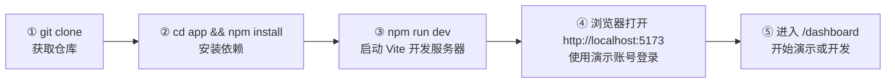

# 环境搭建与运行手册（Setup Guide）

| 项 | 内容 |
|---|---|
| 文档编号 | SFS-CRM-SG-01 |
| 项目名称 | SalesFlow 智销云 · 销售全流程管理平台（简称 SalesFlow CRM） |
| 版本 | v1.0 |
| 编写日期 | 2026-10-09 |
| 状态 | 已评审通过 |

**版本变更历史**

| 版本 | 日期 | 修订人 | 修订说明 |
|---|---|---|---|
| v0.6 | 2026-10-05 | 开发组 | 编写三步启动与演示账号说明 |
| v1.0 | 2026-10-09 | 开发组 | 补充目录速查、脚本对照表、FAQ 与调试技巧 |

---

## 1. 引言

### 1.1 编写目的

本文档面向**首次接触本项目的成员、答辩演示人员与评审教师**，提供从零搭建开发/演示环境的完整步骤、演示账号与数据说明、常见问题排查与调试技巧，确保任何人按文档操作即可在数分钟内跑起系统。

### 1.2 前置假设

- 读者具备基础的命令行操作能力（Windows 推荐使用 **Git Bash** 或 **PowerShell**）。
- 不需要数据库、不需要后端服务：数据全部保存在浏览器 LocalStorage。

---

## 2. 环境要求

| 类别 | 要求 | 版本/规格 | 校验命令 | 备注 |
|---|---|---|---|---|
| Node.js | **必需** | **≥ 20（开发实际使用 v22.22.2）** | `node -v` | Vite 5 要求 Node 18+，本项目按 ≥ 20 要求，推荐 v22 LTS |
| npm | **必需** | 随 Node 附带（实际 10.9.7） | `npm -v` | 使用 npm 作为包管理器，请勿混用 pnpm/yarn 以免 lock 文件冲突 |
| 浏览器 | **必需** | Chrome / Edge ≥ 110（推荐 Chrome 最新稳定版） | — | 需支持 ES2020、CSS `:has` 之外的主流特性；**不支持 IE** |
| 操作系统 | 任选 | Windows 10/11、macOS 12+、主流 Linux | — | 本手册命令以 Windows + Git Bash 为例 |
| 分辨率 | **推荐** | **1440 × 900**（设计基准），最低 1280 × 800 | — | `index.html` 固定 `viewport width=1440`，低于 1280 会出现横向滚动 |
| 磁盘空间 | ≥ 500 MB | 含 `node_modules` 约 200~300 MB | — | — |
| 网络 | 首次安装需要 | 可访问 npm registry | `npm ping` | 离线环境见 FAQ-1 |
| 编辑器（可选） | VS Code | 最新版 | — | 推荐安装 ESLint、Tailwind CSS IntelliSense、Error Lens 插件 |

**版本不符的处理**：Node < 20 请先升级（Windows 可用 `winget install OpenJS.NodeJS.LTS` 或官网安装包）；不要通过降低 Vite/TS 版本来适配旧 Node。

---

## 3. 三步启动指引

### 第 1 步：获取代码

已有本地仓库可直接进入 `app` 目录；从远端克隆执行：

```bash
git clone https://<your-host>/<group>/salesflow-crm.git
cd salesflow-crm
```

预期输出（末尾）：

```
remote: Enumerating objects: 100% (xxx/xxx), done.
Receiving objects: 100% (xxx/xxx), xx.xx KiB | 1.20 MiB/s, done.
Resolving deltas: 100% (xx/xx), done.
```

验证仓库结构：

```bash
ls
# app  docs  homework  prototype  skill
```

### 第 2 步：安装依赖

```bash
cd app
npm install
```

预期输出（关键片段）：

```
added 2xx packages, and audited 2xx packages in 12s

found 0 vulnerabilities
```

> 出现 `npm warn deprecated ...`（如某些传递依赖）属正常告警，不影响运行；出现 `npm ERR!` 请跳转 FAQ-1。

安装成功后目录内会出现 `node_modules/`（已被 `.gitignore` 忽略，切勿提交）。

### 第 3 步：启动开发服务器

```bash
npm run dev
```

预期输出：

```
  VITE v5.4.8  ready in 412 ms

  ➜  Local:   http://localhost:5173/
  ➜  Network: http://192.168.x.x:5173/
  ➜  press h + enter to show help
```

打开浏览器访问 **http://localhost:5173/** ，应看到登录页（标题：SalesFlow 智销云 · 销售全流程管理平台）。



停止服务：在终端按 `Ctrl + C`。

---

## 4. 目录结构速查

```
SalesFlow-CRM/                     ← 仓库根目录（Git 根）
├── app/                           ← 前端工程（本手册操作对象）
│   ├── index.html                 ← 入口 HTML（viewport 固定 width=1440）
│   ├── package.json               ← 依赖与 4 个 npm 脚本
│   ├── tsconfig.json              ← TS strict 配置
│   ├── vite.config.ts             ← 别名 @→src、端口 5173、outDir dist
│   ├── tailwind.config.js         ← brand/ink 色板
│   ├── postcss.config.js          ← tailwindcss + autoprefixer
│   └── src/
│       ├── main.tsx               ← 挂载 StrictMode + BrowserRouter + AppProvider
│       ├── App.tsx                ← 路由表 + 登录拦截 + 越权拦截
│       ├── index.css              ← Tailwind 三层指令 + 全局基础样式
│       ├── types.ts               ← 17 个实体/联合类型集中定义
│       ├── config/
│       │   └── businessRules.ts   ← 业务阈值、字典、权限矩阵（唯一来源）
│       ├── lib/
│       │   ├── storage.ts         ← LocalStorage 读写（键 salesflow:db / salesflow:session）
│       │   ├── id.ts              ← 业务编号生成 L/C/O/Q/SO/PAY
│       │   └── format.ts          ← 金额、日期、百分比格式化
│       ├── data/
│       │   └── seed.ts            ← buildSeedDb() 演示数据 + DEMO_ACCOUNTS
│       ├── store/
│       │   ├── AppContext.tsx     ← 全局状态 + 全部业务动作（commit 事务）
│       │   └── selectors.ts       ← 权限过滤、统计口径、图表数据（纯函数）
│       ├── components/
│       │   ├── Layout.tsx         ← 主框架：侧边栏/顶栏/PageHeader/FilterBar
│       │   ├── ui/index.tsx       ← Button/Card/Modal/Drawer/Table/Badge/Tabs...
│       │   └── charts/index.tsx   ← FunnelChart/LineChart/PieChart/BarRanking/MiniBars
│       └── pages/                 ← 10 个路由级页面
│           ├── Login.tsx          ← 登录（/login）
│           ├── Dashboard.tsx      ← 工作台（/dashboard）
│           ├── Leads.tsx          ← 线索管理（/leads）
│           ├── Customers.tsx      ← 客户管理（/customers）
│           ├── Opportunities.tsx  ← 商机管理（/opportunities）
│           ├── Quotations.tsx     ← 报价与审批（/quotations）
│           ├── Orders.tsx         ← 订单管理（/orders）
│           ├── Payments.tsx       ← 回款与发票（/payments）
│           ├── Analytics.tsx      ← 统计分析（/analytics）
│           └── Admin.tsx          ← 系统管理（/admin，仅管理员）
├── docs/                          ← 27 份技术文档（本手册位于 04-开发实现）
├── homework/                      ← 三份调研报告
├── prototype/                     ← 原型设计产物
└── skill/                         ← 软件开发全流程 Skill
```

---

## 5. npm 脚本对照表

脚本定义在 `app/package.json`：

| 命令 | 实际执行 | 作用 | 使用场景 | 端口/产物 |
|---|---|---|---|---|
| `npm run dev` | `vite` | 启动开发服务器，支持热更新（HMR） | 日常开发、演示、调试 | http://localhost:5173 |
| `npm run build` | `tsc -b && vite build` | 先类型检查再打包生产产物 | 发布前、部署前、CI | 产出 `app/dist/` |
| `npm run preview` | `vite preview` | 本地静态服务预览**构建产物** | 验证 dist 是否正确（尤其路由 fallback 前自检） | http://localhost:4173 |
| `npm run typecheck` | `tsc --noEmit` | 仅类型检查，不产出文件 | 提交前自检、快速定位类型错误 | 无产物 |

**组合用法（推荐提交前执行）**：

```bash
npm run typecheck && npm run build && npm run preview
```

> 注意：`npm run build` 与 `npm run dev` 可并存；`preview` 需要先有 `dist/`，否则会提示空目录。

---

## 6. 演示账号一览

四个账号密码**均为 `123456`**，登录后可在顶栏/个人区域确认当前身份。

| # | 姓名 | 用户名 | 密码 | 角色（Role） | 主要负责 | 可访问模块 | 典型演示动作 |
|---|---|---|---|---|---|---|---|
| 1 | 张伟 | `zhangwei` | `123456` | 销售员 `SALES` | 一线销售，维护自己的线索、客户、商机、报价、订单 | 工作台、线索、客户、商机、报价、订单、回款、分析 | 领取线索 → 建客户 → 建商机推进阶段 → 建报价并提交审批 → 转订单 → 登记回款 |
| 2 | 李娜 | `lina` | `123456` | 销售经理 `MANAGER` | 团队管理与审批第一级 | 工作台、线索、客户、商机、报价、订单、回款、分析 | 批量分配线索、查看团队漏斗与排行、审批一级/二级报价 |
| 3 | 王芳 | `wangfang` | `123456` | 商务财务 `FINANCE` | 回款确认、发票开具、订单审核 | 工作台、订单、回款、分析 | 确认回款流水、开具/寄出发票、审核订单 |
| 4 | 赵强 | `zhaoqiang` | `123456` | 系统管理员 `ADMIN` | 用户与产品维护、数据运维 | **全部模块 + 系统管理** | 新增/停用用户、维护产品价目、导出数据 JSON、重置演示数据 |

权限矩阵以 `src/config/businessRules.ts` 中的 `ROLE_MENUS` 为唯一来源：

| 模块 key | SALES | MANAGER | FINANCE | ADMIN |
|---|---|---|---|---|
| `dashboard` 工作台 | ✅ | ✅ | ✅ | ✅ |
| `leads` 线索 | ✅ | ✅ | ❌ | ✅ |
| `customers` 客户 | ✅ | ✅ | ❌ | ✅ |
| `opportunities` 商机 | ✅ | ✅ | ❌ | ✅ |
| `quotations` 报价 | ✅ | ✅ | ❌ | ✅ |
| `orders` 订单 | ✅ | ✅ | ✅ | ✅ |
| `payments` 回款 | ✅ | ✅ | ✅ | ✅ |
| `analytics` 分析 | ✅ | ✅ | ✅ | ✅ |
| `admin` 系统管理 | ❌ | ❌ | ❌ | ✅ |

**数据可见范围**（由 `src/store/selectors.ts` 的 `visibleXxx` 决定）：

- 销售员：仅本人负责的数据（`ownerId` 等于自己）。
- 销售经理：本人 + 本部门成员数据。
- 商务财务 / 管理员：全量数据。

**登录失败排查**：确认用户名无空格、密码为 `123456`；若提示用户已停用，请用 `zhaoqiang` 登录后在"系统管理 → 用户"中将状态改回"启用"。

---

## 7. 演示数据说明

### 7.1 数据来源与生成时机

- 演示数据由 `src/data/seed.ts` 的 `buildSeedDb()` 生成，在**首次打开页面且 LocalStorage 无数据时**自动写入并落盘。
- 存储键：数据 `salesflow:db`，会话 `salesflow:session`（见 `src/lib/storage.ts`）。
- 数据版本号 `Database.version = 1`。

### 7.2 覆盖的实体

`Database` 共 17 个集合：

`users`、`leads`、`followUps`、`customers`、`contacts`、`opportunities`、`stageHistories`、`products`、`quotations`、`quotationItems`、`approvalRecords`、`orders`、`paymentPlans`、`payments`、`targets`、`activityLogs` + `version`。

在浏览器控制台执行以下命令即可查看当前库内**实际数据量**（以运行为准，文档不固定具体条数，避免与种子数据不同步）：

```js
const db = JSON.parse(localStorage.getItem('salesflow:db'));
Object.fromEntries(Object.entries(db).map(([k, v]) => [k, Array.isArray(v) ? v.length : v]))
```

### 7.3 覆盖的状态分支（答辩重点）

| 实体 | 演示数据覆盖的状态 |
|---|---|
| 线索 `LeadStatus` | `NEW` 待分配 / `FOLLOWING` 跟进中 / `CONVERTED` 已转化 / `LOST` 已废弃 |
| 商机阶段 `Stage` | `S1` 初步接洽 → `S5` 赢单 全覆盖；含 `WON` / `LOST` / `OPEN` |
| 报价 `QuotationStatus` | `DRAFT` 草稿 / `APPROVING` 审批中 / `APPROVED` 已通过 / `REJECTED` 已驳回 / `CONVERTED` 已转订单 / `EXPIRED` 已过期 |
| 订单 `OrderStatus` | `PENDING` 待签约 / `SIGNED` 已签约 / `EXECUTING` 执行中 / `COMPLETED` 已完成 / `CANCELLED` 已取消 |
| 回款计划 `PlanStatus` | `UNPAID` 未回款 / `PARTIAL` 部分回款 / `PAID` 已回款 / `OVERDUE` 逾期 |
| 回款流水 | `REGISTERED` 待确认 / `CONFIRMED` 已确认 |
| 发票 | `NONE` 未开票 / `ISSUED` 已开票 / `SENT` 已寄出 |
| 客户等级 | `A` / `B` / `C`（含自动评级 `levelAuto` 与手工评级两类） |
| 审批链 | 免审批（折扣 < 15%）/ 一级审批 / 两级审批（折扣 ≥ 30% 或金额 ≥ 100 万） |

### 7.4 重置演示数据

**方式一（推荐，应用内）**：以 `zhaoqiang` 登录 → 系统管理 → 点击"重置演示数据" → 确认。

**方式二（浏览器控制台）**：

```js
localStorage.removeItem('salesflow:db');
localStorage.removeItem('salesflow:session');
location.href = '/login';
```

**方式三（DevTools 界面）**：F12 → Application → Local Storage → 选中当前域名 → 右键删除 `salesflow:db` 与 `salesflow:session` → 刷新页面。

> 重置会**清空所有手工录入的数据**，请先按 9.3 节导出备份。

### 7.5 推荐演示路线（约 10 分钟）

按此顺序操作可完整走通 L2C（Lead to Cash）主链路，并自然带出审批与权限两类亮点：

| 步骤 | 操作账号 | 操作路径 | 展示要点 |
|---|---|---|---|
| 1 | `zhaoqiang` | 系统管理 → 用户/产品 | 展示基础数据维护与"导出数据 JSON / 重置演示数据"入口 |
| 2 | `lina` | 线索管理 → 批量分配 | 销售经理将 `NEW` 待分配线索分配给张伟；展示批量操作与负责人变更 |
| 3 | `zhangwei` | 线索管理 → 跟进 → 转化 | 录入跟进记录，转化为客户 + 商机；展示 `CONVERTED` 状态与数据贯通 |
| 4 | `zhangwei` | 商机管理 → 推进阶段 | 从 `S1` 逐级推进；展示阶段前置条件校验（如 `S3` 需至少 1 张报价单） |
| 5 | `zhangwei` | 报价管理 → 新建并提交 | 构造折扣率 ≥ 30% 的报价，展示**两级审批链**自动生成 |
| 6 | `lina` | 报价管理 → 待我审批 | 第一级审批通过；展示审批流转与 `APPROVING → APPROVED` |
| 7 | `zhangwei` | 报价管理 → 转订单 | 生成合同编号与订单；展示回款计划按模板（三三四等）自动生成 |
| 8 | `zhangwei` | 回款管理 → 登记回款 | 登记一笔流水，状态为 `REGISTERED`，**不计入**完成统计 |
| 9 | `wangfang` | 回款管理 → 确认 | 确认后状态变 `CONFIRMED`，回款统计与完成率随之变化；展示口径差异 |
| 10 | `wangfang` | 订单管理 → 审核 | 展示商务财务仅可见订单/回款/分析三类模块（权限边界） |
| 11 | `zhaoqiang` | 分析 | 展示销售漏斗、月度回款折线、销售排行、线索来源分布 |

> 演示前建议将浏览器窗口调整为 1440×900、缩放 100%，并提前导出一份数据备份以便现场一键重置。

---

## 8. 常见问题排查（FAQ）

### FAQ-1：`npm install` 失败 / 卡住 / 报 `ENOTFOUND`、`ETIMEDOUT`

| 项 | 内容 |
|---|---|
| 现象 | `npm ERR! network request to https://registry.npmjs.org/... failed` |
| 原因 | 默认 registry 在国外，网络不通或公司代理限制 |
| 解决 | ① 切换镜像：`npm config set registry https://registry.npmmirror.com` 后重装；② 若在公司代理下：`npm config set proxy http://<proxy>:<port>`；③ 仍失败可删除 `node_modules` 与 `package-lock.json` 后重试 |

### FAQ-2：`npm install` 报 `EBADENGINE` / Vite 启动即崩

| 项 | 内容 |
|---|---|
| 现象 | `You are using Node.js 16.x, which is no longer supported` |
| 原因 | Node 版本低于 20 |
| 解决 | `node -v` 确认，升级到 Node ≥ 20（推荐 v22 LTS）后**删除 `node_modules` 重新安装** |

### FAQ-3：端口 5173 被占用

| 项 | 内容 |
|---|---|
| 现象 | `Port 5173 is already in use` |
| 原因 | 上一个 `npm run dev` 未关闭，或其他程序占用 |
| 解决 | ① 关闭占用进程（Windows：`netstat -ano \| findstr 5173` → `taskkill /PID <pid> /F`）；② 临时换端口：`npm run dev -- --port 5174`；③ 需要局域网访问：`npm run dev -- --host` |

### FAQ-4：页面白屏 / 一片空白

| 项 | 内容 |
|---|---|
| 现象 | 浏览器打开只有空白背景，无任何内容 |
| 原因 | ① 控制台有 JS 运行时错误；② 访问的是 `/` 但应用路由从 `/login` 起；③ 旧数据 `salesflow:db` 结构与新版本不兼容 |
| 解决 | ① F12 看 Console 红色报错（见 8.9 节定位）；② 手动访问 `http://localhost:5173/login`；③ 清除 `salesflow:db` 后刷新（见 7.4）；④ 执行 `npm run typecheck` 排除类型问题 |

### FAQ-5：登录后数据不显示 / 列表为空

| 项 | 内容 |
|---|---|
| 现象 | 登录成功但线索、商机列表为空 |
| 原因 | ① 当前角色数据可见范围限制（销售员只看自己的）；② 筛选条件未清空；③ 演示数据未生成 |
| 解决 | ① 换用 `zhaoqiang`（管理员）查看全量；② 清空页面筛选条件；③ 控制台执行 `JSON.parse(localStorage.getItem('salesflow:db')).leads.length` 若为 0，按 7.4 重置 |

### FAQ-6：`npm run typecheck` 报错

| 项 | 内容 |
|---|---|
| 现象 | `error TS6133: 'xxx' is declared but its value is never read` |
| 原因 | `noUnusedLocals` / `noUnusedParameters` 生效，存在未使用的导入或形参 |
| 解决 | 删除未使用的导入；确实需要保留的形参加 `_` 前缀（如 `_index`）。不要关闭编译选项（见《编码规范》第 4.1 节） |

### FAQ-7：`npm run build` 失败

| 项 | 内容 |
|---|---|
| 现象 | 构建中断并输出 TS 错误，或提示 chunk 体积超限 |
| 原因 | 类型错误；或单 chunk 超过 `chunkSizeWarningLimit: 1200` kB |
| 解决 | ① 先跑 `npm run typecheck` 修完类型；② 体积告警为**警告**不阻断构建，可通过路由级 `React.lazy` 拆包消除；③ 确认磁盘空间充足 |

### FAQ-8：样式全部失效 / 页面像"裸 HTML"

| 项 | 内容 |
|---|---|
| 现象 | 元素无间距、无颜色，Tailwind 类不起作用 |
| 原因 | ① `src/index.css` 未被 `main.tsx` 引入；② `tailwind.config.js` 的 `content` 未覆盖新目录 |
| 解决 | 确认 `main.tsx` 中有 `import './index.css'`；确认 `content: ['./index.html', './src/**/*.{js,ts,jsx,tsx}']`；重启 dev server（Tailwind 配置变更需重启） |

### FAQ-9：修改代码后页面不更新

| 项 | 内容 |
|---|---|
| 现象 | 保存文件但浏览器无变化 |
| 原因 | HMR 失效；或修改了 `vite.config.ts` / `tailwind.config.js`（需重启） |
| 解决 | ① 手动刷新；② 配置文件改动后 `Ctrl + C` 重启 `npm run dev`；③ 检查终端是否报 HMR 连接失败 |

### FAQ-10：LocalStorage 写入失败（提示"本地存储写入失败"）

| 项 | 内容 |
|---|---|
| 现象 | Toast 弹出"本地存储写入失败…可能是存储容量已满" |
| 原因 | 浏览器 LocalStorage 单域名上限约 5 MB（对应 NFR-R-02，写入失败不得静默） |
| 解决 | 用 `zhaoqiang` 登录 → 系统管理 → 导出数据 JSON 备份 → 重置演示数据；或使用无痕窗口外的独立 Profile |

### FAQ-11：直接访问 `/orders` 等子路径刷新后 404（**仅部署环境**）

| 项 | 内容 |
|---|---|
| 现象 | 开发环境正常，部署到静态服务器后刷新子路径 404 |
| 原因 | React Router 使用 history 模式，静态服务器未配置 fallback |
| 解决 | 配置 SPA 重写（Nginx `try_files $uri $uri/ /index.html;`），详见《部署与运维手册》SFS-CRM-DP-01 |

### FAQ-12：浏览器提示不支持 / 布局错乱

| 项 | 内容 |
|---|---|
| 现象 | 表格错位、横向出现大片留白 |
| 原因 | 浏览器窗口宽度低于 1280，或使用了 IE/老旧内核 |
| 解决 | 将窗口调整至 **1440 × 900**（设计基准），浏览器缩放设为 100%；更换 Chrome/Edge 最新版 |

---

## 9. 开发调试技巧

### 9.1 React DevTools

1. Chrome 扩展商店安装 **React Developer Tools**。
2. F12 → Components 面板：查看 `AppProvider` 提供的 `db`、`user`、`toasts`，可直接观察状态变化。
3. Profiler 面板：录制一次列表渲染，定位重渲染热点（配合《编码规范》H-4/H-5 的 `useMemo`/`useCallback` 优化）。

### 9.2 清空 / 查看 LocalStorage

```js
// 查看当前登录用户
JSON.parse(localStorage.getItem('salesflow:session'))

// 查看当前用户实体
const db = JSON.parse(localStorage.getItem('salesflow:db'));
const s = JSON.parse(localStorage.getItem('salesflow:session'));
db.users.find(u => u.id === s.userId)

// 查看某条报价的审批链
db.quotations.find(q => q.status === 'APPROVING')

// 查看回款统计口径（仅 CONFIRMED 计入）
db.payments.filter(p => p.status === 'CONFIRMED').reduce((a, p) => a + p.amount, 0)

// 清空全部本地数据并回到登录页
localStorage.clear();
location.href = '/login';
```

### 9.3 导出数据 JSON

**应用内**：以 `zhaoqiang` 登录 → 系统管理 → "导出数据 JSON"，文件名为 `salesflow-data-<日期>.json`。

**控制台手动导出**（未登录管理员时可用）：

```js
const db = JSON.parse(localStorage.getItem('salesflow:db'));
const blob = new Blob([JSON.stringify(db, null, 2)], { type: 'application/json' });
const a = document.createElement('a');
a.href = URL.createObjectURL(blob);
a.download = 'salesflow-data-manual.json';
a.click();
```

### 9.4 导入数据 JSON（恢复备份）

```js
// 在控制台执行，选择此前导出的 JSON 文件内容粘贴到 fileText 中
const fileText = '<粘贴 salesflow-data-XXXX-XX-XX.json 的全部内容>';
localStorage.setItem('salesflow:db', fileText);
location.reload();
```

### 9.5 其他实用技巧

| 技巧 | 操作 |
|---|---|
| 快速切换角色对比权限 | 退出登录后换账号；或控制台 `localStorage.removeItem('salesflow:session'); location.reload();` |
| 定位某条数据的生成位置 | 控制台执行 `npm run typecheck` 无效时，用编辑器全局搜索业务编号前缀（如 `SO0003`） |
| 模拟"存储已满" | 控制台批量写入大字符串占满 5 MB 后操作系统，验证 NFR-R-02 的失败提示 |
| 只看某个模块 | 直接访问 `http://localhost:5173/quotations` 等路径（dev 环境 Vite 已内置 SPA fallback） |
| 清理构建缓存 | 删除 `app/node_modules/.vite` 与 `app/dist` 后重启 |

---

## 10. 附：验收/演示前的环境自检清单

- [ ] `node -v` ≥ 20、`npm -v` 正常
- [ ] `npm install` 无 ERR
- [ ] `npm run typecheck` 无错误
- [ ] `npm run build` 成功，`app/dist/` 已生成
- [ ] `npm run dev` 启动，浏览器窗口 1440×900、缩放 100%
- [ ] 四个演示账号均可登录，权限边界符合第 6 章矩阵
- [ ] 演示数据已覆盖第 7.3 节的全部状态分支
- [ ] 已导出一份 `salesflow-data-*.json` 备份，便于现场重置

> 部署到静态服务器请见《部署与运维手册》SFS-CRM-DP-01；提交代码请见《Git 协作与分支管理规范》SFS-CRM-GW-01；编码细节请见《编码规范》SFS-CRM-CS-01。
