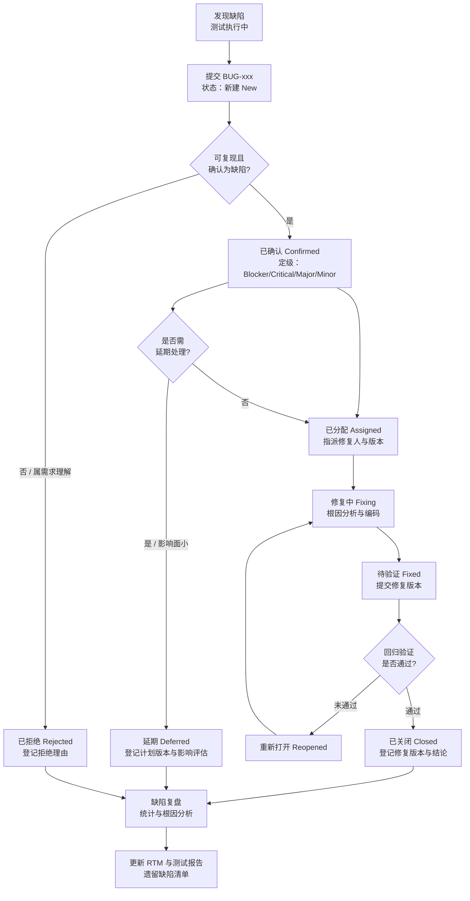

# 缺陷管理记录（Bug Tracking）

| 项 | 内容 |
|---|---|
| 文档编号 | SFS-CRM-BT-01 |
| 项目名称 | SalesFlow 智销云 · 销售全流程管理平台（简称 SalesFlow CRM） |
| 版本 | v1.0 |
| 编写日期 | 2026-10-09 |
| 状态 | 已归档（2 条遗留：BUG-011 重新打开、BUG-012 延期） |
| 编写人 | 测试工程师（项目组） |
| 关联文档 | SFS-CRM-TP-01、SFS-CRM-TC-01、SFS-CRM-TR-01、SFS-CRM-RTM-01 |
| 缺陷总数 | 12 条（Blocker 1 / Critical 1 / Major 5 / Minor 5） |

---

## 1. 缺陷管理流程

### 1.1 流程说明

本项目缺陷管理采用"发现 → 提交 → 确认 → 分配 → 修复 → 验证 → 关闭 → 复盘"八步闭环。所有缺陷由测试工程师统一登记与跟踪，开发负责人负责分配与修复，项目经理裁决争议与延期申请。

| 步骤 | 活动 | 责任人 | 输出 | 时限 |
|---|---|---|---|---|
| ① 发现 | 执行用例时发现实际结果与预期不符 | 测试工程师 | 缺陷记录草稿（含截图） | 即时 |
| ② 提交 | 按标准字段模板登记缺陷单，分配编号 BUG-xxx | 测试工程师 | BUG-xxx（状态：新建） | 发现后 2 小时内 |
| ③ 确认 | 复核可复现性，判定严重程度与优先级；无法复现或属需求理解的转"已拒绝"并说明 | 测试负责人 + 开发负责人 | 状态：已确认 / 已拒绝 | 提交后 8 小时内 |
| ④ 分配 | 按模块指派修复人，明确修复版本 | 开发负责人 | 状态：已分配 | 确认后 4 小时内 |
| ⑤ 修复 | 定位根因、修改代码、自检；提交时关联缺陷编号 | 开发工程师 | 状态：修复中 → 待验证 | 按优先级时限 |
| ⑥ 验证 | 在修复版本上回归关联用例 + 关联模块 P0 用例 | 测试工程师 | 状态：已关闭 / 重新打开 | 收到后 4 小时内 |
| ⑦ 关闭 | 回归通过后关闭，登记修复版本与验证结论 | 测试工程师 | 状态：已关闭 | 验证通过后即时 |
| ⑧ 复盘 | 迭代结束统计缺陷分布、分析根因、形成改进项 | 项目组 | 缺陷复盘纪要 | 迭代结束 |

### 1.2 缺陷状态机

### 1.3 状态流转规则

一条缺陷只对应一个根因，双根因须拆分新单；重新打开必须附新证据（复现步骤与截图）；延期须项目经理批准并登记计划版本、影响评估与规避方案；已拒绝须说明拒绝理由（需求理解偏差、环境问题、数据污染、重复提交）；关闭后不得直接编辑结论，须走重新打开流程。

---

## 2. 缺陷严重等级与优先级定义

### 2.1 严重程度（Severity）

| 等级 | 定义 | 判定要点 | 处理时限 | 准出约束 |
|---|---|---|---|---|
| **Blocker 致命** | 系统崩溃、核心功能完全不可用、数据大面积损坏，且无规避方案 | 无法登录、主流程中断、数据全量丢失、越权可访问全部数据 | 4 小时内响应，当日修复 | 残留必须为 0 |
| **Critical 严重** | 核心业务规则错误导致金额/统计口径失真，影响经营决策 | 金额计算错误、审批链错误、统计口径错误 | 8 小时内响应，1 个工作日内修复 | 残留必须为 0 |
| **Major 主要** | 主要功能未实现或部分错误，有规避方案，不影响主流程 | 前置条件未校验、必填校验缺失、状态流转异常 | 1 个工作日内响应，2 个工作日内修复 | 残留 ≤1 且需规避方案 |
| **Minor 次要** | 界面、文案、格式、易用性问题，不影响功能正确性 | 千分位缺失、高亮缺失、提示文案、图表样式 | 2 个工作日内响应，本迭代内修复或延期 | 允许遗留，需评估 |

### 2.2 优先级（Priority）

| 优先级 | 定义 | 默认对应关系 |
|---|---|---|
| **P1 紧急** | 阻塞测试或验收演示，必须立即修复 | Blocker、Critical 默认 P1 |
| **P2 高** | 本轮迭代必须修复 | Major 默认 P2 |
| **P3 中** | 本迭代内安排修复，可延至下轮 | Minor 默认 P3 |
| **P4 低** | 可延期至后续版本 | 有规避方案的 Minor |

### 2.3 严重程度 × 优先级处理矩阵

| 严重程度 \ 影响面 | 主流程核心路径 | 常用功能 | 边缘功能/展示 |
|---|---|---|---|
| Blocker / Critical | P1 | P1 | P2 |
| Major | P1 | P2 | P3 |
| Minor | P2 | P3 | P4 |

---

## 3. 缺陷单标准字段模板

> 新建缺陷单时直接复制下表填写。

| 字段 | 填写说明 | 示例 |
|---|---|---|
| 缺陷编号 | `BUG-` + 三位流水，不跳号、不复用 | BUG-001 |
| 缺陷标题 | 【模块】+ 现象 + 违反的规则，≤30 字 | 【回款】未确认回款被计入订单已回款金额 |
| 所属模块 | 十四个模块之一 | 回款管理 |
| 关联用例 | 发现该缺陷的用例编号 | TC-PAY-008 |
| 关联需求 | 违反的 SRS 需求编号 | FR-08-04 |
| 严重程度 | Blocker / Critical / Major / Minor | Critical |
| 优先级 | P1 / P2 / P3 / P4 | P1 |
| 发现人 | 姓名 | 测试工程师 |
| 发现日期 | `YYYY-MM-DD` | 2026-10-08 |
| 缺陷状态 | 新建/已确认/已分配/修复中/待验证/已关闭/重新打开/延期/已拒绝 | 已关闭 |
| 环境 | 浏览器 + 版本 + 分辨率 + 数据版本 | Chrome 131.0.6778.86 / 1920×1080 / 演示数据 v1.0 |
| 前置条件 | 复现所需的数据与状态 | 订单 SO20260004 已签约，存在未确认回款 PAY20260008 |
| 复现步骤 | 编号步骤，可一步一操作直接复现 | 1) 登录… 2) 进入… |
| 实际结果 | 系统真实表现（含截图） | 订单已回款金额显示 150,000 |
| 期望结果 | 依据 SRS 应有的表现 | 未确认回款不计入，已回款金额显示 0 |
| 复现概率 | 必现 / 偶现（x/y 次） | 必现 |
| 根因分析 | 代码层面根因，定位到文件与函数 | `paymentRepo.confirm()` 未过滤 status |
| 修复方案 | 具体改法 | 统计查询增加 `status === 'CONFIRMED'` 过滤 |
| 修复人 | 姓名 | 开发工程师 A |
| 修复版本 | 版本号 | v1.0.1 |
| 验证结果 | 回归结论与用例编号 | TC-PAY-008 回归通过 |
| 备注 | 规避方案、影响评估等 | — |

---

## 4. 缺陷单实例（BUG-001 ~ BUG-012）

### BUG-001

| 字段 | 内容 |
|---|---|
| **缺陷编号** | BUG-001 |
| **标题** | 【回款】未确认回款被计入订单已回款金额（违反 FR-08-04） |
| **所属模块** | 回款管理（M08） |
| **严重程度** | **Critical（严重）** |
| **优先级** | **P1（紧急）** |
| **关联用例** | TC-PAY-008、TC-PAY-009、TC-ORD-008 |
| **关联需求** | FR-08-04、FR-07-05、FR-04-04 |
| **发现人 / 日期** | 测试工程师 / 2026-10-08 |
| **环境** | Chrome 131.0.6778.86 / 1920×1080 / 演示数据 v1.0 |
| **前置条件** | 订单 SO20260004（绿源新能源，76 万）已签约；回款计划 SO20260004-P1 计划金额 190,000、计划日期 2026-09-25；存在已登记但未确认回款 PAY20260008（150,000，状态 REGISTERED） |
| **复现步骤** | 1) 以 `wangfang`（王芳，FINANCE）登录；2) 进入订单管理，打开 SO20260004 详情；3) 查看"已回款金额"与"回款进度"；4) 进入回款管理，查看 SO20260004-P1 的已回款金额；5) 不进行"确认到账"操作，直接刷新页面再次核对 |
| **实际结果** | 订单 SO20260004 已回款金额显示 **150,000.00**，回款进度显示 19.74%；回款计划 SO20260004-P1 已回款金额显示 150,000，状态被计算为"部分回款"而非"逾期"；客户 C20260008 绿源新能源累计成交金额同步增加了 150,000 |
| **期望结果** | 依据 FR-08-04"未确认的回款以'待确认'状态展示，**不计入统计**"：订单已回款金额应为 0.00，进度 0%；SO20260004-P1 因已回款 0 < 计划 190,000 且计划日期 2026-09-25 < 今天，状态应为"逾期"并红色高亮；客户累计成交金额不变 |
| **复现概率** | 必现（5/5） |
| **根因分析** | `src/modules/payments` 中计算订单已回款金额的聚合函数 `sumPaidByOrder()` 直接对 `payments` 表按 `orderId` 求和，**未过滤 `status === 'CONFIRMED'`**；客户累计成交金额的更新逻辑复用了同一聚合结果，导致污染沿调用链放大。回款计划状态判定函数 `calcPlanStatus()` 因已回款金额被污染，进一步把"逾期"误判为"部分回款" |
| **修复方案** | 1) `sumPaidByOrder()` 增加 `status === 'CONFIRMED'` 过滤条件；2) 客户累计成交金额改由已确认回款重新聚合，禁止增量累加；3) `calcPlanStatus()` 增加"计划日期 < 今天 且 已回款 < 计划金额 → 逾期"的前置判定，优先级高于"部分回款"；4) 补充单元测试级断言（金额口径只取已确认） |
| **修复人** | 开发工程师 A（回款模块） |
| **修复版本** | v1.0.1 |
| **验证结果** | 2026-10-09 回归：TC-PAY-008、TC-PAY-009、TC-ORD-008 全部通过；SO20260004 已回款金额显示 0.00、进度 0%，SO20260004-P1 状态正确显示"逾期"；执行确认到账后金额正确增加 150,000 |
| **状态** | **已关闭** |

---

### BUG-002

| 字段 | 内容 |
|---|---|
| **缺陷编号** | BUG-002 |
| **标题** | 【商机】拖拽到"方案报价"阶段未校验是否存在报价单 |
| **所属模块** | 商机管理（M05） |
| **严重程度** | **Major（主要）** |
| **优先级** | **P2（高）** |
| **关联用例** | TC-OPP-002 |
| **关联需求** | FR-05-01、FR-05-06 |
| **发现人 / 日期** | 测试工程师 / 2026-10-08 |
| **环境** | Chrome 131.0.6778.86 / 1920×1080 / 演示数据 v1.0 |
| **前置条件** | 商机 O20260012「实验室 LIMS 系统采购」（42 万，归属 U006 刘洋）处于 S2 需求确认；其关联报价单 Q20260010 状态为"已过期（EXPIRED）"，不存在任何有效报价单 |
| **复现步骤** | 1) 以 `liuyang`（U006）登录；2) 进入商机管理，切换到看板视图；3) 找到 O20260012 卡片；4) 将其拖拽至"方案报价（S3）"列并释放；5) 观察卡片落位与阶段历史 |
| **实际结果** | 卡片直接进入 S3 列，无**任何拒绝提示**；阶段历史新增一条 S2 → S3 记录；看板顶部加权金额按 60% 重新计算，将该商机的 252,000 计入 S3 汇总 |
| **期望结果** | 依据 FR-05-01"拖拽时校验阶段推进的前置条件，不满足则**拒绝并给出明确提示**"与 STAGES 配置中 S3 的 `requirement = '需至少创建 1 张报价单'`：拖拽应被拒绝、卡片回弹至 S2；弹出提示"推进至【方案报价】需至少创建 1 张报价单，当前商机尚未创建报价单"；不生成阶段历史；加权金额不变 |
| **复现概率** | 必现（5/5） |
| **根因分析** | 看板拖拽处理函数 `handleDragEnd()` 只调用了 `updateStage()` 写入新阶段，**遗漏了 `validateStageEntry(opp, targetStage)` 前置校验调用**；校验函数本身已实现（在商机详情页手动改阶段时会触发），但看板拖拽路径未接入，属于调用点遗漏而非规则缺失 |
| **修复方案** | 1) 在 `handleDragEnd()` 中于 `updateStage()` 之前插入 `validateStageEntry()`，校验失败则中断并 `toast.error(STAGE_MAP[target].requirement)`；2) 校验规则统一从 `businessRules.ts` 的 `STAGES[].requirement` 读取提示文案，禁止在组件内另写一套文案；3) S4 的"需存在审批通过的报价单"校验同步接入同一入口 |
| **修复人** | 开发工程师 B（商机模块） |
| **修复版本** | v1.0.1 |
| **验证结果** | 2026-10-09 回归：TC-OPP-002、TC-OPP-003 通过；拖拽被拒绝并回弹，提示文案与 STAGES 配置一致；阶段历史未新增记录；满足条件的 TC-OPP-001 拖拽仍正常成功 |
| **状态** | **已关闭** |

---

### BUG-003

| 字段 | 内容 |
|---|---|
| **缺陷编号** | BUG-003 |
| **标题** | 【报价】折扣率 29.9% 时审批链被错误计算为两级审批 |
| **所属模块** | 报价与审批（M06） |
| **严重程度** | **Major（主要）** |
| **优先级** | **P2（高）** |
| **关联用例** | TC-QUO-007 |
| **关联需求** | FR-06-03（R2）、NFR-M-01 |
| **发现人 / 日期** | 测试工程师 / 2026-10-08 |
| **环境** | Chrome 131.0.6778.86 / 1920×1080 / 演示数据 v1.0 |
| **前置条件** | 以 `zhangwei`（U001）登录；商机 O20260007 已存在；产品 P002 SalesFlow CRM 企业版标准单价 88,000 元/套 |
| **复现步骤** | 1) 进入报价与审批 → 新建报价单；2) 关联商机 O20260007；3) 添加产品明细：P002（88,000 元/套）× 10 套，折扣率输入 29.9%；4) 确认报价总额 880,000.00、折后金额 616,880.00、整体折扣率 29.90%；5) 点击「提交审批」；6) 在详情页查看生成的审批链 |
| **实际结果** | 系统生成了**两级**审批链：销售经理 李娜（U002）→ 销售总监 孙磊（U007）；审批中心同时出现两个待办 |
| **期望结果** | 依据 FR-06-03 决策表 R2（15% ≤ d < 30% → 一级审批，审批链为"销售经理"）：d = 0.299 < 0.30 且折后 616,880 < 1,000,000，应只生成**一级**审批链（仅李娜 U002），不得上报总监 |
| **复现概率** | 必现（5/5）；30.0% 时反而正确生成两级，说明为比较运算边界错误 |
| **根因分析** | `buildApprovalChain()` 中判定语句写作 `if (discountRate > DISCOUNT_TWO_LEVEL || net >= AMOUNT_FORCE_TWO_LEVEL)`，将"≥ 0.3"误写为"> 0.3"，导致 29.9%（0.299）被归入两级分支；同时 30.0% 恰好命中另一条兜底逻辑，掩盖了该错误，属于典型的边界比较符写错 |
| **修复方案** | 1) 修正为 `discountRate >= DISCOUNT_TWO_LEVEL`；2) 阈值统一从 `businessRules.ts` 的 `DISCOUNT_TWO_LEVEL` 常量读取，组件内不再出现 `0.3` 字面量（NFR-M-01）；3) 补充 14.9% / 15.0% / 29.9% / 30.0% / 折后 100 万 五个边界的断言检查 |
| **修复人** | 开发工程师 A（报价模块） |
| **修复版本** | v1.0.1 |
| **验证结果** | 2026-10-09 回归：TC-QUO-005 ~ TC-QUO-009 五条边界用例全部通过；29.9% 生成一级审批链（仅 U002），30.0% 生成两级（U002→U007），折后 100 万强制两级 |
| **状态** | **已关闭** |

---

### BUG-004

| 字段 | 内容 |
|---|---|
| **缺陷编号** | BUG-004 |
| **标题** | 【客户】客户列表累计成交金额未做千分位格式化 |
| **所属模块** | 客户管理（M04） |
| **严重程度** | **Minor（次要）** |
| **优先级** | **P3（中）** |
| **关联用例** | TC-CUST-001 |
| **关联需求** | FR-04-01、NFR-U-06 |
| **发现人 / 日期** | 测试工程师 / 2026-10-08 |
| **环境** | Chrome 131.0.6778.86 / 1920×1080 / 演示数据 v1.0 |
| **前置条件** | 以 `zhangwei` 登录；客户列表存在 C20260001（累计成交 964000）、C20260009（累计成交 2050000） |
| **复现步骤** | 1) 进入客户管理；2) 观察"累计成交金额"列；3) 对比订单列表与报价单中的金额格式 |
| **实际结果** | 客户列表累计成交金额显示为 `964000` 与 `2050000`，无千分位分隔符、无两位小数、未右对齐；而订单列表与报价详情的金额格式正确 |
| **期望结果** | 依据 NFR-U-06"金额字段右对齐并千分位格式化"：应显示为 `964,000.00` 与 `2,050,000.00`，列右对齐，与其他模块的金额格式保持一致 |
| **复现概率** | 必现（5/5） |
| **根因分析** | 客户列表列定义中直接渲染 `{row.total}`，**未调用统一的 `formatMoney()` 工具函数**；该工具函数已在订单/报价模块使用，属于新列开发时的遗漏 |
| **修复方案** | 1) 客户列表"累计成交金额"列改用 `formatMoney(row.total)`，`text-align: right`；2) 全局排查其余金额列（客户 360 回款页、工作台金额卡片、看板排行）是否遗漏，统一接入格式化工具；3) 在代码评审清单中增加"金额必须走 formatMoney"检查项 |
| **修复人** | 开发工程师 C（客户模块） |
| **修复版本** | v1.0.1 |
| **验证结果** | 2026-10-09 回归：TC-CUST-001、TC-NFR-010 通过；客户列表与其余四处金额列格式统一为千分位 + 两位小数 + 右对齐 |
| **状态** | **已关闭** |

---

### BUG-005

| 字段 | 内容 |
|---|---|
| **缺陷编号** | BUG-005 |
| **标题** | 【回款】逾期回款计划未高亮红色，与未回款状态视觉无区别 |
| **所属模块** | 回款管理（M08） |
| **严重程度** | **Minor（次要）** |
| **优先级** | **P3（中）** |
| **关联用例** | TC-PAY-004 |
| **关联需求** | FR-08-02、FR-08-06 |
| **发现人 / 日期** | 测试工程师 / 2026-10-08 |
| **环境** | Chrome 131.0.6778.86 / 1920×1080 / 演示数据 v1.0 |
| **前置条件** | 当前日期 2026-10-09；回款计划 SO20260004-P1（计划 190,000，计划日期 2026-09-25，已回款 0）应为逾期；SO20260005-P3（计划 352,000，计划日期 2027-01-06）为未回款 |
| **复现步骤** | 1) 以 `wangfang` 登录；2) 进入回款管理 → 回款计划列表；3) 对比 SO20260004-P1 与 SO20260005-P3 两行的视觉呈现；4) 筛选状态"逾期"确认结果集 |
| **实际结果** | 两行状态标签文字不同（"逾期" / "未回款"），但**颜色一致（均为中性灰）**，整行无红色高亮、无背景色区分；筛选功能正常，但用户在列表中无法一眼识别逾期项 |
| **期望结果** | 依据 FR-08-02"已回款金额 < 计划金额 且 计划日期 < 今天 → **逾期（界面高亮红色）**"：逾期行的状态标签为 danger 色（红）、整行文字或左侧边框红色高亮，与未回款行形成明显视觉差异 |
| **复现概率** | 必现（5/5） |
| **根因分析** | 状态字典 `PLAN_STATUS.OVERDUE` 已配置 `tone: 'danger'`，但回款计划列表的 `getRowClassName()` 只处理了选中态与斑马纹，**未根据行状态追加高亮类名**；状态标签组件虽读取 tone，但列表行级高亮逻辑缺失 |
| **修复方案** | 1) `getRowClassName()` 中增加：`plan.status === 'OVERDUE' ? 'row-overdue' : ''`；2) 定义 `.row-overdue { color: #dc2626; background: #fef2f2; }` 并在状态标签上强制 danger tone；3) 工作台逾期预警卡片同步采用红色警示样式 |
| **修复人** | 开发工程师 A（回款模块） |
| **修复版本** | v1.0.1 |
| **验证结果** | 2026-10-09 回归：TC-PAY-004 通过；SO20260004-P1 状态标签红色、整行浅红背景，与未回款行差异明显；确认到账后高亮自动消失 |
| **状态** | **已关闭** |

---

### BUG-006

| 字段 | 内容 |
|---|---|
| **缺陷编号** | BUG-006 |
| **标题** | 【权限】未登录直接访问受保护路由未重定向至登录页 |
| **所属模块** | 用户与权限（M01） |
| **严重程度** | **Blocker（致命）** |
| **优先级** | **P1（紧急）** |
| **关联用例** | TC-NFR-014 |
| **关联需求** | NFR-S-01、FR-01-02 |
| **发现人 / 日期** | 测试工程师 / 2026-10-08 |
| **环境** | Chrome 131.0.6778.86 / 1920×1080 / 演示数据 v1.0 |
| **前置条件** | 已退出登录，或新开无痕窗口从未登录 |
| **复现步骤** | 1) 打开浏览器无痕窗口；2) 地址栏直接输入 `http://localhost:5173/orders` 回车；3) 再输入 `/quotations` 与 `/admin`；4) 观察页面渲染情况与地址栏 |
| **实际结果** | 三个受保护路由**均可直接访问并渲染出完整页面**：订单列表显示全部 7 张订单（含合同金额、客户名称），`/admin` 甚至渲染出系统管理界面；地址栏未跳转；控制台无鉴权报错。存在未授权访问敏感业务数据的风险 |
| **期望结果** | 依据 NFR-S-01"未登录访问受保护页面**必须重定向至登录页**"：三个路由均应 302 式重定向至 `/login`，不渲染任何受保护数据；登录后应跳转回原访问路径或工作台 |
| **复现概率** | 必现（5/5） |
| **根因分析** | 路由表使用 `<Route path="/orders" element={<OrdersPage/>} />` 直接挂载，**未包裹 `<RequireAuth>` 路由守卫组件**；`RequireAuth` 组件已实现并应用于部分路由（`/dashboard`），但订单、报价、系统管理三条路由遗漏挂载，属于配置遗漏 |
| **修复方案** | 1) 将全部受保护路由统一包裹在 `<RequireAuth>` 之下，白名单仅保留 `/login`；2) `RequireAuth` 内记录 `location.pathname` 到 state，登录后回跳；3) 增加路由守卫的兜底 `<Route path="*" element={<Navigate to="/login"/>} />`；4) 补充四条越权路由的验证用例 |
| **修复人** | 开发工程师 B（认证与路由） |
| **修复版本** | v1.0.1 |
| **验证结果** | 2026-10-09 回归：TC-NFR-014、TC-NFR-015 通过；三个路由均重定向至 `/login` 且不渲染数据；登录后正确回跳；其余已授权路由访问正常 |
| **状态** | **已关闭** |

---

### BUG-007

| 字段 | 内容 |
|---|---|
| **缺陷编号** | BUG-007 |
| **标题** | 【权限】销售员可见其他销售员的线索与客户数据 |
| **所属模块** | 用户与权限（M01） |
| **严重程度** | **Major（主要）** |
| **优先级** | **P2（高）** |
| **关联用例** | TC-LOGIN-006 |
| **关联需求** | FR-01-04、NFR-S-02 |
| **发现人 / 日期** | 测试工程师 / 2026-10-08 |
| **环境** | Chrome 131.0.6778.86 / 1920×1080 / 演示数据 v1.0 |
| **前置条件** | 演示数据含 U001 张伟、U005 陈静、U006 刘洋三名销售员，各自名下均有线索与客户 |
| **复现步骤** | 1) 以 `zhangwei`（U001，SALES）登录；2) 进入线索管理，观察列表归属人列与总条数；3) 进入客户管理、商机管理，核对归属；4) 记录可见条数 |
| **实际结果** | 线索列表显示**全部 24 条**线索（含归属 U005 陈静的 L20260010、L20260012 与归属 U006 刘洋的 L20260007）；客户列表显示全部 12 家客户（含 U005 的中鼎重工、U006 的泰和建筑）；商机看板显示他人商机 |
| **期望结果** | 依据 FR-01-04"`SALES`：仅可见 `ownerId` 等于自身的线索、客户、商机、报价、订单"：张伟应只见自己名下的线索（L20260003/04/09/11/14/15/19 等）与客户（C20260001/04/07/10）；列表顶部计数与可见行数一致；不得显示他人数据 |
| **复现概率** | 必现（5/5） |
| **根因分析** | 列表查询函数 `listLeads()` 中数据可见性过滤参数 `ownerId` 取值来自 `useAuth().user?.id`，但**线索模块的 `ownerId` 传入了 `undefined`**（变量命名与用户对象的 `id` 字段不一致，误取 `userId` 字段），导致过滤条件被跳过、退化为全量查询；客户与商机模块复用了同一套错误的取值封装 |
| **修复方案** | 1) 统一可见性过滤入口 `applyVisibilityScope(query, currentUser)`，按 `ROLE_MENUS` 与角色规则集中处理，禁止各模块自行拼过滤条件；2) 修正字段取值错误，增加 `ownerId` 非空断言；3) 增加一条"跨角色数据隔离"的回归断言：SALES 可见条数必须等于其 owner 命中数 |
| **修复人** | 开发工程师 B（认证与权限） |
| **修复版本** | v1.0.1 |
| **验证结果** | 2026-10-09 回归：TC-LOGIN-006、TC-LOGIN-007 通过；张伟仅见本人数据，李娜可见本部门全部，王芳可见订单回款无归属限制，赵强可见全量；四种角色数据隔离符合 FR-01-04 |
| **状态** | **已关闭** |

---

### BUG-008

| 字段 | 内容 |
|---|---|
| **缺陷编号** | BUG-008 |
| **标题** | 【报价】已过期报价单仍可一键生成合同订单 |
| **所属模块** | 报价与审批（M06） |
| **严重程度** | **Major（主要）** |
| **优先级** | **P2（高）** |
| **关联用例** | TC-QUO-015 |
| **关联需求** | FR-06-08、FR-06-07 |
| **发现人 / 日期** | 测试工程师 / 2026-10-08 |
| **环境** | Chrome 131.0.6778.86 / 1920×1080 / 演示数据 v1.0 |
| **前置条件** | 报价单 Q20260010（16% 折扣，全额预付，创建人 U006）有效期为 `TODAY − 12`（2026-09-27），状态已标记为"已过期（EXPIRED）" |
| **复现步骤** | 1) 以 `liuyang`（U006）登录；2) 进入报价与审批，确认 Q20260010 列表显示"已过期"灰色标记；3) 打开 Q20260010 详情；4) 点击「生成订单」；5) 填写合同编号 HT-2026-1009 并提交 |
| **实际结果** | 「生成订单」按钮**未置灰且可点击**；提交后成功生成新订单（编号 SO2026xxxx，金额按 16% 折扣后的折后金额），无**任何过期提示或拦截**；报价单状态被置为"已转订单" |
| **期望结果** | 依据 FR-06-08"报价超过有效期时…**不允许生成订单**"：「生成订单」按钮应置灰，或点击后提示"该报价单已超过有效期（2026-09-27），不允许生成订单，请重新报价"；不得生成任何订单；报价单保持"已过期"状态 |
| **复现概率** | 必现（5/5） |
| **根因分析** | 生成订单的可用性判断只校验了 `status === 'APPROVED'`，**未加入有效期判断 `validUntil >= today`**；列表与详情的"已过期"标记由展示层单独渲染，与操作权限判断未共用同一函数，导致展示与控制不一致 |
| **修复方案** | 1) 抽取 `canConvertToOrder(quotation)` 单一判定函数，同时校验 `status === 'APPROVED'` 与 `!isExpired(validUntil)`，供按钮禁用态与提交前校验共用；2) 提交接口侧二次校验，防止绕过前端；3) 提示文案引用有效期具体日期 |
| **修复人** | 开发工程师 A（报价模块） |
| **修复版本** | v1.0.1 |
| **验证结果** | 2026-10-09 回归：TC-QUO-015、TC-QUO-014 通过；Q20260010 生成订单按钮置灰并提示过期日期；未过期的 Q20260001 仍可正常生成订单 |
| **状态** | **已关闭** |

---

### BUG-009

| 字段 | 内容 |
|---|---|
| **缺陷编号** | BUG-009 |
| **标题** | 【线索】废弃线索未填写废弃原因仍可提交成功 |
| **所属模块** | 线索管理（M03） |
| **严重程度** | **Minor（次要）** |
| **优先级** | **P3（中）** |
| **关联用例** | TC-LEAD-012 |
| **关联需求** | FR-03-06、NFR-U-03 |
| **发现人 / 日期** | 测试工程师 / 2026-10-08 |
| **环境** | Chrome 131.0.6778.86 / 1920×1080 / 演示数据 v1.0 |
| **前置条件** | 以 `zhangwei` 登录；线索 L20260009 启明教育集团状态为"跟进中" |
| **复现步骤** | 1) 打开线索 L20260009 详情；2) 点击「废弃」；3) 弹出确认框中废弃原因下拉保持未选；4) 直接点击「确认」 |
| **实际结果** | 废弃操作**执行成功**，线索状态变为"已废弃（LOST）"；详情页废弃原因字段为空；无**任何必填校验提示** |
| **期望结果** | 依据 FR-03-06"废弃**必须**填写废弃原因（枚举：无采购需求/预算不足/已选竞品/联系不上/信息无效/其他）"与 NFR-U-03：确认时应拒绝并提示"请选择废弃原因"；选择原因后方可提交；提交后详情展示所选原因 |
| **复现概率** | 必现（5/5） |
| **根因分析** | 废弃确认弹窗的表单结构中，`lostReason` 字段**未加入必填校验规则数组 `requiredFields`**，导致 `validateForm()` 跳过该字段；枚举下拉虽已渲染但允许空值提交 |
| **修复方案** | 1) 将 `lostReason` 加入废弃弹窗必填校验；2) 枚举选项从 `LEAD_LOST_REASONS` 常量读取，禁止组件内硬编码数组（NFR-M-01）；3) 同步排查输单原因（FR-05-05）、驳回意见（FR-06-05）两处同类必填项是否存在相同问题（排查结果：输单与驳回校验正常） |
| **修复人** | 开发工程师 C（线索模块） |
| **修复版本** | v1.0.1 |
| **验证结果** | 2026-10-09 回归：TC-LEAD-012、TC-NFR-007 通过；未选原因时拒绝提交并提示；选择"预算不足"后废弃成功，详情正确展示原因与操作人 |
| **状态** | **已关闭** |

---

### BUG-010

| 字段 | 内容 |
|---|---|
| **缺陷编号** | BUG-010 |
| **标题** | 【订单】订单列表回款进度百分比计算错误（分母误用折后金额） |
| **所属模块** | 合同订单（M07） |
| **严重程度** | **Minor（次要）** |
| **优先级** | **P3（中）** |
| **关联用例** | TC-ORD-008 |
| **关联需求** | FR-07-05、FR-08-04 |
| **发现人 / 日期** | 测试工程师 / 2026-10-08 |
| **环境** | Chrome 131.0.6778.86 / 1920×1080 / 演示数据 v1.0 |
| **前置条件** | 订单 SO20260001（中鼎重工，合同金额 1,480,000）；已确认回款 PAY20260001 = 444,000、PAY20260002 = 200,000；未确认回款 PAY20260009 = 300,000 |
| **复现步骤** | 1) 以 `wangfang` 登录；2) 进入订单管理；3) 查看 SO20260001 的已回款金额与回款进度百分比；4) 手工核算进度并与界面对比 |
| **实际结果** | 已回款金额显示 644,000.00（正确），但回款进度显示 **49.54%**；经反推，分母使用了 1,300,000（疑似报价折后金额）而非合同金额 1,480,000 |
| **期望结果** | 依据 FR-07-05 与 FR-08-04：已回款金额 = 644,000.00（未确认的 300,000 不计入），进度 = 644,000 ÷ 1,480,000 = **43.51%**；进度条长度与百分比一致 |
| **复现概率** | 必现（5/5）；SO20260002（205 万，三期全确认）显示 100% 正常，说明仅影响存在报价折扣的订单 |
| **根因分析** | 进度计算函数 `calcPayProgress()` 的分母取值为 `order.amount ?? quotation.netAmount`，而订单生成时 `amount` 字段在某些路径下未赋值，退化为报价折后金额；同时进度百分比使用 `Math.round` 导致小数位丢失，与金额口径不一致 |
| **修复方案** | 1) 分母强制取订单合同金额 `order.amount`，移除报价折后金额兜底；订单生成逻辑补充 `amount` 必填赋值与断言；2) 百分比统一保留两位小数并使用整数分计算避免浮点误差；3) 补充"金额 × 折扣"与"已确认回款 / 合同金额"两条断言 |
| **修复人** | 开发工程师 A（订单模块） |
| **修复版本** | v1.0.1 |
| **验证结果** | 2026-10-09 回归：TC-ORD-008 通过；SO20260001 进度显示 43.51%，SO20260002 显示 100%，新建订单显示 0%；确认 PAY20260009 后进度升至 63.78% |
| **状态** | **已关闭** |

---

### BUG-011

| 字段 | 内容 |
|---|---|
| **缺陷编号** | BUG-011 |
| **标题** | 【回款】登记金额大于本期应收（溢收）无提示与二次确认 |
| **所属模块** | 回款管理（M08） |
| **严重程度** | **Major（主要）** |
| **优先级** | **P2（高）** |
| **关联用例** | TC-PAY-006、TC-E2E-003 |
| **关联需求** | FR-08-03、FR-08-02、NFR-U-02 |
| **发现人 / 日期** | 测试工程师 / 2026-10-09（第二轮回归中发现） |
| **环境** | Chrome 131.0.6778.86 / 1920×1080 / 演示数据 v1.0.1 |
| **前置条件** | 订单 SO20260004 已签约；回款计划 SO20260004-P2 计划金额 190,000、计划日期 2026-10-25、已回款 0（剩余应收 190,000） |
| **复现步骤** | 1) 以 `chenjing`（U005）登录；2) 进入回款管理，找到 SO20260004-P2；3) 点击「登记回款」；4) 回款金额填写 250,000（大于剩余应收 190,000）；5) 选择方式"电汇"、日期 2026-10-09、流水号 TR20261009002；6) 点击保存 |
| **实际结果** | 系统**未弹出任何溢收提示**，直接保存成功；该期次已回款金额变为 250,000，**大于**计划金额 190,000；期次状态被判定为"已回款"；订单 SO20260004 已回款金额超出多期合计，进度计算出现 105% 之类的异常值；无二次确认弹窗 |
| **期望结果** | 依据 FR-08-03（登记回款含"拆分与溢收"处理）与 NFR-U-02：应弹出提示"登记金额 250,000.00 超过本期应收金额 190,000.00，超出 60,000.00，请确认是否为溢收或拆分至下一期"，并提供"确认溢收 / 拆分至下期 / 取消"三个选项；确认后超额部分须明确归属并留痕；期次状态不得因溢收而错误跳变 |
| **复现概率** | 必现（5/5） |
| **根因分析** | 回款登记提交路径 `registerPayment()` 只校验了金额 > 0 与日期非空，**未与 `plan.amount - plan.paid` 做比较**；期次状态判定 `calcPlanStatus()` 使用 `paid >= amount` 判"已回款"，未处理 `paid > amount` 的溢收分支；订单进度汇总亦未对超收做上限截断 |
| **修复方案** | 1) `registerPayment()` 增加 `amount > remain` 的溢收判断，触发二次确认弹窗（三选项）；2) `calcPlanStatus()` 增加 `OVERPAID` 分支或在"已回款"基础上标注溢收金额；3) 订单进度百分比增加 `Math.min(paid, order.amount)` 截断；4) 溢收金额须写入回款记录备注与操作日志 |
| **修复人** | 开发工程师 A（回款模块） |
| **修复版本** | v1.0.1（首次修复）→ v1.0.2 热修复（回归未通过后重新打开） |
| **验证结果** | 第一轮修复（v1.0.1）后于 2026-10-09 回归：**仍未通过** —— 溢收提示弹窗已补充，但"拆分至下期"选项执行后未同步更新下一期次的已回款金额，导致 TC-E2E-003 步骤 5 状态重算异常；已重新打开并转 v1.0.2 热修复，计划于验收后 3 个工作日内完成 |
| **状态** | **重新打开（Reopened）** —— 计为遗留风险，附规避方案 |

> **规避方案（临时）**：在 v1.0.2 发布前，销售员登记回款时须人工核对本期剩余应收金额，禁止登记超过剩余应收的金额；财务确认到账前二次核对流水金额与期次。该规避方案已写入《用户操作说明》，不影响主流程（TC-E2E-001）走通。

---

### BUG-012

| 字段 | 内容 |
|---|---|
| **缺陷编号** | BUG-012 |
| **标题** | 【看板】Firefox 下漏斗图标签溢出容器、趋势图 tooltip 位置偏移 |
| **所属模块** | 数据看板（M09） |
| **严重程度** | **Minor（次要）** |
| **优先级** | **P4（低）** |
| **关联用例** | TC-NFR-019 |
| **关联需求** | NFR-T-01、NFR-U-07 |
| **发现人 / 日期** | 测试工程师 / 2026-10-09 |
| **环境** | Firefox 133.0 / 1920×1080 / 演示数据 v1.0.1 |
| **前置条件** | 以 `lina` 登录；数据看板页已加载五张图表 |
| **复现步骤** | 1) 使用 Firefox 133.0 打开系统并登录；2) 点击左侧导航"数据看板"；3) 观察销售漏斗图的阶段标签；4) 将鼠标悬停在近 12 个月趋势折线图的数据点上；5) 与 Chrome 131 下的渲染结果截图比对 |
| **实际结果** | 漏斗图各阶段标签文字**溢出容器边界**（"商务谈判（S4）"文字被右侧截断）；趋势图 tooltip 出现位置**向左上偏移约 40px**，部分数据点上 tooltip 超出图表区被裁切；图表数据本身正确，仅渲染位置异常 |
| **期望结果** | 依据 NFR-T-01"支持 Chrome / Edge / Firefox 最新两个大版本"：三种浏览器下标签完整显示于容器内、tooltip 紧贴数据点且不被裁切；与 Chrome 渲染效果一致 |
| **复现概率** | 必现（3/3，仅 Firefox）；Chrome 131 与 Edge 131 均正常 |
| **根因分析** | 图表基于 SVG 手绘实现，漏斗标签的 `x` 坐标使用了 `getBBox()` 返回值，而 Firefox 对 `getBBox()` 在 `text` 元素上的实现与 Chromium 存在差异（返回值不含字体回退后的实际宽度）；tooltip 定位使用 `offsetX/offsetY` 事件属性，Firefox 下该属性在 SVG 子元素上的基准元素与 Chromium 不同，导致偏移量计算错误 |
| **修复方案** | 1) tooltip 定位改用 `getBoundingClientRect()` 相对于图表容器计算，替换 `offsetX/offsetY`；2) 漏斗标签宽度改为按字符数估算 + `textLength` 约束，避免依赖 `getBBox()`；3) 增加 CSS `overflow: visible` 与容器 `padding` 兜底；4) 兼容性用例纳入回归集 |
| **修复人** | 开发工程师 C（报表模块） |
| **修复版本** | **v1.1.0（延期）** |
| **验证结果** | 未验证。经项目经理批准延期：缺陷仅影响 Firefox 下的图表**展示位置**，不影响数据正确性与任何业务流程；Chrome / Edge（企业实际使用环境）完全正常；修复涉及图表组件定位逻辑重构，回归成本高于本期收益 |
| **状态** | **延期（Deferred）** —— 遗留至 v1.1.0 |

---

## 5. 缺陷统计与分析

### 5.1 按模块分布

| 模块 | 缺陷数 | 占比 | 缺陷编号 | 说明 |
|---|---|---|---|---|
| 回款管理（M08） | 3 | 25.00% | BUG-001、BUG-005、BUG-011 | 金额口径与状态判定最复杂，缺陷最集中 |
| 报价与审批（M06） | 2 | 16.67% | BUG-003、BUG-008 | 均为规则边界与前置校验遗漏 |
| 用户与权限（M01） | 2 | 16.67% | BUG-006、BUG-007 | 路由守卫与数据可见性配置遗漏 |
| 商机管理（M05） | 1 | 8.33% | BUG-002 | 拖拽路径未接入校验 |
| 客户管理（M04） | 1 | 8.33% | BUG-004 | 格式化工具遗漏 |
| 合同订单（M07） | 1 | 8.33% | BUG-010 | 进度分母取值错误 |
| 线索管理（M03） | 1 | 8.33% | BUG-009 | 必填校验遗漏 |
| 数据看板（M09） | 1 | 8.33% | BUG-012 | 浏览器兼容（延期） |
| **合计** | **12** | **100%** | — | — |

### 5.2 按严重程度分布

| 严重程度 | 缺陷数 | 占比 | 缺陷编号 | 已修复（关闭/重开） | 未修复（延期） | 修复率 |
|---|---|---|---|---|---|---|
| Blocker 致命 | 1 | 8.33% | BUG-006 | 1 | 0 | 100% |
| Critical 严重 | 1 | 8.33% | BUG-001 | 1 | 0 | 100% |
| Major 主要 | 5 | 41.67% | BUG-002、BUG-003、BUG-007、BUG-008、BUG-011 | 5 | 0 | 100% |
| Minor 次要 | 5 | 41.67% | BUG-004、BUG-005、BUG-009、BUG-010、BUG-012 | 4 | 1（BUG-012 延期） | 80% |
| **合计** | **12** | **100%** | — | **11** | **1** | **91.67%** |

> 修复率口径说明：修复率 =（已关闭 10 + 重新打开 1）÷ 提交总数 12 = 91.67%。重新打开的 BUG-011 已交付过修复版本（v1.0.1），因回归未通过转入 v1.0.2 继续修复，故计入"已修复"分子；延期的 BUG-012 从未交付修复，计入分母不计入分子。

### 5.3 按状态分布

| 状态 | 缺陷数 | 占比 | 缺陷编号 |
|---|---|---|---|
| 已关闭（Closed） | 10 | 83.33% | BUG-001 ~ BUG-010 |
| 重新打开（Reopened） | 1 | 8.33% | BUG-011 |
| 延期（Deferred） | 1 | 8.33% | BUG-012 |
| 已拒绝（Rejected） | 0 | 0% | — |
| 新建 / 修复中 | 0 | 0% | — |
| **合计** | **12** | **100%** | — |

> 说明：BUG-011 当前状态为"重新打开"（已完成一次修复但回归未通过），BUG-012 为"延期"（从未修复）；二者均计入遗留缺陷清单，其余 10 条处于"已关闭"。

### 5.4 按缺陷类型分布

| 缺陷类型 | 缺陷数 | 占比 | 缺陷编号 |
|---|---|---|---|
| 业务规则与计算错误 | 3 | 25.00% | BUG-001、BUG-003、BUG-010 |
| 前置条件/必填校验遗漏 | 3 | 25.00% | BUG-002、BUG-008、BUG-009 |
| 权限与数据安全 | 2 | 16.67% | BUG-006、BUG-007 |
| 界面与格式化 | 2 | 16.67% | BUG-004、BUG-005 |
| 兼容性 | 1 | 8.33% | BUG-012 |
| 异常分支未处理（溢收） | 1 | 8.33% | BUG-011 |

### 5.5 缺陷趋势

| 日期 | 当日新增 | 累计提交 | 当日关闭 | 累计关闭 | 剩余未关闭 |
|---|---|---|---|---|---|
| 2026-10-08（第一轮） | 10 | 10 | 0 | 0 | 10 |
| 2026-10-09 上午（修复） | 0 | 10 | 8 | 8 | 2 |
| 2026-10-09 下午（第二轮回归） | 2（BUG-011、BUG-012） | 12 | 2 | 10 | 2 |
| 2026-10-09 晚（第三轮回归） | 0 | 12 | 0 | 10 | 2 |
| **当前** | — | **12** | — | **10 已关闭** | **2（BUG-011 重开 + BUG-012 延期）** |

趋势判读：缺陷在首日集中暴露 10 条，次日修复关闭 8 条后收敛；第二轮回归新发现 2 条（BUG-011 修复不完整、BUG-012 兼容性新暴露），末期无新增 Blocker/Critical。

### 5.6 根因分析与改进项

| 根因类别 | 缺陷数 | 典型表现 | 改进项 |
|---|---|---|---|
| 校验/过滤条件遗漏（调用点未接入） | 5 | BUG-002、BUG-006、BUG-007、BUG-008、BUG-009 | 规则单一入口：状态推进、可见性过滤、操作可用性均调用集中函数 |
| 边界比较符与阈值错误 | 2 | BUG-003（≥ 写成 >）、BUG-010（分母取值错误） | 阈值统一取自 `businessRules.ts`；边界值纳入 P0 回归集 |
| 统计口径不一致 | 1 | BUG-001 | 金额聚合统一"仅已确认"口径并加断言 |
| 格式化/展示工具未复用 | 2 | BUG-004、BUG-005 | 金额、状态色、日期统一走工具函数与状态字典 |
| 异常分支未设计 | 1 | BUG-011（溢收） | 需求评审增加"异常分支清单"检查项 |
| 浏览器差异 | 1 | BUG-012 | 图表定位改用标准 API；兼容性纳入回归集 |

### 5.7 遗留缺陷说明

| 编号 | 标题 | 等级 | 当前状态 | 影响评估 | 规避方案 | 计划修复版本 |
|---|---|---|---|---|---|---|
| BUG-011 | 回款登记溢收无提示 | Major | 重新打开 | **中**：仅影响"登记金额超过本期剩余应收"这一异常分支；正常金额登记、到账确认、统计口径均正常；不阻断主流程（TC-E2E-001 已通过） | 人工核对剩余应收后再登记；财务确认前二次核对流水；已在《用户操作说明》中加注 | v1.0.2（验收后 3 个工作日内） |
| BUG-012 | Firefox 图表标签溢出、tooltip 偏移 | Minor | 延期 | **低**：仅影响 Firefox 下数据看板两张图表的**展示位置**，数据正确；Chrome/Edge（企业实际使用环境）完全正常；不影响任何写操作与业务流程 | 演示与日常使用建议使用 Chrome 或 Edge | v1.1.0 |

**遗留缺陷准出判定**：BUG-011 为 Major 级，但有明确规避方案与修复计划，符合准出标准 E6（Major 残留 ≤1 且须有规避方案与明确修复计划）；BUG-012 为 Minor 级、有规避方案，符合准出标准中"Minor 可遗留需评估"的约定。二者均不构成验收阻塞。

---

## 6. 缺陷复盘结论

1. **缺陷集中在"校验遗漏"而非"规则缺失"**：12 条中有 5 条根因是"校验函数已实现但调用点未接入"（BUG-002、BUG-006、BUG-007、BUG-008、BUG-009）。规则设计正确，问题出在**执行入口未收敛**，须将状态推进、可见性过滤、操作可用性判断收敛到单一函数。
2. **边界值是最高效的缺陷发现手段**：BUG-003 仅在 29.9% 这一取值上暴露，正向用例（20%、32%）全部通过。五条 R1~R4 边界用例一次执行即发现 1 条 Major 缺陷，建议固化为 P0 回归集。
3. **统计口径类缺陷影响面被低估**：BUG-001 表面是"一个字段算错"，实际沿调用链污染了订单进度、期次状态、客户等级三个下游，须对金额聚合增加统一口径断言。
4. **回归轮次不可省略**：BUG-011 在第二轮回归中新发现，说明修复本身会引入不完整修复，三轮回归安排必要且有效。
5. **兼容性测试宜前置**：BUG-012 若在编码阶段纳入浏览器自查可避免末期暴露，后续将兼容性检查纳入开发自检清单。

---

**缺陷记录归档签字**

| 角色 | 姓名 | 签字 | 日期 |
|---|---|---|---|
| 测试工程师 | | | 2026-10-09 |
| 开发负责人 | | | 2026-10-09 |
| 项目经理 | | | 2026-10-09 |
