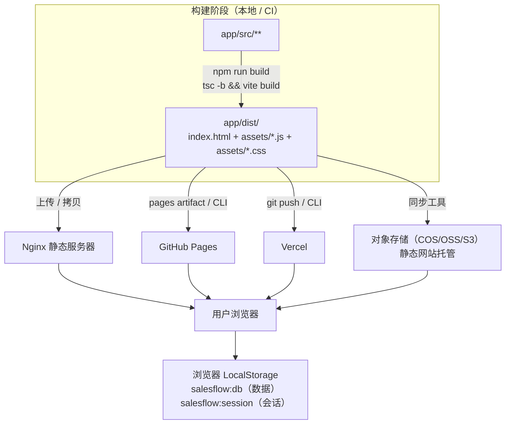

# 部署与运维手册（Deployment Guide）

| 项 | 内容 |
|---|---|
| 文档编号 | SFS-CRM-DP-01 |
| 项目名称 | SalesFlow 智销云 · 销售全流程管理平台（简称 SalesFlow CRM） |
| 版本 | v1.0 |
| 编写日期 | 2026-10-09 |
| 状态 | 已评审通过 |

**版本变更历史**

| 版本 | 日期 | 修订人 | 修订说明 |
|---|---|---|---|
| v0.6 | 2026-10-07 | 开发组 | 编写 Nginx 与静态托管部署方案 |
| v1.0 | 2026-10-09 | 开发组 | 补充数据运维、回滚流程与已知限制清单 |

---

## 1. 引言

### 1.1 编写目的

本文档说明 SalesFlow CRM 的部署架构、构建流程、静态服务器配置（重点：SPA history 路由 fallback）、环境变量规划、运维监控与数据备份恢复、版本升级与回滚，并**坦率列出已知限制**，供部署人员与运维人员使用。

### 1.2 读者对象

部署与运维人员、课程项目答辩演示人员、后续接手维护的工程师。

### 1.3 关键前提

本系统为**纯前端单页应用（SPA）**：无后端服务、无数据库服务端、无服务端会话。全部数据保存在**浏览器 LocalStorage**。因此部署的本质是"把一堆静态文件放到能被 HTTP 访问到的地方"。

---

## 2. 部署架构说明

### 2.1 架构图



### 2.2 架构要点

| 要点 | 说明 |
|---|---|
| 产物形态 | 纯静态：`index.html` + `assets/*.js` + `assets/*.css`，无 Node 运行时、无服务端渲染 |
| 可移植性 | 可部署到任意静态服务器：Nginx、Apache、GitHub Pages、Vercel、Netlify、对象存储静态网站 |
| 路由模式 | React Router 6 `BrowserRouter`（history 模式），**必须配置 SPA fallback**，否则刷新子路径 404 |
| 数据位置 | 全部在用户浏览器 LocalStorage，**服务端不保存任何业务数据** |
| 多用户 | 不同浏览器/不同设备之间数据**互不相通**（单机系统） |
| 并发 | 无需考虑服务端并发；仅受浏览器本地存储容量约束 |

---

## 3. 构建流程

### 3.1 构建命令

```bash
cd app
npm ci            # 或 npm install（CI 推荐 npm ci，依赖严格一致）
npm run build     # 实际执行：tsc -b && vite build
```

### 3.2 预期输出

```
vite v5.4.8 building for production...
✓ 2xx modules transformed.
dist/index.html                   0.6 kB │ gzip:  0.4 kB
dist/assets/index-<hash>.css     xx.xx kB │ gzip:  x.xx kB
dist/assets/index-<hash>.js    xxx.xx kB │ gzip: xx.xx kB
✓ built in 1.2s
```

> 具体体积以实际构建为准。Vite 配置中 `chunkSizeWarningLimit: 1200`（kB），超过会给出告警但不阻断构建。

### 3.3 产物目录结构

```
app/dist/
├── index.html                    # SPA 入口（引用 assets 下带 hash 的资源）
└── assets/
    ├── index-<hash>.js           # 全部业务代码 + React + React Router（单 chunk）
    └── index-<hash>.css          # Tailwind 编译后的样式（已 purge 未使用类）
```

构建配置要点（`app/vite.config.ts`）：

| 配置项 | 值 | 影响 |
|---|---|---|
| `build.outDir` | `dist` | 产物目录 |
| `build.sourcemap` | `false` | 不产出 source map；如需线上排查可临时改为 `true`（会增大体积） |
| `build.chunkSizeWarningLimit` | `1200` | 单 chunk 超过 1200 kB 时告警 |
| `resolve.alias` | `@` → `./src` | 源码内统一用 `@/` 导入，构建时解析 |

### 3.4 构建前自检

```bash
npm run typecheck     # 类型检查必须 0 错误
npm run preview       # 构建后本地预览（需先 build）
```

只有 `npm run build` 成功且 `npm run preview` 主流程无白屏，才允许上传部署。

---

## 4. Nginx 部署方案

### 4.1 前置准备

```bash
# 1) 本地构建
cd app && npm run build

# 2) 拷贝产物到服务器目录（示例）
scp -r dist/* user@server:/var/www/salesflow/

# 或直接在服务器拉取代码后构建（需服务器具备 Node ≥ 20）
git clone <repo> && cd salesflow-crm/app && npm ci && npm run build
```

### 4.2 完整 Nginx 配置（可直接复制）

> **最关键的一行是 `try_files $uri $uri/ /index.html;`** —— React Router 使用 history 模式（`/orders`、`/quotations` 等真实路径），若缺少该配置，用户刷新或直接访问子路径会返回 404。

```nginx
server {
    listen       80;
    server_name  salesflow.example.com;   # 改成实际域名或服务器 IP

    root         /var/www/salesflow;      # 指向 dist 目录内容
    index        index.html;

    # ===== gzip 压缩 =====
    gzip on;
    gzip_vary on;
    gzip_comp_level 6;
    gzip_min_length 1024;
    gzip_proxied any;
    gzip_types text/plain text/css text/xml application/javascript
               application/json application/xml image/svg+xml font/woff2;

    # ===== 带 hash 的静态资源：长期强缓存 =====
    location ^~ /assets/ {
        expires 1y;
        add_header Cache-Control "public, max-age=31536000, immutable";
        access_log off;
        try_files $uri =404;
    }

    # ===== SPA history 路由 fallback（关键！）=====
    # 除 /assets/ 外的所有请求，找不到文件时一律回落到 index.html，
    # 交由 React Router 在前端完成路由匹配。
    location / {
        try_files $uri $uri/ /index.html;
    }

    # ===== index.html 禁止缓存，保证发版即刻生效 =====
    location = /index.html {
        add_header Cache-Control "no-cache, no-store, must-revalidate";
        add_header Pragma "no-cache";
        expires -1;
    }

    # ===== 安全响应头（建议）=====
    add_header X-Content-Type-Options "nosniff" always;
    add_header X-Frame-Options "SAMEORIGIN" always;
    add_header Referrer-Policy "strict-origin-when-cross-origin" always;

    # ===== 访问日志 =====
    access_log /var/log/nginx/salesflow.access.log;
    error_log  /var/log/nginx/salesflow.error.log warn;
}
```

### 4.3 生效与校验

```bash
sudo nginx -t                 # 语法检查，出现 "syntax is ok" 才继续
sudo systemctl reload nginx   # 或 sudo nginx -s reload
```

```bash
# 校验 1：根路径
curl -I http://salesflow.example.com/
# 期望：HTTP/1.1 200 OK

# 校验 2：子路径（验证 SPA fallback 生效）
curl -I http://salesflow.example.com/quotations
# 期望：HTTP/1.1 200 OK，且返回的是 index.html，而非 404

# 校验 3：静态资源
curl -I http://salesflow.example.com/assets/index-<hash>.js
# 期望：200 且响应头含 Cache-Control: max-age=31536000, immutable
```

### 4.4 HTTPS（生产建议）

```bash
# 使用 certbot 一键申请并改写配置
sudo certbot --nginx -d salesflow.example.com
```

---

## 5. 静态托管方案

### 5.1 GitHub Pages

| 项 | 说明 |
|---|---|
| 适用 | 课程项目公开展示、无自定义后端 |
| 部署方式 | GitHub Actions 构建 `app/dist` 后发布 `pages` artifact；或本地构建后推送 `gh-pages` 分支 |
| **SPA 重写** | GitHub Pages **不支持**服务端重写规则。两种解法：<br/>① 在项目**仓库**根目录放 `404.html`，内容为 `index.html` 的副本（刷新子路径时由 404 页面接管再由前端路由解析）；<br/>② 改用 **HashRouter**（需改动 `src/main.tsx`，URL 变为 `/#/orders`，会影响既有 URL 与演示脚本，不推荐） |
| 相对路径 | 若部署在 `https://<user>.github.io/<repo>/` 子路径下，需在 `app/vite.config.ts` 中设置 `base: '/<repo>/'` 后重新构建，否则资源 404 |
| 自定义域名 | 仓库 Settings → Pages → Custom domain；同时在 DNS 添加 CNAME |

最小 Actions 示例（`.github/workflows/deploy.yml`）：

```yaml
name: Deploy to GitHub Pages
on:
  push:
    tags: ['v*']
permissions:
  contents: read
  pages: write
  id-token: write
jobs:
  build:
    runs-on: ubuntu-latest
    defaults:
      run:
        working-directory: app
    steps:
      - uses: actions/checkout@v4
      - uses: actions/setup-node@v4
        with:
          node-version: '22'
      - run: npm ci
      - run: npm run build
      - run: cp dist/index.html dist/404.html   # SPA fallback：404 回落
      - uses: actions/upload-pages-artifact@v3
        with:
          path: app/dist
  deploy:
    needs: build
    runs-on: ubuntu-latest
    environment:
      name: github-pages
    steps:
      - uses: actions/deploy-pages@v4
```

### 5.2 Vercel

| 项 | 说明 |
|---|---|
| 适用 | 快速获得可访问链接、自动 HTTPS |
| 部署方式 | 网页端 Import Git Repository；或 `npx vercel --prod` |
| 配置项 | Root Directory 设为 `app`；Build Command `npm run build`；Output Directory `dist` |
| **SPA 重写** | 在 `app/` 下新建 `vercel.json`： |

```json
{
  "rewrites": [{ "source": "/(.*)", "destination": "/index.html" }],
  "headers": [
    {
      "source": "/assets/(.*)",
      "headers": [{ "key": "Cache-Control", "value": "public, max-age=31536000, immutable" }]
    }
  ]
}
```

> 注意：`rewrites` 会把所有未命中静态文件的请求回落到 `index.html`，从而支持 `/orders` 等路径直接访问与刷新。

### 5.3 对象存储静态网站（腾讯云 COS / 阿里云 OSS / S3）

1. 开启"静态网站托管"，索引文档设为 `index.html`，**错误文档也设为 `index.html`**（等效 SPA fallback）。
2. 上传 `dist/` 下全部文件，保持目录结构。
3. `assets/` 前缀的对象设置长缓存头；`index.html` 设置 `no-cache`。
4. 通过 CDN 加速时，需在 CDN 控制台配置"**回源 404 → 返回 index.html**"或"错误码重定向"，否则刷新子路径仍会 404。

---

## 6. 本地预览验证

```bash
cd app
npm run build
npm run preview
```

预期输出：

```
  ➜  Local:   http://localhost:4173/
  ➜  Network: http://192.168.x.x:4173/
```

打开 http://localhost:4173/ 验证以下清单，通过后再上传服务器：

- [ ] 登录页正常，四个演示账号均可登录
- [ ] 直接访问 `http://localhost:4173/quotations` 不报 404（验证 fallback 思路）
- [ ] 刷新任意子页面仍停留原页面
- [ ] 控制台无红色报错
- [ ] 图表（漏斗/折线/饼图/排行）渲染正常
- [ ] 导出数据 JSON 可正常下载

> `preview` 是 Vite 的静态预览服务，自带 SPA fallback；它**不能替代** Nginx 等生产服务器的验证。上线前务必在真实服务器上再验一次子路径刷新。

---

## 7. 环境变量与配置

### 7.1 当前状态

**本项目当前不依赖任何环境变量**：无后端接口、无第三方密钥、无埋点上报，`app/` 下不存在 `.env` 文件。所有配置均编译期常量：

| 配置 | 位置 | 说明 |
|---|---|---|
| 业务阈值、字典、权限矩阵 | `src/config/businessRules.ts` | 运行时不可改，需改须重新构建 |
| 存储键 | `src/lib/storage.ts` | `salesflow:db`、`salesflow:session` |
| 数据版本 | `DB_VERSION = 1` | 结构变更时递增，用于将来做数据迁移 |
| 开发端口 / 构建产物 | `vite.config.ts` | `5173` / `dist` |

### 7.2 未来接入后端 API 的规划

若后续引入 REST 后端（把 LocalStorage 换成服务端数据库），按下述方式接入，**不要**把地址写死在代码里：

1. 在 `app/.env.example` 中声明模板并提交到仓库：

```bash
# 后端 API 基地址（示例）
VITE_API_BASE_URL=https://api.salesflow.example.com
# 是否启用后端模式（false 时仍走 LocalStorage）
VITE_USE_BACKEND=false
```

2. 新建 `src/config/env.ts` 统一读取与兜底：

```ts
/** 运行时配置：统一从 import.meta.env 读取，禁止在组件中直接读取 */
export const API_BASE_URL = import.meta.env.VITE_API_BASE_URL ?? '';
export const USE_BACKEND = import.meta.env.VITE_USE_BACKEND === 'true';
```

3. 在 `src/lib/storage.ts` 之外新增 `src/lib/api.ts` 实现与 `Repository` 契约一致的接口，由 `USE_BACKEND` 决定走本地还是远端，保证上层 `store` 零改动。
4. 真实 `.env` 文件**必须**写入 `.gitignore`（见《Git 协作与分支管理规范》第 9 章），仅提交 `.env.example`。
5. 变量必须以 `VITE_` 开头才会被 Vite 暴露给客户端；**任何密钥都不应放进 `VITE_` 变量**（会被打进产物，任何人可见）。

---

## 8. 运维监控

### 8.1 健康检查

由于无服务端，健康检查只能是"静态可用性"检查：

```bash
# 首页可达
curl -o /dev/null -s -w "%{http_code} %{time_total}s\n" https://salesflow.example.com/

# 子路径可达（fallback 生效）
curl -o /dev/null -s -w "%{http_code}\n" https://salesflow.example.com/orders

# 资源可达
curl -o /dev/null -s -w "%{http_code}\n" https://salesflow.example.com/assets/index-<hash>.js
```

判定标准：

| 检查项 | 期望 |
|---|---|
| `/` 状态码 | 200 |
| `/orders`、`/quotations` 等子路径 | 200（不是 404） |
| `/assets/*.js`、`/assets/*.css` | 200，且带缓存头 |
| 首页 HTML 中包含 `<div id="root">` | 是 |

### 8.2 浏览器控制台错误排查（主要手段）

用户侧问题基本只能在浏览器排查，标准流程：

1. F12 打开 DevTools → **Console**：查看红色错误。
2. **Network**：确认 `index.html` 与 `assets/*` 是否 200；若为 404，通常是部署路径或 `base` 配置问题。
3. **Application → Local Storage**：确认 `salesflow:db` 是否存在、是否可解析。
4. 常见错误与处置：

| 控制台错误 | 原因 | 处置 |
|---|---|---|
| `Failed to load resource: 404` (assets) | 部署在子路径但未设 `base` | 设 `base: '/<子路径>/'` 重新构建 |
| `Unexpected token < in JSON at position 0` | 请求 HTML 却按 JSON 解析；或 LocalStorage 数据损坏 | 检查 API 地址（未来）；或清理 `salesflow:db` |
| `Cannot read properties of null` | 数据结构与版本不匹配 | 清理 LocalStorage 重新生成种子数据 |
| 空白页无报错 | 路由未匹配且未配置 `*` 兜底 | 确认 `App.tsx` 的 `<Route path="*" ... />` 存在并已构建进去 |
| `本地存储写入失败…` | LocalStorage 超 5 MB | 导出备份 → 重置演示数据 |

### 8.3 用户反馈渠道

| 渠道 | 用途 | 需收集的信息 |
|---|---|---|
| 项目 Issues（若有远端仓库） | 缺陷登记与跟踪 | 浏览器版本 + 分辨率 + 复现步骤 + 控制台报错截图 |
| 课程答疑群 / 邮件 | 演示与验收阶段反馈 | 账号、模块路径、操作序列、截图 |
| 系统管理 → 操作日志 | 追溯用户动作（应用内 `activityLogs`） | 由管理员登录后查看 |

建议反馈模板：

```
【环境】Chrome 版本 / 分辨率 / 操作系统
【账号角色】如 zhangwei（销售员）
【访问地址】https://.../quotations
【复现步骤】1. … 2. … 3. …
【期望结果】…
【实际结果】…
【控制台报错】（F12 Console 截图或文字）
```

---

## 9. 数据运维

### 9.1 备份与恢复

**导出（备份）**

- 应用内：以 `zhaoqiang` 登录 → 系统管理 → **导出数据 JSON**，文件名 `salesflow-data-<YYYY-MM-DD>.json`。
- 手动（控制台）：

```js
const db = JSON.parse(localStorage.getItem('salesflow:db'));
const a = document.createElement('a');
a.href = URL.createObjectURL(new Blob([JSON.stringify(db, null, 2)], { type: 'application/json' }));
a.download = 'salesflow-data-backup.json';
a.click();
```

**恢复**

```js
// 粘贴备份文件内容
localStorage.setItem('salesflow:db', '<备份 JSON 全文>');
location.reload();
```

**重置为演示数据**

- 应用内：系统管理 → **重置演示数据**（二次确认）。
- 手动：

```js
localStorage.removeItem('salesflow:db');
localStorage.removeItem('salesflow:session');
location.href = '/login';
```

> 重置后下次进入会由 `buildSeedDb()` 重新生成种子数据并落盘。

### 9.2 浏览器清除缓存导致数据丢失的应对

这是本架构**最主要的运维风险**，必须提前告知用户：

| 情形 | 后果 | 应对 |
|---|---|---|
| 用户清理"浏览数据 / Cookie 及网站数据" | `salesflow:db` 被清空，数据不可恢复 | 演示/验收前**必须导出 JSON 备份**；重要数据定期导出 |
| 使用无痕/隐私窗口 | 关闭窗口即清空 | 演示请勿使用无痕窗口 |
| 更换浏览器 / 换电脑 | 数据不随账号同步 | 通过导出/导入 JSON 迁移 |
| 用户手动删除 LocalStorage | 同上 | 同上 |
| 站点域名变更 | 数据按 origin 隔离，旧数据读不到 | 迁移前导出，在新域名导入 |

**运维建议**：在验收/演示前一天导出一份备份存档；在登录页或系统管理页对"数据仅存于本机浏览器"做醒目提示。

### 9.3 容量上限

| 项 | 说明 |
|---|---|
| 单域名上限 | 约 **5 MB**（各浏览器实现略有差异，通常按字符数计） |
| 存储内容 | `salesflow:db` 一个键，内含全部 17 个实体集合的 JSON |
| 超出后果 | `localStorage.setItem` 抛异常；`src/lib/storage.ts` 会捕获并抛出 `StorageError`，页面弹出明确提示（对应 NFR-R-02：不得静默失败） |
| 处置 | 导出 JSON → 重置演示数据 → 如仍不够，需归档历史日志（如裁剪 `activityLogs`） |
| 估算 | 演示种子数据量级为数百 KB 级，正常使用距离 5 MB 上限有充足余量 |

---

## 10. 版本升级与回滚

### 10.1 升级流程

```bash
# 1) 切到发布标签
git fetch --tags
git switch main && git pull --ff-only
git switch --detach v1.0.1          # 或 v1.0.0

# 2) 构建
cd app && npm ci && npm run build

# 3) 备份旧产物（关键！便于秒级回滚）
ssh user@server 'cp -r /var/www/salesflow /var/www/salesflow.bak-$(date +%F)'

# 4) 上传新产物
rsync -av --delete dist/ user@server:/var/www/salesflow/

# 5) 重载并验证
ssh user@server 'sudo nginx -t && sudo systemctl reload nginx'
curl -o /dev/null -s -w "%{http_code}\n" https://salesflow.example.com/orders
```

### 10.2 回滚流程

**方式一：静态产物回滚（最快，秒级）**

```bash
ssh user@server 'rm -rf /var/www/salesflow && mv /var/www/salesflow.bak-2026-10-09 /var/www/salesflow'
ssh user@server 'sudo nginx -s reload'
```

**方式二：按 tag 重新构建回滚**

```bash
git switch --detach v1.0.0
cd app && npm ci && npm run build
rsync -av --delete dist/ user@server:/var/www/salesflow/
```

**方式三：代码级回滚**

```bash
git revert <有问题的提交 sha>        # 生成反向提交，安全可追溯
git tag -a v1.0.2 -m "回滚 xxx 改动"
git push origin main --follow-tags
```

### 10.3 回滚注意事项

| 注意点 | 说明 |
|---|---|
| 回滚**不影响**用户浏览器里的 LocalStorage 数据 | 服务端无数据，回滚只是换静态文件 |
| 但若新版本改动过 `DB_VERSION` 或数据结构 | 旧版本可能读不懂新数据，需在发布说明中提示用户"重置演示数据"或导入备份 |
| `assets/*` 文件名带 hash 且长缓存 | 回滚后务必确认 `index.html` 未被 CDN 缓存（`no-cache`），否则用户仍加载旧资源引用 |
| 保留至少 2 份历史产物备份 | 便于连续回滚 |

---

## 11. 已知限制清单

本章**坦率列出本版本的限制**，这些限制源于课程项目的定位与技术选型，不是缺陷遗漏。

| # | 限制 | 影响 | 规避/未来方向 |
|---|---|---|---|
| L-1 | **无真实后端** | 所有数据读写在浏览器内完成，无服务端 API、无数据库 | 后续按第 7.2 节接入 REST 后端，`Repository` 契约已预留 |
| L-2 | **无服务端鉴权** | 登录校验仅在前端比对 `users` 表中的账号密码；清除/篡改 LocalStorage 可绕过登录 | **不可用于生产环境的真实业务**；接后端后改为服务端签发 Token + 接口鉴权 |
| L-3 | **单机数据，不共享** | 同一账号在不同电脑/浏览器看到的是各自独立的数据；多人无法协作同一份数据 | 依赖服务端存储解决 |
| L-4 | **数据易丢失** | 清理浏览器数据、换设备、无痕窗口都会导致数据消失 | 定期导出 JSON 备份（见 9.1） |
| L-5 | **存储容量上限约 5 MB** | 数据量增长后会写入失败 | 归档裁剪或迁移服务端 |
| L-6 | **不支持移动端** | `index.html` 固定 `viewport width=1440`；低于 1280 宽体验明显下降；未做触屏适配 | 未来可新增响应式断点与移动端布局 |
| L-7 | **不支持 IE 及老旧浏览器** | 依赖 ES2020 与现代 CSS | 需适配时引入 Babel polyfill + 降级样式 |
| L-8 | **无自动化单元测试/端到端测试** | 质量保障依赖人工用例与代码评审 | 后续引入 Vitest + Playwright |
| L-9 | **无 CI/CD（默认）** | 构建与部署为手工执行 | 可按第 5.1 节 GitHub Actions 示例补齐 |
| L-10 | **无埋点与线上监控** | 只能靠用户反馈与控制台排查，无法主动发现线上错误 | 后续接入前端监控 SDK（需注意 `VITE_` 变量不存密钥） |
| L-11 | **审批为流程模拟** | 审批链在前端按 `ROLE_MENUS` 与常量生成，无消息通知、无待办推送 | 接后端后补齐消息通知与待办中心 |
| L-12 | **密码为明文存储** | `users[].password` 以明文存于 LocalStorage，演示密码统一 `123456` | 生产必须改为服务端加盐哈希 + HTTPS |
| L-13 | **无并发与权限审计的服务端保障** | 操作日志 `activityLogs` 存于本地，可被清除 | 服务端审计日志 |

> **重要声明**：本系统定位为**课程项目原型与演示系统**，其价值在于完整呈现 L2C（Lead to Cash）销售全流程的业务建模、交互设计与工程规范，**不具备生产级安全与数据可靠性保障**，请勿直接用于处理真实客户与真实交易数据。

---

## 12. 附：部署检查清单

- [ ] `npm run typecheck` 通过
- [ ] `npm run build` 成功，`app/dist/` 含 `index.html` 与 `assets/`
- [ ] `npm run preview` 主流程验证通过
- [ ] 服务器已配置 **SPA fallback**（`try_files $uri $uri/ /index.html;` 或等价重写）
- [ ] `/assets/` 长缓存、`index.html` 不缓存
- [ ] gzip 已开启
- [ ] 子路径（`/orders`、`/quotations`）直接访问与刷新均返回 200
- [ ] 四个演示账号在**部署环境**登录正常
- [ ] 已导出一份 `salesflow-data-*.json` 备份存档
- [ ] 已保留上一版本产物备份，回滚方案可即时执行
- [ ] 已向用户告知第 11 章的已知限制（尤其 L-2、L-3、L-4）

> 相关文档：《环境搭建与运行手册》SFS-CRM-SG-01、《Git 协作与分支管理规范》SFS-CRM-GW-01、《编码规范》SFS-CRM-CS-01、《数据库设计说明书》SFS-CRM-DB-01。
