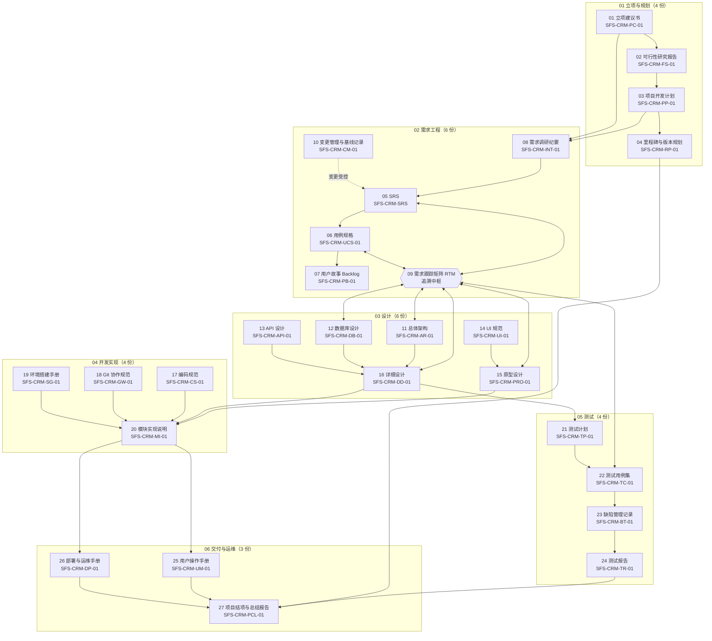

# SalesFlow CRM 技术文档体系总索引

| 项 | 内容 |
|---|---|
| 项目名称 | SalesFlow 智销云 · 销售全流程管理平台（简称 SalesFlow CRM） |
| 项目代号 | SFS-CRM |
| 文档集版本 | v1.0（对应交付版本 v1.0.0） |
| 编制日期 | 2026-10-09 |
| 文档总数 | **27 份正式文档 + 本索引** |
| 体系依据 | GB/T 8566-2022、GB/T 9385-2008、IEEE Std 29148-2018 |
| 维护责任 | 配置管理员（归档前由项目经理复核） |

**版本变更历史**

| 版本 | 日期 | 修订人 | 修订说明 | 状态 |
|---|---|---|---|---|
| v0.1 | 2026-10-09 | 配置管理 | 建立索引骨架与文档清单总表 | 草稿 |
| v1.0 | 2026-10-09 | 配置管理、项目经理 | 27 份文档归档后核对路径、编号与字数，发布索引 | **已发布** |

---

## 1. 文档体系设计依据

本目录（`docs/`）收录 SalesFlow CRM 项目的全部技术文档，**共 27 份正式技术文档 + 1 份总索引（本文件）**，其结构与编制要求依据下列标准：

| 依据 | 全名 | 对项目文档体系的具体约束 |
|---|---|---|
| **GB/T 8566-2022** | 软件生存周期过程 | 决定目录的**阶段划分**：立项与规划、需求工程、设计、开发实现、测试、交付与运维六个过程域，确保无阶段遗漏 |
| **GB/T 9385-2008** | 计算机软件需求规格说明规范 | 决定**需求类文档**的质量特性与章节结构：需求须完整、无二义、一致、可验证、可追踪 |
| **IEEE Std 29148-2018** | Requirements Engineering | 指导需求获取、分析、规格说明与确认的条目化写法，以及需求双向追溯矩阵的建立方法 |

三条原则贯穿整个文档集：**可追溯**（每条需求都能追到设计、代码与用例）、**可验证**（每条需求都写验收标准）、**可审计**（每份文档都有编号、版本历史与责任角色）。

---

## 2. 文档清单总表

> 字数统计口径为文件字符数（含表格与标记符号），取整至 0.1 千字，用于篇幅概览；所有链接均为相对路径，可在任意 Markdown 阅读器中跳转。

| 序号 | 文档名称 | 文档编号 | 所属阶段 | 文件路径（相对链接） | 状态 | 字数 |
|---|---|---|---|---|---|---|
| 01 | 项目立项建议书 | SFS-CRM-PC-01 | 01-立项与规划 | [./01-立项与规划/01-项目立项建议书-Project-Charter.md](./01-立项与规划/01-项目立项建议书-Project-Charter.md) | 已批准·基线 | 约 11.8 千字 |
| 02 | 可行性研究报告 | SFS-CRM-FS-01 | 01-立项与规划 | [./01-立项与规划/02-可行性研究报告.md](./01-立项与规划/02-可行性研究报告.md) | 已评审·基线 | 约 13.6 千字 |
| 03 | 项目开发计划 | SFS-CRM-PP-01 | 01-立项与规划 | [./01-立项与规划/03-项目开发计划-Software-Project-Plan.md](./01-立项与规划/03-项目开发计划-Software-Project-Plan.md) | 已基线化 | 约 18.8 千字 |
| 04 | 里程碑与版本规划 | SFS-CRM-RP-01 | 01-立项与规划 | [./01-立项与规划/04-里程碑与版本规划-Release-Plan.md](./01-立项与规划/04-里程碑与版本规划-Release-Plan.md) | 已基线化 | 约 19.7 千字 |
| 05 | 软件需求规格说明书（SRS） | SFS-CRM-SRS | 02-需求工程 | [./02-需求工程/05-软件需求规格说明书-SRS.md](./02-需求工程/05-软件需求规格说明书-SRS.md) | 已基线化 | 约 12.3 千字 |
| 06 | 用例规格说明书 | SFS-CRM-UCS-01 | 02-需求工程 | [./02-需求工程/06-用例规格说明书-Use-Case-Specification.md](./02-需求工程/06-用例规格说明书-Use-Case-Specification.md) | 已基线化 | 约 17.8 千字 |
| 07 | 用户故事与产品待办列表 | SFS-CRM-PB-01 | 02-需求工程 | [./02-需求工程/07-用户故事与产品待办列表-Product-Backlog.md](./02-需求工程/07-用户故事与产品待办列表-Product-Backlog.md) | 已基线化 | 约 15.4 千字 |
| 08 | 需求调研计划与访谈纪要 | SFS-CRM-INT-01 | 02-需求工程 | [./02-需求工程/08-需求调研计划与访谈纪要.md](./02-需求工程/08-需求调研计划与访谈纪要.md) | 已基线化 | 约 8.2 千字 |
| 09 | 需求跟踪矩阵（RTM） | SFS-CRM-RTM-01 | 02-需求工程 | [./02-需求工程/09-需求跟踪矩阵-RTM.md](./02-需求工程/09-需求跟踪矩阵-RTM.md) | 已基线化 | 约 11.2 千字 |
| 10 | 需求变更管理与基线记录 | SFS-CRM-CM-01 | 02-需求工程 | [./02-需求工程/10-需求变更管理与基线记录.md](./02-需求工程/10-需求变更管理与基线记录.md) | 已基线化 | 约 10.3 千字 |
| 11 | 总体架构设计说明书 | SFS-CRM-AR-01 | 03-设计 | [./03-设计/11-总体架构设计说明书-Architecture.md](./03-设计/11-总体架构设计说明书-Architecture.md) | 已评审通过 | 约 15.0 千字 |
| 12 | 数据库设计说明书 | SFS-CRM-DB-01 | 03-设计 | [./03-设计/12-数据库设计说明书-DB-Design.md](./03-设计/12-数据库设计说明书-DB-Design.md) | 已评审通过 | 约 14.6 千字 |
| 13 | API 接口设计说明书 | SFS-CRM-API-01 | 03-设计 | [./03-设计/13-API接口设计说明书-API-Design.md](./03-设计/13-API接口设计说明书-API-Design.md) | 已评审通过 | 约 20.8 千字 |
| 14 | UI 设计规范与组件说明 | SFS-CRM-UI-01 | 03-设计 | [./03-设计/14-UI设计规范与组件说明-UI-Guideline.md](./03-设计/14-UI设计规范与组件说明-UI-Guideline.md) | 已评审通过 | 约 40.1 千字 |
| 15 | 原型设计说明书 | SFS-CRM-PRO-01 | 03-设计 | [./03-设计/15-原型设计说明书-Prototype.md](./03-设计/15-原型设计说明书-Prototype.md) | 已确认·签字 | 约 51.1 千字 |
| 16 | 详细设计说明书 | SFS-CRM-DD-01 | 03-设计 | [./03-设计/16-详细设计说明书-Detailed-Design.md](./03-设计/16-详细设计说明书-Detailed-Design.md) | 已评审通过 | 约 20.0 千字 |
| 17 | 编码规范 | SFS-CRM-CS-01 | 04-开发实现 | [./04-开发实现/17-编码规范-Coding-Standard.md](./04-开发实现/17-编码规范-Coding-Standard.md) | 已发布 | 约 17.5 千字 |
| 18 | Git 协作与分支管理规范 | SFS-CRM-GW-01 | 04-开发实现 | [./04-开发实现/18-Git协作与分支管理规范-Git-Workflow.md](./04-开发实现/18-Git协作与分支管理规范-Git-Workflow.md) | 已发布 | 约 15.2 千字 |
| 19 | 环境搭建与运行手册 | SFS-CRM-SG-01 | 04-开发实现 | [./04-开发实现/19-环境搭建与运行手册-Setup-Guide.md](./04-开发实现/19-环境搭建与运行手册-Setup-Guide.md) | 已发布 | 约 15.0 千字 |
| 20 | 模块实现说明 | SFS-CRM-MI-01 | 04-开发实现 | [./04-开发实现/20-模块实现说明-Module-Implementation.md](./04-开发实现/20-模块实现说明-Module-Implementation.md) | 已评审通过 | 约 12.7 千字 |
| 21 | 测试计划 | SFS-CRM-TP-01 | 05-测试 | [./05-测试/21-测试计划-Test-Plan.md](./05-测试/21-测试计划-Test-Plan.md) | 已发布 | 约 14.4 千字 |
| 22 | 测试用例集 | SFS-CRM-TC-01 | 05-测试 | [./05-测试/22-测试用例集-Test-Cases.md](./05-测试/22-测试用例集-Test-Cases.md) | 已发布 | 约 39.4 千字 |
| 23 | 缺陷管理记录 | SFS-CRM-BT-01 | 05-测试 | [./05-测试/23-缺陷管理记录-Bug-Tracking.md](./05-测试/23-缺陷管理记录-Bug-Tracking.md) | 已发布 | 约 24.7 千字 |
| 24 | 测试报告 | SFS-CRM-TR-01 | 05-测试 | [./05-测试/24-测试报告-Test-Report.md](./05-测试/24-测试报告-Test-Report.md) | 已发布·准出通过 | 约 15.9 千字 |
| 25 | 用户操作手册 | SFS-CRM-UM-01 | 06-交付与运维 | [./06-交付与运维/25-用户操作手册-User-Manual.md](./06-交付与运维/25-用户操作手册-User-Manual.md) | 已发布 | 约 27.1 千字 |
| 26 | 部署与运维手册 | SFS-CRM-DP-01 | 06-交付与运维 | [./06-交付与运维/26-部署与运维手册-Deployment-Guide.md](./06-交付与运维/26-部署与运维手册-Deployment-Guide.md) | 已发布 | 约 15.4 千字 |
| 27 | 项目结项与总结报告 | SFS-CRM-PCL-01 | 06-交付与运维 | [./06-交付与运维/27-项目结项与总结报告-Project-Closure.md](./06-交付与运维/27-项目结项与总结报告-Project-Closure.md) | 待结项签字 | 约 17.0 千字 |
| — | 技术文档体系总索引（本文件） | SFS-CRM-IDX-01 | 全阶段 | [./README.md](./README.md) | 已发布 | 约 3.5 千字 |

**合计**：27 份正式文档约 516.9 千字，加本索引约 520.4 千字；六阶段分布为立项与规划 4 份、需求工程 6 份、设计 6 份、开发实现 4 份、测试 4 份、交付与运维 3 份。

---

## 3. 按阶段分组的二级索引

### 3.1 01-立项与规划（4 份）

| 序号 | 文档 | 一句话简介 |
|---|---|---|
| 01 | [项目立项建议书](./01-立项与规划/01-项目立项建议书-Project-Charter.md) | 痛点量化、目标指标与预算，立项依据 |
| 02 | [可行性研究报告](./01-立项与规划/02-可行性研究报告.md) | 技术、经济、操作、法律四维可行性论证 |
| 03 | [项目开发计划](./01-立项与规划/03-项目开发计划-Software-Project-Plan.md) | 过程模型、WBS 104 人日与质量、配置、风险计划 |
| 04 | [里程碑与版本规划](./01-立项与规划/04-里程碑与版本规划-Release-Plan.md) | 版本策略、M1~M6 准入准出与 v2.0 规划 |

### 3.2 02-需求工程（6 份）

| 序号 | 文档 | 一句话简介 |
|---|---|---|
| 05 | [软件需求规格说明书（SRS）](./02-需求工程/05-软件需求规格说明书-SRS.md) | 需求基准：54 条功能需求与 25 条非功能需求 |
| 06 | [用例规格说明书](./02-需求工程/06-用例规格说明书-Use-Case-Specification.md) | UC-01 ~ UC-33 的基本流、备选流与异常流 |
| 07 | [用户故事与产品待办列表](./02-需求工程/07-用户故事与产品待办列表-Product-Backlog.md) | 用户故事、验收标准与故事点，迭代排期输入 |
| 08 | [需求调研计划与访谈纪要](./02-需求工程/08-需求调研计划与访谈纪要.md) | 访谈提纲、原话记录与痛点归纳 |
| 09 | [需求跟踪矩阵（RTM）](./02-需求工程/09-需求跟踪矩阵-RTM.md) | **追溯中枢**：需求↔用例↔设计↔测试双向映射 |
| 10 | [需求变更管理与基线记录](./02-需求工程/10-需求变更管理与基线记录.md) | 变更流程、CR-001 ~ CR-004 与基线记录 |

### 3.3 03-设计（6 份）

| 序号 | 文档 | 一句话简介 |
|---|---|---|
| 11 | [总体架构设计说明书](./03-设计/11-总体架构设计说明书-Architecture.md) | 技术选型、分层架构与模块划分 |
| 12 | [数据库设计说明书](./03-设计/12-数据库设计说明书-DB-Design.md) | 14 个核心实体的字段、主外键与存储约定 |
| 13 | [API 接口设计说明书](./03-设计/13-API接口设计说明书-API-Design.md) | 面向 v2.0 的 REST 契约、错误码与鉴权约定 |
| 14 | [UI 设计规范与组件说明](./03-设计/14-UI设计规范与组件说明-UI-Guideline.md) | 色板、字号、间距与组件状态规范 |
| 15 | [原型设计说明书](./03-设计/15-原型设计说明书-Prototype.md) | P01 ~ P10 页面原型与交互说明，业务方已签字 |
| 16 | [详细设计说明书](./03-设计/16-详细设计说明书-Detailed-Design.md) | 组件接口、状态机实现与待重构项登记 |

### 3.4 04-开发实现（4 份）

| 序号 | 文档 | 一句话简介 |
|---|---|---|
| 17 | [编码规范](./04-开发实现/17-编码规范-Coding-Standard.md) | 命名、类型、组件与样式约定及检查规则 |
| 18 | [Git 协作与分支管理规范](./04-开发实现/18-Git协作与分支管理规范-Git-Workflow.md) | 分支策略、提交规范与评审准入要求 |
| 19 | [环境搭建与运行手册](./04-开发实现/19-环境搭建与运行手册-Setup-Guide.md) | 环境搭建、依赖安装与故障排查 |
| 20 | [模块实现说明](./04-开发实现/20-模块实现说明-Module-Implementation.md) | 代码规模、模块职责、技术难点与偏离说明 |

### 3.5 05-测试（4 份）

| 序号 | 文档 | 一句话简介 |
|---|---|---|
| 21 | [测试计划](./05-测试/21-测试计划-Test-Plan.md) | 测试范围、策略与准入准出标准 E1 ~ E12 |
| 22 | [测试用例集](./05-测试/22-测试用例集-Test-Cases.md) | 107 条用例，含边界值与端到端场景 |
| 23 | [缺陷管理记录](./05-测试/23-缺陷管理记录-Bug-Tracking.md) | BUG-001 ~ BUG-012 的生命周期与根因分析 |
| 24 | [测试报告](./05-测试/24-测试报告-Test-Report.md) | 通过率 96.26%、非功能结论与准出签字 |

### 3.6 06-交付与运维（3 份）

| 序号 | 文档 | 一句话简介 |
|---|---|---|
| 25 | [用户操作手册](./06-交付与运维/25-用户操作手册-User-Manual.md) | 四角色的操作指南与演示脚本 |
| 26 | [部署与运维手册](./06-交付与运维/26-部署与运维手册-Deployment-Guide.md) | 静态部署、备份重置与故障处置 |
| 27 | [项目结项与总结报告](./06-交付与运维/27-项目结项与总结报告-Project-Closure.md) | 验收对照、过程数据与 v2.0 规划 |

---

## 4. 文档之间的追溯关系

文档流向按软件生存周期自上而下：**立项 → 需求 → 设计 → 实现 → 测试 → 交付**；《需求跟踪矩阵》（09）作为中枢，把需求同后向的设计与测试资产连接为双向追溯链。



**追溯要点**

1. **前向追溯**：每条需求均可从 RTM 追至用例、设计章节、测试用例与缺陷单，证明"需求被实现了"；
2. **后向追溯**：每条测试用例与每个设计项都能反查到需求编号，证明"没有凭空堆砌的规格"；
3. **孤儿检查**：每个迭代出口做双向扫描，未挂接需求的设计项或用例均须声明或删除；
4. **变更闭环**：需求变更经 CRF 批准后，SRS、用例规格、产品待办与 RTM **在同一分支同步修改**，避免出现矩阵与需求脱节。

---

## 5. 阅读指南

### 5.1 教师评审路线（约 40 分钟，重点：过程规范性与数据自洽）

| 顺序 | 文档 | 看什么 |
|---|---|---|
| 1 | [03 项目开发计划](./01-立项与规划/03-项目开发计划-Software-Project-Plan.md) | 过程模型选型、WBS 与甘特图、质量与配置管理计划 |
| 2 | [05 SRS](./02-需求工程/05-软件需求规格说明书-SRS.md) | 需求编号连续性、状态机与决策表、验收标准 |
| 3 | [09 需求跟踪矩阵](./02-需求工程/09-需求跟踪矩阵-RTM.md) | 需求—用例—设计—测试的双向追溯完整性 |
| 4 | [11 总体架构设计](./03-设计/11-总体架构设计说明书-Architecture.md) | 模块划分与 SRS 功能编号的对应关系 |
| 5 | [24 测试报告](./05-测试/24-测试报告-Test-Report.md) | 通过率、缺陷闭环、非功能验证与准出签字 |
| 6 | [27 结项与总结报告](./06-交付与运维/27-项目结项与总结报告-Project-Closure.md) | 验收对照表、过程数据统计、经验总结与遗留问题 |

### 5.2 答辩准备路线（约 30 分钟，重点：讲清价值与闭环）

| 顺序 | 文档 | 看什么 |
|---|---|---|
| 1 | [01 立项建议书](./01-立项与规划/01-项目立项建议书-Project-Charter.md) | 四类痛点与量化目标（回答"为什么做"） |
| 2 | [15 原型设计说明书](./03-设计/15-原型设计说明书-Prototype.md) | 十个页面与端到端跳转（回答"做成什么样"） |
| 3 | [05 SRS](./02-需求工程/05-软件需求规格说明书-SRS.md) | 第 7.2 节十步演示脚本（可直接作为演示提纲） |
| 4 | [24 测试报告](./05-测试/24-测试报告-Test-Report.md) | 第 5 章端到端场景结论（回答"是否跑通"） |
| 5 | [27 结项与总结报告](./06-交付与运维/27-项目结项与总结报告-Project-Closure.md) | 经验总结与 v2.0 规划（回答"学到什么、还要做什么"） |

### 5.3 开发同学接手路线（约 60 分钟，重点：能跑起来、能改得动）

| 顺序 | 文档 | 看什么 |
|---|---|---|
| 1 | [19 环境搭建与运行手册](./04-开发实现/19-环境搭建与运行手册-Setup-Guide.md) | 先把项目跑起来 |
| 2 | [17 编码规范](./04-开发实现/17-编码规范-Coding-Standard.md) | 命名、组件与样式约定 |
| 3 | [18 Git 协作与分支管理规范](./04-开发实现/18-Git协作与分支管理规范-Git-Workflow.md) | 分支、提交与评审要求 |
| 4 | [11 总体架构](./03-设计/11-总体架构设计说明书-Architecture.md)、[12 数据库设计](./03-设计/12-数据库设计说明书-DB-Design.md)、[13 API 设计](./03-设计/13-API接口设计说明书-API-Design.md) | 分层、实体与接口契约 |
| 5 | [16 详细设计说明书](./03-设计/16-详细设计说明书-Detailed-Design.md) | 组件接口、状态机与数据访问层约定 |
| 6 | [20 模块实现说明](./04-开发实现/20-模块实现说明-Module-Implementation.md) | 现有代码结构与已知待重构项 |
| 7 | [21 测试计划](./05-测试/21-测试计划-Test-Plan.md)、[22 测试用例集](./05-测试/22-测试用例集-Test-Cases.md) | 改代码前先看哪些用例会受影响 |

---

## 6. 文档编号规则

**格式**：`SFS-CRM-<类别码>[-序号]`

```
SFS-CRM - <类别码> - <两位序号>
  │         │          │
  │         │          └─ 同类文档的流水号，从 01 起
  │         └──────────── 文档类别缩写（见下表）
  └────────────────────── 项目代号（SalesFlow CRM）
```

| 类别码 | 含义 | 示例 |
|---|---|---|
| `PC` | Project Charter，立项建议书 | SFS-CRM-PC-01 |
| `FS` | Feasibility Study，可行性研究 | SFS-CRM-FS-01 |
| `PP` | Project Plan，开发计划 | SFS-CRM-PP-01 |
| `RP` | Release Plan，里程碑与版本规划 | SFS-CRM-RP-01 |
| `SRS` | 软件需求规格说明书（唯一本体文档，不加序号） | SFS-CRM-SRS |
| `UCS` / `PB` / `INT` | 用例规格 / 产品待办 / 访谈纪要 | SFS-CRM-UCS-01 |
| `RTM` | Requirements Traceability Matrix，需求跟踪矩阵 | SFS-CRM-RTM-01 |
| `CM` | Change Management，变更管理与基线记录 | SFS-CRM-CM-01 |
| `AR` / `DB` / `API` / `UI` / `PRO` / `DD` | 架构 / 数据库 / 接口 / UI 规范 / 原型 / 详细设计 | SFS-CRM-AR-01 |
| `CS` / `GW` / `SG` / `MI` | 编码规范 / Git 工作流 / 环境搭建 / 模块实现 | SFS-CRM-CS-01 |
| `TP` / `TC` / `BT` / `TR` | 测试计划 / 测试用例 / 缺陷记录 / 测试报告 | SFS-CRM-TP-01 |
| `UM` / `DP` / `PCL` | 用户手册 / 部署手册 / 结项总结 | SFS-CRM-UM-01 |
| `IDX` | Index，索引（本文件） | SFS-CRM-IDX-01 |

**规则与例外**

1. 文件名的两位数字序号 01 ~ 27 为**全局连续流水**，与目录名中的阶段无关，便于排序；文档编号中的序号由类别码单独编排；
2. 《软件需求规格说明书》为需求阶段的唯一本体文档，编号不带序号（SFS-CRM-SRS），其余文档均带两位序号；
3. **已知偏差**：《里程碑与版本规划》第 2.3 节早期引用架构与详细设计为 `SFS-CRM-HLD-01`、`SFS-CRM-LLD-01`，实际归档编号为 `SFS-CRM-AR-01`、`SFS-CRM-DD-01`；已在结项报告遗留项 L-08 中登记，归档前由配置管理员统一校准引用。

---

## 7. 版本管理说明

1. **文档头部信息表**：每份文档首页均含表格，列出文档编号、项目名称、版本、编写日期、状态与编写人（或责任角色）；
2. **版本变更历史表**：每份文档头部均附"版本变更历史"，记录版本号、修订日期、修订人、修订说明与状态，**至少保留最后一次迭代记录**；
3. **版本号的语义**：`v0.x` 表示草稿（v0.1 首稿 / v0.5 内部评审 / v0.9 评审稿），`v1.0` 表示已基线化或已发布；需求类文档的基线版本须经变更控制委员会批准；
4. **变更控制**：一般性勘误由文档责任人直接修改并提交合并请求，1 人评审；涉及需求条目的修改必须走变更流程（《需求变更管理与基线记录》第 1.3 节），批准后同步更新 SRS、用例、待办与 RTM；
5. **文档与代码同源管理**：文档与源码同处受控配置库，二者通过里程碑评审对齐；每次发布后同步打附注 tag，并在《里程碑与版本规划》的发布说明中登记；
6. **归档检查**：交付前由配置管理员逐项核对"是否存在、编号是否连续、版本历史是否完整、链接是否可达"，并更新本索引第 2 章清单总表的状态与字数。

---

> 本索引随文档集同步维护：新增、重命名或废止任一文档时，须在同一合并请求中更新本文件相应条目与版本变更历史。
