# 软件需求表达工具、方法与规范调研报告

| 项目 | 内容 |
| --- | --- |
| 课程 | 软件工程 |
| 作业项 | 第 1 项：需求表达工具、方法与规范调研 |
| 业务案例 | CRM 销售管理平台（L2C 全流程） |
| 文档版本 | v1.0 |
| 撰写日期 | 2026-10-09 |

## 目录

- [1 概述：需求表达要解决的三个问题](#1-概述需求表达要解决的三个问题)
- [2 需求表达方法逐项详解](#2-需求表达方法逐项详解)
- [3 支持需求表达的软件工具](#3-支持需求表达的软件工具)
- [4 需求表达应遵守的规范与标准](#4-需求表达应遵守的规范与标准)
- [5 从素材到正式需求文档 SRS 的收敛路径](#5-从素材到正式需求文档-srs-的收敛路径)
- [6 案例应用：CRM 销售管理平台 L2C 全流程](#6-案例应用crm-销售管理平台-l2c-全流程)
- [7 常见错误与自查清单](#7-常见错误与自查清单)
- [8 参考文献与标准](#8-参考文献与标准)

---

## 1 概述：需求表达要解决的三个问题

### 1.1 什么是需求表达

**需求表达（Requirements Representation / Requirements Expression）**，是指把从用户、市场、法规、竞品等渠道采集来的、原始而粗糙的"想要"，转化为**结构清晰、语义唯一、可被评审、可被验证、可被追踪**的正式描述的过程。

需求表达不是"把话写漂亮"，而是完成一次**信息形态的转换**：

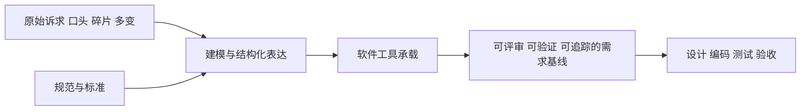

需求表达包含三层含义：

1. **表达给谁看**：客户/业务方看"是不是我要的"，开发看"怎么做"，测试看"怎么验"，项目经理看"做多少、什么优先级"。
2. **用什么表达**：图形化模型（用例图、状态图、时序图……）、文本化规格（用例规格说明、用户故事、需求条目）、可执行示例（原型、验收标准）。
3. **表达成什么样**：符合组织规范与国家标准，有编号、有优先级、有来源、有验收标准、有追溯关系。

> 一个容易被忽略的事实：需求表达产出的**过程**本身就在发现需求。画一张状态图，往往会立刻暴露"线索被作废后还能不能转客户"这类从来没有被人明确提出过的规则。这是需求表达最大的价值，仅次于它产出的文档本身。

### 1.2 为什么单一的自然语言描述不够用

自然语言（中文或英文散文）是人类最顺手的沟通工具，但作为需求载体它天然存在四类缺陷：

| 缺陷 | 自然语言中的典型表现 | 造成的后果 |
| --- | --- | --- |
| 多义性 | "系统应快速响应查询" | 开发认为 2 秒，用户认为 0.5 秒，测试无法判定 |
| 信息密度低 | 一大段描述里混杂了功能、界面、性能、权限 | 遗漏率高，评审者读不下去 |
| 结构性缺失 | 只说"能导入客户"，没说导入失败怎么办 | 异常路径被整体遗忘，上线后集中爆发 |
| 不可追踪 | 需求没有编号，无法与测试用例、代码模块对应 | 无法确认"做完了没有"，变更影响面不可控 |

举例，同一句话的四个人可以有四种理解：

> 原始需求：**"销售可以在系统里方便地查看客户的历史报价。"**

- 产品经理理解成：客户详情页有一个"历史报价"Tab。
- 开发理解成：提供报价单查询接口即可，列表页支持筛选。
- 销售理解成：打开客户名片就能看到最近三次报价和折扣。
- 测试理解成：随便一个页面能查到就算通过。

四种理解都不算错，但都不完整且不唯一。这不是沟通态度问题，而是**自然语言作为需求载体的结构性缺陷**。需求表达方法的作用，就是用**约束**（模板、图形语法、字段、规则表）把"可以有很多种理解"压缩成"只有一种理解"。

### 1.3 需求表达要解决的核心三问题

| 核心问题 | 症状 | 主要治理手段 |
| --- | --- | --- |
| **歧义 Ambiguity** | 同一句话不同角色理解不同 | 术语表与数据字典；用例规格说明中的前置/后置条件；决策表消除条件组合歧义；状态图明确状态迁移条件；量化描述替代形容词 |
| **遗漏 Omission** | 功能看着做完了，但异常、权限、边界没人做 | 用例清单做角色×场景矩阵式梳理；用例规格说明强制写备选流与异常流；状态图枚举全部状态与迁移；非功能需求检查单 |
| **不可验证 Unverifiability** | 无法判断做没做完、做得对不对 | 每条需求带验收标准 AC；需求条目化编号；用"应/必须"等强制性措辞；量化指标（时间、容量、并发、成功率）；需求跟踪矩阵 RTM 关联测试用例 |

这三个问题彼此纠缠：**歧义**导致各方对"完成"的定义不一致，**遗漏**导致系统存在无人负责的空洞，**不可验证**导致问题直到上线后才被发现。需求表达的全部方法，本质上都是围绕这三点展开的。

### 1.4 需求的分层与表达粒度

不同层级的需求，适合不同的表达方法。混淆层级是初学者最常见的错误。

| 层次 | 回答的问题 | 典型表达方法 | 本案例示例 |
| --- | --- | --- | --- |
| 业务需求 | 为什么要做这个项目 | 目标陈述、商业论证、Kano 分析 | 把线索转化率从 12% 提升到 18% |
| 用户需求 | 用户要用它完成什么任务 | 用例图、用户故事、原型、流程图 | 销售代表要能一键把线索转为客户 |
| 系统需求（功能） | 系统必须提供什么能力 | 用例规格说明、时序图、决策表、状态图 | 线索转客户时校验手机号唯一性 |
| 系统需求（非功能） | 系统必须做到多好 | 量化指标表、EARS 非功能句式 | 客户列表查询 P95 响应时间不大于 2 秒 |
| 设计约束 | 有哪些不可协商的限制 | 约束清单 | 必须部署在私有云，数据不出境 |

### 1.5 方法、工具、规范三者的关系

- **方法**决定"想得清楚"：用例图让你穷举角色与场景，状态图让你穷举生命周期，决策表让你穷举规则组合。
- **规范**决定"说得准确"：GB/T 9385 和 IEEE 29148 给出了文档结构与质量判据，INVEST/SMART 给出了单条需求的判据。
- **工具**决定"传得下去"：让模型可版本管理、可协作评审、可追踪到测试用例。

三者缺一不可。只有工具没有方法，会得到一堆漂亮但无用的图；只有方法没有工具，模型无法沉淀和演进；没有规范，则每个人都用自己的一套记号，评审无法进行。

---

## 2 需求表达方法逐项详解

### 2.0 方法全景速查表

| 方法 | 主要回答的问题 | 表达粒度 | 核心优点 | 主要局限 | 本案例典型用途 |
| --- | --- | --- | --- | --- | --- |
| 用例图 | 谁用系统做什么 | 粗粒度全景 | 一眼看清范围与角色 | 不含细节与规则 | 角色权限全景 |
| 用例规格说明 | 这件事具体怎么走完 | 单场景细节 | 覆盖主/备/异常流 | 写作成本高 | 报价提交与审批 |
| 用户故事 + AC | 用户要什么价值、怎样算完成 | 迭代级 | 轻量、面向交付 | 缺乏全局结构 | 迭代待办列表 |
| 活动图/流程图 | 业务步骤与分支怎么走 | 流程级 | 表达并行与分支 | 不体现状态与数据 | 报价审批流程 |
| 状态图 | 实体一生有哪几种状态 | 单实体生命周期 | 杜绝非法状态跳转 | 不表达跨实体协作 | 商机阶段流转 |
| 数据流图 DFD | 数据从哪来到哪去、在哪加工存贮 | 系统级数据视角 | 突出数据变换与存贮 | 不表达时序与控制 | 系统边界与数据流 |
| ER 图/领域模型 | 有哪些概念、什么属性、如何关联 | 概念级静态结构 | 统一术语，支撑数据库设计 | 不表达行为 | 客户 360 视图 |
| 时序图 | 对象之间按什么顺序交互 | 单场景交互细节 | 精确表达调用顺序 | 对象多时图很臃肿 | 提交报价的接口交互 |
| 决策表/决策树 | 复杂条件组合下该走哪条规则 | 规则级 | 无遗漏、无冲突 | 条件多时表爆炸 | 折扣审批路由规则 |
| 原型与线框图 | 长什么样、怎么操作 | 界面级 | 最直观、歧义最少 | 容易陷入视觉细节争论 | 客户详情页面 |
| 需求属性表/RTM | 每条需求的状态与去向 | 管理级 | 支撑追踪与变更控制 | 不描述需求本身 | 全程 |

---

### 2.1 用例图 Use Case Diagram

**定义**：用例图从**外部参与者（Actor）**的视角描述系统提供的功能单元（Use Case），以及参与者与用例、用例与用例之间的关系。它是功能需求的**目录**，不是细节说明书。

**适用场景**：
- 项目启动阶段确定系统边界与范围；
- 向客户/老师做范围汇报，"我们要做这些、不做这些"；
- 梳理角色权限矩阵（谁可以做什么）；
- 作为后续编写用例规格说明的索引。

**绘制要点**：
1. **Actor 是人或外部系统，不是岗位也不是部门内部角色**。与系统交互的外部系统（如财务系统、短信网关）也是 Actor。
2. **用例命名用"动词 + 宾语"**，如"创建线索""审批报价"，不要用"线索管理"这种名词短语。
3. 三种关系的语义必须分清：
   - **include（包含）**：被包含用例是**必然发生**的公共步骤，如"创建线索"必然"校验手机号格式"；
   - **extend（扩展）**：扩展用例是**条件发生**的附加行为，如"审批报价"在特定条件下"发起加签"；
   - **generalize（泛化）**：子用例是父用例的一种特例，如"上级特批"是"审批"的一种。
4. 一张图控制在 **10~15 个用例**以内，多了要分包（按角色或业务域分包）。
5. 系统边界框（System Boundary）要画，明确框内是我们要建的、框外不是。

**优缺点**：

| 优点 | 缺点 |
| --- | --- |
| 一张图讲清范围，沟通成本极低 | 无细节，不能据此开发 |
| 天然形成角色-功能矩阵，利于权限设计 | include/extend 容易被滥用成流程图 |
| 是用例规格说明的索引，保证不漏场景 | 无法表达顺序、规则、数据 |

**实例（CRM 案例片段）**：

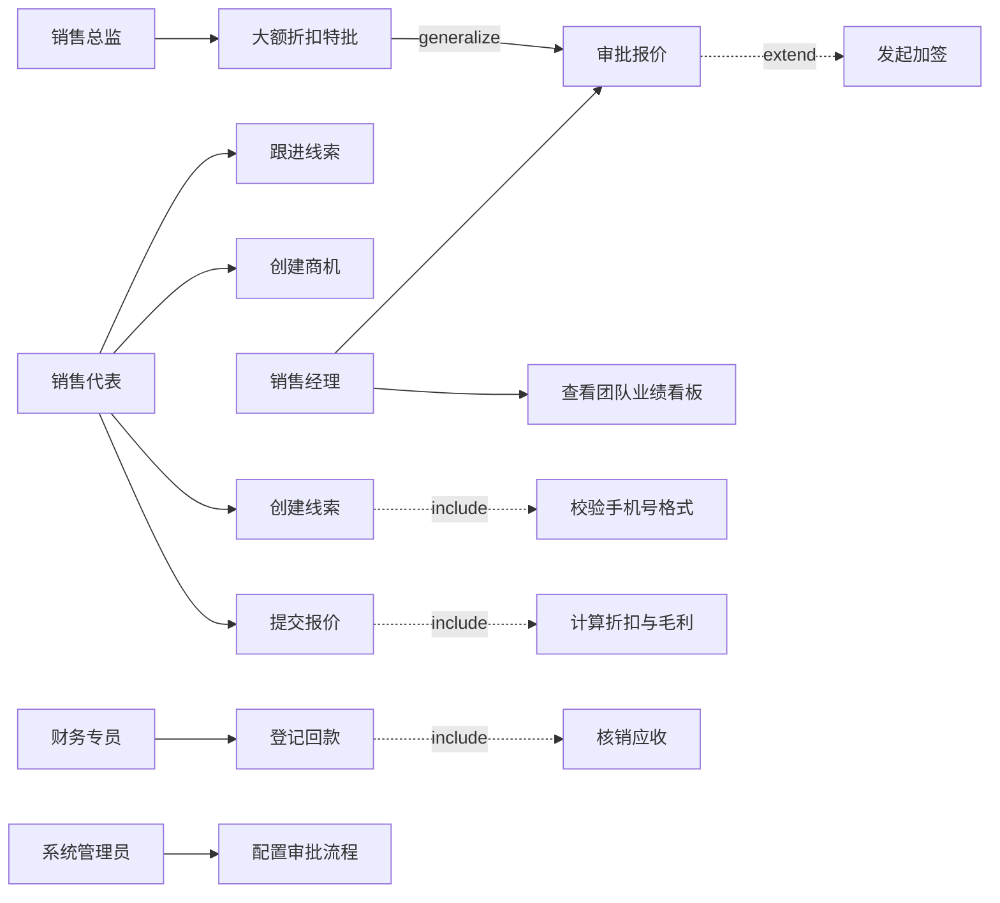

> 说明：上图中"销售总监 大额折扣特批"泛化自"销售经理 审批报价"，表示它是审批的一种特例；"发起加签"是审批过程中的条件行为，用 extend；"校验手机号格式"在创建线索时必然发生，用 include。

---

### 2.2 用例规格说明 Use Case Specification

**定义**：对用例图中的每一个用例，用**结构化模板**写出它的完整行为描述，包括前置条件、后置条件、基本流、备选流、异常流、业务规则、特殊需求等。它是用例图的**展开**，是功能需求的主要文本载体。

**适用场景**：
- 流程性强、异常分支多的核心业务（审批、下单、支付、对账）；
- 需要开发/测试据此实现的任何功能需求；
- 瀑布或规范严格的课程作业、政企项目。

**写法要点（模板）**：

| 字段 | 说明 | 写作要求 |
| --- | --- | --- |
| 用例编号/名称 | 唯一标识，如 UC-QUO-01 | 全局唯一，与 RTM 对齐 |
| 参与者 | 主参与者、次要参与者 | 次要参与者指被调用的外部系统 |
| 前置条件 | 执行前必须为真的状态 | 必须可判定，如"商机已处于商务谈判阶段" |
| 后置条件（成功） | 执行成功后系统状态 | 必须可验证，如"生成一条状态为待审批的报价单" |
| 基本流 | 最顺利的一条路径，编号 1、2、3…… | 只写一条，不要混入分支 |
| 备选流 | 合理的分支，编号 2a、3a…… | 从基本流某步分出，最终回到基本流或结束 |
| 异常流 | 错误或失败路径 | 明确提示语与数据回滚规则 |
| 业务规则 | 约束与计算口径 | 引用决策表或规则编号 |
| 非功能需求 | 性能、并发、审计等 | 量化 |
| 优先级/频率 | 排期依据 | 如"高，每日约 200 次" |

**优缺点**：

| 优点 | 缺点 |
| --- | --- |
| 主/备/异常流强制覆盖，极大降低遗漏 | 写作与维护成本高，容易写完就没人看 |
| 前置/后置条件天然可验证 | 长文本不易评审，需要配合图形 |
| 与测试用例天然一一对应 | 不适合频繁变更的探索性需求 |

**实例（UC-QUO-01 提交报价单）**：

| 字段 | 内容 |
| --- | --- |
| 用例编号 | UC-QUO-01 |
| 用例名称 | 提交报价单 |
| 主参与者 | 销售代表 |
| 次要参与者 | 审批引擎、价格服务 |
| 前置条件 | 1. 当前登录用户是该商机的负责人或上级；2. 商机状态为"商务谈判"；3. 报价明细至少含 1 条产品行 |
| 后置条件（成功） | 1. 生成版本号为 N 的报价单，状态为"待审批"；2. 按 BR-DISC-01 生成审批任务；3. 商机阶段变更记录写入操作日志 |
| 基本流 | 1. 销售打开商机详情，点击"新建报价" 2. 系统带出客户等级、可用价格表与历史成交价 3. 销售添加产品行，填写数量与折扣 4. 系统实时计算行金额、合计金额、折扣率与毛利率 5. 销售点击"提交" 6. 系统校验必填项、价格下限与信用额度 7. 系统保存报价单并提交审批 8. 系统提示"已提交，当前审批人：张经理" |
| 备选流 3a | 销售选择"复制历史报价"，系统带入上一次报价明细，销售可修改后继续走步骤 4 |
| 备选流 6a | 折扣率超过该客户等级上限，系统按 BR-DISC-01 追加总监级审批节点 |
| 异常流 6b | 校验不通过（必填项缺失/价格低于下限/超出信用额度），系统阻止提交，逐条高亮错误原因，不生成报价单 |
| 异常流 7a | 审批引擎不可用，系统保存为"待提交"状态并提示稍后重试，记录重试次数 |
| 业务规则 | BR-DISC-01 折扣审批路由规则（见决策表）；BR-PRICE-02 毛利率低于 15% 必须填写理由 |
| 非功能 | 报价单保存响应时间不大于 1 秒（P95）；提交操作必须记录审计日志且不可删除 |
| 优先级 | 高 |

---

### 2.3 用户故事 User Story + 验收标准 AC

**定义**：用户故事是从**用户价值**出发的一句话式需求描述，标准格式为：

> **作为**〈某角色〉，**我希望**〈完成某件事〉，**以便**〈获得某种价值〉。

配合**验收标准（Acceptance Criteria, AC）**，通常以 Given/When/Then 三段式书写，形成**可测试的完成定义**。

**适用场景**：
- 敏捷/Scrum 迭代开发中的需求待办（Product Backlog）；
- 需求变化快、细节需要与用户持续澄清的项目；
- 作为史诗级需求（Epic）向下拆分的载体。

**两大原则**：

**（1）INVEST 原则——判断一个故事写得好不好**

| 字母 | 含义 | 判据 | 反例 |
| --- | --- | --- | --- |
| I | Independent 独立 | 可单独排期交付，不依赖其他故事 | "导出报表"必须等"查询"开发完 |
| N | Negotiable 可协商 | 是讨论的邀请，不是合同 | 故事里写死了实现方式和字段细节 |
| V | Valuable 有价值 | 对用户或客户有明确价值 | "重构报价服务 Dao 层" |
| E | Estimable 可估算 | 团队能给出工作量估计 | "优化系统性能" |
| S | Small 足够小 | 一个迭代内能完成（通常 1~5 人日） | "完成整个 L2C 流程" |
| T | Testable 可测试 | 能写出明确的验收标准 | "界面要美观易用" |

**（2）3C 原则——一个故事的完整生命周期**

| C | 含义 | 说明 |
| --- | --- | --- |
| Card | 卡片 | 故事本身只是索引，简写在卡片/看板上 |
| Conversation | 对话 | 细节通过与客户/PO 的持续沟通澄清，而不是写死 |
| Confirmation | 确认 | 以验收标准固化讨论结果，作为完成的判据 |

**优缺点**：

| 优点 | 缺点 |
| --- | --- |
| 轻量、面向价值、易于拆分排期 | 缺乏全局结构，容易只见树木不见森林 |
| 强制写 AC，天然可验证 | 不表达复杂规则与状态，需要图补充 |
| 促进团队与客户对话 | 过度使用会导致需求碎片化、忽略非功能需求 |

**实例（CRM 案例）**：

> **故事 US-015**：作为**销售代表**，我希望**把一条已跟进的线索一键转化为客户**，以便**不必重复录入客户资料就开始跟踪商机**。
>
> **验收标准（Given/When/Then）**：
> 1. Given 我是线索的负责人，且线索状态为"跟进中"，When 我点击"转客户"，Then 系统创建客户档案并自动生成一条该客户下的商机，商机阶段默认为"初步接洽"；
> 2. Given 线索的手机号已存在于客户库，When 我点击"转客户"，Then 系统提示"该手机号已存在客户 XXX，是否关联到该客户"，我确认后线索关联到已有客户且不新建档案；
> 3. Given 线索缺少必填字段"客户名称"，When 我点击"转客户"，Then 系统阻止转换并高亮缺失字段；
> 4. Given 转换成功，When 我查看原线索，Then 线索状态变为"已转化"且不可再次转换；
> 5. Given 任意一次转换，Then 系统写入一条含操作人、时间、前后状态的审计日志。

> **实践建议**：用户故事不能替代所有表达。复杂计费、审批路由、状态流转这类需求，故事背后必须挂一张状态图或决策表，否则"对话"会无限延长。

---

### 2.4 活动图 / 流程图 Activity Diagram / Flowchart

**定义**：活动图描述一项业务从起点到终点所经历的**动作、判断、分支、合并、并发与泳道（参与者分工）**。UML 活动图在语义上强于普通流程图（支持并发分叉/汇合、泳道、对象流），但在课程与实际工作中，二者常被视为同一族工具。

**适用场景**：
- 跨角色、跨系统的业务流程（审批流、订单履约、售后服务）；
- 需要表达"谁在什么环节做什么"（泳道）；
- 需要表达并行任务（如"生成合同"与"通知财务"可并行）。

**绘制要点**：
1. **一个起点，至少一个终点**；不要出现悬空的活动节点。
2. 判断节点（菱形）的**出边必须标注条件且条件互斥、穷尽**，否则就是遗漏。
3. 用**泳道（Partition）**区分角色/系统，一眼看出职责交接点。
4. 并发用分叉/汇合（粗横线）表达，不要画成两条看起来并行的普通箭头。
5. 活动命名"动词 + 宾语"，判断命名写成疑问句。
6. 活动图**不表达状态驻留**，那是状态图的事。

**优缺点**：

| 优点 | 缺点 |
| --- | --- |
| 直观，业务方最容易看懂的一种图 | 复杂流程容易画成"意大利面" |
| 泳道天然暴露职责边界与交接风险 | 无法表达实体状态与数据存贮 |
| 支持并行，适合多系统协同 | 规则组合复杂时应改用决策表 |

**实例（报价审批活动图）**：

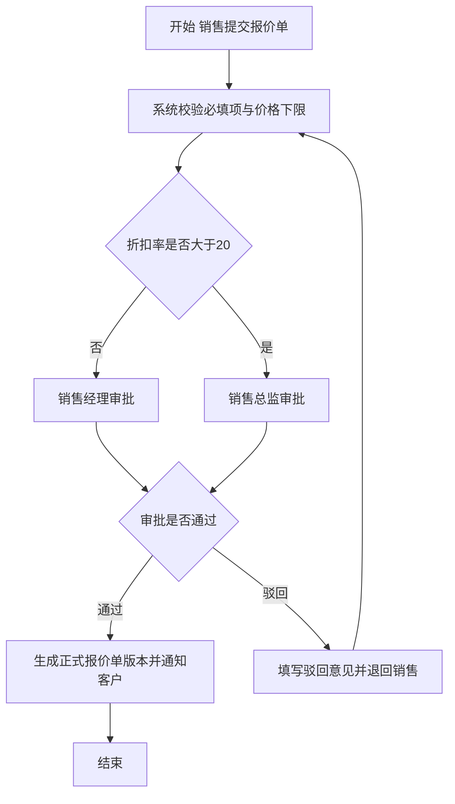

---

### 2.5 状态图 State Machine Diagram

**定义**：状态图描述**某一个实体对象**在其生命周期内有哪些状态、在什么**事件/条件**下从哪个状态迁移到哪个状态，以及进入/退出状态时执行的动作。

**适用场景**：
- 有明确生命周期的业务实体：线索、商机、订单、合同、回款单、审批单；
- 需要严格禁止非法跳转的场景（如"已作废的线索不能再转客户"）；
- 与状态字段、权限、按钮可用性直接挂钩。

**绘制要点**：
1. **一张图只描述一个实体**；多个实体的状态混在一起是常见错误。
2. 状态是**名词或形容词**（待审批、已生效），迁移是**事件/动词**（提交、审批通过）。
3. 必须定义**初始状态**和**终止状态**；要考虑是否允许回退（如"已驳回 → 草稿"）。
4. 每个状态都要问三个问题：**谁能改、改成什么、改时做什么副作用**（通知、日志、字段校验）。
5. 与权限联动：标注每个迁移的执行角色，这张图就能直接驱动按钮显隐设计。

**优缺点**：

| 优点 | 缺点 |
| --- | --- |
| 彻底消除"非法状态跳转"这类遗漏 | 只描述单实体，不描述跨实体协作 |
| 直接对应数据库状态字段与测试用例 | 状态过多时需要分层/子状态机 |
| 业务方极易理解，"这个状态对不对"讨论效率高 | 不表达业务步骤细节 |

**实例（商机状态图）**：

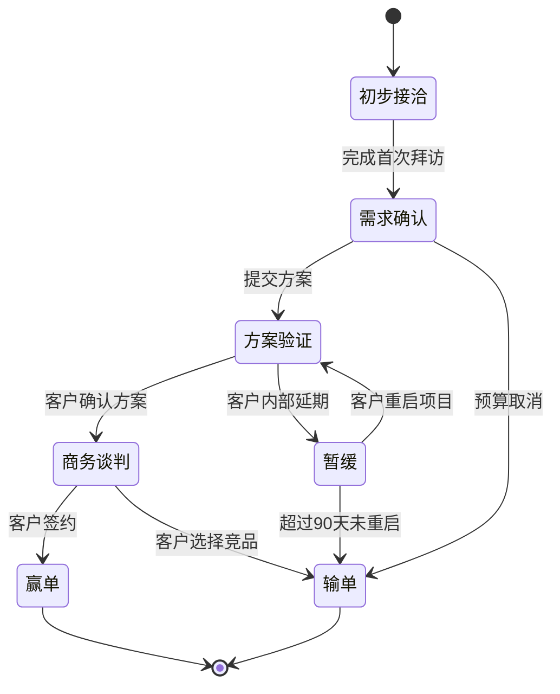

---

### 2.6 数据流图 DFD（Data Flow Diagram）

**定义**：DFD 从**数据视角**描述系统：数据从哪里进入系统（外部实体），经过哪些**加工（Process）**变换，存贮在哪些**数据存储（Data Store）**，最终流向哪里。采用**自顶向下分层**：

- **0 层（上下文图）**：整个系统是一个加工，展示系统与所有外部实体的数据交换，用于界定**系统边界**。
- **1 层**：把 0 层的系统分解为若干主要加工，并展示加工之间的数据流和数据存储。
- **2 层及以下**：对复杂加工继续分解，直到每个加工都是"原子加工"（可用一页纸说清）。

**适用场景**：
- 界定系统边界与外部接口（哪些数据由别的系统给、要给别的系统什么）；
- 数据密集型系统（报表、对账、数据同步、ETL）；
- 做安全与隐私分析时定位数据存贮点。

**绘制要点**：
1. 四种元素符号固定：**外部实体（矩形）、加工（圆角矩形/圆）、数据流（带箭头的线，必须标注数据名称）、数据存储（开口矩形/双横线）**。
2. **数据流必须命名**，写"客户信息"而不是一根光秃秃的箭头。
3. **加工必须有输入和输出**，不允许"黑洞"（只有输入）或"奇迹"（只有输出）。
4. **外部实体之间不直接连线**，数据必须经过加工；**数据存储之间不直接连线**。
5. 分层时保持**父图与子图的数据流平衡**（进出父加工的流，必须等于子图所有进出流的总和）。

**DFD 与流程图的区别（重点）**：

| 对比维度 | 数据流图 DFD | 活动图/流程图 |
| --- | --- | --- |
| 关注对象 | **数据**的流动、变换与存贮 | **控制与步骤**的先后顺序 |
| 是否有判断分支 | 没有判断框，不表达 if/else | 有判断节点，核心就是分支 |
| 是否有时序 | **无时序**，也不表达循环与并发 | 有明确先后顺序，可表达并行 |
| 是否表达触发条件 | 不表达"什么事件触发" | 表达"做完 A 再做 B" |
| 主要元素 | 外部实体、加工、数据流、数据存储 | 活动、判断、分支/合并、泳道 |
| 典型用途 | 划系统边界、找接口、找数据存储 | 描述业务流程、审批步骤 |
| 容易犯的错 | 把 DFD 画成流程图（加判断框） | 把流程图当 DFD 用（找不到数据存贮） |

一句话总结：**"流程图看的是事情怎么一步步做，DFD 看的是数据怎么一步步变。"**

**优缺点**：

| 优点 | 缺点 |
| --- | --- |
| 边界与接口极其清晰，适合与外部系统对接 | 不表达控制逻辑与时序，功能细节不足 |
| 强制发现"数据存在哪里"，利于数据库设计 | 大型系统分层多，维护成本高 |
| 父/子图平衡规则能自动发现遗漏的流 | 学生容易与流程图混淆 |

**实例（0 层与 1 层）**：

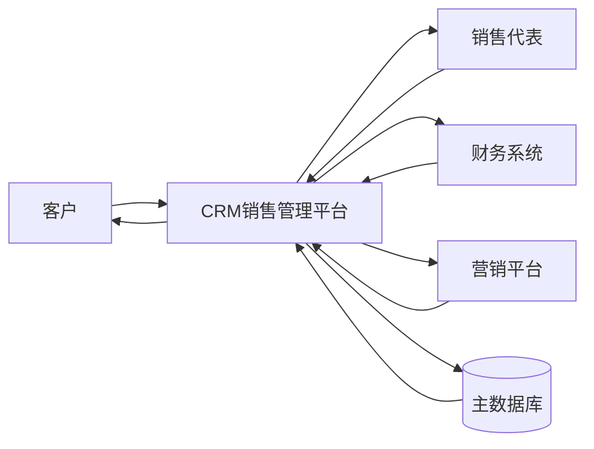

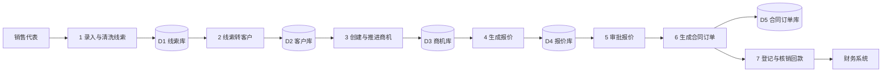

---

### 2.7 ER 图 / 领域模型图 Domain Model

**定义**：
- **ER 图（实体-联系图）**：面向数据库设计，描述实体、属性、主键、联系及基数（1:1、1:N、M:N）。
- **领域模型图（Domain Model）**：面向业务概念，描述**概念类（Conceptual Class）**、关键属性与关联，通常不画外键、不画技术性字段。

**适用场景**：
- 统一团队术语（"客户"到底是什么？签约过的才叫客户，还是线索也算？）；
- 客户 360 视图、主数据管理、报表口径定义；
- 为数据库表结构设计与接口字段定义提供依据。

**绘制要点**：
1. **先画概念类，再补属性，最后定关联基数**。上来就画字段是本末倒置。
2. 属性用**业务语言**命名（"客户等级"而非 `level_code`），技术实现留给设计阶段。
3. **关联要标注基数与方向**，并给它一个动词（"客户 拥有 商机"），无动词的关联通常是伪关联。
4. 区分**关联（association）**与**聚合/组合（aggregation/composition）**：报价单与报价明细是组合（明细不能脱离报价单存在），客户与商机是普通关联。
5. 领域模型**不画方法、不画操作**，那属于设计类图。

**优缺点**：

| 优点 | 缺点 |
| --- | --- |
| 术语统一的最强工具，一举消灭"同名不同义" | 不表达行为与流程 |
| 直接支撑数据库与 API 设计 | 容易被过早细化成表结构，失去业务表达力 |
| 关联基数检查能发现"一个商机能不能有多份生效报价"这类遗漏 | 概念类过多时图会变得难以阅读，需要分包 |

**实例（L2C 领域模型片段）**：

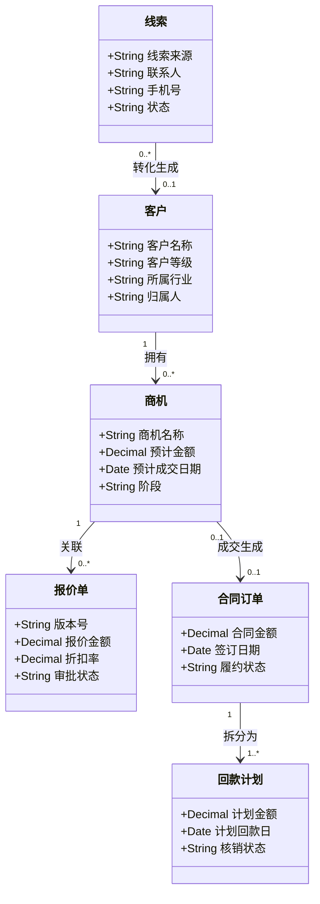

---

### 2.8 时序图 Sequence Diagram

**定义**：时序图描述**一组对象/参与者之间按时间先后顺序发生的消息交互**。横轴是对象（生命线），纵轴是时间（自上而下），箭头是消息（同步、异步、返回）。

**适用场景**：
- 关键功能的实现级交互（谁调谁、调什么、顺序如何）；
- 跨系统调用与接口设计（CRM 调财务系统、调短信网关）；
- 排查"某个操作到底写了几张表、发了几次消息"这类问题。

**绘制要点**：
1. 参与对象用 `角色:类名` 或中文名标注，左侧自上而下按调用顺序排列。
2. 区分消息类型：**同步消息（实线实心箭头）**、**异步消息（实线空心箭头）**、**返回（虚线箭头）**、**自调用**。
3. 用 **alt / opt / loop / par 组合片段**表达分支、可选、循环与并行，这是时序图最容易被忽略但最有用的部分。
4. 激活条（生命线上的窄矩形）表示对象正在执行，能直观看出阻塞时长。
5. **不要在一张图里塞 10 个以上对象**，按场景拆图。

**优缺点**：

| 优点 | 缺点 |
| --- | --- |
| 精确表达调用顺序，开发与测试最爱 | 对象多时图极宽，阅读困难 |
| 能表达同步/异步、超时、重试 | 偏向设计层，客户看不懂 |
| 组合片段使异常分支也能被表达 | 维护成本高，代码变了图就失效 |

**实例（提交报价单的交互）**：

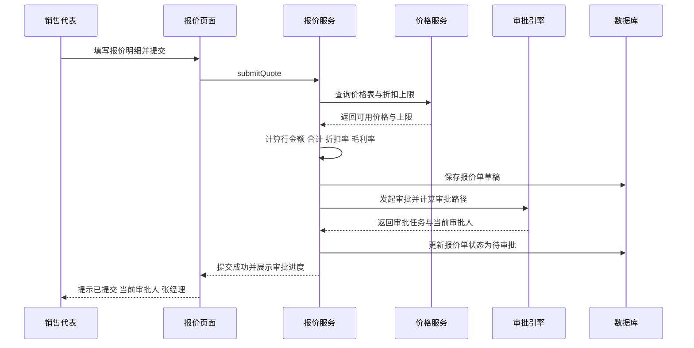

---

### 2.9 决策表 / 决策树

**定义**：当一条业务结果由**多个条件组合**决定时，用二维表（决策表）穷举所有条件组合并给出对应动作；决策树是决策表的树形等价表达，更直观但组合爆炸时不如表格清晰。

**适用场景**：
- 审批路由、折扣策略、运费计算、风控规则、积分规则；
- 业务方说"这个要看情况"的一切场合；
- 需要向开发/测试明确"所有情况都覆盖了"的规则集。

**写法要点**：
1. 表分为四象限：**条件桩（左上）、条件项（右上）、动作桩（左下）、动作项（右下）**。
2. 每一列是一条**规则**，条件项取值填 Y/N 或"-"（无关）。
3. 条件数 n 且均二值时，理论组合数 2ⁿ；必须说明遗漏组合如何处理（合并或声明不可能）。
4. 必须检查**完备性**（所有组合都有对应动作）与**一致性**（不存在两列条件相同但动作不同）。
5. 规则编号化（BR-XXX-NN），供 SRS 与代码引用，便于变更追踪。
6. 条件超过 5 个时，考虑拆成多张表或改用规则引擎 + 决策表 DSL。

**优缺点**：

| 优点 | 缺点 |
| --- | --- |
| 强制穷举，彻底消除规则遗漏与冲突 | 条件多时列数指数爆炸 |
| 业务方参与度极高，可逐列确认 | 不适合表达过程与顺序 |
| 直接翻译成测试用例与代码分支 | 需要编号管理，否则维护混乱 |

**实例（BR-DISC-01 折扣审批路由规则）**：

| 规则编号 | R1 | R2 | R3 | R4 | R5 | R6 |
| --- | --- | --- | --- | --- | --- | --- |
| 条件：客户等级 = 战略客户 | Y | Y | N | N | N | - |
| 条件：订单金额 ≥ 50 万 | Y | N | Y | N | - | - |
| 条件：折扣率 ≤ 20% | - | Y | - | Y | N | N |
| 条件：毛利率 ≥ 15% | - | - | - | - | Y | N |
| 动作：无需审批 | | | | ✓ | | |
| 动作：销售经理审批 | ✓ | ✓ | | | | |
| 动作：销售总监审批 | | | ✓ | | ✓ | |
| 动作：总监 + 财务会签 | | | | | | ✓ |
| 动作：强制填写折扣理由 | | | | | | ✓ |

对应决策树：

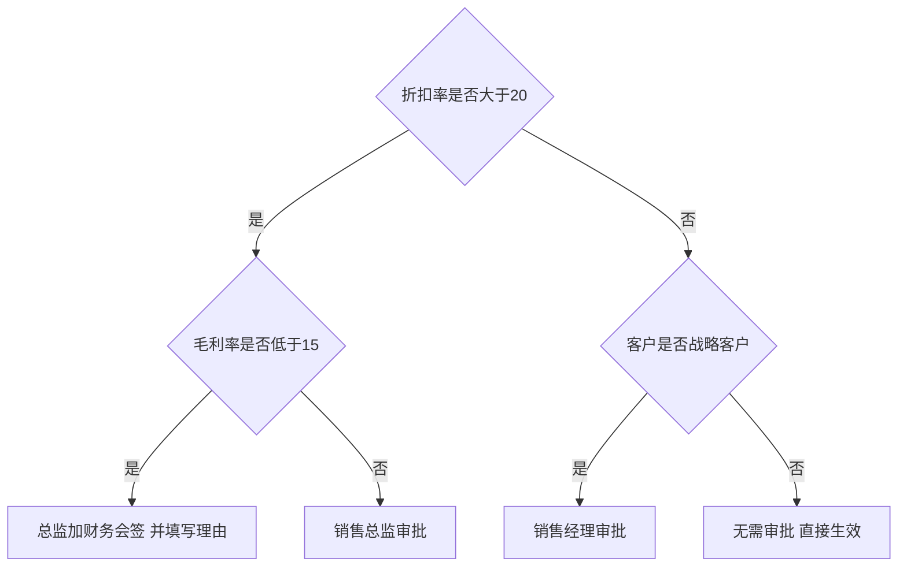

---

### 2.10 原型与线框图 Prototype / Wireframe

**定义**：用可视化的方式表达界面布局、信息架构与交互路径。**线框图（Wireframe）**是用灰阶方块表达结构与优先级；**原型（Prototype）**进一步带上可点击的交互；按精细度分为**低保真（Lo-Fi）**和**高保真（Hi-Fi）**。

**适用场景**：
- 界面密集、交互复杂的功能（客户 360 视图、仪表盘、录入表单）；
- 需求模糊、用户说不清自己要什么时，用原型激发反馈；
- 向客户/老师做演示汇报。

**绘制要点**：
1. **先低保真后高保真**：先用线框图对齐结构与优先级，再谈配色与视觉。
2. 低保真阶段**故意画得粗糙**，避免评审陷入"这个蓝色好不好看"。
3. 原型必须配合**交互说明**：点击后去哪、数据从哪来、空状态长什么样、错误提示长什么样。
4. 必须覆盖**四种状态**：正常、空、加载中、错误/超限，多数原型只画了正常状态。
5. 明确哪些是"示意"而不是"视觉稿"，避免被当成 UI 交付物。

**优缺点**：

| 优点 | 缺点 |
| --- | --- |
| 歧义最少，用户一眼能说"这不是我要的" | 制作耗时，容易被当成设计任务 |
| 能发现文字描述发现不了的流程断点 | 过早高保真会让评审跑偏到视觉细节 |
| 可直接用于可用性测试 | 不表达规则、状态与数据，必须配文档 |

**实例（客户详情页低保真线框，文本示意图）**：

```
+---------------------------------------------------------------+
|  客户名称：XX 科技有限公司        [编辑] [新建商机] [更多操作]  |
+------------------+--------------------------------------------+
| 客户基本信息      |  [概况] [联系人] [商机] [报价] [合同] [回款] |
| 等级：A           |--------------------------------------------|
| 行业：智能制造    |   当前 Tab：概况                            |
| 归属人：张三      |   - 关键指标卡片：在谈金额 / 已签金额 / 回款 |
| 最近跟进：10-08   |   - 时间线：近 10 条跟进与审批记录           |
|                   |   - 右侧栏：待办任务与风险提示               |
+------------------+--------------------------------------------+
| 状态：正常  创建人：张三  创建时间：2026-03-11                  |
+---------------------------------------------------------------+
```

---

### 2.11 需求属性表 / 需求跟踪矩阵 RTM

**定义**：
- **需求属性表**：为每条需求附加管理与控制所需的元数据（编号、来源、类型、优先级、状态、负责人、稳定性、验收方式等），让需求成为可管理的对象。
- **需求跟踪矩阵 RTM（Requirements Traceability Matrix）**：一张把**业务目标 → 需求条目 → 用例/用户故事 → 设计模块 → 代码 → 测试用例 → 上线验证**串起来的表格，回答两个问题：
  - **前向追踪**：这条需求被实现到哪了？
  - **后向追踪**：这行代码/这个测试用例是为哪条需求写的？

**适用场景**：
- 有验收与合规要求的正式项目；
- 变更影响分析（改这条需求会影响哪些模块和用例）；
- 课程作业中证明"需求被完整覆盖"。

**写法要点**：
1. **编号体系先行**：如 `REQ-F-QUO-001`（功能需求-报价域-序号）、`REQ-NF-PERF-003`。
2. 每一行需求都要有**来源（Stakeholder/会议纪要编号）**和**验收方式**。
3. RTM 至少覆盖三段：需求 → 用例/故事 → 测试用例；有余力再加设计与代码。
4. **状态字段要定义清楚**：草稿、已评审、已批准、已实现、已验证、已废弃。
5. RTM 由工具自动生成优于手工维护；手工维护的 RTM 三个月后必然失真。

**优缺点**：

| 优点 | 缺点 |
| --- | --- |
| 唯一能回答"做完了没有、改会影响什么"的工具 | 维护成本高，需工具支撑 |
| 支撑变更控制、回归测试范围确定 | 粒度不一致会导致矩阵失效 |
| 验收与审计的硬证据 | 不描述需求内容，只是索引 |

**实例（需求属性表）**：

| 属性 | 取值 |
| --- | --- |
| 需求编号 | REQ-F-QUO-001 |
| 需求名称 | 报价单提交与审批路由 |
| 需求类型 | 功能需求 |
| 来源 | 销售总监访谈纪要 M-003 |
| 优先级 | Must（MoSCoW）/ 高 |
| 稳定性 | 中（折扣规则可能季度调整） |
| 关联模型 | UC-QUO-01、BR-DISC-01、商机状态图、报价审批活动图 |
| 负责人 | 张三 |
| 状态 | 已评审 |
| 验收方式 | 测试用例 TC-QUO-001~008 + 业务方 UAT |
| 版本 | v1.2 |

**实例（RTM 片段）**：

| 需求 ID | 需求名称 | 用例 | 设计模块 | 测试用例 | 状态 |
| --- | --- | --- | --- | --- | --- |
| REQ-F-QUO-001 | 报价提交与审批路由 | UC-QUO-01 | QuoteService / ApprovalEngine | TC-QUO-001 ~ 008 | 已验证 |
| REQ-F-QUO-002 | 折扣上限控制 | BR-DISC-01 | PriceRuleEngine | TC-QUO-009 ~ 014 | 已验证 |
| REQ-F-OPP-003 | 商机阶段流转 | UC-OPP-02 + 商机状态图 | OpportunityStateMachine | TC-OPP-010 ~ 020 | 实现中 |
| REQ-NF-PERF-001 | 客户列表查询性能 | N/A | CustomerQuery | TC-PERF-001 | 待测试 |
| REQ-F-REC-001 | 回款登记与核销 | UC-REC-01 | ReceivableService | TC-REC-001 ~ 006 | 草稿 |

---

## 3 支持需求表达的软件工具

### 3.1 建模工具（UML / 图表）

| 工具 | 类型与特点 | 优势 | 劣势 | 适合谁 |
| --- | --- | --- | --- | --- |
| **draw.io / diagrams.net** | 免费开源、网页/桌面双端、可存本地或云盘 | 完全免费、模板丰富、可导出 PNG/SVG/PDF、可直接存到 GitHub/OneDrive | 无语法校验，画出的 UML 可能"形似神不似"；多人实时协作弱 | 学生与个人首选 |
| **PlantUML** | 用代码画图，支持全部 UML 图 + 甘特图 + 思维导图 | 纯文本、**可 Git 版本管理、可 diff、可 Code Review**；适合写进 Markdown/文档流水线 | 需要记语法；布局自动，细节排版控制弱；需本地 Java 或在线服务渲染 | 工程化团队、写文档即画图 |
| **Mermaid** | 轻量代码画图，原生被 GitHub/GitLab/Notion/飞书/语雀支持 | 零依赖嵌入 Markdown，本报告即用它；语法比 PlantUML 简单 | 支持的图种类少于 PlantUML（无规范用例图、无组件图细节）；复杂图排版受限 | 写 Markdown 文档的所有人 |
| **StarUML** | 桌面专业 UML 工具，完整支持 UML 2.x | 模型语义严格、支持正向/反向工程 | 免费版有导出水印/试用限制；Windows/macOS 为主 | 需要严格 UML 语义的课程作业 |
| **Enterprise Architect (EA)** | 重型建模与架构建模工具 | 支持 UML/SysML/BPMN、需求管理、追踪矩阵、代码工程，一体化 | 昂贵、笨重、学习曲线陡 | 政企大型项目、系统工程 |
| **Microsoft Visio** | 通用绘图工具 | 企业普及率高、形状库全、与 Office 生态打通 | 非专业 UML 工具，无模型语义；付费；协作弱 | 企业内部流程图 |
| **ProcessOn** | 国产在线作图 | 中文模板丰富、支持流程图/UML/思维导图、在线协作 | 免费版文件数受限；导出与离线能力弱 | 国内团队快速作图 |
| **boardmix 博思白板** | 国产在线白板 | 无限画布、多人实时协作、支持 AI 生成图 | 图元规范性弱于专业 UML 工具 | 需求研讨工作坊 |
| **语雀 / 飞书画图** | 文档内嵌绘图 | 与文档、知识库无缝结合，评审上下文不割裂 | 图种类有限，专业度一般 | 已用飞书/语雀的团队 |

**选型结论（给课程团队）**：**Mermaid（写文档）+ draw.io（画规范图）+ PlantUML（需要版本管理的核心模型）**三者组合最实用，且全部免费。若老师要求标准 UML 语义与导出，补一个 StarUML。

### 3.2 需求管理与协作工具

| 工具 | 特点 | 优势 | 劣势 |
| --- | --- | --- | --- |
| **Jira** | 事实标准的敏捷项目管理工具，Issue + 工作流 + 看板 | 需求-任务-缺陷闭环，强大的筛选（JQL）、看板与报表；与 Confluence 深度集成 | 配置复杂、学习成本高；自托管版昂贵；对纯文档型需求不友好 |
| **Confluence** | 团队 Wiki 与文档协作 | 承载 SRS、会议纪要、决策记录；页面级评论与版本对比；可嵌入 draw.io/PlantUML | 结构化需求管理能力弱，需配合 Jira 或表格宏 |
| **Azure DevOps** | 微软一体化 DevOps 平台 | 需求（Work Item）+ 代码 + 流水线 + 测试计划打通，**原生支持端到端 RTM**；小团队免费 | 界面偏重，国内访问速度不稳定 |
| **禅道** | 国产开源项目管理 | 内置"产品-需求-计划-任务-用例-Bug"完整模型，中文贴合国内流程；开源可自建 | 界面老旧，二次开发成本较高 |
| **TAPD** | 腾讯敏捷协作平台 | 需求与迭代管理、故事墙、报表；与企微/微信生态打通 | 云 SaaS，数据不在本地；深度定制能力有限 |
| **Notion** | 文档 + 数据库一体化 | 数据库视图可自建需求属性表与 RTM，灵活度极高；模板生态丰富 | 无内置工作流与权限审批，靠手工约定；离线能力弱 |
| **飞书多维表格 / 钉钉项目** | 协同表格 + 项目 | 与 IM 打通，需求表可直接建视图（看板/甘特/仪表盘）；国内团队普及 | 复杂追踪关系表达受限，适合中小项目 |

### 3.3 原型工具

| 工具 | 特点 | 优势 | 劣势 |
| --- | --- | --- | --- |
| **Axure RP** | 老牌高保真原型工具 | 交互逻辑最强（变量、条件、函数、动态面板），能产出接近真实的交互原型；可生成规格文档 | 学习曲线陡；价格高；视觉设计能力一般 |
| **Figma** | 云端 UI 设计与协作 | 实时多人协作、组件与设计系统能力顶级、社区资源海量；免费版够用 | 国内访问需网络条件；复杂条件交互不如 Axure |
| **墨刀** | 国产原型工具 | 上手极快，内置大量移动端/后台模板，可一键生成演示链接 | 精细交互能力有限；团队版收费 |
| **即时设计** | 国产 Figma 替代品 | 国内访问流畅、免费额度高、支持导入 Figma/Sketch 文件 | 生态与插件少于 Figma |
| **Sketch** | macOS 专用 UI 设计 | 符号与插件生态成熟 | 仅 macOS；协作能力弱于 Figma |
| **Balsamiq** | 手绘风低保真线框 | 故意"丑"，强制团队关注结构与流程而非视觉 | 只能做低保真，无法产出交互原型 |

> **建议**：需求阶段先用 **Balsamiq 或墨刀线框**对齐结构，确认后再用 **Figma / Axure** 产出高保真与交互。跳过低保真直接高保真，是需求返工最常见的诱因。

### 3.4 AI 辅助需求表达（LLM）

**能做什么**：
- 从一段访谈纪要/会议记录中**抽取候选用户故事**并套用"作为……我希望……以便……"格式；
- **生成用例清单初稿**（角色 × 场景矩阵）；
- 把散文式描述改写成 **EARS 句式**或 Given/When/Then 验收标准；
- 直接产出 **Mermaid / PlantUML 代码**，秒出状态图、时序图、活动图；
- 检查需求文档的**模糊词**（"快速""友好""适当""支持"）并给出量化建议；
- 生成**边界值与异常场景清单**，辅助补全备选流与异常流。

**必须人工校验的风险（重点）**：

| 风险 | 表现 | 应对 |
| --- | --- | --- |
| **幻觉（Hallucination）** | 编造业务里根本不存在的角色、状态、规则，且语气非常自信 | 每一条产出必须与真实访谈/业务确认，禁止直接进 SRS |
| **看似合理的默认值** | 擅自假定"审批超时 24 小时自动通过""折扣上限 20%"等未经确认的数字 | 凡是数字必须标注「待确认」，由业务方签字 |
| **遗漏而非错误，更难发现** | 生成的用例清单看着完整，但缺少关键异常流与权限约束 | 用检查单逐项核对：异常、权限、边界、审计、并发 |
| **领域知识缺失** | 不理解本行业口径（如"回款核销""毛利计算口径"） | 提供术语表与业务规则作为上下文，并要求引用来源 |
| **一致性与可追踪性为零** | 每次生成编号不同，跨文档引用断裂 | 编号由人维护，AI 只生成内容草稿 |
| **合规与泄密** | 把客户资料、未公开业务数据上传到公有云模型 | 敏感项目使用私有部署或脱敏后再输入 |
| **责任归属** | AI 生成的需求出问题时无人负责 | 每条需求必须有**人类负责人**与**来源凭证** |

**定位**：AI 是**草稿生成器与查漏助手**，不是需求的**责任主体**。正确的用法是"AI 出初稿 → 领域专家校验 → 业务方确认 → 基线化"，而不是"AI 出稿 → 直接交付"。

### 3.5 课程场景工具组合建议

| 用途 | 推荐组合 | 理由 |
| --- | --- | --- |
| 报告与 SRS 撰写 | Markdown + Mermaid（VS Code / Typora / Obsidian） | 图随文走、可 Git 管理、免费 |
| 规范 UML 图 | draw.io 或 StarUML | 图形语义标准，导出方便 |
| 需求清单与 RTM | 飞书多维表格 / Notion Database / Excel | 视图灵活、零成本 |
| 原型 | 墨刀（低保真）+ Figma（高保真） | 上手快、演示方便 |
| 团队协作与提交 | 学校 Git 仓库 + Markdown | 可追溯每次修改 |

---

## 4 需求表达应遵守的规范与标准

### 4.1 国家标准

| 标准号 | 名称 | 与需求表达的关系 |
| --- | --- | --- |
| **GB/T 8566** | 软件生存周期过程（对应 ISO/IEC/IEEE 12207） | 规定了软件生存周期的**过程、活动与任务**，其中"需求获取""需求分析""需求规格说明"属于获取过程与需求分析过程；明确了需求在生命周期中的位置与上下游接口 |
| **GB/T 9385** | 计算机软件需求规格说明规范（修改采用 IEEE 830-1998） | 直接规定 **SRS 的质量特性与目录结构**，是本报告第 5 章 SRS 模板的直接依据 |
| GB/T 8567 | 计算机软件文档编制规范 | 规定全套软件文档的编制要求，SRS 是其中之一 |
| GB/T 11457 | 软件工程术语 | 术语统一依据，编写术语表时对齐 |
| GB/T 16260 / GB/T 25000 系列 | 软件产品质量要求与评价（对应 ISO/IEC 25010） | 非功能需求分类与度量的权威依据（功能性、性能效率、兼容性、易用性、可靠性、安全性、维护性、可移植性） |
| GB/T 20157 / GB/T 18491 等 | 软件维护、度量相关 | 支撑需求稳定性与规模度量 |

> 注意：GB/T 9385 对应的是 **IEEE 830-1998**；而 IEEE 830 已于 2011/2018 年被 **ISO/IEC/IEEE 29148** 取代。撰写新文档时建议**以 GB/T 9385 为目录骨架、以 IEEE 29148 为质量要求补充**。

### 4.2 IEEE / ISO 国际标准

| 标准 | 全称与要点 |
| --- | --- |
| **IEEE 830-1998** | IEEE Recommended Practice for Software Requirements Specifications。定义了 SRS 的八大质量特性（正确、无歧义、完整、一致、可验证、可修改、可追踪、按重要性排序），是课程作业中最常被引用的经典标准 |
| **ISO/IEC/IEEE 29148:2018** | Requirements engineering。取代 IEEE 830、IEEE 1233、IEEE 1362，覆盖需求**引出、分析、规格说明、确认与管理**全过程；明确区分**利益相关方需求规格说明（StRS）**与**系统/软件需求规格说明（SyRS/SRS）**；给出需求属性与需求质量判据 |
| **ISO/IEC/IEEE 12207** | 软件生存周期过程，与 GB/T 8566 对应 |
| **ISO/IEC/IEEE 15288** | 系统生存周期过程，系统级需求的框架 |
| **ISO/IEC 25030** | 软件质量要求（Requirements Quality），给出需求质量的评价方法 |
| **BABOK v3**（IIBA） | 商业分析知识体系，需求分类（业务/干系人/解决方案/过渡需求）与需求生命周期管理的实践指南 |
| **EARS**（Easy Approach to Requirements Syntax） | 轻量级需求句式规范，源自 Rolls-Royce，被 INCOSE 推荐。分五类句式：<br>① 泛在型：The 系统 shall 始终……<br>② 事件驱动型：WHEN 触发条件, the 系统 shall 动作<br>③ 状态驱动型：WHILE 系统处于某状态, the 系统 shall 动作<br>④ 可选功能型：WHERE 某功能已启用, the 系统 shall 动作<br>⑤ 非功能型：The 系统 shall 在某约束下达到某指标<br>另有"异常处理句式"：IF 异常条件, THEN the 系统 shall 响应 |

### 4.3 优先级与验收法则

**INVEST**（用户故事质量）：见 2.3 节。

**SMART**（目标与验收指标质量）：

| 字母 | 含义 | 需求示例 |
| --- | --- | --- |
| S Specific 具体 | 明确不含糊 | "客户列表查询响应时间 P95 ≤ 2 秒"（而非"响应要快"） |
| M Measurable 可度量 | 有量化口径 | "在 5 万条客户数据、50 并发下测得" |
| A Achievable 可实现 | 技术上与资源上可达 | 与架构师确认可达，而非拍脑袋 |
| R Relevant 相关 | 与业务目标相关 | 支撑"线索转化率提升"这一目标 |
| T Time-bound 有时限 | 明确时间点或版本 | "于 2026 年 Q4 版本上线" |

**MoSCoW 优先级法则**：

| 等级 | 含义 | 解释 | 本案例示例 |
| --- | --- | --- | --- |
| **M** Must have | 必须有 | 不做则系统不可用/不合规 | 线索转客户、报价审批 |
| **S** Should have | 应该有 | 重要但可临时替代 | 商机赢率预测 |
| **C** Could have | 可以有 | 有余力再做 | 客户地图分布视图 |
| **W** Won't have this time | 本次不做 | 明确排除，避免范围蔓延 | 移动端离线拜访打卡 |

> MoSCoW 的纪律在于 **W**：必须明确写出"本次不做什么"。没有 W 的优先级排序等于没排。

**Kano 模型简介**（需求满意度分类，用于需求筛选与版本规划）：

| 类型 | 定义 | 用户反应 | 本案例示例 |
| --- | --- | --- | --- |
| 必备属性 Must-be | 没有会非常不满，有了也不会更满意 | 理所应当 | 数据权限隔离、审批留痕 |
| 期望属性 One-dimensional | 做得越好越满意 | 线性关系 | 列表加载速度、导出速度 |
| 魅力属性 Attractive | 没有不会不满，有了惊喜 | 亮点 | 商机赢率 AI 预测、智能跟进提醒 |
| 无差异 Indifferent | 有没有都无所谓 | 无感 | 皮肤主题切换 |
| 反向 Reverse | 做了反而不满 | 反感 | 强制每日打卡弹窗、过多通知 |

使用方式：对候选需求做正向/反向问卷，落点到四象限图，据此决定 Must/Should/Could 排序。**必备属性不达标时，堆魅力属性毫无意义。**

### 4.4 好的需求应具备的质量特征

| 质量特征 | 判据（如何检验） | 常见反例 | 改进后 |
| --- | --- | --- | --- |
| **正确性 Correctness** | 与业务方确认过的真实意图一致 | "折扣超过 30% 需总经理审批"（实际是 20%） | 与业务规则表对齐并签字 |
| **无歧义性 Unambiguity** | 两个独立读者解释出同一含义 | "系统应快速响应" | "查询 P95 ≤ 2 秒（5 万条数据、50 并发）" |
| **完整性 Completeness** | 覆盖所有角色、场景、状态、异常与边界 | 只写成功路径，没写驳回与超时 | 补备选流/异常流，补空态与错误态 |
| **一致性 Consistency** | 需求之间不冲突，术语统一 | A 处称"客户"指签约客户，B 处含线索 | 建术语表，全文统一 |
| **可验证性 Verifiability** | 存在有限的、成本可行的验证方法 | "界面友好、易于使用" | "新用户完成一次报价提交不超过 5 步" |
| **可追踪性 Traceability** | 有编号、有来源、可关联设计与测试 | 无编号的散装需求 | 统一编号 + RTM |
| **必要性 Necessity** | 每条都对应某个目标或约束，删掉会出问题 | "支持导出为 PDF 和 Excel 和 Word 和 HTML" | 用 MoSCoW 与 Kano 删减 |
| **优先级 Prioritization** | 有明确排序与版本归属 | 全部标"高" | MoSCoW + 版本计划 |
| **可修改性 Modifiability** | 结构良好、无冗余、有目录与索引，改一处不牵全身 | 同一规则散落在 5 个文档 | 规则编号化、单一信息源 |
| **可理解性 Understandability** | 目标读者无需额外解释即可读懂 | 大段无结构长文 | 分条目、配图、配例 |

**写作层面的硬规矩**：

1. 用**强制性措辞**表达必须：`必须 / 应（shall）`；用 `宜（should）` 表达推荐；用 `可（may）` 表达允许。不要在同一文档中混用。
2. **禁用模糊词清单**：快速、友好、灵活、适当、大约、支持、尽量、若干、及时、稳定、高效、用户友好、健壮、可扩展（除非给出量化或明确定义）。
3. 每条需求**只表达一件事**，出现"并且/同时/此外"就该拆分。
4. 每条需求必须有**唯一编号**，且编号在文档全生命周期内不变（废弃也不复用）。
5. 量化指标必须带**测量条件**（数据量、并发数、网络、终端、统计口径）。

---

## 5 从素材到正式需求文档 SRS 的收敛路径

### 5.1 八步收敛路径

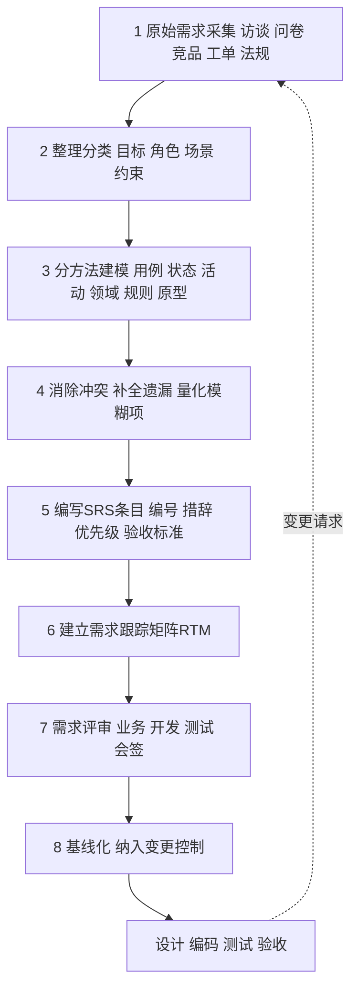

| 步骤 | 关键动作 | 产出物 | 完成判据 |
| --- | --- | --- | --- |
| **1 采集** | 用户访谈、问卷、现场观察、竞品分析、历史工单、法规梳理 | 原始需求池（不做加工，保留原话与来源） | 每个诉求都有来源和提出人 |
| **2 整理分类** | 归到业务目标 / 用户需求 / 功能需求 / 非功能需求 / 约束；识别角色清单 | 角色清单、需求分类表、术语表初稿 | 没有"不知道放哪"的条目 |
| **3 分方法建模** | 用例图定范围、用例规格写流程、状态图定生命周期、活动图画审批、领域模型定概念、决策表定规则、原型定界面、DFD 定边界 | 一整套模型（图 + 规格 + 原型） | 每个需求至少被一种模型覆盖 |
| **4 消除冲突** | 交叉检查：状态图 vs 用例流、决策表 vs 规则描述、术语表 vs 全文、需求 vs 约束 | 冲突清单与处理决议（含"待定"项跟踪表） | 冲突与待定项清零 |
| **5 编写 SRS 条目** | 按 EARS 句式改写，编号，标注优先级，附验收标准 | SRS 正文 | 无模糊词、每条可验证 |
| **6 建立 RTM** | 需求 → 用例/故事 → 设计 → 测试 四段关联 | RTM 表 | 每条需求有对应用例与测试计划 |
| **7 评审** | 走查 + 正式评审会；业务方确认价值与规则，开发确认可行性，测试确认可验证 | 评审记录、问题清单、修改记录 | 所有阻塞级问题关闭 |
| **8 基线化** | 打版本标签（SRS v1.0），进入配置管理；后续变更走 CCB | 需求基线 | 变更必须走申请-影响分析-审批流程 |

> **第 3 步"补 mold"是本条路径的灵魂**：不是把采集来的话重抄一遍，而是用不同方法的**结构约束**去逼出没说出来的东西。画状态图会逼出"暂超时限怎么办"，画决策表会逼出"既是战略客户又超折扣的情况"，画领域模型会逼出"一条线索能不能关联多个客户"。这些被逼出来的内容，才是需求工作的真正产出。

### 5.2 SRS 标准目录结构（按 GB/T 9385 / IEEE 830）

```
1  引言
   1.1 编写目的
   1.2 适用范围
   1.3 定义、首字母缩写词和缩略语（术语表 / 数据字典）
   1.4 参考文献（标准、法规、会议纪要编号）
   1.5 概述（本文档其余部分的组织方式）

2  总体描述
   2.1 产品前景与背景（业务目标、现状痛点、Kano 结论）
   2.2 产品功能概述（用例图 + 功能清单，明确系统边界）
   2.3 用户特征与角色（角色-权限矩阵，含外部系统角色）
   2.4 运行环境（硬件、操作系统、网络、浏览器、移动端）
   2.5 设计与实现约束（技术栈、法规合规、数据不出境、遗留系统兼容）
   2.6 假设与依赖（Assumptions and Dependencies）
   2.7 需求的优先级与版本划分（MoSCoW + 版本计划）

3  功能需求
   3.1 功能域 A（如：线索管理）
       3.1.1 用例/需求条目 REQ-F-LEAD-001 名称
             - 描述（EARS 句式）
             - 前置条件 / 后置条件
             - 基本流 / 备选流 / 异常流
             - 业务规则（引用 BR-XXX）
             - 优先级 / 稳定性 / 来源
             - 验收标准
   3.2 功能域 B（如：客户管理）
   3.3 功能域 C（如：商机管理）
   ...（按业务域组织，每个域附状态图/活动图/决策表）

4  非功能需求
   4.1 性能需求（响应时间、吞吐量、并发数、数据量上限）
   4.2 安全性需求（认证、授权、审计、加密、数据脱敏）
   4.3 可靠性与可用性（可用率、故障恢复 RTO/RPO、备份）
   4.4 易用性需求（学习成本、操作步数、无障碍）
   4.5 兼容性需求（浏览器、操作系统、移动端、接口版本）
   4.6 可维护性与可扩展性（日志、监控、配置项）
   4.7 可移植性与合规（部署形态、等保、个人信息保护）

5  外部接口需求
   5.1 用户界面接口（原型链接、风格规范）
   5.2 硬件接口
   5.3 软件接口（财务系统、营销平台、短信网关、ERP；含报文与错误码约定）
   5.4 通信接口（协议、频率、鉴权方式）

6  其他需求
   6.1 数据需求（数据字典、初始化数据、数据保留期、归档策略）
   6.2 国际化与本地化
   6.3 法规与授权需求
   6.4 培训与文档需求
   6.5 运维需求

7  附录
   附录 A  用例清单与用例规格说明全集
   附录 B  业务规则全集（决策表）
   附录 C  需求跟踪矩阵 RTM
   附录 D  术语表与数据字典
   附录 E  需求优先级与版本计划
   附录 F  待定问题清单（TBD 跟踪表）
   附录 G  变更历史与版本记录
```

### 5.3 单条需求条目模板（推荐直接用）

| 字段 | 填写规范 |
| --- | --- |
| 编号 | `REQ-<F/NF/C>-<域>-<三位序号>`，全局唯一，废弃不复用 |
| 名称 | 动宾短语，≤ 20 字 |
| 描述 | EARS 句式 + 强制性措辞（必须/应/宜/可） |
| 优先级 | MoSCoW 之一 + 版本归属 |
| 来源 | 访谈纪要编号 / 工单号 / 标准条款 |
| 关联模型 | 用例、状态图、活动图、决策表编号 |
| 前置/后置条件 | 可判定的系统状态 |
| 验收标准 | Given/When/Then 列表，≥ 1 条正常 + ≥ 1 条异常 |
| 稳定性 | 高/中/低 + 变更风险说明 |
| 状态 | 草稿/已评审/已批准/已实现/已验证 |
| 负责人 | 需求负责人（人类，非 AI） |

**改写示例（EARS）**：

| 原始表达 | EARS 改写 |
| --- | --- |
| 系统要能方便导入客户 | WHEN 销售上传符合模板的 Excel 文件，the 系统 shall 在 60 秒内完成 1000 行以内客户数据的校验与导入，并逐行返回成功或失败原因 |
| 报价审批要灵活 | WHILE 报价单处于待审批状态，the 系统 shall 允许具有报价审批权限的用户执行通过、驳回与加签操作 |
| 折扣太高要上级审批 | IF 折扣率 > 20%，THEN the 系统 shall 将审批路径升级至销售总监节点 |
| 系统要安全 | The 系统 shall 对所有客户手机号在数据库存储时进行 AES-256 加密，并在列表页默认脱敏展示 |

### 5.4 评审与基线化检查单

**评审检查单（Reviewer 用）**：
- [ ] 每条需求都有编号、来源、优先级、负责人？
- [ ] 有没有出现模糊词清单中的词？
- [ ] 每条需求是否只有一种解释？找第二个人复述一遍。
- [ ] 异常流、边界值、权限、审计是否被覆盖？
- [ ] 状态图的状态是否都被需求覆盖？是否存在不可达状态？
- [ ] 决策表是否完备且一致？
- [ ] 术语是否全文一致？数据字典是否覆盖所有关键字段？
- [ ] 非功能需求是否量化并给出测量条件？
- [ ] 每条需求是否有对应的验收标准与测试计划？
- [ ] RTM 是否存在"孤儿需求"（无测试用例）与"孤儿测试"（无需求）？
- [ ] 是否存在镀金需求（无人提出、无目标支撑）？

**基线化要求**：评审通过后的 SRS 打 `v1.0` 标签并纳入版本库；此后任何修改必须提交变更申请，经影响分析（改哪些模块、哪些用例、哪些测试用例）与审批后，以 `v1.1` 形式发布，严禁就地静默修改。

---

## 6 案例应用：CRM 销售管理平台 L2C 全流程

### 6.1 业务链路

本项目业务主线为 **L2C（Lead to Cash）**：

```
线索 Lead → 客户 Customer → 商机 Opportunity → 报价审批 Quote & Approval
          → 合同订单 Contract / Order → 回款 Receivable
```

主要角色：**销售代表**（一线执行）、**销售经理**（团队管理与一级审批）、**销售总监**（大额/高折扣审批）、**财务专员**（回款登记与核销）、**系统管理员**（流程与权限配置），外部系统包括**财务系统**、**营销平台**、**短信/邮件网关**。

### 6.2 方法映射：哪种需求用哪种方法表达最合适

| 业务环节 | 需求类型 | 最合适的方法 | 为什么是它 | 配套方法 |
| --- | --- | --- | --- | --- |
| **全流程范围与角色权限** | 功能范围、权限 | **用例图** | 一眼看清"哪个角色能做什么"，天然形成角色-功能矩阵，直接支撑权限设计 | 角色权限矩阵表 |
| **线索录入、清洗、查重** | 功能流程、数据校验 | **用例规格说明 + DFD** | 异常分支多（手机号重复、必填缺失），需要主/备/异常流；DFD 说明线索数据进出哪些系统 | 领域模型（线索类） |
| **线索 → 客户 转化** | 状态与规则 | **状态图 + 用户故事 AC** | 线索有明确生命周期（待跟进/跟进中/已转化/已废弃），转化条件与不可逆性必须严格定义 | 用例规格说明 |
| **商机阶段流转** | 生命周期 | **状态图（核心方法）** | 阶段转换是典型状态机：初步接洽→需求确认→方案验证→商务谈判→赢单/输单/暂缓；必须用状态图杜绝非法跳转、定义回退与超时规则 | 阶段-权限-必填字段矩阵表 |
| **报价单编制** | 交互与计算 | **时序图 + 领域模型** | 涉及页面、报价服务、价格服务、审批引擎多方交互，时序图精确表达调用顺序与返回 | 用例规格说明 |
| **报价审批流程** | 业务流程 + 业务规则 | **活动图 + 决策表（核心组合）** | 活动图表达"谁在什么时候审、通过/驳回/加签怎么走"，决策表表达"什么条件下走哪条审批路径"；两者缺一，审批需求必然出现遗漏与歧义 | 用例规格说明、状态图 |
| **折扣与价格规则** | 复杂条件规则 | **决策表 / 决策树** | 由客户等级、订单金额、折扣率、毛利率多条件组合决定，决策表强制穷举 | 规则编号化，纳入附录 B |
| **合同与订单生成** | 流程 + 数据 | **活动图 + 领域模型** | 需要表达"报价转订单的字段映射、审批后自动生效、库存/信用占用"等步骤 | DFD（订单数据流） |
| **回款计划与核销** | 状态 + 规则 | **状态图 + 决策表 + 时序图** | 回款单有未回/部分回/已核销/已逾期等状态；核销顺序与部分回款规则用决策表；与财务系统交互用时序图 | 用例规格说明 |
| **客户 360 视图** | 概念结构与界面 | **领域模型图（核心）+ 原型** | 360 视图本质是"以客户为中心聚合所有关联实体"，必须先有领域模型才能定义聚合哪些数据；界面结构用线框图/原型表达 | 用例图（查看视角）、DFD |
| **系统边界与外部集成** | 接口与数据 | **DFD 0 层 / 1 层** | 明确 CRM 与财务系统、营销平台之间交换哪些数据、存在哪里，是接口需求规格的直接来源 | 用例图（外部系统 Actor） |
| **报表与经营看板** | 数据口径 | **领域模型 + 需求属性表** | 报表指标口径依赖概念定义（如"赢单金额是否含税"），必须回到领域模型与数据字典 | 原型 |
| **非功能需求** | 性能、安全、审计 | **量化指标表 + SMART** | 用表格量化：查询 P95、并发数、审计留存期、数据加密方式 | 非功能需求检查单 |
| **全程管理与验收** | 追踪与变更 | **需求属性表 + RTM** | 把上面所有素材串起来，支撑评审、变更影响分析与验收 | 配置管理与版本基线 |

### 6.3 三个关键环节的示范

**（1）商机阶段转换 → 状态图**

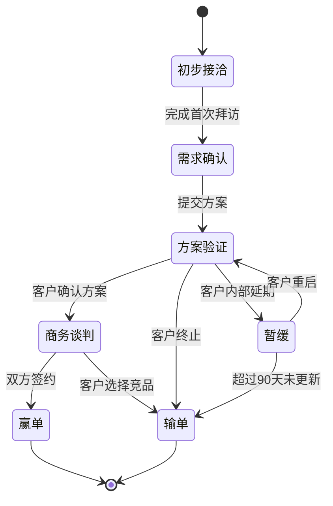

配套必须明确的三件事：
- **谁能改**：阶段回退（如从商务谈判退回方案验证）仅销售经理及以上可执行；
- **改成什么**：进入商务谈判前必须填写预计金额与预计成交日期，否则系统拒绝迁移；
- **改时做什么**：阶段变更写入商机阶段变更日志，赢单时自动生成合同草稿任务。

**（2）报价审批 → 活动图 + 决策表**

活动图（见 2.4 节）解决"步骤与分支"，决策表（见 2.9 节 BR-DISC-01）解决"路由条件"。两张图必须由同一批规则编号（BR-DISC-01）串联，评审时逐列确认，避免出现"图上画两级审批、表里写三级审批"的不一致。

**（3）角色权限 → 用例图**

用例图（见 2.1 节）直接生成角色-用例权限矩阵，作为权限设计输入：

| 角色 | 创建线索 | 跟进线索 | 创建商机 | 提交报价 | 审批报价 | 大额特批 | 登记回款 | 配置流程 |
| --- | --- | --- | --- | --- | --- | --- | --- | --- |
| 销售代表 | ✓ | ✓ | ✓ | ✓ | — | — | — | — |
| 销售经理 | ✓ | ✓ | ✓ | ✓ | ✓ | — | — | — |
| 销售总监 | ✓ | ✓ | ✓ | ✓ | ✓ | ✓ | — | — |
| 财务专员 | — | — | — | — | — | — | ✓ | — |
| 系统管理员 | — | — | — | — | — | — | — | ✓ |

> 数据权限（销售只能看自己的客户、经理可看本团队）属于**实例级权限**，用例图表达不了，必须单独写需求条目与非功能安全需求。这是用例图的能力边界，需要明确标注。

### 6.4 本案建议交付物清单

| 序号 | 交付物 | 形式 | 对应方法 |
| --- | --- | --- | --- |
| 1 | 角色与用例全景图 | 用例图（按角色分包） | 用例图 |
| 2 | 用例规格说明全集（≥ 12 个核心用例） | 模板化表格 | 用例规格说明 |
| 3 | L2C 实体状态图集（线索、商机、报价单、合同、回款单） | 状态图 ×5 | 状态图 |
| 4 | 报价审批活动图（含泳道） | 活动图 | 活动图 |
| 5 | 系统 0 层与 1 层 DFD | DFD | 数据流图 |
| 6 | L2C 领域模型图 + 数据字典 | 类图 + 表格 | 领域模型 |
| 7 | 关键场景时序图（提交报价、登记回款、生成合同） | 时序图 ×3 | 时序图 |
| 8 | 业务规则全集（决策表，编号 BR-XXX） | 决策表 ≥ 5 张 | 决策表 |
| 9 | 用户故事与 AC 清单（迭代待办） | 表格/看板 | 用户故事 |
| 10 | 客户 360 视图与关键页面原型 | 线框图 + 高保真链接 | 原型 |
| 11 | 需求属性表 + RTM | 多维表格 | RTM |
| 12 | 正式 SRS（按 GB/T 9385 目录） | Markdown/Word | 全部方法的收敛结果 |

---

## 7 常见错误与自查清单

### 7.1 学生作业中最常见的九类错误

| 错误 | 表现 | 后果 | 纠正方式 |
| --- | --- | --- | --- |
| 1. 用例图当流程图用 | 用 include/extend 表达步骤顺序 | 图既不是用例图也不是流程图 | include 只用于必然复用，顺序靠用例规格说明 |
| 2. 状态图混入多个实体 | 一张图里同时画线索和商机 | 状态迁移语义混乱 | 一图一实体，交互用时序图 |
| 3. DFD 里画判断分支 | DFD 出现菱形判断框 | 本质错误，DFD 不含控制逻辑 | 分支改画活动图 |
| 4. 只画成功路径 | 用例规格说明只有基本流 | 上线后异常集中爆发 | 强制写备选流与异常流 |
| 5. 需求无编号 | 文档里是散文或一堆句号 | 无法评审、无法追踪、无法测试 | 全量编号 + RTM |
| 6. 形容词当需求 | "友好""快速""稳定""灵活" | 不可验证，验收扯皮 | 量化 + 测量条件（SMART） |
| 7. 需求与原型割裂 | 原型很漂亮，文档不提界面规则 | 开发各做各的 | 原型附交互说明与状态覆盖清单 |
| 8. 全部需求都是"高优先级" | MoSCoW 里全是 Must | 优先级失去意义 | 强制给出 W（本次不做）清单 |
| 9. 直接粘贴 AI 生成内容 | 出现业务中不存在的角色与数字 | 需求失真且无人负责 | 每条标注来源，业务方确认，人负责 |

### 7.2 提交前自查

- [ ] 三大问题是否都被正面回应：歧义（术语表 + 量化）、遗漏（模型穷举 + 异常流）、不可验证（AC + RTM）？
- [ ] 11 种方法是否至少覆盖了报告要求全部项，且每项都有**本项目案例**的例子？
- [ ] 所有 Mermaid 图能否正确渲染（节点文本无破坏性符号）？
- [ ] 工具与规范是否给出了**真实名称**（GB/T 8566、GB/T 9385、IEEE 29148、draw.io、PlantUML、Mermaid、Jira、Axure RP、Figma、墨刀等）？
- [ ] 是否给出了从素材到 SRS 的**可执行路径**与标准目录？
- [ ] 案例章节是否做到了"一个业务环节对应一种最合适的方法"，而非笼统一句"都要用"？
- [ ] AI 使用是否声明并列出风险？

---

## 8 参考文献与标准

1. GB/T 8566《软件生存周期过程》
2. GB/T 9385《计算机软件需求规格说明规范》
3. GB/T 8567《计算机软件文档编制规范》
4. GB/T 11457《软件工程术语》
5. GB/T 25000 系列《系统与软件工程 系统与软件质量要求和评价（SQuaRE）》
6. IEEE Std 830-1998, IEEE Recommended Practice for Software Requirements Specifications
7. ISO/IEC/IEEE 29148:2018, Systems and software engineering — Life cycle processes — Requirements engineering
8. ISO/IEC/IEEE 12207:2017, Systems and software engineering — Software life cycle processes
9. ISO/IEC/IEEE 15288:2015, Systems and software engineering — System life cycle processes
10. ISO/IEC 25030:2019, Systems and software engineering — Software product quality requirements
11. IIBA, A Guide to the Business Analysis Body of Knowledge (BABOK Guide) v3
12. Alistair Mavin et al., EARS — Easy Approach to Requirements Syntax, INCOSE Requirements Writing Guide
13. Karl Wiegers & Joy Beatty, Software Requirements, 3rd Edition
14. Ivar Jacobson et al., Object-Oriented Software Engineering: A Use Case Driven Approach
15. Mike Cohn, User Stories Applied: For Agile Software Development（INVEST 与 3C 原则来源）
16. Dai Clegg, MoSCoW Prioritisation, Dynamic Systems Development Method (DSDM)
17. Noriaki Kano et al., Attractive Quality and Must-be Quality（Kano 模型原始论文）
18. Martin Glinz, On Non-Functional Requirements（非功能需求分类与可验证性）
