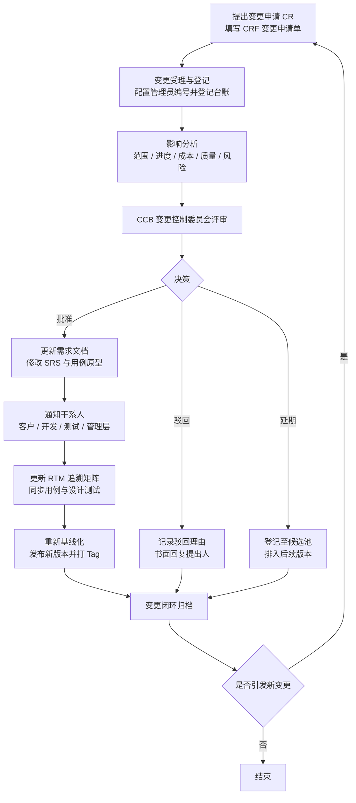

# 软件需求管理调研报告

> 课程：软件工程　|　作业项：第 2 项 · 需求管理
> 业务案例：CRM 销售管理平台（L2C 全流程）
> 撰写角色：课程助教　|　受众：选课学生、任课教师（老潘）

---

## 目录

1. [概述：为什么需要需求管理](#1-概述为什么需要需求管理)
2. [需求会议如何组织](#2-需求会议如何组织)
3. [会议结果如何记录](#3-会议结果如何记录)
4. [需求如何确认](#4-需求如何确认)
5. [需求变更与版本管理](#5-需求变更与版本管理)
6. [课程案例：CRM 销售管理平台落地示例](#6-课程案例crm-销售管理平台落地示例)
7. [附录：需求管理自检清单](#7-附录需求管理自检清单)

---

## 1. 概述：为什么需要需求管理

### 1.1 一个无法回避的前提：需求必然变化

"需求在项目周期内一定会发生变化"几乎是公理：**业务侧**（市场、组织、合规在变）、**认知侧**（客户看到原型后才会说出真正想要的）、**技术侧**（实现中暴露出文档未写的约束）。

既然变化不可避免，需求管理的目标就**不是"阻止变化"**，而是：

> **在"需求必然变化"的前提下，保证任何变化都是受控、可追溯、可解释的。**

这句话可以拆成三个可检验的标准：

| 标准 | 含义 | 可检验的问法 |
| --- | --- | --- |
| **受控**（Controlled） | 任何变更都必须经过既定流程与授权人审批，任何人不得擅自改需求、擅自改代码 | 这个改动是谁批准的？有没有记录？ |
| **可追溯**（Traceable） | 任意一条需求都能向上追溯到业务目标，向下追溯到设计、代码与测试用例 | 这条需求从哪儿来？改了会影响哪些模块和用例？ |
| **可解释**（Explainable） | 任意时刻都能说清"当前需求是什么、为什么是这样、和上一版差在哪" | 为什么现在是这个方案？当初否决的那个方案理由是什么？ |

如果做不到这三点，项目会滑向典型的失败形态：范围蔓延、返工、验收时扯皮、"做完了但客户说不是他要的"。

### 1.2 需求开发 vs 需求管理

这是本课程最容易被混淆的一组概念。二者是**并列关系**，不是包含关系，且在项目中共生交替进行。

| 维度 | 需求开发（Requirements Development） | 需求管理（Requirements Management） |
| --- | --- | --- |
| 本质 | **把需求"做出来"**——获取、分析、规格化、确认 | **把需求"管起来"**——基线化、变更控制、版本、追溯 |
| 关注点 | 需求的内容与质量（对不对、全不全、清不清楚） | 需求的状态与过程（稳不稳、变没变、谁批准） |
| 主要活动 | 访谈、调研、建模（用例/原型/数据流）、编写 SRS、需求评审 | 建立基线、变更申请与影响分析、CCB 评审、版本发布、维护 RTM |
| 交付物 | 需求规格说明书 SRS、用例模型、原型、验收标准 | 需求基线、变更申请单 CRF、变更日志、RTM 追溯矩阵、版本历史 |
| 典型角色 | 需求分析师、产品经理、架构师、客户代表 | 项目经理、配置管理员、CCB 委员会、QA |
| 失败表现 | 需求遗漏、描述歧义、需求冲突 | 范围蔓延、版本混乱、改了不通知、验收无依据 |

一句话记忆：**需求开发解决"做什么"，需求管理解决"改了怎么办"**。需求开发产出的东西，正是需求管理的管理对象。

### 1.3 需求基线（Requirements Baseline）

**定义**：需求基线是在某一特定时间点，经过正式评审与批准、并被冻结下来的**需求规格说明书（含用例、原型、验收标准）的一个版本**。它是后续开发、测试、变更控制的**唯一参照基准**。

关键性质：

1. **时间点属性**：基线不是一个文档，而是"文档 + 那个时刻的快照"。因此必须与版本号、日期绑定，例如 `CRM-SRS-v1.0（2026-10-20 基线化）`。
2. **正式性**：基线必须经过评审并得到客户/发起人书面确认（Sign-off），不是分析师自己说"我觉得差不多了"就算。
3. **冻结性**：基线一旦建立，任何修改都必须走变更流程，**不允许就地直接编辑**。
4. **可比较性**：基线的价值在于提供"对比基准"。没有基线，"我们比原计划多做了多少"这个问题在数学上无法回答。

基线的建立时机：通常对应瀑布模型的"需求阶段结束"里程碑，或敏捷模型中每个发布/大版本规划完成时（敏捷中基线粒度更细、更新更频繁，但"冻结—变更"的纪律不变）。

---

## 2. 需求会议如何组织

需求不是"开个会就能定"的，但**需求必须通过会议推进**。本节给出可直接复制的会议模板。

### 2.1 会议全景图

| 会议 | 英文 / 缩写 | 典型时机 | 核心产出 | 时长建议 |
| --- | --- | --- | --- | --- |
| 需求启动会 | Kick-off | 项目启动，需求工作开始前 | 项目章程要点、需求工作计划、干系人清单 | 60–90 min |
| 需求调研访谈 | Interview | 需求获取期，按角色分批 | 访谈纪要、原始需求清单、业务流程图 | 45–60 min／场 |
| 联合需求计划会 | JRP / JAD | 需求获取期，集中攻坚 | 共识后的需求草案、优先级排序、冲突清单 | 半天–2 天 |
| 需求评审会 | Review / Inspection | 需求文档成稿后 | 评审意见表、缺陷清单、通过/返工结论 | 90 min（上限） |
| 需求澄清会 | Clarification | 开发/测试过程中随时 | 澄清结论、Q&A 台账更新 | 30–60 min |
| 变更控制会 | CCB Meeting | 变更申请累积后定期召开 | 变更决议（批准/驳回/延期） | 30–60 min |
| Sprint 计划会 | Sprint Planning | 每个迭代开始 | 迭代目标、迭代待办清单 Sprint Backlog | 60–120 min |
| 待办梳理会 | Backlog Refinement | 迭代中，通常每周一次 | 拆分/估算/重排后的 Product Backlog | 60–90 min |

### 2.2 六类关键会议的实操模板

#### （1）需求启动会 Kick-off

- **目的**：对齐项目背景、目标与边界；明确谁参与需求工作、什么时间交付什么；建立沟通与决策机制（含变更流程）。
- **参与角色**：发起人/客户高层（定调）、项目经理（主持）、需求分析师、架构师、客户方业务负责人、关键用户代表、QA/配置管理员。
- **会前准备材料**：项目章程或立项说明、初步的业务背景资料、干系人登记表草案、需求工作计划（Draft）、会议议程。
- **议程模板（90 分钟）**

  | 时段 | 议程 | 负责人 |
  | --- | --- | --- |
  | 0–10 min | 与会者介绍、会议目标说明 | 项目经理 |
  | 10–25 min | 项目背景、业务目标与成功标准（可量化） | 发起人 |
  | 25–40 min | 项目范围与**明确的边界外内容**（本次不做什么） | 项目经理 |
  | 40–55 min | 需求工作计划：调研排期、访谈名单、交付物清单 | 需求分析师 |
  | 55–75 min | 沟通机制：例会节奏、纪要规范、变更流程与 CCB 组成 | 项目经理 |
  | 75–90 min | 风险与假设、答疑、下一步行动项确认 | 全体 |

- **会后产出物**：《项目启动会纪要》《干系人登记表》《需求工作计划 v1.0》《沟通与变更管理机制说明》。

#### （2）需求调研访谈 / 联合需求计划会 JRP

- **目的**：从用户口中获取真实业务流程与痛点；JRP 则进一步把多方干系人拉到一起，当场消除冲突、达成共识（比多轮一对一访谈效率更高，但组织成本也更高）。
- **参与角色**（JRP）：主持人（Facilitator，必须中立）、记录人（Scribe）、业务专家/关键用户、需求分析师、技术观察员（只听不决策）、决策人（Sponsor，有权拍板）。
- **会前准备材料**：访谈提纲（按角色定制）、现有系统截图/单据样本、业务流程图草案、术语表。
- **议程模板（JRP，1 天版）**

  | 时段 | 议程 | 说明 |
  | --- | --- | --- |
  | 09:00–09:30 | 目标与规则重申 | 明确"对事不对人""主持人控场" |
  | 09:30–10:30 | 业务流程全景走查（As-Is） | 用户主讲，分析师画流程图 |
  | 10:30–12:00 | 痛点与期望清单（To-Be） | 便利贴收集，一轮不评判 |
  | 13:30–15:00 | 需求条目化与去重 | 逐条确认归属与边界 |
  | 15:00–16:00 | 冲突识别与当场裁决 | 决策人拍板，未决进停车场 |
  | 16:00–17:00 | MoSCoW 优先级排序 | 见 5.4 节 |
  | 17:00–17:30 | 当日结论回顾与行动项 | 口头复述 + 书面确认 |

- **会后产出物**：《访谈纪要/JRP 纪要》《原始需求清单（带优先级）》《待澄清问题清单 Q&A》《冲突与遗留问题登记表（Parking Lot）》。

#### （3）需求评审会 Review

- **目的**：在需求进入基线之前，系统地发现规格说明中的**错误、遗漏、歧义、冲突、不可测、不可行**问题。注意：评审的对象是**文档**，不是人；结论是**文档是否通过**，不是"谁写得差"。
- **参与角色**：主持人（组织）、作者（需求分析师，讲解但不得辩解）、评审员（客户代表、架构师、开发负责人、测试负责人、QA）、记录人。
- **会前准备材料（至少提前 2 个工作日发出）**：SRS/PRD 待评审版、用例模型、原型、评审检查单 Checklist、评审意见表模板。
- **议程模板（90 分钟，硬性上限）**

  | 时段 | 议程 |
  | --- | --- |
  | 0–10 min | 主持人说明评审范围、通过标准、记录规则 |
  | 10–40 min | 作者走查（Walkthrough）：按模块串讲需求与用例 |
  | 40–75 min | 逐条过评审意见表：确认/争议/缺陷，争议不超过 2 分钟，超时进"待议" |
  | 75–85 min | 分类汇总：致命/严重/一般/建议；判定通过/有条件通过/返工 |
  | 85–90 min | 复述结论与行动项，约定复评时间 |

- **会后产出物**：《需求评审报告》（含意见表、缺陷清单、评审结论）、更新后的需求文档、复评安排。

#### （4）需求澄清会 Clarification

- **目的**：解决开发/测试过程中暴露的"文档没写清/写了但有两种理解"的问题，**不改变需求范围**（一旦改变范围，就必须转为变更流程）。
- **参与角色**：提问题方（开发/测试）、需求分析师、客户代表（必要时）、记录人。
- **会前准备材料**：问题台账（Q&A Log），每条含：编号、提出人、关联需求 ID、问题描述、提出人的理解、期望答复时间。
- **议程**：问题逐条过（每条 ≤5 分钟）→ 当场答复或标记"需客户确认"→ 更新台账 → 24 小时内回写需求文档。
- **会后产出物**：更新后的 Q&A 台账、需求文档的补充说明（以修订模式标注）、必要的回归范围说明。

#### （5）变更控制会 CCB

- **目的**：对变更申请（CR）逐条做决策——批准、驳回或延期，并对批准的变更确定优先级与实施版本。
- **参与角色**：CCB 主席（通常为项目经理或发起人）、客户代表、架构师/技术负责人、测试负责人、配置管理员（记录与执行基线更新）、QA（流程合规监督）。**CCB 人数宜少（3–7 人），但必须有决策权。**
- **会前准备材料**：变更申请单 CRF 汇总表（含影响分析结果）、当前需求基线、干系人影响清单。
- **议程模板（60 分钟）**

  | 时段 | 议程 |
  | --- |
  | 0–5 min | 上次会议决议执行情况回顾 |
  | 5–40 min | 逐条审议 CR：陈述 → 影响分析（范围/进度/成本/质量/风险）→ 讨论 → 表决 |
  | 40–55 min | 批准项的排期与资源归属、驳回项的话术与回复责任人 |
  | 55–60 min | 决议复述、基线更新计划、通知计划 |

- **会后产出物**：《CCB 决议纪要》、更新后的 CRF（填写决议与签字）、基线更新任务、干系人通知邮件。

#### （6）Sprint 计划会与待办梳理会（敏捷场景）

- **Sprint 计划会**：确定本迭代"为什么做（目标）""做什么（选取条目）""怎么做（任务拆解）"。角色为 Product Owner（讲价值）、Scrum Master（主持）、开发团队（估算与认领）。会前需准备好已估算的 Product Backlog 与团队历史速率。议程（月迭代约 2 小时）：Part 1（60 min）目标对齐与条目选取；Part 2（60 min）任务拆解与认领。产出：Sprint 目标、Sprint Backlog、初步任务看板。
- **待办梳理会（Refinement）**：为后续迭代准备"就绪（Definition of Ready）"的需求条目——拆分、估算、补验收标准。固定节奏（每周一次，60–90 min），占用团队时间不超过 10%。产出：更新后的 Product Backlog、补全的 AC、风险标记。

### 2.3 访谈技巧：把"客户说的"变成"客户真正要的"

#### （1）开放式 vs 封闭式问题

| 类型 | 特点 | 适用场景 | 示例 |
| --- | --- | --- | --- |
| 开放式 | 以"为什么/怎么/请描述"开头，让对方自由表达 | 访谈前段，探索业务全景、挖掘痛点 | "请您描述一下，从拿到线索到签下合同，中间要经过哪些环节？" |
| 封闭式 | 只能用"是/否/具体值"回答 | 访谈后段，确认与收敛 | "报价单超过 10 万元就必须上级审批，对吗？" |

**黄金节奏**：先开放、后封闭。访谈中 70% 的问题应是开放式的；最后 30% 用封闭式逐条确认，避免"我以为我理解了"。

#### （2）5 Why：挖到根因

客户提出的往往是**解决方案**而非**需求**。用 5 Why 层层追问，回到业务目标。

```
客户："我要在报价单上加一个'导出 PDF'按钮。"
Why 1：为什么要导出？      → "销售要把报价发给客户看。"
Why 2：为什么不能直接发？  → "客户不一定有系统账号，微信发过去打不开。"
Why 3：为什么客户要看到？  → "客户内部要走采购流程，需要留档。"
Why 4：为什么不能截图？    → "截图没有公司抬头，法务不认。"
Why 5：留档的关键是什么？  → "要有抬头、编号、金额、有效期、可追溯。"
```

结论从"加一个导出按钮"变成"生成带公司抬头与编号的正式报价凭证，可外发、可留档、含有效期"。**方案空间被打开了**：可以是 PDF，也可以是带水印的 H5 链接 + 邮件推送。

#### （3）引导性提问与避坑

- **禁用的引导式问法**："系统自动分配线索，是不是很方便？"——客户为迎合你会说"是"。改为中性问法："线索分配目前是怎么做的？哪个环节最花时间？"
- **避免专业术语**：不说"你们需要 RBAC 权限模型吗"，说"谁可以看到全部客户的报价？谁只能看自己的？"

#### （4）挖掘隐性需求的四种抓手

1. **异常与例外流程**：客户只会讲正常流程。必须追问"如果审批人出差了怎么办""如果客户中途要改金额怎么办""如果同时两个人改同一张单怎么办"。**异常流程往往是系统复杂度的主体。**
2. **约束类需求**：合规（数据留存年限）、性能（月底批量导入多少条）、集成（要与钉钉/企业微信/财务系统打通）、运行环境。
3. **非功能需求**：用"质量属性清单"逐项过：性能、并发、可用性、安全性、易用性、可维护性、可移植性。
4. **现场观察（Gemba）**：坐在销售旁边看他实际操作半小时，比开会两小时收获更大。

#### （5）"客户说的" vs "客户真正要的"

| 客户说的（表层方案） | 追问后的真实需求（业务目标） | 更优的方案可能 |
| --- | --- | --- |
| "我要一个导出 Excel 按钮" | 管理层每周要看销售漏斗汇总 | 自动推送的周报 + 在线看板 |
| "线索必须手动分配" | 公平分配、避免抢单，且要能追溯 | 规则自动分配 + 手工干预 + 分配日志 |
| "所有字段都必填" | 保证数据完整，方便后续分析 | 关键字段必填 + 分级必填 + 完整性看板 |

**核心动作**：把每一条"客户说的"翻译成"业务目标 + 验收标准"，再让客户确认目标而不是确认方案。

### 2.4 会议组织的八条硬规则

1. **会前必发议题与材料**（至少提前 2 个工作日）。没材料的会一律取消。
2. **时长上限 90 分钟**，超过必须拆分——人的有效注意力在 60–90 分钟后急剧下降。
3. **主持人 ≠ 记录人**。主持人控场、守时、裁断；记录人只记不辩。
4. **必须有明确的决策人**。没有决策人的会只能产出"待办"，不能产出"结论"。
5. **必须有结论形态**：通过/不通过、批准/驳回/延期，不接受"再看看"。
6. **停车场机制（Parking Lot）**：2 分钟内无法收敛的争议一律挂起、会后再议。
7. **破除"需求是开会就能定"的误区**：会议只能暴露与收敛需求，真正的确认依赖会后书面化、原型验证与正式评审。口头共识不等于需求。
8. **会后 24 小时内发出纪要**（见第 3 章），把口头共识转为可追溯证据。

---

## 3. 会议结果如何记录

### 3.1 为什么记录是需求管理的命门

没有记录的会议等于没有开过。记录在需求管理中承担三重角色：**证据**（验收与争议时的依据）、**契约**（待办事项的责任约定）、**知识**（项目结束后可复用的组织资产）。

### 3.2 会议纪要的标准结构

一份合格的纪要必须包含以下九个要素，缺一不可：

| 要素 | 要求 | 常见错误 |
| --- | --- | --- |
| 会议名称 | 含项目名与会议类型，如"CRM 项目第 3 次需求评审会" | 只写"评审会" |
| 时间 | 起止时间 + 时区，日期完整 | 只写日期 |
| 地点 | 线下会议室编号 或 线上会议链接/会议号 | 缺失 |
| 参会人 | 姓名 + 角色 + **签到/签字**（缺席人也要列明） | 只写"相关同事" |
| 议程 | 与实际讨论顺序对应 | 无议程 |
| 讨论结论 | 逐条编号，措辞为"结论"而非"过程" | 记成流水账 |
| 待办事项 Action Item | **每条必须有责任人 + 截止日期**，可验证 | 只写"后续跟进" |
| 遗留问题 | 明确挂起原因与解决路径 | 悄悄略过 |
| 附件与下次会议 | 材料清单、下次会议时间与议题 | 缺失 |

### 3.3 严格区分：讨论过程 vs 结论 vs 待办

这是纪要质量的核心分水岭。三者的写法完全不同：

| 类别 | 回答的问题 | 动词特征 | 示例 |
| --- | --- | --- | --- |
| **讨论过程** | 我们是怎么想到这个结论的 | 认为/提出/讨论了/有人建议 | "测试组提出若审批超时未处理会导致商机停滞" |
| **结论** | 我们最终定的是什么 | **决定/确认/同意/否决**，无歧义、无主语模糊 | "确认：审批超时 24 小时自动升级至上级，并推送钉钉提醒" |
| **待办** | 接下来谁在什么时间前做完什么 | 负责人 + 动作 + 截止日期 | "张三：补充超时升级的用例与验收标准，10-18 前" |

**写作纪律**：
- 纪要正文以**结论为骨架**，讨论过程只做简要背景（1–2 句），避免变成逐字稿。
- 每条结论用 `C-01`、`C-02` 编号；每条待办用 `A-01`、`A-02` 编号。**编号是后续 RTM 追溯与周会跟踪的锚点。**
- 禁止出现"大家觉得""基本上""原则上"这类模糊词。

### 3.4 24 小时原则与书面确认

- **24 小时原则**：会议结束后 **24 小时内**必须发出纪要初稿。超过 24 小时，与会者记忆衰减、细节失真，争议率显著上升。
- **确认闭环**：纪要发出后，设定 **48 小时异议期**。异议期内无书面异议视为确认；有异议必须书面提出并出修订版。
- **书面确认的形式**：邮件回复"确认无异议"、在线文档评论区 @ 回复、或纸质签字扫描件。**口头确认无效。**
- **结论必须得到参会方书面确认**，尤其是涉及范围、工期、费用、验收标准的结论——这是 Sign-off（见 4.4）的前置材料。

### 3.5 记录手段对比

| 手段 | 优点 | 局限 | 使用建议 |
| --- | --- | --- | --- |
| 人工笔记（记录人） | 结构化、直接成稿 | 速度跟不上、易漏 | 主力手段，配合其他手段 |
| 录音 / 会议录制 | 完整、可回溯争议 | 整理耗时；**须事先征得同意** | 用于重要评审与 JRP，会后 48h 内整理完即归档 |
| 白板拍照 | 保留流程图/便利贴的原始形态 | 照片易褪色、不可检索 | 当场拍，当天转抄为电子图 or 文本 |
| 在线文档协同（腾讯文档/飞书/Notion） | 多人实时、版本留痕、可 @ 追责 | 依赖网络、格式易散 | 强烈推荐作为纪要主载体，导出 PDF 归档 |
| 协作看板（Jira/Trello/Teambition） | 待办可自动跟踪状态 | 不适合记录讨论 | 纪要中的 Action Item 同步建卡 |

**推荐组合**：在线文档实时记录（主） + 白板拍照（辅） + 录音（争议高危会议才用） + 待办同步进看板（跟踪）。

### 3.6 可直接复制的 Markdown 纪要模板

````markdown
# 【项目名称】第 N 次【会议类型】会议纪要

| 项目 | 内容 |
| --- | --- |
| 会议名称 | CRM 销售管理平台 · 需求评审会（第 2 次） |
| 会议时间 | 2026-10-16 14:00 – 15:30 |
| 会议地点 | 公司 3F 会议室 A / 腾讯会议 123-456-789 |
| 主持人 | 李四（项目经理） |
| 记录人 | 王五（需求分析师） |
| 决策人 | 赵六（客户方业务负责人） |
| 参会人 | 赵六（客户方业务负责人）、李四（PM）、王五（BA）、张三（架构）、钱七（测试）、孙八（QA） |
| 缺席人 | 周九（销售总监，出差，已会前书面授权赵六代决） |
| 纪要版本 | v1.0（待确认）　异议截止：2026-10-18 18:00 |

---

## 一、会议议程

| 序号 | 议程 | 主讲 | 计划时长 |
| --- | --- | --- | --- |
| 1 | 上轮评审缺陷闭环情况 | 王五 | 10 min |
| 2 | 商机与报价模块需求走查 | 王五 | 40 min |
| 3 | 评审意见逐条审议 | 全体 | 30 min |
| 4 | 结论与行动项 | 李四 | 10 min |

---

## 二、讨论结论

| 编号 | 议题 | 讨论要点（简述） | 结论 | 关联需求 ID |
| --- | --- | --- | --- | --- |
| C-01 | 报价审批层级 | 测试组提出多级审批会拉长成交周期 | **决定**：报价金额 ≤ 10 万走一级审批（销售经理）；> 10 万走两级审批（销售经理 + 销售总监）。阈值可在后台配置 | REQ-QT-003 |
| C-02 | 审批超时处理 | 有人建议人工催办，成本过高 | **决定**：审批超 24 小时自动升级至上一级并推送钉钉提醒 | REQ-QT-004 |
| C-03 | 回款与合同关联 | 财务口径与销售口径不一致 | **决定**：以合同为主键关联回款计划，一期不做预收款拆分 | REQ-CT-002 |
| C-04 | 移动端需求 | 客户希望手机审批 | **暂缓**：一期仅做审批消息推送，移动端审批列入 v1.1 | REQ-MB-001 |

---

## 三、待办事项（Action Item）

| 编号 | 任务描述 | 责任人 | 协助人 | 截止日期 | 验收方式 | 状态 |
| --- | --- | --- | --- | --- | --- | --- |
| A-01 | 补充"审批超时自动升级"用例与验收标准 | 王五 | 钱七 | 2026-10-18 | 评审通过 | 进行中 |
| A-02 | 评估报价审批阈值的配置项设计 | 张三 | — | 2026-10-19 | 设计说明书 | 未开始 |
| A-03 | 输出 REQ-MB-001 的延期说明并通知客户 | 李四 | — | 2026-10-17 | 客户邮件回复 | 未开始 |
| A-04 | 更新 RTM 中 REQ-QT-003/004 的用例映射 | 钱七 | — | 2026-10-20 | RTM v0.9 | 未开始 |

---

## 四、遗留问题（Parking Lot）

| 编号 | 问题描述 | 挂起原因 | 责任跟进人 | 计划解决时间 |
| --- | --- | --- | --- | --- |
| P-01 | 预收款是否拆分到回款计划 | 财务口径未定 | 赵六 | 2026-10-23 前书面答复 |
| P-02 | 与钉钉审批流的单点登录方案 | 需 IT 部门确认权限 | 张三 | 2026-10-25 |

---

## 五、附件

- `CRM-SRS-v0.8.pdf`（待评审版）
- `报价审批原型_v3.rp`
- 白板照片 `20261016-board.jpg`

## 六、下次会议

- 时间：2026-10-20 14:00
- 议题：SRS v0.9 复评、遗留问题闭环、v1.0 基线确认

---

**参会人确认签字**：

| 角色 | 姓名 | 签字 | 日期 |
| --- | --- | --- | --- |
| 客户方代表 | 赵六 | | |
| 项目经理 | 李四 | | |
| 需求分析师 | 王五 | | |
| QA | 孙八 | | |
````

---

## 4. 需求如何确认

### 4.1 确认（Validation） vs 验证（Verification）

这对概念在中文里极易混淆，但区别是根本性的：

| 维度 | 需求确认 Validation | 需求验证 Verification |
| --- | --- | --- |
| 经典问法 | **Are we building the right product?** | **Are we building the product right?** |
| 中文 | **我们做的是不是客户真正要的？** | 我们是不是按规格正确地做出来的？ |
| 对象 | 需求本身（SRS、原型、用例） | 产品/工件（设计、代码、系统） |
| 时机 | 需求阶段，基线化之前 | 开发、测试阶段，交付之前 |
| 手段 | 评审、原型确认、场景走查、客户签字 | 代码审查、单元测试、集成测试、系统测试、验收测试 |
| 失败后果 | 做错了东西（**代价最大**） | 做坏了东西（代价可度量、可修复） |
| 责任人 | 客户 + 需求分析师 | 开发 + 测试 + QA |

**必答的问题：我们做的是不是客户真正要的？** 这个问题只能通过 **Validation** 回答，而且必须在写代码之前回答。一旦答错，后面所有工作都是负价值。

### 4.2 确认手段矩阵

| 手段 | 说明 | 适用阶段 | 参与人 | 强度 | 成本 |
| --- | --- | --- | --- | --- | --- |
| **走查 Walkthrough** | 作者向同行串讲需求，边讲边收集意见 | 文档初稿 | 作者 + 同行 | ★★☆☆☆ | 低 |
| **审查 Inspection** | 按正式流程、带角色分工与检查单，逐条查找缺陷并记录分类 | 文档接近定稿 | 主持人 + 评审员 + 记录人 | ★★★★★ | 中高 |
| **技术评审 Technical Review** | 从技术可行性、架构影响、性能与安全角度审视需求 | 文档定稿前 | 架构师 + 开发负责人 | ★★★★☆ | 中 |
| **原型确认** | 用可点击原型/线框图让客户"看见"系统 | 需求中期至定稿 | 客户 + BA + UX | ★★★★☆ | 中 |
| **用例场景走查** | 用具体业务场景（正常流 + 异常流）逐条走一遍 | 需求定稿 | 客户 + BA + 测试 | ★★★★☆ | 中 |
| **验收标准 AC 对齐** | 每条需求配可测试的验收标准，逐条确认 | 需求定稿 | BA + 测试 + 客户 | ★★★★★ | 低 |
| **客户签字 Sign-off** | 客户以书面形式确认需求基线 | 基线化时刻 | 客户授权代表 | ★★★★★ | 低 |

**组合策略（推荐）**：走查（草稿自清） → 原型确认（消除想象差异） → 审查 + 技术评审（正式查缺） → 用例场景走查 + AC 对齐（可测化） → Sign-off（契约化）。

**验收标准 AC 的写法**：建议采用 Given/When/Then 三段式。

> **AC-01（REQ-QT-003）**
> **Given** 销售提交一张金额为 15 万元的报价单
> **When** 点击"提交审批"
> **Then** 系统创建两级审批流：先由销售经理审批，通过后自动转销售总监审批；两级均通过后方可生成正式报价单

### 4.3 可追溯性矩阵 RTM（Requirements Traceability Matrix）

**定义**：RTM 是一张把需求与其下游工件（用例、设计、代码、测试）以及上游来源（业务目标、干系人）一一对应起来的表格。它是"可追溯"这一目标的**物理载体**。

RTM 的核心价值：
1. **变更影响分析**：改一条需求，一查 RTM 就知道影响哪些用例、哪些模块、哪些测试用例。
2. **覆盖率检查**：有没有需求没被设计覆盖？有没有代码没被需求覆盖（镀金 Gold Plating）？
3. **验收依据**：证明所有需求都已被测试并验证。

**RTM 表格模板**

| 需求 ID | 需求描述 | 来源（干系人/业务目标） | 优先级 | 用例 ID | 设计/模块 | 代码实现 | 测试用例 ID | 状态 |
| --- | --- | --- | --- | --- | --- | --- | --- | --- |
| REQ-LD-001 | 线索可从官网表单自动汇入 | 市场部 / 提升线索获取效率 | Must | UC-01 | LeadModule | `LeadController.import()` | TC-001, TC-002 | 已验证 |
| REQ-QT-003 | 报价单按金额分级审批 | 销售总监 / 控制折扣风险 | Must | UC-12, UC-13 | QuoteModule, ApprovalEngine | `ApprovalEngine.route()` | TC-041 ~ TC-045 | 已验证 |
| REQ-QT-004 | 审批超时 24h 自动升级 | 评审会 C-02 | Should | UC-14 | ApprovalEngine | `ApprovalTimeoutJob` | TC-046, TC-047 | 待开发 |
| REQ-CT-002 | 回款计划按合同关联 | 财务 / 口径统一 | Must | UC-21 | ContractModule | `PaymentPlanService` | TC-061 | 测试中 |
| REQ-MB-001 | 移动端审批 | 销售总监 | Could（延期至 v1.1） | — | — | — | — | 已延期 |

追溯方向说明：
- **正向追溯**（需求 → 测试）：确保所有需求都被实现与验证。
- **反向追溯**（代码/测试 → 需求）：找出无源需求的代码，即"镀金"或"私自加功能"。

### 4.4 需求签字的意义与效力

**签字的意义**

1. **认知对齐的确认**：签字动作本身强迫客户认真读完并承担责任，比"看过了"强十倍。
2. **项目管理的效力**：签字后的需求即**基线**，是进度、成本、质量考核的基准；未走流程的改动不构成承诺。
3. **契约与法律效力**：在合同型项目中，需求规格说明书通常是合同附件，签字确认具有法律约束力，是验收、结算、争议仲裁（包括诉讼/仲裁中的证据）的依据。
4. **变更的分水岭**：签字之前是"需求开发"，签字之后改动即"变更"，必须走 CCB。

**为什么"签字了不代表不能改"**

这是学生最常误解的一点。签字**冻结的是"随意修改的权利"，不是"修改的可能性"**。

- 签字是对**当时认知**的确认。而认知会随业务推进、原型演示、市场变化而更新——强行禁止变更只会导致更糟的结果：团队做出来一个"符合签字文档但客户已不需要"的系统。
- 变更流程的存在恰恰是为了**让变更变得可行**：通过影响分析与 CCB 评审，明确"这个改动要花多少时间、多少钱、影响什么"，让客户在**知情**的前提下做决策。
- 因此正确的表述是：**签字之后可以改，但改必须走流程、付代价、留记录。** 变更的代价（工期/成本）由提出方与客户共同承担，这就是变更流程的经济学意义。
- 反例警示：若团队宣称"既然签了字就不能改"，客户要么绕过流程私下找开发改（破坏基线、失控），要么在验收时以"不满足实际业务"为由拒收——两种结果都比走变更流程糟糕得多。

---

## 5. 需求变更与版本管理

### 5.1 为什么必须有变更流程：范围蔓延 Scope Creep

**定义**：范围蔓延指项目范围内的工作在没有经过正式的范围变更控制程序的情况下，持续、渐进地增加。它不是某一次大改动，而是**大量小改动的累积**。

**蔓延的典型来源**：
- "顺手加一个小功能，反正很快"（镀金 Gold Plating）
- 客户方新的对接人带来新的想法
- 会上口头答应、会后无人记录与计价
- 需求描述不清，实现时按"最合理"的方式自由发挥

**危害**：

| 危害 | 表现 | 后果 |
| --- | --- | --- |
| 进度失控 | 每个改动"只有两天"，二十个就是一个月 | 延期、里程碑失守 |
| 成本失控 | 无预算的人力投入 | 项目亏损 |
| 质量下降 | 频繁插入改动，回归测试不充分 | 缺陷率上升、技术债累积 |
| 团队士气 | 目标不断移动，"永远做不完" | 人员流失 |
| 追溯断裂 | 文档与代码不一致 | 验收无依据，争议无法裁决 |

**结论**：变更流程不是官僚主义产物，而是防止"温水煮青蛙"的唯一机制，其核心价值是**让代价可见**。

### 5.2 变更控制完整闭环



流程要点说明：

| 环节 | 关键控制点 |
| --- | --- |
| 提出 | 任何人（客户、销售、开发、测试）都可提出，**但必须书面**，不接受口头变更 |
| 受理 | 统一入口（配置管理员或 PMO），分配唯一 CR 编号，防止"多头受理" |
| 影响分析 | **必须由技术负责人与 PM 共同完成**，至少覆盖范围/进度/成本/质量/风险五个维度，量化到人天 |
| 评审 | CCB 由 3–7 名有决策权的人组成；重大变更需发起人参与 |
| 决策 | 只有三种结果：批准、驳回、延期。不允许"原则同意"这类模糊结论 |
| 更新文档 | 先改文档再改代码，顺序不可颠倒 |
| 通知 | 所有受影响的干系人必须书面通知，尤其是测试与一线开发 |
| 更新 RTM | 遗漏此步等于追溯链断裂，后续影响分析失效 |
| 基线化 | 变更落地后发布新版本基线，形成新的对比基准 |

### 5.3 变更申请单 CRF 标准字段模板

| 字段 | 说明 | 填写要求 |
| --- | --- | --- |
| **CR 编号** | 唯一标识 | 格式：`CR-项目-年份-序号`，如 `CR-CRM-2026-017`，不可重号 |
| **提出人** | 姓名 / 部门 / 联系方式 | 必须是具体的人 |
| **提出日期** | 申请提交日期 | YYYY-MM-DD |
| **变更类型** | 新增需求 / 修改需求 / 删除需求 / 缺陷修复 / 技术优化 | 单选，影响审批路径 |
| **关联需求 ID** | 涉及的需求编号（可多条） | 关联 RTM |
| **变更内容描述** | 变更前是什么、变更后是什么 | 用"原：…… 改为：……"句式，避免歧义 |
| **变更原因** | 业务驱动 / 合规要求 / 客户新想法 / 缺陷暴露 | 必须写明业务理由，不接受"领导要求" |
| **影响分析** | 范围、进度、成本、质量、风险五维 | 量化：影响模块数、人天、延期天数、新增风险 |
| **优先级** | MoSCoW 或 高/中/低 + 业务价值评分 | 见 5.4 |
| **建议实施版本** | 目标版本 | 如 v1.0 / v1.1 / 下个 Sprint |
| **处理方式** | 批准 / 驳回 / 延期 | 由 CCB 填写 |
| **CCB 决议与理由** | 决议说明 | 驳回必须有理由，作为沟通依据 |
| **结果与签字** | CCB 主席、客户代表、PM 签字与日期 | 三方签字方可生效 |

> 填写要点：变更内容描述统一用"**原：…… 改为：……**"句式；影响分析必须量化到人天与模块；驳回同样需要书面理由，作为与提出人沟通的依据。完整填写示例见 [6.2 节](#62-变更申请单示例虚构)。

### 5.4 需求优先级评估方法

#### （1）MoSCoW

| 等级 | 含义 | 判定问法 | 处置原则 |
| --- | --- | --- | --- |
| **M** – Must have | 必须有 | 没有它系统就无法上线/无法达成核心目标？ | 不可妥协，工期紧张时保 M |
| **S** – Should have | 应该有 | 很重要但可用临时方案替代？ | 尽量做，可延后一个版本 |
| **C** – Could have | 可以有 | 有了更好，没有也不影响主流程？ | 有余力再做 |
| **W** – Won't have | 本次不做 | 明确排除 | **必须写出来**，避免后期反复；形成"不在范围内"清单 |

经验比例：M:S:C ≈ 60%:20%:20%。**W 是最容易被忽略但最有价值的一栏**——它把范围边界写成了文档。

#### （2）Kano 模型

| 类别 | 客户反应 | 示例（CRM） | 策略 |
| --- | --- | --- | --- |
| 基本型 Must-be | 有：理所当然；无：极不满意 | 数据不能丢、权限不能越界 | 必做，做到及格即可，不投入过度 |
| 期望型 One-dimensional | 做得越好越满意 | 报价单生成速度、列表查询响应 | 重点投入，形成竞争力 |
| 兴奋型 Attractive | 没有不不满，有了很惊喜 | 商机赢率 AI 预测、自动跟进提醒 | 少量投入，制造亮点 |
| 无差异 Indifferent | 有没有都无所谓 | 花哨的动画效果 | 不做 |
| 反向 Reverse | 做了反而不满 | 强制每步弹窗确认 | 坚决不做 |

#### （3）价值 vs 代价矩阵

按"业务价值（1–10）"与"实现代价（人天，1–10）"打分，落入四象限：

| 象限 | 价值 / 代价 | 策略 | CRM 示例 |
| --- | --- | --- | --- |
| Ⅰ 快速取胜 Quick Win | 高价值 / 低代价 | **优先做，立即排期** | 线索查重、报价单模板 |
| Ⅱ 重大投资 Big Bet | 高价值 / 高代价 | 拆分后分期做，做架构设计 | 多级审批引擎、报价利润测算 |
| Ⅲ 填补空白 Fill-in | 低价值 / 低代价 | 有空档时顺手做 | 列表自定义列、导出 Excel |
| Ⅳ 避免 Avoid | 低价值 / 高代价 | **明确不做，写入 W 清单** | 自研 BI 报表、多语言 |

参考排序公式：`优先级分 = 业务价值 × 紧急度 / 实现代价`。但**不要迷信公式**——合规类与安全类需求价值不高却必须做，应单独设"强制项"通道。

### 5.5 需求版本管理

#### （1）版本号规则

两种主流方案，按项目性质选择：

| 方案 | 规则 | 场景 |
| --- | --- | --- |
| **语义化版本 MAJOR.MINOR.PATCH** | MAJOR：不兼容的架构/范围级变更；MINOR：向下兼容的新增功能；PATCH：向下兼容的修订与缺陷修复 | 软件产品、长期演进的文档 |
| **文档成熟度版本 v0.1 → v0.9 → v1.0** | v0.x 为草稿与评审稿，v1.0 为首个基线；后续基线为 v1.1、v2.0 | 课程作业、合同型项目的需求文档 |

**推荐组合**：内部用成熟度版本表达"文档状态"，发布时用语义化版本表达"变更性质"。例如 `CRM-SRS-v1.0`（基线）经一次新增模块后发布为 `CRM-SRS-v1.1`。

明确的版本语义约定（写入文档头部）：

| 版本号 | 含义 | 可否直接修改 |
| --- | --- | --- |
| v0.1 – v0.8 | 草稿，作者可自由编辑 | 可 |
| v0.9 | 评审稿，冻结待评审，改动需记录 | 仅评审意见修订 |
| v1.0+ | 基线，冻结 | **不可**，必须走 CR |

#### （2）版本变更历史表 Revision History（每份需求文档必备）

| 版本 | 日期 | 修订人 | 修订类型 | 修订内容摘要 | 关联 CR | 审批人 | 状态 |
| --- | --- | --- | --- | --- | --- | --- | --- |
| v0.1 | 2026-10-08 | 王五 | 创建 | 初稿：线索与客户模块 | — | — | 草稿 |
| v0.5 | 2026-10-14 | 王五 | 新增 | 补充商机与报价模块 | — | 李四 | 草稿 |
| v0.9 | 2026-10-20 | 王五 | 修订 | 按第 2 次评审意见修订 18 条 | — | 李四 | 评审稿 |
| v1.0 | 2026-10-24 | 王五 | 基线化 | 客户 Sign-off，正式基线 | — | 赵六 | **基线** |
| v1.1 | 2026-11-05 | 王五 | 变更 | 报价审批增加财务总监节点，层级可配置 | CR-CRM-2026-017 | 赵六 | **基线** |

#### （3）命名规范

```
<项目>-<文档类型>-<模块>-v<版本>_<日期>.<扩展名>
示例：
CRM-SRS-v1.0_20261024.md
CRM-SRS-Quote-v1.1_20261105.md
CRM-RTM-v1.0_20261024.xlsx
CRM-MeetingMinutes-Review-02_20261016.md
```

规范要点：项目名与文档类型缩写固定（SRS/PRD/RTM/CRF/MM）；日期用 `YYYYMMDD`，避免 `10-24` 这类跨年歧义；**不用"最终版""最新版""最终版2"等词**。

#### （4）配置管理三库

| 库 | 英文 | 存放内容 | 控制强度 | 谁可写 |
| --- | --- | --- | --- | --- |
| **开发库** | Development Library / Workspace | 开发人员正在编写、未稳定的半成品 | 弱，个人可自由修改 | 每个开发人员 |
| **受控库** | Controlled Library / Baseline Library | 通过评审并基线化的正式工件（SRS v1.0、设计文档、基线代码） | **强**，只读，改动必须走变更流程 | 配置管理员（CMO） |
| **产品库** | Product Library / Release Library | 可交付给客户的最终产品与发布包 | 最强，含发布审批与归档 | 配置管理员 + 发布经理 |

**流转方向**：开发库 →（评审通过）→ 受控库 →（发布审批）→ 产品库。**任何一步都不允许倒流或直接跳级写入。** 三库制度的本质是"权限 + 时点"的分离。

### 5.6 用 Git 管理需求文档的实践

把需求文档当作代码一样管理（Docs as Code），对学生团队和中小项目性价比极高。

#### 推荐实践

1. **用 Markdown 写需求文档**，与代码放在同一仓库的 `docs/requirements/` 目录，或独立 `docs` 仓库。
2. **分支策略**（简化 Git Flow）：

   | 分支 | 用途 | 对应三库 |
   | --- | --- | --- |
   | `main` / `master` | 只存放已基线化的版本，受保护 | 受控库 / 产品库 |
   | `develop` | 集成中的评审稿（v0.9） | 受控库（预） |
   | `feature/REQ-xxx` | 单条需求或单个 CR 的开发分支 | 开发库 |
   | `release/v1.0` | 发布准备分支 | 产品库（预） |

3. **一次变更一次原子提交**：一个 CR 对应一个分支、一个 PR、一次合并。严禁"改了报价又改线索又改错别字"混在一次提交里，否则回滚与追溯失效。
4. **提交信息规范**（约定式提交）：

   ```
   feat(quote): 报价审批支持可配置多级审批 CR-CRM-2026-017
   fix(lead): 修正线索导入字段映射 REQ-LD-001
   docs(srs): SRS v1.0 基线化，客户 Sign-off
   ```

   **提交信息里必须带 CR 编号或需求 ID**——这是 Git 与 RTM 打通的关键。
5. **打 Tag 做基线**：

   ```bash
   git tag -a v1.0 -m "CRM SRS v1.0 基线，2026-10-24 客户 Sign-off"
   git push origin v1.0
   ```

   Tag 即基线，配合 `git diff v1.0..v1.1 -- docs/` 即可生成变更清单。
6. **PR 即评审**：需求文档的修改通过 Pull Request + Reviewer 审核合并，PR 描述中引用评审意见编号。**PR 记录天然成为评审证据。**
7. **保护 `main` 分支**：禁止直接 push，强制 PR + 至少 1 名 Reviewer 通过。

#### 优势

- 全量历史可回溯：`git log`/`git blame` 直接回答"这条需求是谁、什么时候、为什么改的"。
- 差异可计算：`git diff v1.0..v1.1` 精确给出两个基线间的变化，是变更影响分析的利器。
- 与代码同生命周期：需求与实现在同一仓库，天然支持 RTM 的自动化检查（如用脚本校验提交信息中的 REQ ID 是否存在于 SRS）。
- 零额外成本：学生团队无需购买专业需求管理工具。

#### 局限（必须诚实说明）

| 局限 | 说明 | 缓解方式 |
| --- | --- | --- |
| **二进制文件 diff 困难** | Word/Excel/原型 .rp 文件 Git 只能整体存储，无法逐行对比，仓库体积快速膨胀 | 关键文档改 Markdown；原型导出 HTML；大文件用 Git LFS；RTM 转 CSV/Markdown 表格 |
| 非技术人员门槛 | 客户不会用 Git | 导出 PDF 交付评审；在线文档收集意见后同步回 Git |
| 无状态字段 | Git 不记录"需求的审批状态" | 用 front-matter 字段或结合 Jira 等工具管理 |
| 历史改写风险 | `rebase`/`force push` 会破坏可追溯性 | 基线后严禁，保护 Tag 与 main 分支 |
| 签字效力 | 提交记录不等于法律意义上的签字 | 正式 Sign-off 仍需纸质/电子签章或邮件确认并归档 |

---

## 6. 课程案例：CRM 销售管理平台落地示例

**业务背景**：为某 B2B 企业建设 CRM 销售管理平台，覆盖 **L2C（Lead to Cash）** 全流程：
`线索 Lead → 客户 Customer → 商机 Opportunity → 报价与审批 Quotation → 合同订单 Contract/Order → 回款 Payment`。

### 6.1 需求会议计划表

| 序号 | 会议 | 时间（拟） | 时长 | 参与方 | 核心议题 | 关键产出 |
| --- | --- | --- | --- | --- | --- | --- |
| M1 | 需求启动会 Kick-off | D1 | 90 min | 发起人、PM、BA、架构、销售总监、财务代表 | 项目目标（线索转化率 +20%、报价审批周期 ≤1 天）、范围边界（不做财务总账、不做 HR）、变更机制与 CCB 组成 | 启动会纪要、干系人表、需求工作计划 |
| M2 | 销售流程访谈（一线销售 3 人） | D3 | 45 min/人 | BA、销售代表 | 线索来源与跟进现状、抢单问题、报价制作耗时 | 访谈纪要、As-Is 流程图、痛点清单 |
| M3 | 管理层访谈（销售总监 + 财务） | D4 | 60 min | BA、总监、财务 | 折扣与毛利控制、审批权责、回款口径 | 业务规则清单、KPI 口径 |
| M4 | 联合需求计划会 JRP | D7 | 1 天 | 主持人、BA、销售/市场/财务代表、架构观察员 | L2C 六段流程的 To-Be 走查、需求条目化、冲突裁决、MoSCoW 排序 | 需求草案、优先级清单、冲突登记表 |
| M5 | 需求澄清会（第 1 次） | D10 | 60 min | BA、架构、测试 | 审批超时、线索查重规则、回款拆分口径 | Q&A 台账更新、需求补充说明 |
| M6 | 需求评审会（第 1 次） | D14 | 90 min | 全员 + 客户代表 | SRS v0.8 走查、用例与 AC 审核、技术可行性 | 评审报告、缺陷清单 |
| M7 | 需求评审会（第 2 次，复评） | D18 | 90 min | 全员 + 客户代表 | 缺陷闭环复核、遗留问题裁决、AC 对齐 | 评审通过结论、SRS v0.9 |
| M8 | 需求确认会暨 Sign-off | D20 | 60 min | 客户授权代表、PM、BA、QA | 逐条确认验收标准、签署需求基线确认书 | 签字确认书、**SRS v1.0 基线** |
| M9 | Sprint 计划会（每 2 周一次） | 迭代首日 | 90 min | PO、SM、开发团队 | 迭代目标、条目选取、任务拆解 | Sprint Backlog |
| M10 | 待办梳理会（每周一次） | 每周三 | 60 min | PO、BA、开发代表 | 需求拆分、估算、AC 补全 | 更新后的 Product Backlog |
| M11 | 变更控制会 CCB（每 2 周一次，紧急可加开） | 双周周五 | 45 min | CCB 成员 | 审议本期 CR、排期与资源 | CCB 决议、更新后的 CRF 台账 |

> 说明：会议不是越多越好。本计划共 4 次需求获取类会议 + 3 次评审确认类会议 + 例行敏捷会议，形成"获取 → 收敛 → 确认 → 基线 → 变更"的完整闭环。

### 6.2 变更申请单示例（虚构）

**背景**：v1.0 基线已签署两周后，客户在季度审计中提出增加审批层级。

| 字段 | 内容 |
| --- | --- |
| **CR 编号** | CR-CRM-2026-017 |
| **提出人** | 赵六（客户方销售总监），手机 138****，zhaoliu@client.com |
| **提出日期** | 2026-11-03 |
| **变更类型** | 修改需求（涉及新增配置项） |
| **关联需求 ID** | REQ-QT-003（报价分级审批）、REQ-QT-004（审批超时升级） |
| **变更前** | 报价金额 ≤ 10 万：销售经理一级审批；> 10 万：销售经理 + 销售总监两级审批。层级与阈值写死在代码中 |
| **变更后** | 审批层级与金额阈值**后台可配置**；预置规则增加：金额 > 50 万时，在销售总监之后增加**财务总监二级审批**（共三级）；支持按产品线配置不同规则 |
| **变更原因** | 季度内审发现 3 笔 > 50 万订单折扣率超 25% 且未经财务复核，实际毛利低于审批毛利，属内控缺陷；审计要求限期整改（合规驱动） |
| **影响分析** | **范围**：审批引擎（新增规则路由）、报价模块（新增规则配置页）、消息推送（新增财务总监角色）、权限模块（新增角色）；**进度**：+5 人天（开发 3 + 测试 2），v1.0 上线由 11-20 顺延至 11-23；**成本**：+5 人天 ≈ 1.25 万元，按合同变更条款计增补；**质量**：新增 6 条测试用例（TC-048 ~ TC-053），需对存量审批流做回归；**风险**：三级审批可能延长大单成交周期（中风险），缓解措施——财务总监节点启用 12 小时超时自动提醒 + 24 小时超时代批；另需对历史数据进行规则迁移（低风险） |
| **优先级** | Must（合规强制项） |
| **建议实施版本** | v1.1（若坚持 v1.0 上线，则一期只做"可配置框架"，财务总监节点作为 v1.1 预置数据） |
| **CCB 审议过程** | 架构师指出硬编码改规则引擎涉及核心重构，建议一期做通用多级路由；PM 指出 5 人天将影响 11-20 上线节点；客户代表确认合规不可妥协但可接受延后 3 天 |
| **处理方式** | **批准（附条件）** |
| **CCB 决议与理由** | 批准 CR-CRM-2026-017。实施范围调整为：一期实现**可配置多级审批引擎**（含阈值与角色配置），预置"财务总监"节点但初始仅对 > 50 万生效；工期顺延 3 天至 11-23；费用按 5 人天计增补；历史报价单不做追溯重审，仅对生效后新建单据生效 |
| **关联更新** | SRS：REQ-QT-003 修订、新增 REQ-QT-007（审批规则配置）；用例：UC-12 修订、新增 UC-15；RTM：TC-048 ~ TC-053 映射；版本：v1.0 → v1.1 |
| **结果与签字** | CCB 主席（PM）：李四 ______　客户代表：赵六 ______　技术负责人：张三 ______　日期：2026-11-05 |

> **教学要点**：这份 CRF 值得注意的三点——①"变更原因"给出了可验证的业务事实（3 笔订单、折扣率 25%），而不是"领导要求"；②影响分析五维全覆盖且量化到人天；③决议是"附条件批准"，即变更流程的产物往往是**重新谈判后的方案**，而非原样接受。

### 6.3 需求版本规划

| 版本 | 计划日期 | 成熟度 | 主要内容 | 触发事件 | 审批 |
| --- | --- | --- | --- | --- | --- |
| **v0.1** | 2026-10-08 | 草稿 | 文档骨架 + 线索、客户模块初稿 | 访谈 M2/M3 完成 | 作者自审 |
| **v0.3** | 2026-10-10 | 草稿 | 补充商机、报价模块 | 补充访谈 | 内部走查 |
| **v0.5** | 2026-10-13 | 草稿 | 补齐合同、回款模块；首次 MoSCoW 排序 | JRP（M4）结束 | PM 审核 |
| **v0.8** | 2026-10-16 | 评审稿 | 全模块成稿 + 用例模型 + 原型 v3 + 首版 AC | 第 1 次评审会（M6）前 | PM 审核 |
| **v0.9** | 2026-10-20 | 评审稿 | 按评审意见修订 18 条缺陷；AC 全部对齐 | 第 2 次评审会（M7）通过 | 评审组 |
| **v1.0** | 2026-10-24 | **基线** | 客户 Sign-off；Git 打 tag `v1.0`；纳入受控库 | 需求确认会（M8）签字 | 客户授权代表签字 |
| **v1.1** | 2026-11-05 | **基线** | 报价审批规则可配置 + 财务总监节点（CR-CRM-2026-017） | CCB 批准变更 | 客户代表签字 |
| **v1.2** | 2026-11-20（规划） | 基线（计划） | 移动端审批消息、赢率预测看板（原 REQ-MB-001 等 C 级需求） | 规划中的第二批变更 | 待定 |

配套的版本管理动作：

```bash
# v1.0 基线化
git checkout -b release/v1.0
git add docs/requirements/CRM-SRS.md docs/requirements/CRM-RTM.md
git commit -m "docs(srs): SRS v1.0 基线化，客户 Sign-off 2026-10-24"
git tag -a v1.0 -m "CRM 需求基线 v1.0"
git push origin v1.0

# v1.1 变更（CR-CRM-2026-017）
git checkout -b feature/CR-CRM-2026-017
# ... 修改 REQ-QT-003，新增 REQ-QT-007 ...
git commit -m "feat(quote): 审批层级与阈值可配置，新增财务总监节点 CR-CRM-2026-017"
# 发起 PR → 评审通过 → 合并 → 打 tag v1.1

# 生成两基线间的变更清单
git diff v1.0..v1.1 -- docs/requirements/
```

**版本规划的三条纪律**：
1. v1.0 之前允许自由迭代，**v1.0 之后任何改动必须有 CR 编号**；
2. 每个基线版本必须同步更新 RTM 与 Revision History，**三者版本一致**；
3. 客户手中永远只有最新基线版本的 PDF 导出件，避免"客户拿着旧版本来验收"。

---

## 7. 附录：需求管理自检清单

**需求开发侧**：每条需求有唯一 ID 与可测量的 AC；可向上追溯到业务目标与提出人；覆盖异常流程与非功能需求；无"快速/友好/大约"等歧义词。

**会议与记录侧**：每次会议有会前材料、主持与记录分工、会后 24h 纪要；纪要区分讨论过程、结论、待办；所有 Action Item 有责任人与截止日期；关键结论已书面确认。

**确认侧**：至少走过一轮正式评审；有原型或场景走查记录；RTM 已建立且需求 → 用例 → 设计 → 代码 → 测试全覆盖；客户 Sign-off 签字件已归档。

**变更与版本侧**：基线已建立并冻结（Git tag / 受控库）；变更流程与 CCB 成员已公布；所有变更有 CRF 编号且影响分析覆盖五维；Revision History 完整、版本号语义清晰；三库职责与权限已定义；变更后的 RTM 已同步更新。

---

## 参考与延伸阅读

- Karl Wiegers & Joy Beatty，《Software Requirements》（第 3 版），第 1、17、18 章。
- Ian Sommerville，《Software Engineering》，需求工程与变更管理章节。
- IEEE Std 830-1998 / ISO-IEC-IEEE 29148，软件需求规格说明（SRS）标准结构。
- PMBOK Guide（第 7 版），范围管理、变更控制与配置管理。
- 语义化版本规范 Semantic Versioning 2.0.0。

---

*（全文完）*
