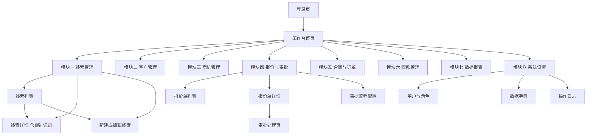
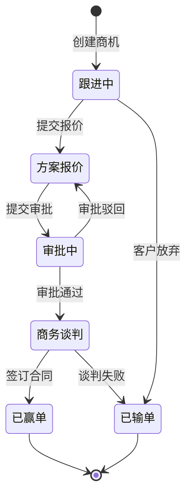
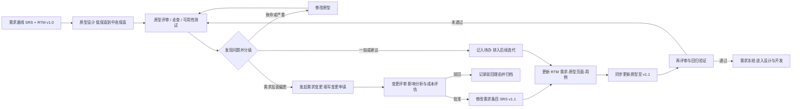
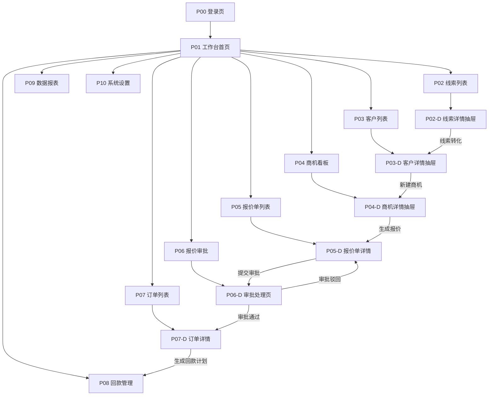

# 原型设计调研报告

> **课程**：软件工程（任课教师：老潘）　**作业项**：第 3 项 —— 原型设计调研报告
> **业务案例**：CRM 销售管理平台（线索 → 客户 → 商机 → 报价审批 → 合同订单 → 回款，L2C 全流程，PC Web 端）

---

## 目录

- [1. 概述：为什么需要原型](#1-概述为什么需要原型)
- [2. 原型的作用](#2-原型的作用)
- [3. 原型的分类与保真度](#3-原型的分类与保真度)
- [4. 原型应包含的内容清单](#4-原型应包含的内容清单)
- [5. 原型应该做到什么程度](#5-原型应该做到什么程度)
- [6. 原型制作工具对比](#6-原型制作工具对比)
- [7. 如何用原型验证需求](#7-如何用原型验证需求)
- [8. 结合本课程案例：CRM 销售管理平台](#8-结合本课程案例crm-销售管理平台)
- [9. 小结与参考文献](#9-小结与参考文献)

---

## 1. 概述：为什么需要原型

### 1.1 软件的最大风险：做完才发现做错了

软件的材料是看不见的逻辑与抽象。一座桥没建完，谁都能看出它歪了；而软件完工之前，用户看到的只有文档里的文字、UML 图里的方框和"快好了"的承诺。于是最昂贵的失败出现了：**做完了，才发现做错了。** 需求方说"要一个管客户的系统"，开发方理解成"客户信息增删改查表"；需求方想的是"总监要看每月漏斗转化率"，交付的是"只能按创建时间排序的列表"；需求方以为审批两级，开发方按三级做了，因为"多加一级更严谨"。这些偏差在需求阶段只是几句话的分歧，在设计阶段是几张图的返工，在编码阶段是几百行代码重写，上线后则意味着数据迁移、再培训、业务中断与信任损失。原型正是为解决这个"看不见"的难题而生。

### 1.2 缺陷修正成本随时间指数上升

软件工程有一条被广泛引用的经典经验规律（源自 Barry Boehm 1980 年代对缺陷修复成本的研究）：**同一个错误发现得越晚，修复代价越高，且增长近似指数级而非线性。**

| 发现阶段 | 相对成本 | 典型情形 | CRM 举例 |
| --- | --- | --- | --- |
| 需求阶段 | **1×** | 改一句话、改一条需求条目 | 发现"报价审批应支持加签"，文档中补一句即可 |
| 设计阶段 | **10×** | 改原型、改表结构、改接口 | 报价单增加"折扣率"，原型与数据结构都要改 |
| 编码阶段 | **100×** | 改代码、改测试、牵动多模块 | 审批流已编码完成，要改成动态配置节点，需重构 |
| 测试阶段 | **100×~500×** | 代码 + 回归测试 + 重走流程 | 测试环境才发现审批人规则错了，多轮回归 |
| 上线/运维 | **1000×** | 代码 + 数据迁移 + 再培训 + 业务中断 | 上线后发现回款无法分期核销，需停机修数 |

数字不必精确，重要的是**量级差异**：需求阶段 10 分钟讨论清楚的问题，拖到上线可能要 10 个人日，还附带一堆无法量化的隐性成本。

> **一句话总结**：原型是"把成本为 1× 的错误，提前暴露在成本还是 1× 的时候"的投资。

### 1.3 原型的核心价值

原型的本质是：**把抽象的需求，变成可感知的东西。**

1. **把抽象变具体。** "系统应支持线索批量分配"这句话，不同人脑中画面完全不同。画成界面后歧义立刻暴露——"批量"是勾选多条还是导入 Excel？"分配"后状态变不变？
2. **早期暴露误解。** 人对没见过的东西几乎无法给出有效反馈，看到后却能立刻说"这不是我要的"。原型把反馈触发点从"交付之后"提前到"开发之前"。
3. **降低返工成本。** 改一张线框图几分钟，改一个上线功能几个星期。原型把尽可能多的修改压缩在成本最低的时间窗口内。

### 1.4 原型与需求规格说明书的关系

**原型不是需求文档的替代品，而是它的补充与校验器。** SRS 擅长表达业务规则、约束、边界条件与非功能需求，精确但抽象、非专业人士读不下去；原型擅长表达信息架构、布局、操作路径与反馈方式，直观但难以表达复杂算法与性能要求。最佳实践是**图文并茂、互为索引**：SRS 每条需求指向对应原型页面 ID，原型页面旁标注它实现哪几条需求，二者共同纳入变更控制与 RTM（需求跟踪矩阵）。

---

## 2. 原型的作用

### 2.1 需求澄清与确认：让用户说出"这就是我要的"

文字需求的致命弱点是**读者会用自身经验补全作者没写出的细节**，且双方意识不到彼此的"补全"不同。原型给出一个可讨论的实体，把隐性分歧显性化："**这就是我要的**" → 达成共识，冻结该页面；"**这不是我要的**" → 追问"哪里不对" → 立刻定位分歧点；"**我没想到还有这种情况**" → 最有价值的反馈，说明原型触发了对遗漏场景的思考。

> **实践要点**：评审会上先演示原型再逐条过文档，效率远高于反过来。人对图像的反应速度远快于文字。

### 2.2 早期可用性验证：在写代码之前发现"难用"

有些问题只在"真的去点"时才暴露：**导航混乱**（同一入口出现三次）；**操作路径过深**（记录一次跟进要四层点击，而一天要操作几十次）；**信息缺失**（报价单上没有"上次成交价"，销售每次都要切系统查）；**反馈缺失**（点"提交"无提示，用户连点五次生成五条重复数据）。需求文档回答的是"功能有没有"，而不是"用起来顺不顺"。可点击原型能以极低成本模拟真实操作，提前发现这类缺陷。

### 2.3 干系人沟通桥梁：共同的可视化基准

业务方用它确认"对不对"；产品经理用它收敛方案、确定 MVP 边界；UI 设计师把它当视觉设计的骨架输入；前端据此拆分页面与抽象组件；测试工程师据此设计用例；管理者用页面数量估算工作量。原型是**唯一一种所有角色都能看懂、都能发言的工件**——架构图后端懂业务不懂，需求文档人人能读但读出各不相同，只有原型能让大家指着同一个方框说"这里不对"。

### 2.4 降低返工成本

除 1.2 节的成本论证外，补充三条实践：**渐进冻结**（讨论成熟一块冻结一块进入开发）；**版本留痕**（保留版本号与变更说明，如 `v0.3 2026-10-09 报价审批增加加签入口`）；**成本可视化**（有人说"先做出来再说"时，把 1×/10×/100×/1000× 的表拿出来，是最有力的反驳）。

### 2.5 作为后续 UI 设计和测试用例的输入

**对 UI 设计**：原型定义了信息架构与布局骨架，设计师在此基础上做配色、字体、图标、间距与视觉层次，不必从零思考"这页该放什么"——即"结构与表现分离"。**对测试**：每个输入框 → 等价类/边界值用例；每个按钮 → 正常 + 权限不足 + 网络异常用例；每条跳转 → 流程用例；每个列表 → 空数据/单条/满页/超长字段用例；每个状态标签 → 状态流转用例。标注了页面 ID 的原型可直接映射成用例编号体系，让 RTM 从"需求 → 用例"扩展为"需求 → 原型页面 → 用例"的完整链路。

### 2.6 演示与汇报（课程答辩场景特别重要）

有原型的汇报，评委能在 3 分钟内理解项目全貌，反馈具体（"这个筛选器是不是该支持多选"）；没有原型的汇报只能靠文字和口述，提问停留在"你打算怎么做"，评分更容易受表达技巧而非方案质量影响。对课程作业，原型还是**团队分工依据**：有了页面清单，五人小组可以把 10 个页面拆开并行开发。

### 2.7 风险的另一面：原型可能被误认为成品

**"功能都画出来了，怎么还要做这么久？"** —— 几乎每个做过原型的项目都听过。高保真原型太"像"真实系统，业务方甚至管理者会认为"产品已完成 80%"，进而施加不合理进度压力，最终导致削减测试、牺牲质量。

**必须做的期望管理动作：**

| 措施 | 具体做法 |
| --- | --- |
| 明确声明 | 演示材料标题、页眉页脚显著标注"**交互原型 · 非最终产品**" |
| 开场一句话 | "以下画面是用于确认需求的可交互示意图，不代表功能已完成" |
| 视觉降噪 | 需求确认阶段刻意用低保真（灰度、手绘风），杜绝"已完成"错觉 |
| 标明"假"的部分 | 标注哪些数据是模拟的、哪些按钮点了没反应、哪些逻辑未实现 |
| 书面化 | 写明本原型是"**可能的技术实现**（a possible implementation），非最终产品" |
| 解释工作量 | 界面只是冰山一角，底下还有校验、权限、并发、异常处理、性能、安全、测试 |

> **关键区分**：原型回答的是"**做什么**"和"**长什么样/怎么用**"，而不是"**做完了吗**"。这三件事必须反复区分。

---

## 3. 原型的分类与保真度

原型可从**用途、保真度、内容形态**三个维度分类。三者相互独立，一个原型可以同时是"抛弃式 + 中保真 + HTML 可点击原型"。

### 3.1 按用途：抛弃式 vs 演化式

| 类型 | 核心思想 | 优点 | 缺点 | 适用场景 |
| --- | --- | --- | --- | --- |
| **探索型/抛弃式** Throwaway | 只为验证某问题快速搭建，验证完即丢弃 | 极快、无历史包袱、敢尝试激进方案、可多方案对比 | 工作量"浪费"；管理不当可能被偷偷当成正式代码 | 需求不明、方案未定、需对比多方向 |
| **演化型** Evolutionary | 从粗糙原型起步不断增量完善，最终长成产品 | 无浪费、所见即所得、持续获反馈、天然支持迭代 | 对初始架构要求高；早期结构糟糕会一路带病；易被"边想边做"拖入无设计状态 | 需求框架清楚、技术栈明确、追求交付效率 |

**判断建议**：需求与技术不确定性高 → 先用抛弃式探路；需求框架清楚、追求交付 → 直接走演化型。**本课程案例采用演化型路线**（见第 6、8 章）。

### 3.2 按内容形态

- **纸上原型**：纸上手绘，由人手动"翻页"模拟。极低保真，最快、零成本、人人可参与，天然传递"这不是成品"；但无动态效果，不便远程协作与存档。
- **故事板 Storyboard**：一组画格描述完成某任务的完整过程，如分镜。低保真，擅长表达**场景与流程**与时间顺序；不表达单页细节，需与线框图配合。
- **线框图 Wireframe**：灰块与线条描述结构、区域、元素位置。低–中保真，聚焦结构与信息层级，避免过早陷入视觉争论；缺乏真实感，非专业人士有时看不懂。
- **视觉稿 Mockup**：带完整视觉风格的静态页面图。高保真，直观有说服力；但静态、不能操作，无法验证流程。
- **HTML 可点击原型**：用 HTML/CSS/JS 或组件库实现的可交互页面。中–高保真，可真实点击、可部署分享、**可演进为真代码**；需前端能力，易做得过深。
- **垂直/水平原型**：见 3.3 节。

### 3.3 垂直原型 vs 水平原型（重点辨析）

**水平原型（Horizontal）**：把系统**所有界面都做一层表层**，覆盖全部功能入口，每页只做到"能看到、能点过去"，不做深入逻辑与数据处理。比喻是**一张摊开的大饼**——宽而薄。它验证整体**信息架构与功能范围**（"系统到底有哪些功能？导航通不通？"），产出为全站点地图 + 每页线框图 + 页面跳转，适合向管理层汇报范围、确认"有没有漏功能"；风险是看起来什么都有、实际什么都跑不通，易营造"已完成"错觉。

**垂直原型（Vertical）**：选取**一个或少数几个关键功能，从头到尾做深做实**，包括界面、业务逻辑、数据读写、异常处理，形成真正可运行的"切片"。比喻是**一口深井**——窄而深。它验证**技术可行性与业务细节**（"最难的流程能不能跑通？数据模型对不对？性能行不行？"），适合验证技术难点（第三方对接、复杂审批引擎）与高风险业务流程；风险是只见树木不见森林，无法回答"整体多少工作量"。

| 对比维度 | 水平原型 | 垂直原型 |
| --- | --- | --- |
| 覆盖范围 | 广（大部分功能） | 窄（一个或少数功能） |
| 实现深度 | 浅（表层界面，无真实逻辑） | 深（完整逻辑 + 数据，可运行） |
| 回答的问题 | "系统有多少东西？架构对不对？" | "这块最难的地方能不能做？" |
| 覆盖的风险 | 功能遗漏、导航混乱 | 技术不可行、业务规则错误 |
| 使用时机 | 项目早期，范围确认 | 项目中早期，技术方案验证 |

> **最佳实践"先横后竖"**：先用水平原型拉全景、确认范围，再对风险最高的 1–2 个功能做垂直原型深挖（如 CRM 的"报价审批流"）。

### 3.4 保真度综合对比总表

保真度（Fidelity）指原型与最终产品在**视觉、内容、交互**三方面的相似程度。

| 保真度 | 视觉 / 内容 / 交互 | 制作成本 | 适用阶段 | 能验证 | 不能验证 | 典型工具 |
| --- | --- | --- | --- | --- | --- | --- |
| **低保真** | 手绘草图、灰块 / 假数据或省略 / 基本不可点击 | 极低（分钟级/页） | 需求探索、概念讨论、流程梳理 | 信息架构、页面要素、流程走向、功能范围 | 视觉风格、微交互、真实数据表现 | 纸笔、白板、Balsamiq、Figma/墨刀线框模式 |
| **中保真** | 灰度线框、真实布局与文案 / 示例数据 / 主要跳转可点击 | 中（小时级/页） | 需求确认、方案评审、干系人沟通 | 布局、导航、操作路径、字段完整性、空/加载/错误状态 | 视觉细节、动效、真实性能 | Figma、墨刀、即时设计、MasterGo、Axure 简易模式 |
| **高保真** | 完整视觉（配色/字体/图标）/ 真实数据 / 校验、加载、成功失败、弹窗、动效 | 高（数小时/页） | UI 评审、可用性测试、开发交付、答辩 | 视觉规范、交互细节、异常反馈、完成率/耗时/出错等指标 | 系统性能、真实数据量表现、安全 | Figma 高保真、Axure RP、Adobe XD、**HTML + Ant Design / Element Plus** |

**重要提醒**：保真度与成本近似指数关系。高保真单页工作量可能是低保真的 20–30 倍，但带来的需求澄清增量远不到 20 倍。**过早高保真是原型设计中最常见的浪费。**

---

## 4. 原型应包含的内容清单

### 4.1 页面清单与站点地图

**页面清单**（Page Inventory）是所有页面的枚举：`页面 ID | 页面名称 | 所属模块 | 入口 | 类型 | 优先级`，例如 `P01 | 工作台首页 | 全局 | 登录后默认 | 仪表盘 | P0`。

**站点地图**表达页面层级与跳转关系。以下为通用后台的导航结构示意：



站点地图的作用：**防遗漏**（一眼看出哪个模块少了编辑页）、**定导航**（菜单如何组织）、**估工作量**（页面数 × 平均复杂度）、**分工依据**（子树分给不同成员）。

### 4.2 每个页面的布局框架与区域划分

每个页面原型至少清晰表达六个区域：**全局区**（顶部导航：Logo、模块切换、搜索、消息、用户菜单）、**导航区**（侧边栏，含收起与选中态）、**内容区头部**（标题、面包屑、主操作按钮）、**筛选区**（条件与查询/重置）、**主体区**（表格/表单/图表/详情卡）、**页脚区**（分页、批量操作条）。建议先定义 1–2 套**通用页面模板**（列表页、详情页、表单弹窗），同类页面复用，既保证一致性又大幅提速。

### 4.3 关键组件清单（Checklist）

- [ ] **导航**：一/二级菜单、面包屑、Tab 页签、返回按钮
- [ ] **表单控件**：文本、文本域、下拉、多选、级联、日期（范围）、数字、金额、单选/复选、开关、上传
- [ ] **表单配套**：必填标识、占位提示、校验错误提示、字段联动、禁用/只读态
- [ ] **表格**：列头、排序、固定列、行选择、行内操作、行展开、列设置、超长省略 + tooltip
- [ ] **筛选器**：快捷筛选标签、高级筛选展开/收起、条件回显、清空
- [ ] **弹窗与抽屉**：模态弹窗（确认/表单/信息）、抽屉侧滑、关闭方式（× / 遮罩 / ESC）
- [ ] **状态标签**：颜色语义（成功绿、进行中蓝、警告橙、失败或逾期红、未开始灰）+ 文案统一
- [ ] **分页**：页码、每页条数、总数、跳转
- [ ] **按钮态**：默认 / hover / active / disabled / loading / focus
- [ ] **空状态**：无数据、无搜索结果、无权限、404
- [ ] **加载状态**：骨架屏、局部/全局 loading、进度条
- [ ] **错误状态**：校验错误、请求失败（含重试）、网络异常、权限不足
- [ ] **反馈提示**：Toast、Message、Notification、确认框
- [ ] **其他**：步骤条 Steps、时间轴 Timeline、上传列表、图片预览

### 4.4 交互规则与状态流转

原型必须说清"点了之后会发生什么"。建议每页配一张**交互说明表**：

| 元素 | 触发 | 系统响应 | 结果 | 异常分支 |
| --- | --- | --- | --- | --- |
| 「新建线索」 | 点击 | 打开抽屉表单 | 保存后关闭抽屉、列表刷新置顶、提示"创建成功" | 必填未填 → 字段下方红字并聚焦首个错误项 |
| 列表行 | 点击 | 打开详情页 | 跳转线索详情 | 无权限 → 提示"无查看权限" |
| 「提交审批」 | 点击 | 二次确认弹窗 | 状态变"审批中"，按钮置灰 | 校验不通过 → 弹窗显示具体原因 |

业务状态流转同样要表达。以商机为例：



### 4.5 界面文案与术语一致性

- [ ] 同一实体统一叫法：不出现"客户 / 顾客 / 客户单位"混用
- [ ] 同一操作统一动词：不出现"新增 / 新建 / 添加 / 创建"混用（选定一个）
- [ ] 按钮文案用"动词 + 名词"（"提交审批"而非"确定"）
- [ ] 提示区分场景：成功说结果（"保存成功"），失败说原因 + 怎么办
- [ ] 不用技术术语面向用户（不说"请求超时"，说"网络异常，请稍后重试"）
- [ ] 术语表与原型同步维护（线索 Lead、客户 Account、商机 Opportunity、报价 Quote、合同 Contract、回款 Payment）

### 4.6 数据展示：列表字段与四种状态

**列表字段清单**：字段是否够用（不点进详情即可判断）；是否有主次（关键信息靠左/固定列）；数字是否右对齐、金额带千分位与单位、日期格式统一；长文本是否省略 + 悬浮全文；排序与筛选是否覆盖高频场景。

**四种必须画出的状态：**

| 状态 | 表现要求 | 常见错误 |
| --- | --- | --- |
| 空状态 | 插图 + 说明文案 + 引导操作（"暂无线索，点击新建"） | 只留空白，用户以为加载失败 |
| 加载状态 | 骨架屏或 loading，布局稳定不跳动 | 加载完成后高度突变导致误点 |
| 错误状态 | 明确原因 + 可操作出口（重试/返回/联系管理员） | 只显示"出错了" |
| 无权限 | 说明权限不足及申请方式 | 直接白屏或跳登录页 |

### 4.7 响应式与断点（PC Web）

即使定位 PC Web，也应说明适配策略：xs（< 576px）与 sm（≥ 576px）**不适配**，提示"建议使用 PC 端访问"；md（≥ 768px）侧边栏自动收起、表格横向滚动；lg（≥ 992px）完整布局；**xl（≥ 1200px）为标准设计基准**；xxl（≥ 1600px）容器限宽 1440px 居中。原型至少要给出**最小宽度**（如 1280px 下不错乱）与**最大内容宽度**（如 1440px 居中），并对表格列过多时的处理（固定列 + 横向滚动 / 列设置隐藏）给出示意。

### 4.8 原型中"不要包含"的内容

- ❌ **真实复杂业务逻辑的实现纠结**：不该纠结"折扣计算用策略模式还是责任链""并发如何加锁"。原型只表达"输入 A，显示 B"。
- ❌ **过度动画**：弹窗飞入、页面转场、3D 翻转。仅保留必要状态过渡（loading、展开收起）。
- ❌ **过早的像素级美化**：流程还没确认就反复调圆角与阴影，是典型的资源错配。
- ❌ **真实敏感数据**：使用脱敏假数据，不得粘贴真实客户信息。
- ❌ **性能/安全的实现**：权限校验、防注入、XSS 转义属开发阶段必做项（但权限对应的**界面表现**要画，如无权限时按钮置灰/隐藏）。

---

## 5. 原型应该做到什么程度

### 5.1 判断原则：够用即可（Good Enough）

**核心判据 —— 只要足以回答以下三个问题，程度就够了：**

| # | 问题 | 对应内容 |
| --- | --- | --- |
| Q1 | **这个页面的信息是否完整？** | 完成任务所需的全部字段、数据、说明是否都在 |
| Q2 | **这个页面的操作是否可行？** | 该有的按钮、入口、操作路径是否都存在且可触达 |
| Q3 | **这个流程是否顺畅？** | 从入口到目标完成的路径是否合理、分支是否有明确反馈 |

三个问题都能清晰回答 → **停止细化**，进入下一页或进入评审。任一问题答不上来 → 继续补充原型，而不是靠口头解释蒙混（口头解释往往意味着没想清楚）。

### 5.2 不同阶段的程度建议

| 阶段 | 推荐保真度 | 典型形态 | 迭代节奏 | 程度判据 |
| --- | --- | --- | --- | --- |
| 需求探索 | 低保真 | 纸面草图、Balsamiq、白板 | 小时级，一天多轮 | 讨论的是"有哪些页面、每页放什么" |
| **需求确认** | 中–低保真 | 灰度线框 + 主要跳转 | **一天能改三轮** | 业务方能明确说"是/不是"，字段与流程无异议 |
| 方案/UI 评审 | 中–高保真 | 真实布局 + 完整视觉 | 天级 | 视觉与交互细节被确认 |
| 可用性测试 | 高保真 | 可点击、真实数据、完整状态 | 测试后批量修改 | 能支撑用户独立完成任务 |
| 开发交付前 | 高保真 + 标注 | 视觉稿 + 交互说明 + 状态清单 | 冻结，变更走流程 | 开发无需再问产品即可实现 |

**为什么需求确认阶段刻意推荐中低保真？** ① **快**——一天改三轮，可在一次评审会上当场改当场确认；② **敢改**——投入越少越舍得推翻重来，做了一周的高保真没人愿意承认它错了（沉没成本谬误）；③ **聚焦**——灰白界面把讨论锁定在"结构对不对、流程通不通"；④ **防误判**——天然避免"看起来已完成"的错觉（见 2.7）。

### 5.3 停止信号：什么时候说明做得过度了

| 停止信号 | 说明 |
| --- | --- |
| 🚩 **讨论从"业务流程对不对"变成"按钮像素对齐"** | 最典型的过度信号。开始纠结"这个按钮差了 2px"时，说明结构问题已解决，应转交视觉设计用规范统一处理 |
| 🚩 同一页面改超 5 版仍无定论 | 通常不是原型问题，而是需求本身未定，应回到需求层面讨论 |
| 🚩 为"可能不会发生"的分支画了三张图 | 先确认分支是否真实存在，必要时用垂直原型验证 |
| 🚩 制作时间超过评审时间的 10 倍 | 花 20 小时做的原型只评审 2 小时，投入产出失衡 |
| 🚩 开始讨论技术实现细节（用什么动画库、怎么缓存） | 越界了，属设计/开发阶段 |
| 🚩 无人提新意见，只提视觉偏好 | 收敛完成，冻结 |

### 5.4 原型自检清单（提问式）

完成原型后逐条自检，**有任何一条答"否"，原型就不合格：**

- [ ] **1. 用户能否在 3 次点击内完成核心任务？**（如从首页到"给某客户新建跟进记录"是否 ≤ 3 次点击）
- [ ] **2. 每个页面的主要操作是否一眼可见且位置符合习惯？**（主操作在右上角或内容区顶部，而非藏在下拉菜单）
- [ ] **3. 异常分支是否都有明确提示？**（校验失败、无数据、加载失败、无权限、操作被拒绝，五种是否都画了）
- [ ] **4. 用户随时知道"自己在哪、能去哪、刚做了什么"吗？**（面包屑/导航选中态 + 操作结果反馈）
- [ ] **5. 破坏性操作是否有二次确认？**（删除、驳回、作废、批量操作）
- [ ] **6. 列表页在 0 条、1 条、10 条、1000 条数据下的表现都考虑了吗？**
- [ ] **7. 所有字段的校验规则是否可见？**（必填、长度、格式、唯一性、联动）
- [ ] **8. 一个没参与过项目的人，看原型能否独立走完主流程？**（这实际就是一次最小走查）

针对**课程作业**再补两条：**9. 每个页面都能对应到需求清单中的某条需求吗？**（无来源的页面 = 范围蔓延）**10. 需求清单中每条功能需求，都能在某个页面中找到吗？**（无页面的需求 = 遗漏）第 9、10 条本质是要求原型与需求之间**双向可追溯**，这是 RTM 能成立的前提。

---

## 6. 原型制作工具对比

### 6.1 主流工具逐一点评

**Axure RP**：强在条件逻辑与变量（if/else、全局变量），能做出接近真实系统的动态效果；动态面板与**中继器 Repeater** 可模拟表格增删改查与分页；一键生成 HTML 或发布到 Axure Cloud；可自动导出带标注的需求文档。弱在学习曲线陡峭（掌握中继器需数周）、正版价格对学生不友好、协作能力弱（本质单机文件）、视觉设计一般。**适合**业务流程复杂的企业级系统原型（ERP、CRM、OA 审批流）。

**Figma**：强在实时多人协作 + 元素级评论；组件化与 Variants + Auto Layout，改一处全局生效；海量社区 UI Kit；本身就是专业矢量设计工具，线框到高保真一气呵成；Prototype 模式支持跳转、Overlay、Smart Animate，"够用"；浏览器即可运行，跨平台；个人版免费。弱在复杂条件逻辑做不了。**只推荐一个通用工具的话就是 Figma**——综合最均衡，学生免费，当前事实上的行业标准。

**墨刀 / 即时设计 / MasterGo（国产三强）**：墨刀是国内最早的专业原型工具之一，中文教程完善、模板丰富、移动端可投屏预览、上手极快（免费版有页面数限制）；即时设计是 Figma 的国产替代品，操作逻辑接近、迁移成本低、国内网络友好、个人免费；MasterGo 主打设计 + 原型 + 交付一体，支持设计稿转代码（相对较新）。共同优势是中文界面与文档、国内速度快、内置大量中文业务组件模板、多数提供免费个人版。**适合**国内团队、中文项目、课程作业——降低工具学习成本，把精力放在需求本身。

**Balsamiq**：手绘风格 UI 库从视觉上**强制团队关注结构而非外观**；拖拽即用，几分钟一张线框；**天然期望管理**——没人会认为手绘图是成品。只能做低保真、无法表达视觉与复杂交互、付费。它是个"**态度工具**"——粗糙本身就是一种沟通信号。

**Sketch**：macOS 上静态视觉设计能力强，Symbols 成熟、插件丰富；但**仅支持 macOS**（Windows 团队无法使用，致命限制）、原型交互一般、协作弱于 Figma。**课程作业不推荐**——协作场景下跨平台是刚需。

**其他**：Adobe XD 操作简洁、与 PS/AI 协同好，但已停止重大功能更新，**不建议新项目选用**；Justinmind 交互能力接近 Axure，支持条件逻辑与数据模拟，可导出 HTML，但小众；Proto.io 在线高保真，移动端仿真强（真机手势），适合 App 演示，价格高；Framer 基于 React，设计与代码边界模糊，可直接产出可运行站点；PPT/Keynote 零成本，适合极早期拼故事板，无交互，仅作过渡方案。

**代码类原型：HTML/CSS + 现代前端组件库（★ 本课程推荐路线）** —— 直接用前端技术栈（Vue 3 + Element Plus，或 React + Ant Design / shadcn/ui）搭建**可真实运行的页面**，数据用 Mock（Mock.js、MSW、JSON Server）或假数据。

- **优点**：① **可直接演进为真代码**——最大优势，需求确认后把 Mock 换成真实 API、补上校验与权限，页面自然长成产品，**原型工作量 100% 不浪费**，而 Axure/Figma 原型最终都要被前端重做一遍；② **真实感最强**，不会出现"原型能点，做出来不能点"的落差；③ **组件库开箱即用**，自带成熟设计规范，省去大量视觉决策；④ **顺便验证技术可行性**，等于同时做了垂直原型；⑤ **技能正向积累**，练的是工业界真实技术栈；⑥ **天然支持可运行演示**，答辩直接开浏览器，也可部署成在线链接。
- **缺点**：需要前端基础，零基础同学上手门槛高于 Figma/墨刀；**容易做过头**——**必须靠纪律约束：原型阶段只做界面与假数据，不接后端、不做复杂逻辑**；视觉一致性依赖组件库，定制化受其能力限制。
- **组件库选型**：**Ant Design**（React，亦有 Vue 版）企业级中后台首选，组件最全、规范最完整、社区最大；**Element Plus**（Vue 3）Vue 生态最主流，中文文档友好；**shadcn/ui**（React + Tailwind）源码可复制进项目、定制性极强，覆盖度略低；**Arco Design / TDesign**（字节 / 腾讯出品）规范完整、中文场景适配好。

### 6.2 工具对比决策表

| 工具 | 上手难度 | 交互能力 | 协作 | 成本 | 可演进为产品 | 推荐场景 |
| --- | --- | --- | --- | --- | --- | --- |
| **Axure RP** | 高 ★★★★ | 极强 ★★★★★ | 弱 ★★ | 高 | ❌ | 复杂业务逻辑原型、需生成需求文档交付 |
| **Figma** | 中 ★★☆ | 中 ★★★ | 极强 ★★★★★ | 低（个人免费） | ❌ | UI 设计 + 高保真原型、团队协作、通用首选 |
| **墨刀** | 低 ★ | 中 ★★★ | 中 ★★★ | 低（有限免费） | ❌ | 中文项目快速原型、移动端预览、课程作业 |
| **即时设计** | 低 ★ | 中 ★★★ | 强 ★★★★ | 低（个人免费） | ❌ | Figma 国产替代、国内团队协作 |
| **MasterGo** | 低 ★ | 中 ★★★ | 强 ★★★★ | 低（个人免费） | ❌ | 设计 + 原型 + 交付一体 |
| **Balsamiq** | 极低 ★ | 弱 ★★ | 弱 ★★ | 中 | ❌ | 需求探索、低保真工作坊、强制聚焦结构 |
| **Sketch** | 中 ★★ | 中 ★★★ | 中 ★★★ | 中 | ❌ | 纯 macOS 团队静态视觉设计 |
| **Adobe XD** | 低 ★ | 中 ★★★ | 中 ★★★ | 中 | ❌ | 已停止重大更新，不建议 |
| **Justinmind** | 高 ★★★★ | 强 ★★★★ | 弱 ★★ | 高 | ❌ | 高交互复杂桌面原型 |
| **Proto.io** | 中 ★★ | 强 ★★★★ | 中 ★★★ | 高 | ❌ | 移动端高保真演示、真机手势 |
| **HTML + Ant Design / Element Plus** | 中高 ★★★ | 极强 ★★★★★ | Git 协作 ★★★★ | 低（开源） | **✅ 是（核心优势）** | 演化型原型、课程作业、中小项目、需交付真实系统 |
| **纸笔 / 白板** | 极低 ★ | 无 | 面对面 ★★★★ | 零 | ❌ | 需求探索最初期、头脑风暴 |

### 6.3 选择建议（课程作业与中小项目）

**推荐路线：低保真草图 → 组件库搭建的可运行 Web 原型（演化型）**

1. **第一步（1–2 天）**：纸笔或 Figma/墨刀快速画出站点地图 + 主要页面线框，与用户/老师确认范围与核心流程。**刻意保持低保真**，追求一天改三轮。
2. **第二步（核心）**：用 **Vue 3 + Element Plus**（或 React + Ant Design）搭建可运行原型，数据用 Mock，覆盖全部页面与状态（空/加载/错误/成功）。
3. **第三步（交付）**：确认后逐步替换 Mock 为真实接口，补充校验、权限、异常处理，原型自然演进为产品。

**理由**：**工作量零浪费**（原型即产品第一版，不存在"做完再重做一遍"，对时间紧张的课程作业尤为关键）；**答辩演示效果好**（可运行系统比静态图更有说服力，能应对"点这里会怎么样"的追问）；**技能正向积累**；**组件库降低门槛**（无需从零做视觉设计也能产出专业外观）；**便于团队分工**（基于 Git 的页面级并行开发，比多人编辑同一 .rp 或 Figma 文件更清晰）。

**不适合该路线的情况及应对**：团队无前端基础 → 退选**墨刀/即时设计**或 **Figma**；项目极度强调视觉创新（C 端、独特品牌风格）→ 先用 **Figma** 做视觉稿；只需快速验证想法、不打算真开发 → **Balsamiq / 纸笔** 就够。

---

## 7. 如何用原型验证需求

做出原型只是手段，**用原型把需求验证清楚**才是目的。

### 7.1 四类验证方法

**（1）原型走查 Walkthrough**：用户或业务方**亲自操作**原型，按预先准备的"任务脚本"走完某场景，产品/设计在旁观察记录。成本最低、最易组织，适合任何阶段。重点关注：**能否走通、在哪里犹豫、在哪里走错、在哪里抱怨**。

> **任务脚本示例**：你是销售小张。请为"深圳宏远科技"创建一条新商机，预计金额 50 万，预计成交时间下月底，并提交报价审批。起点：系统首页。请边操作边说出你的想法。

**（2）可用性测试 Usability Testing**：比走查更正式，给被试一组明确任务，在接近真实的环境中独立操作，观察并记录量化指标。

| 要素 | 说明 |
| --- | --- |
| **任务清单 Task List** | 5–8 个覆盖核心场景的任务，每个有明确成功标准；描述要**场景化**——不说"请使用筛选功能"，而说"请找出上个月所有金额超过 10 万的商机" |
| **观察** | 不干预、不提示；记录操作路径、犹豫点、错误、求助、情绪 |
| **出声思考 Think Aloud** | 要求被试**边操作边说出在想什么**。这是最有价值的数据来源——让"误解"在发生那一刻被捕捉，而非事后回忆 |
| **量化指标** | **完成率**、**耗时**、**出错次数**、**求助次数**、**主观满意度**（如 SUS 量表） |

**Think Aloud 主持要点**：开头做一次示范，让被试熟悉"说话"；被试沉默时提醒"现在你在想什么？"；**绝不解释、绝不提示**——一旦提示数据即作废；全程录音或录屏。

**（3）认知预演 Cognitive Walkthrough**：由**专家**以新手视角逐步预演任务，每步自问四个经典问题：① 用户会**想要**执行正确的操作吗（动机）；② 能**看见**对应控件吗（可见性）；③ 能**认出**这就是他要找的吗（可理解性）；④ 操作后能**判断**自己做对了吗（反馈）。不需要真实用户、成本极低、原型做完即可做；缺点是专家视角有偏差，**不能替代可用性测试，但可作前置过滤**。

**（4）A/B 测试（简介）**：为同一功能做两个版本，将真实用户随机分流，通过埋点比较关键指标（转化率、完成率、耗时），选更优者。这是**定量**方法，需真实产品与流量，通常**不在原型阶段使用**，而用于上线后持续优化。原型阶段要做方案对比，更现实的做法是**做两个原型方案，各找 3–5 人做对比走查**。

| 方法 | 参与人 | 成本 | 定性/定量 | 阶段 | 主要产出 |
| --- | --- | --- | --- | --- | --- |
| 原型走查 | 用户/业务方 | 低 | 定性 | 需求确认 | 流程问题清单 |
| 可用性测试 | 真实用户 5–8 人 | 中 | 定性 + 部分定量 | 中高保真原型完成后 | 问题清单 + 量化指标 |
| 认知预演 | 专家自查 | 极低 | 定性 | 任何时候（尤其早期） | 明显问题清单 |
| A/B 测试 | 大量真实用户 | 高 | 定量 | 上线后 | 最优方案的数据结论 |

### 7.2 验证活动的组织

#### （1）参与人数：Nielsen 的"5 用户"结论

可用性工程最著名的经验结论之一：**测试 5 个用户，就能发现约 85% 的可用性问题。** 原理是问题发现数随人数呈 1-(1-L)ⁿ 曲线（L 约 31%）：1 人 ~31%，3 人 ~65%，5 人 ~85%，8 人 ~95%，15 人 ~99%+。

**实践含义**：找 5 人比找 15 人性价比高得多；与其一次测 15 人，不如**"测 5 人 → 修改 → 再测 5 人"**做两三轮。**本课程作业：找 3–5 位未参与项目的同学做走查**，就足以形成一份有说服力的可用性测试报告。

#### （2）测试环境与任务设计

安静会议室，避免围观（围观会让被试紧张并改变行为）；使用被试熟悉的浏览器与分辨率，PC Web 建议 1920×1080 或 1440×900；主持人 1 名（引导、提问）+ 记录员 1 名（记录、不说话），不要是同一人；单人 30–60 分钟（超时疲劳，数据质量下降）；知情同意——说明测的是**系统**而非被试能力，可中途退出，数据仅用于改进。

任务设计原则（Checklist）：**场景化**（给真实角色和目标，而非功能指令）；**有明确成功标准**；**覆盖核心场景**（优先测最高频任务）；**含至少一个异常任务**（如"报价被驳回后重新提交"）；**任务之间独立**；**难度递增**；**不透露设计意图**；**准备备用数据**（确保原型里真有能完成任务的数据）。

#### （3）记录表模板

| 项目 | 内容 |
| --- | --- |
| 被试编号 / 角色 | U03 / 销售代表（2 年 CRM 使用经验） |
| 原型版本 / 日期 | v0.4 / 2026-10-09 14:30 |
| 任务描述 | T2：为"深圳宏远科技"创建商机，金额 50 万，并提交报价审批 |
| 成功标准 | 系统中出现该商机，状态为"审批中" |
| 是否完成 / 耗时 | ⚠️ 经提示完成 / 3 分 42 秒 |
| 出错次数 | 2（① 找搜索框花了 40 秒；② 提交后不知是否成功，重复点 2 次） |
| 求助次数 | 1（问"金额填什么单位"） |
| 操作路径 | 首页 → 客户管理 →（犹豫，找搜索框）→ 搜索 → 客户详情 → 新建商机 → 填写 → 提交 |
| 出声思考原话 | "这里应该能搜吧……哦搜索框在最上面，我以为是标题。"<br>"提交完了？没反应啊，是不是没点上？" |
| 发现问题编号 | P-007（搜索框视觉层级过弱）、P-008（提交后缺成功反馈） |
| 主观满意度（1–5） | 3 |

**问题汇总表**

| 问题 ID | 页面 | 问题描述 | 严重度 | 出现人数 | 建议修改 | 状态 |
| --- | --- | --- | --- | --- | --- | --- |
| P-001 | 线索列表 | 提交后无提示，用户重复点击 | 🔴 致命 | 4/5 | 增加 Toast 提示 + 提交期间按钮 loading 禁用 | 待修 |
| P-002 | 报价详情 | 审批进度入口藏在三级菜单 | 🟠 严重 | 3/5 | 详情页主区增加"审批进度"步骤条 | 已修 |
| P-003 | 工作台 | "待跟进线索"数字与列表条数不一致 | 🟠 严重 | 2/5 | 统一统计口径 | 待修 |
| P-004 | 客户详情 | 金额字段未标明单位（元/万元） | 🟡 一般 | 3/5 | 标签增加单位说明 | 已修 |
| P-005 | 报表 | 图表配色对比度不足 | 🟢 建议 | 1/5 | 调整配色 | 暂缓 |

### 7.3 问题的分级与处理

| 级别 | 定义 | 判定标准 | 处理 | 时限 |
| --- | --- | --- | --- | --- |
| 🔴 **致命** Blocker | 核心任务无法完成，或造成数据错误/丢失 | 用户无法完成任务；或产生不可逆错误数据 | **必须修复**，可作发布阻断项 | 立即 |
| 🟠 **严重** Critical | 严重影响效率或导致大量出错 | 完成率 < 60%；出错 ≥ 3 次；过半用户在此受阻 | **必须修复** | 本迭代 |
| 🟡 **一般** Major | 影响体验但不阻断任务 | 有犹豫或轻微困惑，但最终能完成 | **计划修复** | 下迭代 |
| 🟢 **建议** Enhancement | 锦上添花 | 仅个别人提出，属偏好或前瞻建议 | **记录备案**，视资源决定 | 视情况 |

**处理原则**：① 按"**影响人数 × 严重程度**"排序，而非按提出者的嗓门或领导意见——这正是量化记录的价值；② 不要一次性全改，改后必须再验证，否则可能引入新问题；③ 被否决的意见也要记录理由（"未采纳，原因：……"），在课程作业的变更记录中是加分项。

### 7.4 结果如何回流到需求：完整闭环

验证发现的问题必须形成**从原型回到需求的闭环**，否则测试白做：



**闭环的五个关键动作：** ① **问题 → 需求条目**：评审意见必须落到**具体需求编号**（如"REQ-CRM-023 报价审批"），而不是笼统的"这里要优化"；② **需求变更控制**：凡涉及**业务规则**变化（而非原型表现变化），必须走变更流程——填申请、评估影响与成本、共同批准；③ **更新 RTM**：需求改了，对应的原型页面 ID、测试用例 ID 同步更新；④ **版本号同步**：需求文档、原型、用例版本一致（如都升 v1.1），避免"按 v1.0 原型开发、按 v1.1 需求测试"；⑤ **再评审**：修改后必须重新评审（至少做受影响部分的回归验证），确认问题解决且未引入新问题。

> **闭环的本质**：原型不是一次性交付物，而是需求工程中**持续运转的反馈装置**。它让需求从"一次性写死"变成"可验证、可修正、可追溯"。

---

## 8. 结合本课程案例：CRM 销售管理平台

### 8.1 案例背景

| 项目 | 内容 |
| --- | --- |
| 系统名称 | CRM 销售管理平台 |
| 业务主线 | L2C（Lead to Cash）：线索 → 客户 → 商机 → 报价审批 → 合同订单 → 回款 |
| 终端形态 | PC Web 端（管理后台） |
| 用户角色 | 销售代表、销售经理、审批人（销售总监/财务）、系统管理员 |
| 设计基准 | 1440×900（适配 ≥ 1280px） |
| 原型路线 | 演化型：Vue 3 + Element Plus 搭建可运行原型，Mock 数据 |

### 8.2 站点地图（10 个页面）



**缩进式页面层级（与上图等价）**

```
P00 登录页
└── P01 工作台首页（KPI 卡片、待办、漏斗缩略图、快捷入口）
    ├── P02 线索列表（增删改查、批量分配、导入导出）
    │   └── P02-D 线索详情抽屉（基本信息 + 跟进时间轴 + 转客户）
    ├── P03 客户列表（查重、合并、转移）
    │   └── P03-D 客户详情抽屉（联系人 / 商机 / 跟进 / 附件）
    ├── P04 商机看板（分阶段卡片视图 + 列表视图）
    │   └── P04-D 商机详情抽屉（阶段推进、赢单输单、生成报价）
    ├── P05 报价单列表（产品明细、折扣、有效期）
    │   └── P05-D 报价单详情（明细表 + 金额汇总 + 提交审批）
    ├── P06 报价审批（待办列表 + 审批流可视化）
    │   └── P06-D 审批处理页（报价快照 + 审批历史 + 通过/驳回/加签）
    ├── P07 订单列表（合同附件、订单状态）
    │   └── P07-D 订单详情（订单明细 + 回款计划 + 开票记录）
    ├── P08 回款管理（分期核销、逾期预警）
    ├── P09 数据报表（漏斗图、趋势图、排行榜）
    └── P10 系统设置（用户、角色权限、审批流配置、数据字典）
```

### 8.3 每个页面的原型要点清单

| 页面 ID | 页面名称 | 核心内容与原型要点 | 必须覆盖的状态/交互 |
| --- | --- | --- | --- |
| **P00** | 登录页 | 账号密码、记住我、登录按钮；左图右表单布局 | 校验失败、账号锁定、加载中、成功后跳转 |
| **P01** | 工作台首页 | KPI 卡片（新增线索/商机金额/回款额/待办数）、待办列表、漏斗缩略图、快捷入口 | 无待办空状态、卡片骨架屏、数据权限（销售只见自己的） |
| **P02** | 线索列表 | 筛选（来源、状态、归属人、时间）+ 表格（名称、联系人、手机、状态 Tag、操作）+ 批量分配/导入导出 | 空状态、无搜索结果、分页、行多选、批量确认弹窗、导入失败行提示 |
| **P03** | 客户列表 | 筛选（行业、等级、归属人、是否成交）+ 表格（名称、行业、等级、商机数、最近跟进）+ 查重/转移 | 查重命中弹窗、转移归属人弹窗、超长名省略、空状态 |
| **P04** | 商机看板 | **双视图**：看板（按阶段分列卡片，支持拖动推进）+ 列表；卡片含客户名、金额、预计成交日、负责人、滞留红标 | 拖动的视觉反馈与失败回滚、阶段推进的必填校验、空列文案 |
| **P05** | 报价单列表/详情 | 列表：单号、客户、商机、金额、折扣率、状态、有效期；详情：产品明细 + 金额汇总（含税/不含税）+ 附件 | 明细行增删、金额自动计算、折扣超限需审批提示、过期标识、提交确认弹窗 |
| **P06** | 报价审批 | 待办（单据类型、申请人、金额、等待时长）+ 处理页：报价快照 + 审批时间轴 + 通过/驳回（必填意见）/加签 | 驳回必填意见校验、加签人选弹窗、按钮 loading 防重复提交、完成后通知、无权限提示 |
| **P07** | 订单列表/详情 | 列表：订单号、客户、合同编号、金额、签订日、状态、回款进度条；详情：明细 + 回款计划 + 开票记录 | 回款进度条三态（未收/部分收/收齐）、作废二次确认、附件上传预览、状态流转 |
| **P08** | 回款管理 | 回款计划列表（期次、计划/实际金额与日期、状态）+ 登记回款弹窗 + 逾期预警 | 部分/超额回款校验、逾期行红标并置顶、核销后明细联动、无计划空状态 |
| **P09** | 数据报表 | 筛选（时间、部门、人员）+ 销售漏斗图 + 业绩趋势图 + 排行榜 + 导出 | 图表骨架屏、无数据空态、切换筛选的刷新反馈、导出进度提示 |
| **P10** | 系统设置 | Tab：用户管理、角色与权限（树形勾选）、审批流配置（条件如"金额 > 50 万需总监审批"）、数据字典 | 权限树半选态、删除角色的关联用户提示、审批节点为空校验、保存成功提示 |

**跨页面全局要点**：全局顶部导航（Logo、模块搜索、消息红点、用户菜单）；侧边栏（一级菜单 8 项、可收起、当前项高亮）；数据权限的界面体现（销售见自己、经理见团队、总监见全部）；统一的列表页模板（筛选区 + 工具栏 + 表格 + 分页）；统一的详情抽屉模板（标题与状态 + Tab 内容 + 底部操作栏）；统一的状态标签色板与文案（待处理/进行中/已通过/已驳回/已作废/已逾期）。

### 8.4 本案例原型保真度的选型决策

**决策：采用「中高保真的演化型 HTML 原型」——Vue 3 + Element Plus + Mock 数据，覆盖全部 10 个页面及其主要状态。**

| # | 理由 | 说明 |
| --- | --- | --- |
| 1 | **业务主线长、状态多，低保真不足以验证** | L2C 是六段串联流程，商机、报价、审批、回款都有复杂状态流转。纯线框无法表达"拖动商机卡片推进阶段""驳回后回到报价单修改再提交"等关键交互，必须可点击可操作 |
| 2 | **演化型避免重复劳动** | 课程周期有限，原型确认后可直接演进为真系统，省去"Axure 画一遍 + 前端再做一遍" |
| 3 | **组件库提供成熟中后台规范** | 表格、表单校验、步骤条、时间轴、树控件、上传一应俱全，且自带统一间距/色彩/字号 |
| 4 | **中文后台适配成本低** | 中文排版、日期格式、金额展示、分页文案均为中文场景设计，文档与社区中文资源丰富 |
| 5 | **答辩演示效果最佳** | 可运行系统 > 静态视觉稿 > 线框图，可真实操作演示，应对现场追问 |
| 6 | **同时完成垂直原型的技术验证** | 搭建过程即技术可行性验证（组件是否满足、状态管理是否清晰、Mock 与真实接口如何切换），等于对最高风险模块"报价审批"做了一次垂直原型 |

**分阶段执行计划**：第 1 步产出站点地图 + 10 页低保真线框（确认范围与流程，追求一天改三轮）；第 2 步用 Element Plus 搭建 10 页可运行原型（Mock），覆盖筛选、表格、表单、弹窗、状态标签、分页、空/加载/错误态；第 3 步邀请 3–5 名未参与项目的同学做任务走查，覆盖 L2C 全流程 + 1 个异常场景（报价被驳回后重提）；第 4 步问题分级 → 修改原型与需求 → 更新 RTM → 再验证，形成闭环并记录变更；第 5 步替换 Mock 为真实接口，补校验/权限/异常处理，演进为产品。

**刻意不做的事（防止过度）**：不做自定义视觉设计（沿用默认主题，仅调主色与圆角）；不做转场动画与复杂动效；不实现真实审批引擎与权限逻辑（用假数据模拟状态）；不做移动端适配（< 1280px 提示"建议使用 PC 端访问"）；不在流程未确认前纠结像素对齐。

---

## 9. 小结与参考文献

### 9.1 小结

原型设计不是"把界面画好看"，而是**一种需求风险管理手段**。回到开头——软件最大的风险是"做完才发现做错了"——原型的全部价值可归结为一句：**在成本还是 1× 的时候，把错误暴露出来。**

七条核心结论：① **成本规律**：缺陷修复成本随发现阶段近似指数上升（1× / 10× / 100× / 1000×）；② **核心价值**：把抽象需求变成可感知的东西，提前暴露误解，降低返工成本；③ **六项作用**：需求澄清、可用性验证、干系人桥梁、降低返工、输入给 UI 与测试、演示汇报，同时必须警惕"原型被误认为成品"；④ **分类三维度**：用途（抛弃式 vs 演化式）、保真度（低/中/高）、形态（纸面、故事板、线框、视觉稿、HTML、垂直/水平）；⑤ **程度原则**：够用即可 —— 足以回答"信息是否完整、操作是否可行、流程是否顺畅"即止，讨论转向"像素对齐"就是停止信号；⑥ **工具选择**：通用推荐 Figma，中文场景推荐国产三强，但**课程作业与中小项目最推荐"组件库 + 可运行 HTML 原型"的演化型路线**；⑦ **验证闭环**：走查 / 可用性测试（Nielsen 5 用户）/ 认知预演 / A/B 测试，配合问题分级与"评审 → 变更 → 更新 RTM → 再评审"闭环。

对 CRM 案例的具体建议：**站点地图 10 页 + Element Plus 可运行原型 + 5 人走查 + 闭环回归**，是一套在有限课时内可落地、且能体现工程化思考的完整方案。

### 9.2 参考文献

1. Barry W. Boehm. *Software Engineering Economics*. Prentice-Hall, 1981.（缺陷修复成本随阶段递增）
2. Barry W. Boehm. "A Spiral Model of Software Development and Enhancement", *IEEE Computer*, 1988.（螺旋模型与原型驱动的风险管理）
3. Jakob Nielsen. "Why You Only Need to Test with 5 Users", Nielsen Norman Group, 2000.
4. Jakob Nielsen. *Usability Engineering*. Morgan Kaufmann, 1993.（可用性工程与问题发现曲线）
5. Jakob Nielsen, Rolf Molich. "Heuristic Evaluation of User Interfaces", CHI '90.
6. Clayton Lewis, John Rieman. *Task-Centered User Interface Design*, 1993.（认知预演）
7. Alistair Sutcliffe. *User-Centred Requirements Engineering*. Springer, 2012.
8. Ian Sommerville. *Software Engineering*（第 10 版），第 2 章「软件过程」与第 4 章「需求工程」——原型开发与抛弃式/演化式原型的经典分类。
9. Karl Wiegers, Joy Beatty. *Software Requirements*（第 3 版）, Microsoft Press, 2013.（需求验证与 RTM）
10. Ant Design https://ant.design ；Element Plus https://element-plus.org
11. Axure RP 官方文档、Figma 帮助中心、Balsamiq 官方指南。

---

> **文档结束** · 软件工程课程作业（三）：原型设计调研报告
